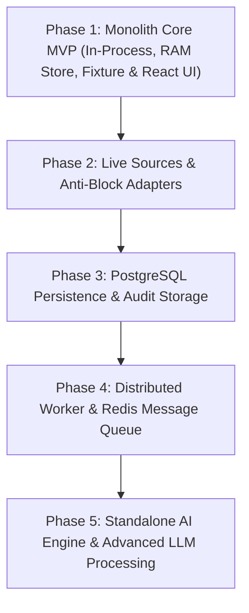

# AI RPA Lead Collector

> **Hệ thống tự động hóa thu thập, chuẩn hóa, làm giàu và xuất dữ liệu khách hàng tiềm năng B2B tại Việt Nam.**

[](docs/architecture.md)
[](docs/architecture.md)
[](docs/architecture.md)
[](docs/)

---

## 1. Giới thiệu dự án

**AI RPA Lead Collector** là giải pháp thu thập và xử lý dữ liệu doanh nghiệp công khai tại Việt Nam nhằm phục vụ hoạt động bán hàng B2B và phát triển thị trường. Hệ thống tập trung giải quyết các bài toán:
* **Thu thập dữ liệu doanh nghiệp đa nguồn** theo ngành nghề mục tiêu (*Giáo dục - Education*, *Sản xuất - Manufacturing*) và phạm vi địa lý toàn quốc (bao gồm Đà Nẵng, Hà Nội, TP.HCM và các tỉnh thành khác).
* **Trích xuất thông minh bằng LLM/AI** từ nội dung web không có cấu trúc.
* **Chuẩn hóa & xác thực dữ liệu đa tầng (L1–L3)** theo quy chuẩn danh mục địa lý hành chính Việt Nam và cú pháp viễn thông/email.
* **Khử trùng lặp (Deduplication) đa cấp** và ghi nhận nguồn gốc dữ liệu (Data Provenance).
* **Xuất kết quả chuẩn hóa sang file Excel (`.xlsx`)** với 12 cột sẵn sàng tích hợp CRM.

---

## 2. Cấu trúc Monorepo mục tiêu

Repository được định hướng theo cấu trúc Monorepo với các ranh giới module rõ ràng, tạo điều kiện thuận lợi để tách thành các dịch vụ độc lập khi mở rộng mà không làm gián đoạn nghiệp vụ:

```text
rpa-lead-collector/
├── docs/                      # Hệ thống tài liệu kiến trúc & đặc tả kỹ thuật (Source of Truth)
│   ├── PRD.md                 # Product Requirements Document
│   ├── source-research.md     # Nghiên cứu nguồn dữ liệu & chính sách truy cập
│   ├── data-dictionary.md     # Từ điển dữ liệu, quy tắc validation & schema 11 trường canonical
│   ├── architecture.md        # Kiến trúc hệ thống, ranh giới module & chiến lược tiến hóa
│   ├── pipeline.md            # Đặc tả chi tiết 10 giai đoạn pipeline thu thập & xử lý
│   ├── api-contract.md        # Hợp đồng REST API (6 endpoints, 19 mã lỗi, lifecycle)
│   └── implementation-plan.md # Kế hoạch triển khai 5 giai đoạn, task breakdown & acceptance criteria
├── web/                       # Frontend application (React 18 + Vite + TypeScript + Tailwind CSS)
├── backend/                   # Backend application (FastAPI Modular Monolith)
│   ├── src/
│   │   └── app/
│   │       ├── api/           # REST API routes & controllers
│   │       ├── core/          # App config, logging, geographic provider
│   │       ├── domain/        # Domain entities, value objects, exceptions
│   │       ├── repositories/  # Repository abstraction (InMemory -> PostgreSQL)
│   │       ├── services/      # Campaign, Export & Lead query services
│   │       └── pipeline/      # In-process pipeline orchestrator & collectors (Phase 1)
│   └── tests/                 # Unit & integration tests cho backend
├── rpa-worker/                # (Dự kiến Phase 4) Dịch vụ worker độc lập tiêu thụ task từ Redis
├── ai-engine/                 # (Dự kiến Phase 5) Dịch vụ AI/LLM chuyên biệt độc lập
├── contracts/                 # Shared schemas/DTOs giữa các dịch vụ
├── infra/                     # Cấu hình triển khai, Docker Compose & hạ tầng
├── tests/                     # End-to-end tests toàn hệ thống
├── docker-compose.yml         # Compose config cho môi trường phát triển
├── Makefile                   # Tập hợp lệnh build, run, test
├── .env.example               # Mẫu biến môi trường chuẩn
├── .gitignore
└── README.md
```

> [!NOTE]
> **Hiện trạng triển khai:** Repository đang ở giai đoạn **Chuẩn hóa tài liệu kỹ thuật trước triển khai (Pre-implementation Docs Baseline)**. Các module mã nguồn (`backend/`, `web/`, `rpa-worker/`, v.v.) sẽ được khởi tạo tuần tự theo đúng kế hoạch tại [docs/implementation-plan.md](docs/implementation-plan.md).

---

## 3. Kiến trúc hệ thống & Nguyên tắc kỹ thuật

### 3.1. Mô hình Modular Monolith (Phase 1)
* **API Gateway & Business Logic:** Toàn bộ REST API, quản lý vòng đời Campaign và truy vấn dữ liệu được điều phối bởi FastAPI application trong `backend/`.
* **Cơ chế Dispatch không có Redis:** Trong Phase 1, khi chưa triển khai Redis broker, toàn bộ pipeline thu thập và xử lý được thực thi **in-process** (cùng một process OS với backend) thông qua `FastAPI BackgroundTasks`.
  > [!IMPORTANT]
  > **Quy tắc bất biến:** Hai tiến trình OS độc lập không thể chia sẻ bộ nhớ RAM. Do đó, Backend và Worker **không** chạy ở hai tiến trình riêng biệt khi chưa có hàng đợi ngoài (Redis).
* **Trừu tượng hóa lưu trữ (Repository Pattern):** Dữ liệu Campaign và Lead được thao tác qua interface trừu tượng (`CampaignRepository`, `LeadRepository`).
  * Phase 1: Triển khai bằng `InMemoryCampaignStore` (lưu trữ trong bộ nhớ RAM, phục vụ phát triển nhanh và kiểm thử).
  * Phase 3: Hoán chuyển sang `PostgresCampaignRepository` (SQLAlchemy 2.0 + Alembic) mà không cần thay đổi bất kỳ dòng mã nghiệp vụ nào.

### 3.2. Chế độ thực thi: FIXTURE vs LIVE
Hệ thống hỗ trợ 2 chế độ thu thập dữ liệu minh bạch, cấu hình qua trường `execution_mode`:
1. **`FIXTURE` (Mặc định):** Sử dụng tệp dữ liệu mẫu chuẩn cục bộ (`tests/fixtures/`) để kiểm thử pipeline hoàn chỉnh từ đầu đến cuối mà không gọi ra Internet hay tiêu tốn token AI. Phù hợp cho kiểm thử tự động CI/CD và demo giao diện.
2. **`LIVE`:** Thu thập dữ liệu thực tế từ các nguồn trực tuyến đã được xác minh chính sách pháp lý và kỹ thuật.
   * **Nguyên tắc không âm thầm fallback:** Nếu chế độ LIVE gặp sự cố mạng hoặc nguồn bị chặn, hệ thống **bắt buộc ghi nhận lỗi minh bạch** (`FAILED`) và thông báo rõ nguyên nhân cho người dùng; tuyệt đối không tự ý chuyển ngầm sang dữ liệu FIXTURE.

### 3.3. Lược đồ dữ liệu chuẩn (Canonical Schema)
Dữ liệu lead đầu ra được chuẩn hóa thành đúng **11 trường canonical**:
1. `company_name`: Tên chính thức của doanh nghiệp (Bắt buộc).
2. `industry`: Nhóm ngành chuẩn hóa (`Education` | `Manufacturing`).
3. `sub_industry`: Phân ngành chi tiết.
4. `province`: Tỉnh/thành phố chuẩn hóa theo danh mục địa lý hành chính Việt Nam.
5. `address`: Địa chỉ đầy đủ (nullable).
6. `website`: Địa chỉ URL website hợp lệ (nullable).
7. `public_email`: Email liên hệ công khai (nullable, chuẩn hóa RFC 5322).
8. `public_phone`: Số điện thoại công khai (nullable, chuẩn hóa E.164 / quy chuẩn VN).
9. `description`: Mô tả ngắn gọn hoạt động doanh nghiệp (nullable).
10. `source_url`: URL nguồn gốc thu thập dữ liệu (Bắt buộc).
11. `collected_at`: Thời điểm thu thập theo chuẩn ISO 8601 (Bắt buộc).

*File Excel xuất ra (`.xlsx`) bổ sung cột phụ thứ 12 là `lead_id` để hỗ trợ tra cứu và đối soát kỹ thuật.*

---

## 4. Lộ trình triển khai (Phased Implementation Roadmap)

Dự án được phân chia thành 5 giai đoạn tiến hóa rõ ràng, loại bỏ hoàn toàn các ràng buộc về mặt thời gian giả định:



* **Phase 1 — Core Modular Monolith MVP:** Xây dựng khung FastAPI backend, Pydantic DTOs, Repository abstraction (RAM), in-process pipeline orchestrator, export Excel và React UI.
* **Phase 2 — Live Source Integrations:** Phát triển các adapter thu thập nguồn thực tế (Trang Vàng, v.v.), cơ chế kiểm soát tốc độ (rate limit), chống chặn IP và xử lý lỗi mạng.
* **Phase 3 — Database Persistence:** Chuyển đổi sang PostgreSQL qua SQLAlchemy và Alembic, hỗ trợ lưu trữ lâu dài và tìm kiếm lịch sử chiến dịch.
* **Phase 4 — Distributed Asynchronous Worker:** Tách biệt `rpa-worker/` thành worker process độc lập giao tiếp qua Redis broker (Celery / ARQ / Redis Streams).
* **Phase 5 — Dedicated AI Engine:** Tách dịch vụ AI thành microservice độc lập `ai-engine/` (gRPC / REST) tối ưu hóa xử lý LLM theo lô và caching embeddings.

---

## 5. Danh mục tài liệu kỹ thuật (Documentation Sitemap)

Tất cả tài liệu kỹ thuật nằm trong thư mục [`docs/`](docs/) và đã được rà soát đồng bộ:

| Tài liệu | Mô tả tóm tắt | Nội dung chính |
| :--- | :--- | :--- |
| [**PRD.md**](docs/PRD.md) | Yêu cầu sản phẩm cốt lõi | Mục tiêu, chân dung người dùng, 4 ca sử dụng (UC-01–04), 11 yêu cầu chức năng, tiêu chí nghiệm thu |
| [**architecture.md**](docs/architecture.md) | Kiến trúc hệ thống | Ranh giới Modular Monolith, quy tắc in-process dispatch, sơ đồ Mermaid, chiến lược tiến hóa 5 phase |
| [**pipeline.md**](docs/pipeline.md) | Đặc tả 10 bước xử lý | Quy trình từ thu thập, trích xuất, chuẩn hóa L1–L3, khử trùng lặp đến ghi nhận provenance và metric |
| [**data-dictionary.md**](docs/data-dictionary.md) | Từ điển dữ liệu chuẩn | Chi tiết 11 trường canonical, danh mục tỉnh/thành động, mức độ tin cậy L1–L3, cấu trúc file Excel |
| [**source-research.md**](docs/source-research.md) | Nghiên cứu nguồn dữ liệu | Đánh giá tính khả thi kỹ thuật/pháp lý các nguồn Trang Vàng, Cổng Thông tin Quốc gia, Google Maps |
| [**api-contract.md**](docs/api-contract.md) | Hợp đồng giao tiếp API | Chi tiết 6 REST endpoints, request/response schema, 19 mã lỗi chuẩn hóa, cơ chế polling tiến độ |
| [**implementation-plan.md**](docs/implementation-plan.md) | Kế hoạch triển khai | Phân rã 8 công việc chính (B1–B8) cho Phase 1, ma trận rủi ro và tiêu chuẩn kiểm thử |

---

## 6. Hướng dẫn khởi chạy môi trường phát triển (Dự kiến Phase 1)

*(Hướng dẫn này sẽ có hiệu lực sau khi hoàn thành mã nguồn Phase 1)*

### Yêu cầu hệ thống
* Python 3.11+
* Node.js 18+ & npm / pnpm
* Trình duyệt hiện đại (Chrome, Edge, Firefox)

### 1. Cấu hình biến môi trường
```bash
cp .env.example .env
# Chỉnh sửa các cấu hình API Key, port nếu cần
```

### 2. Khởi chạy Backend (FastAPI)
```bash
cd backend
python -m venv .venv
# Trên Windows:
.venv\Scripts\activate
# Trên Linux/macOS:
source .venv/bin/activate

pip install -r requirements.txt
uvicorn src.app.main:app --host 127.0.0.1 --port 8000 --reload
```
* API Documentation (Swagger UI): `http://localhost:8000/docs`
* Health check: `http://localhost:8000/api/health`

### 3. Khởi chạy Frontend (React + Vite)
```bash
cd web
npm install
npm run dev
```
* Giao diện người dùng: `http://localhost:5173`

---

## 7. Giấy phép & Tuyên bố trách nhiệm (Disclaimer)

* Hệ thống được thiết kế để chỉ thu thập dữ liệu công khai của các tổ chức, doanh nghiệp phục vụ mục đích B2B hợp pháp.
* Nhà phát triển và người vận hành có trách nhiệm tuân thủ Điều khoản sử dụng (Terms of Service) của các trang web nguồn và các quy định pháp luật hiện hành về bảo vệ dữ liệu cá nhân (Nghị định 13/2023/NĐ-CP).
