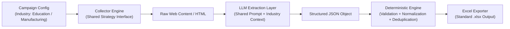
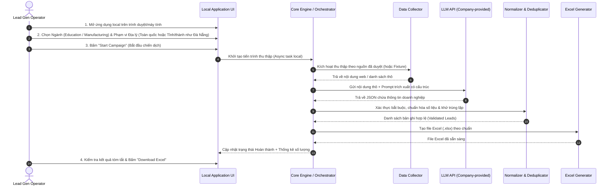
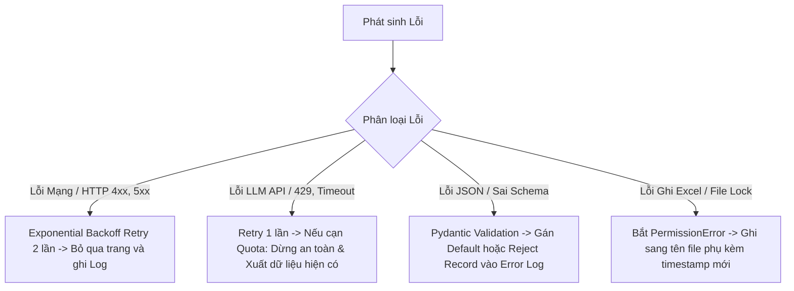
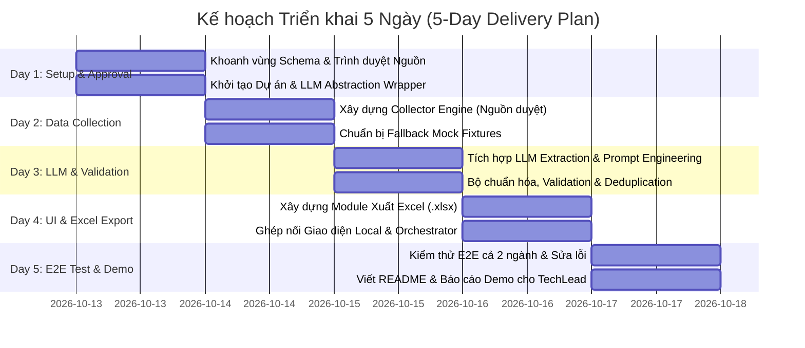

# PRODUCT REQUIREMENTS DOCUMENT (PRD)
# AI RPA Lead Collector MVP

---

## 1. Document Control (Kiểm soát Tài liệu)

### 1.1 Thông tin Tài liệu
* **Tên dự án:** AI RPA Lead Collector
* **Mã tài liệu:** `PRD-LEADGEN-MVP-001`
* **Phiên bản:** `1.2-NATIONWIDE` (Cập nhật yêu cầu bắt buộc: Phạm vi Toàn quốc Việt Nam & Bắt buộc có dữ liệu Đà Nẵng)
* **Ngày tạo:** 12/10/2026
* **Ngày cập nhật:** 13/10/2026
* **Trạng thái tài liệu:** `Chờ phê duyệt`
* **Tài liệu tham chiếu:** [`docs/source-research.md`](docs/source-research.md)

### 1.2 Lịch sử Thay đổi (Revision History)
| Phiên bản | Ngày | Tác giả | Tóm tắt thay đổi | Trạng thái |
| :--- | :--- | :--- | :--- | :--- |
| `1.0-DRAFT` | 12/10/2026 | BA / Architect | Khởi tạo tài liệu PRD hoàn chỉnh cho bản MVP 5 ngày dựa trên định hướng ban đầu | Lưu trữ |
| `1.2-NATIONWIDE` | 13/10/2026 | BA / Architect | Cập nhật yêu cầu bắt buộc: Phạm vi Toàn quốc Việt Nam (63 tỉnh/thành), hỗ trợ bắt buộc Đà Nẵng, bộ lọc địa phương (Toàn quốc / Tỉnh cụ thể), quy tắc chuẩn hóa trường province và xử lý ô trống khi thiếu dữ liệu; đồng bộ độ phủ địa lý các nguồn từ source-research.md | Chờ phê duyệt |

### 1.3 Quy ước Phân loại Trạng thái Quyết định
Tài liệu này phân định nghiêm ngặt ba mức độ trạng thái thông tin:
1. **[CONFIRMED] - Đã xác nhận:** Các yêu cầu và ràng buộc đã được thống nhất chính thức từ đề bài.
2. **[PROPOSED] - Đề xuất mặc định:** Các phương án kỹ thuật và nghiệp vụ do BA/Architect đề xuất nhằm đảm bảo tiến độ 5 ngày; có thể áp dụng tạm thời cho đến khi có ý kiến khác.
3. **[TBD — Pending Approval] - Quyết định chờ phê duyệt:** Các hạng mục bắt buộc phải có văn bản hoặc chỉ đạo phê duyệt chính thức trước khi triển khai hoặc nghiệm thu.

---

## 2. Executive Summary (Tóm tắt Dự án)

Dự án **AI RPA Lead Collector** là giải pháp phần mềm chạy trên môi trường cục bộ (local application) nhằm tự động hóa quy trình thu thập thông tin doanh nghiệp (lead generation) phục vụ kinh doanh trong hai ngành mục tiêu: **Giáo dục (Education)** và **Sản xuất (Manufacturing)**.

Trong thời hạn triển khai ngắn, dự án tập trung xây dựng một Minimum Viable Product (MVP) hoàn chỉnh từ đầu đến cuối (end-to-end), chứng minh tính khả thi kỹ thuật (Proof of Concept - PoC) của mô hình kết hợp:
* **Thu thập dữ liệu xác định (Deterministic RPA/Collector):** Thu thập dữ liệu từ các nguồn công khai, hợp pháp đã được phê duyệt.
* **Trích xuất ngữ nghĩa thông minh bằng AI (LLM Extraction):** Sử dụng LLM API nội bộ để chuẩn hóa văn bản phi cấu trúc thành dữ liệu có cấu trúc.
* **Xác thực và khử trùng lặp xác định (Deterministic Normalization & Deduplication):** Đảm bảo tính toàn vẹn và chất lượng dữ liệu bằng mã nguồn nghiệp vụ nghiêm ngặt, không phó mặc hoàn toàn cho LLM.
* **Xuất kết quả tiêu chuẩn (Excel Export):** Tạo file bảng tính Microsoft Excel (`.xlsx`) hoàn chỉnh, có cấu trúc rõ ràng, hỗ trợ truy vết nguồn gốc (traceability).

**Tôn chỉ cốt lõi của MVP:** Ưu tiên hàng đầu là **tính tin cậy của dữ liệu (data reliability)**, **khả năng truy vết nguồn gốc (source traceability)**, và **không tạo ra thông tin giả mạo (no hallucination)**. MVP **KHÔNG** phải là một nền tảng autonomous multi-agent tự hành phức tạp.

---

## 3. Background and Problem Statement (Bối cảnh & Bài toán)

### 3.1 Bài toán Nghiệp vụ & Thách thức Kỹ thuật
* **Nghiệp vụ thu thập lead thủ công:** Đội ngũ kinh doanh hiện phải tra cứu thủ công qua danh bạ doanh nghiệp và website, sao chép từng trường thông tin vào Excel. Quy trình này tốn nhiều nhân lực, dễ sai sót và năng suất thấp.
* **Dữ liệu web phi cấu trúc và biến động:** Thông tin doanh nghiệp trên Internet không đồng nhất về mặt ngữ nghĩa (ví dụ: cách trình bày số điện thoại, địa chỉ, ngành nghề). Nếu chỉ dùng kỹ thuật bóc tách truyền thống (XPath/Regex), mã nguồn sẽ dễ gãy khi cấu trúc trang thay đổi.
* **Hạn chế của LLM:** Nếu để LLM tự do duyệt web hoặc tự tạo dữ liệu, rủi ro sinh ảo giác (hallucination), sai lệch dữ liệu, vượt hạn mức chi phí (token cost), và vi phạm tính pháp lý là rất cao.
* **Giải pháp của MVP:** Thiết lập một quy trình lai (Hybrid Pipeline) khép kín: RPA/Crawler thu thập nội dung thô từ nguồn hợp lệ → LLM trích xuất cấu trúc ngữ nghĩa → Engine xác thực làm sạch và loại trừ trùng lặp → Xuất file Excel chuẩn hóa.

---

## 4. Product Objectives (Mục tiêu Sản phẩm)

### 4.1 Mục tiêu Chính (Primary Objectives)
1. **Hoàn thành quy trình End-to-End:** Cho phép người dùng vận hành một chiến dịch thu thập dữ liệu từ bước cấu hình, thu thập dữ liệu từ nguồn được phê duyệt, trích xuất cấu trúc bằng LLM, đến bước xuất file Excel (`.xlsx`) hợp lệ.
2. **Hỗ trợ Đa ngành & Phạm vi Toàn quốc (Bao gồm Đà Nẵng):** Hỗ trợ cả 2 ngành **Education** và **Manufacturing** trên phạm vi **Toàn quốc Việt Nam (63 tỉnh/thành phố)**, với khả năng lọc theo tỉnh/thành cụ thể (trong đó **Đà Nẵng** là địa bàn bắt buộc phải được hỗ trợ và có dữ liệu kiểm chứng), vận hành trên cùng một kiến trúc đường ống xử lý dữ liệu chung (Shared Pipeline), không viết hai ứng dụng hoặc hai pipeline riêng biệt.
3. **Độ tin cậy và Truy vết nguồn gốc (Traceability):** 100% bản ghi lead xuất ra phải truy vết được URL nguồn (`source_url`) và thời điểm thu thập (`collected_at`). Tuyệt đối không sinh dữ liệu ảo (no hallucination).
4. **Vận hành Local Độc lập:** Ứng dụng triển khai, cấu hình và chạy thành công trên máy local mà không phụ thuộc vào hạ tầng đám mây phức tạp.

### 4.2 Mục tiêu Thứ cấp & Giới hạn
* Chứng minh giá trị kinh doanh của việc tích hợp LLM vào bài toán RPA dữ liệu B2B.
* Thiết lập khung kiểm soát rủi ro pháp lý và kỹ thuật đối với nguồn dữ liệu web.

---

## 5. Stakeholders and Target Users (Các bên liên quan & Người dùng mục tiêu)

### 5.1 Các Bên liên quan (Stakeholders)
| Vai trò | Đại diện | Trách nhiệm chính trong dự án |
| :--- | :--- | :--- |
| **Technical Sponsor & Approver** | TechLead | Phê duyệt nguồn dữ liệu, danh mục trường schema, LLM provider, và nghiệm thu sản phẩm cuối cùng. |
| **Product & Business Reviewer** | Business Development / Product Team | Đánh giá tính hữu dụng của dữ liệu xuất ra và trải nghiệm workflow người dùng. |
| **Sole Developer** | Developer | Lựa chọn công nghệ, thiết kế kỹ thuật chi tiết, lập trình toàn bộ hệ thống, viết tài liệu vận hành và trình diễn demo. |

### 5.2 Người dùng Mục tiêu (Target Users)
* **Lead Generation Specialist / Sales Operations:** Chuyên viên tìm kiếm khách hàng tiềm năng nội bộ.
* **Đặc điểm hành vi:**
  * Cần giao diện trực quan, dễ thao tác cục bộ, không yêu cầu kỹ năng kỹ thuật sâu.
  * Quan tâm nhất đến tính chính xác của số điện thoại, email, website và ngành nghề của doanh nghiệp.
  * Kỳ vọng nhận file Excel chuẩn chỉnh để nhập trực tiếp vào hệ thống CRM hoặc phân chia cho đội ngũ kinh doanh.

---

## 6. Scope and Out of Scope (Phạm vi Dự án)

### 6.1 Phạm vi Trong MVP (Proposed In-Scope)
* [x] **Cấu hình chiến dịch (Campaign Configuration):** Giao diện/màn hình cục bộ cho phép chọn ngành (Education / Manufacturing), chọn phạm vi địa lý (Toàn quốc hoặc một tỉnh/thành cụ thể, bao gồm bắt buộc Đà Nẵng), chọn nguồn dữ liệu (từ danh sách nguồn đã phê duyệt hoặc fixture mẫu), và đặt giới hạn bản ghi.
* [x] **Khởi chạy và Giám sát:** Kích hoạt chiến dịch và hiển thị tiến trình cơ bản (trạng thái: Đang chạy, Thành công, Thất bại, số lượng bản ghi đã xử lý).
* [x] **Thu thập dữ liệu web & Lọc địa lý (Data Collection & Geographic Filtering):** Trích xuất nội dung HTML/văn bản thô từ nguồn dữ liệu được phê duyệt; hỗ trợ truyền tham số lọc địa phương nếu nguồn hỗ trợ server-side query, hoặc thu thập theo danh mục ngành và lọc sau ở tầng pipeline (post-filtering). Phân biệt rõ giữa phạm vi hệ thống (hỗ trợ toàn quốc/chọn tỉnh) và độ phủ thực tế của từng nguồn.
* [x] **Trích xuất thông minh bằng LLM (LLM-assisted Extraction):** Gửi văn bản trích xuất đến LLM API (do công ty cấp) theo prompt mẫu để nhận về JSON có cấu trúc.
* [x] **Chuẩn hóa & Xác thực xác định (Deterministic Validation):** Kiểm tra kiểu dữ liệu, bắt buộc trường tên doanh nghiệp, chuẩn hóa số điện thoại, email, website và trường `province` theo danh mục 63 tỉnh/thành phố chuẩn của Việt Nam; bản ghi không xác định được tỉnh/thành sẽ lưu `null` nội bộ và xuất ô trống trong Excel (tuyệt đối không tự suy đoán địa phương).
* [x] **Khử trùng lặp xác định (Deterministic Deduplication):** Loại bỏ các bản ghi trùng lặp dựa trên website hoặc tên công ty kết hợp số điện thoại/địa chỉ.
* [x] **Truy vết nguồn (Traceability):** Lưu trữ đầy đủ `source_url` và timestamp `collected_at` cho từng bản ghi.
* [x] **Xuất file Excel (`.xlsx`):** Tạo file Excel chuẩn, tự động căn chỉnh, có freeze pane, bộ lọc và định dạng trực quan.
* [x] **Xử lý lỗi và phản hồi an toàn:** Thông báo rõ ràng khi gặp lỗi mạng, lỗi LLM, hoặc khi chiến dịch thu thập được 0 bản ghi (không báo thành công giả).
* [x] **Chế độ kiểm thử Fallback (Multi-Province Fixtures):** Cho phép chạy thử nghiệm với bộ dữ liệu mẫu (mock fixtures) đa địa phương được chuẩn bị sẵn, bắt buộc bao gồm dữ liệu tại Đà Nẵng, dữ liệu tại địa phương khác (như Hà Nội hoặc TP.HCM), và ít nhất một bản ghi khuyết thiếu trường province để kiểm thử toàn diện pipeline.

### 6.2 Phạm vi Ngoài MVP (Explicitly Out of Scope)
* [ ] **Triển khai Production / Cloud:** Không triển khai AWS/GCP, không cấu hình Kubernetes, CI/CD phức tạp hay Docker orchestration.
* [ ] **Kiến trúc Đa người dùng & Bảo mật nâng cao:** Không xây dựng Multi-tenancy, Authentication, Phân quyền vai trò (RBAC), SSO.
* [ ] **Multi-agent Orchestration:** Không tích hợp các framework phức tạp như CrewAI, AutoGen, LangGraph đa tác tử.
* [ ] **Autonomous Web Crawler:** Không cho phép bot tự động duyệt các website lạ ngẫu nhiên không có trong danh sách phê duyệt.
* [ ] **AI Lead Scoring / Purchasing Intent:** Không chấm điểm tiềm năng khách hàng hay suy đoán ý định mua sắm bằng AI.
* [ ] **Automated Outreach:** Không tự động gửi email marketing, cold email hay nhắn tin hàng loạt.
* [ ] **Bypass cơ chế phòng vệ:** Tuyệt đối không viết module giải CAPTCHA, bẻ khóa Cloudflare, hay xâm nhập các trang yêu cầu trả phí (paywall).
* [ ] **Hạ tầng hàng đợi phân tán:** Không cài đặt Celery, Redis Cluster, RabbitMQ hay Kafka phân tán.
* [ ] **Dashboard phân tích nâng cao:** Không vẽ biểu đồ BI phức tạp hay lưu trữ lịch sử dữ liệu lớn (Data Lake/Warehouse).

---

## 7. Target Industries & Shared Pipeline (Ngành mục tiêu & Pipeline Dùng chung)

### 7.1 Ngành 1: Giáo dục (Education)
* **Mục tiêu:** Thu thập các tổ chức và đơn vị cung cấp dịch vụ giáo dục, đào tạo.
* **Danh mục phân loại dự thảo (Draft Taxonomy):**
  * Trường học và Cơ sở giáo dục đại học / cao đẳng (K-12 Schools, Colleges, Universities)
  * Trung tâm Ngoại ngữ (Language Centers)
  * Trung tâm Đào tạo nghề và Kỹ năng (Vocational & Skill Training Centers)
  * Đơn vị Đào tạo chuyên môn doanh nghiệp (Corporate / Professional Training Providers)
  * Doanh nghiệp Công nghệ Giáo dục (EdTech Companies)
* *Lưu ý:* Phân loại trên là dự thảo phục vụ prompt ngữ cảnh cho LLM, không phải bảng phân loại cứng đã phê duyệt.

### 7.2 Ngành 2: Sản xuất (Manufacturing)
* **Mục tiêu:** Thu thập các đơn vị sản xuất, nhà máy, gia công và cung ứng công nghiệp.
* **Danh mục phân loại dự thảo (Draft Taxonomy):**
  * Doanh nghiệp Sản xuất cơ khí, máy móc và thiết bị chế tạo
  * Nhà máy và Cơ sở sản xuất công nghiệp
  * Nhà cung cấp thiết bị và phụ tùng công nghiệp (Industrial Suppliers)
  * Doanh nghiệp Điện tử và Linh kiện
  * Doanh nghiệp Sản xuất Nhựa, Bao bì, In ấn
  * Doanh nghiệp Dệt may, Da giày
  * Doanh nghiệp Chế biến Thực phẩm và Đồ uống
* *Lưu ý:* Phân loại trên là dự thảo phục vụ prompt ngữ cảnh cho LLM, không phải bảng phân loại cứng đã phê duyệt.

### 7.3 Kiến trúc Đường ống Dùng chung (Shared Collection Pipeline)
Để đảm bảo hoàn thành dự án trong 5 ngày, hệ thống **bắt buộc sử dụng chung một pipeline xử lý duy nhất**. Sự khác biệt giữa 2 ngành chỉ nằm ở tầng **tham số cấu hình (Configuration Parameters)**:



* **Lý do thiết kế:** Cả hai ngành đều chia sẻ chung một lược đồ dữ liệu doanh nghiệp (Tên, Địa chỉ, Website, Email, Phone, Mô tả). Việc phân tách thành 2 pipeline riêng biệt sẽ gây lãng phí công sức, nhân đôi lỗi và không kịp hạn chót 5 ngày.

---

## 8. User Workflow (Quy trình Người dùng)

### 8.1 Sơ đồ Quy trình End-to-End


### 8.2 Chi tiết 8 Bước Trải nghiệm Người dùng
1. **Bước 1: Mở ứng dụng:** Người dùng khởi chạy ứng dụng cục bộ qua lệnh terminal hoặc giao diện web local (ví dụ: `http://localhost:8000`).
2. **Bước 2: Cấu hình chiến dịch:** Người dùng tiếp cận form cấu hình đơn giản.
3. **Bước 3: Chọn ngành mục tiêu:** Chọn một trong hai ngành: `Education` hoặc `Manufacturing`.
4. **Bước 4: Chọn phạm vi địa lý & giới hạn bản ghi:**
   * **Phạm vi địa lý (Geographic Scope):** Người dùng có thể chọn **Toàn quốc (Nationwide)** để thu thập không áp dụng bộ lọc tỉnh/thành, hoặc chọn một **tỉnh/thành phố cụ thể** từ danh mục 63 tỉnh/thành phố chuẩn của Việt Nam (trong đó **Đà Nẵng** là địa bàn bắt buộc phải có trong danh sách hỗ trợ và có dữ liệu kiểm chứng).
   * **Giới hạn số lượng (Record Limit):** Nhập số lượng bản ghi cần thu thập (`max_records`, mặc định: 20 bản ghi) để kiểm thử nhanh mà không gây quá tải cho hệ thống hay máy chủ nguồn.
5. **Bước 5: Bắt đầu thu thập:** Nhấn nút **"Bắt đầu Thu thập (Start Campaign)"**. Hệ thống khóa nút bấm và hiển thị trạng thái đang xử lý.
6. **Bước 6: Theo dõi tiến độ cơ bản:** Hệ thống hiển thị thanh trạng thái hoặc thông báo log tiến độ (ví dụ: "Đang thu thập trang 1/5...", "Đang trích xuất LLM...", "Đang chuẩn hóa dữ liệu...").
7. **Bước 7: Kiểm tra kết quả tổng kết:** Màn hình hiển thị thẻ tóm tắt (Tổng số thu thập, số bản ghi hợp lệ, số bản ghi trùng lặp bị loại bỏ, cảnh báo lỗi nếu có).
8. **Bước 8: Tải file Excel:** Nhấn **"Tải file Excel (.xlsx)"** hoặc mở trực tiếp đường dẫn file được lưu trên máy local.

---

## 9. Functional Requirements (Yêu cầu Chức năng)

### 9.1 Bảng Tổng hợp Yêu cầu Chức năng
| ID | Tên Yêu cầu | Độ ưu tiên | Trạng thái MVP | Phụ thuộc |
| :--- | :--- | :---: | :---: | :--- |
| **FR-01** | Cấu hình Chiến dịch (Campaign Configuration) | P0 | Bắt buộc | Không |
| **FR-02** | Khởi chạy & Quản lý Vòng đời Chiến dịch | P0 | Bắt buộc | FR-01 |
| **FR-03** | Thu thập Dữ liệu từ Nguồn được Phê duyệt | P0 | Bắt buộc | FR-02 |
| **FR-04** | Trích xuất Thông tin bằng LLM API | P0 | Bắt buộc | FR-03 |
| **FR-05** | Chuẩn hóa Dữ liệu & Xác thực Schema | P0 | Bắt buộc | FR-04 |
| **FR-06** | Khử trùng lặp Xác định (Deterministic Deduplication) | P0 | Bắt buộc | FR-05 |
| **FR-07** | Truy vết Nguồn gốc & Dữ liệu Kiểm toán (Traceability) | P0 | Bắt buộc | FR-03, FR-05 |
| **FR-08** | Xuất Workbook Excel Chuẩn hóa (.xlsx) | P0 | Bắt buộc | FR-06, FR-07 |
| **FR-09** | Xử lý Lỗi & Phản hồi Trạng thái Người dùng | P0 | Bắt buộc | FR-02 → FR-08 |
| **FR-10** | Chế độ Kiểm thử Fallback (Sample Dataset Fixtures) | P1 | Đề xuất | FR-01 |

---

### 9.2 Chi tiết Từng Yêu cầu Chức năng

#### FR-01: Cấu hình Chiến dịch (Campaign Configuration)
* **Độ ưu tiên:** P0 (Must Have)
* **Mô tả:** Hệ thống cung cấp giao diện/biểu mẫu cấu hình trước khi kích hoạt thu thập.
* **Acceptance Criteria:**
  * `AC-01.1:` Cho phép chọn ngành từ danh sách cố định: `Education` hoặc `Manufacturing`. Không cho phép để trống trường ngành.
  * `AC-01.2:` Cung cấp trường nhập giới hạn số lượng bản ghi cần thu thập (`max_records`), mặc định đề xuất là 20 bản ghi (có thể chỉnh từ 5 đến 100).
  * `AC-01.3:` Cung cấp trường chọn phạm vi địa lý (`geographic_scope`): Cho phép người dùng chọn **"Toàn quốc" (Nationwide / All)** hoặc chọn một **tỉnh/thành phố cụ thể** từ danh mục 63 tỉnh/thành phố chuẩn của Việt Nam (trong đó **Đà Nẵng** là địa phương bắt buộc phải có trong danh sách lựa chọn và có dữ liệu kiểm chứng).
  * `AC-01.4:` Cung cấp nút chuyển đổi "Chế độ Nguồn Live" hoặc "Chế độ Dữ liệu Mẫu (Fallback Fixture)".
  * `AC-01.5:` Hỗ trợ logic lọc kết hợp (Combined Filtering):
    * Hệ thống hỗ trợ 2 kịch bản cấu hình kết hợp:
      1. Ngành (`Education` hoặc `Manufacturing`) + Một tỉnh/thành cụ thể (bao gồm `Đà Nẵng`).
      2. Ngành (`Education` hoặc `Manufacturing`) + `Toàn quốc` (không áp dụng bộ lọc tỉnh/thành).
    * Cơ chế thực thi phía Collector: Nếu nguồn dữ liệu hỗ trợ lọc tỉnh/thành trực tiếp tại nguồn (Server-side query params như `?city=...`), hệ thống truyền tham số tương ứng để tối ưu hiệu suất. Nếu nguồn không hỗ trợ lọc trực tiếp, hệ thống thu thập theo danh mục ngành và thực hiện lọc theo tỉnh/thành ở tầng pipeline (Pipeline post-filtering), hoặc ghi nhận rõ giới hạn độ phủ của nguồn.

#### FR-02: Khởi chạy & Quản lý Vòng đời Chiến dịch (Campaign Execution & Lifecycle)
* **Độ ưu tiên:** P0 (Must Have)
* **Mô tả:** Hệ thống điều phối toàn bộ quy trình chạy cục bộ từ khi bấm nút đến khi hoàn tất.
* **Acceptance Criteria:**
  * `AC-02.1:` Khi kích hoạt, hệ thống chuyển trạng thái chiến dịch sang `RUNNING` và vô hiệu hóa nút kích hoạt trùng lặp để tránh gọi lặp lại.
  * `AC-02.2:` Quá trình xử lý chạy bất đồng bộ (asynchronous hoặc background thread) trên máy local để giao diện không bị treo (frozen/unresponsive).
  * `AC-02.3:` Kết thúc chiến dịch, trạng thái cập nhật thành `COMPLETED` (thành công), `PARTIAL_SUCCESS` (thành công một phần, có lỗi ở một số trang), hoặc `FAILED` (thất bại toàn bộ).
  * `AC-02.4:` [TBD — Pending TechLead confirmation] Tính năng Hủy chiến dịch (Cancel/Stop) và Lưu lịch sử nhiều chiến dịch được xếp mức P2; trong MVP chấp nhận kịch bản chạy từng chiến dịch một (Single campaign execution).

#### FR-03: Thu thập Dữ liệu từ Nguồn được Phê duyệt (Authorized Data Collection)
* **Độ ưu tiên:** P0 (Must Have)
* **Mô tả:** Module thu thập nội dung web từ danh mục nguồn đã được TechLead phê duyệt chính thức.
* **Acceptance Criteria:**
  * `AC-03.1:` Chỉ kết nối và thu thập dữ liệu từ các URL thuộc danh sách nguồn đã được TechLead phê duyệt chính thức trong file cấu hình.
  * `AC-03.2:` Tuân thủ nghiêm ngặt chỉ dẫn `robots.txt` và áp dụng thời gian chờ (delay 1.0s – 3.0s giữa các request) để tránh gây tải cho máy chủ mục tiêu.
  * `AC-03.3:` Thu thập nội dung trang danh sách và trang chi tiết (nếu có), trích xuất khối văn bản (text blocks/HTML snippets) chứa thông tin doanh nghiệp.
  * `AC-03.4:` Tuyệt đối không chứa logic bẻ khóa CAPTCHA, vượt paywall hay giả mạo phiên đăng nhập trái phép.

#### FR-04: Trích xuất Thông tin bằng LLM API (LLM-Assisted Structured Extraction)
* **Độ ưu tiên:** P0 (Must Have)
* **Mô tả:** Sử dụng LLM API nội bộ để phân tích văn bản phi cấu trúc thành dữ liệu JSON chuẩn.
* **Acceptance Criteria:**
  * `AC-04.1:` Prompt gửi lên LLM phải được đóng gói kèm ngữ cảnh (system prompt) chỉ định rõ: Chỉ trích xuất thông tin xuất hiện trong văn bản được cung cấp; không được tự suy đoán hoặc sáng tác thông tin.
  * `AC-04.2:` LLM trả về kết quả theo định dạng JSON hợp lệ (sử dụng JSON Mode hoặc Structured Outputs nếu API hỗ trợ).
  * `AC-04.3:` Nếu một trường thông tin (ví dụ: email, phone, province) không có trong nội dung nguồn, LLM phải trả về giá trị `null` hoặc chuỗi rỗng `""`, không được sinh giá trị ngẫu nhiên.
  * `AC-04.4:` Hệ thống bọc lớp trừu tượng (Abstraction Layer) cho LLM Client để có thể thay đổi nhà cung cấp mà không phải sửa đổi mã nguồn nghiệp vụ.

#### FR-05: Chuẩn hóa Dữ liệu & Xác thực Schema (Data Normalization & Validation)
* **Độ ưu tiên:** P0 (Must Have)
* **Mô tả:** Áp dụng mã nguồn xác định (deterministic code) để làm sạch, định dạng và kiểm tra tính hợp lệ của dữ liệu do LLM trả về.
* **Acceptance Criteria:**
  * `AC-05.1:` Kiểm tra bắt buộc trường `company_name`: Bản ghi thiếu tên công ty hoặc tên dưới 2 ký tự sẽ bị loại bỏ vào danh sách lỗi (rejected leads).
  * `AC-05.2:` Chuẩn hóa `website`: Tự động thêm tiền tố `https://` nếu thiếu, xóa trailing slash `/`, và kiểm tra định dạng URL hợp lệ qua Regex.
  * `AC-05.3:` Chuẩn hóa `public_email`: Chuyển về chữ thường (lowercase), loại bỏ khoảng trắng, kiểm tra định dạng cú pháp email tiêu chuẩn.
  * `AC-05.4:` Chuẩn hóa `public_phone`: Loại bỏ các ký tự phân tách không chuẩn, chỉ giữ lại số và dấu cộng quốc tế nếu có.
  * `AC-05.5:` Gán nhãn ngành (`industry`) khớp chính xác với ngành đã chọn trong cấu hình chiến dịch.
  * `AC-05.6:` Chuẩn hóa trường `province`: Đối chiếu và ánh xạ thông tin địa phương từ văn bản/nội dung trích xuất về danh mục 63 tỉnh/thành phố chuẩn của Việt Nam (theo chuẩn Tổng cục Thống kê GSO). Xử lý chuẩn hóa các biến thể phổ biến (ví dụ: "TP. Đà Nẵng", "tp đà nẵng", "Da Nang" → "Đà Nẵng"; "TP.HCM", "TP. Hồ Chí Minh", "tp ho chi minh" → "Hồ Chí Minh" hoặc danh mục thống nhất).
  * `AC-05.7:` Xử lý bản ghi không xác định được tỉnh/thành (Unknown/Missing Province Handling): Nếu nội dung nguồn không chứa thông tin tỉnh/thành hoặc không thể nhận diện chính xác theo danh mục 63 tỉnh/thành, hệ thống **tuyệt đối không tự suy đoán, bịa đặt hoặc gán bừa địa phương lân cận**. Trường `province` được lưu giá trị `null` hoặc chuỗi rỗng `""` trong dữ liệu nội bộ và hiển thị **ô trống (Empty cell)** trong file Excel xuất ra. Bản ghi vẫn được coi là hợp lệ nếu trường bắt buộc `company_name` đạt yêu cầu.

#### FR-06: Khử trùng lặp Xác định (Deterministic Deduplication)
* **Độ ưu tiên:** P0 (Must Have)
* **Mô tả:** Loại bỏ các bản ghi trùng lặp trong cùng một chiến dịch bằng các quy tắc logic xác định.
* **Acceptance Criteria:**
  * `AC-06.1:` Quy tắc 1 (Ưu tiên Website): Hai bản ghi có cùng tên miền website chuẩn hóa (ví dụ: `abc.edu.vn` và `https://www.abc.edu.vn/`) được xác định là trùng lặp. Giữ lại bản ghi đầy đủ thông tin hơn.
  * `AC-06.2:` Quy tắc 2 (Ưu tiên Tên + SĐT/Địa chỉ): Nếu không có website, hai bản ghi có cùng tên công ty (so sánh không phân biệt hoa thường và dấu câu) kết hợp cùng số điện thoại hoặc cùng địa chỉ tỉnh thành sẽ được xác định là trùng lặp.
  * `AC-06.3:` Số lượng bản ghi trùng lặp bị loại bỏ phải được đếm và hiển thị trong báo cáo thống kê của chiến dịch.

#### FR-07: Truy vết Nguồn gốc & Dữ liệu Kiểm toán (Traceability)
* **Độ ưu tiên:** P0 (Must Have)
* **Mô tả:** Đảm bảo mọi dòng dữ liệu xuất ra đều có căn cứ xuất xứ rõ ràng.
* **Acceptance Criteria:**
  * `AC-07.1:` Mọi bản ghi trong cơ sở dữ liệu tạm và file Excel phải chứa trường `source_url` trỏ chính xác về trang web nơi bản ghi được thu thập.
  * `AC-07.2:` Mọi bản ghi phải chứa trường `collected_at` theo định dạng chuẩn ISO 8601 (`YYYY-MM-DDTHH:mm:ssZ`).
  * `AC-07.3:` Nếu sử dụng dữ liệu mẫu (Fallback mode), trường `source_url` phải thể hiện rõ định danh fixture (ví dụ: `fixture://education_sample_01.html`).

#### FR-08: Xuất Workbook Excel Chuẩn hóa (.xlsx)
* **Độ ưu tiên:** P0 (Must Have)
* **Mô tả:** Xuất toàn bộ dữ liệu đã được xác thực sang file định dạng `.xlsx` tương thích hoàn toàn với Microsoft Excel và Google Sheets.
* **Acceptance Criteria:**
  * `AC-08.1:` File Excel được tạo bằng thư viện chuẩn (ví dụ: `openpyxl`), có thể mở bình thường mà không phát sinh thông báo file bị lỗi (corrupted file).
  * `AC-08.2:` Chứa ít nhất một worksheet tên là `Leads`. Cột tiêu đề (Header row) nằm ở dòng 1, được in đậm, có màu nền phân biệt và bật tính năng Cố định dòng tiêu đề (`Freeze Panes`).
  * `AC-08.3:` Tự động bật bộ lọc dữ liệu (`AutoFilter`) cho toàn bộ các cột của sheet `Leads`.
  * `AC-08.4:` [PROPOSED] Tạo thêm worksheet `Summary` chứa thông tin tổng hợp chiến dịch (Thời gian chạy, Ngành, Nguồn, Tổng lead thu thập, Lead hợp lệ, Lead trùng lặp).
  * `AC-08.5:` Tự động căn chỉnh độ rộng cột (Auto-fit width) để văn bản không bị che khuất.
  * `AC-08.6:` Quy tắc đặt tên file: `leads_{industry}_{YYYYMMDD_HHmmss}.xlsx`.

#### FR-09: Xử lý Lỗi & Phản hồi Trạng thái Người dùng (Feedback & Error Reporting)
* **Độ ưu tiên:** P0 (Must Have)
* **Mô tả:** Cung cấp thông tin phản hồi trung thực và minh bạch cho người dùng, ngăn chặn việc báo cáo sai lệch.
* **Acceptance Criteria:**
  * `AC-09.1:` Chiến dịch thu thập được 0 bản ghi hợp lệ **tuyệt đối không được báo thành công**. Hệ thống phải hiển thị trạng thái `WARNING` hoặc `FAILED` kèm lý do cụ thể (ví dụ: "Nguồn dữ liệu không phản hồi" hoặc "Cấu trúc trang thay đổi, không trích xuất được bản ghi hợp lệ").
  * `AC-09.2:` Khi gặp lỗi gọi LLM API (401 Unauthorized, 429 Rate Limit, 500 Outage), hệ thống dừng luồng trích xuất an toàn và hiển thị thông báo lỗi thân thiện thay vì làm sập ứng dụng.
  * `AC-09.3:` Lưu trữ file log cục bộ (`logs/campaign_{id}.log`) ghi nhận các bước thực thi để phục vụ kiểm tra lỗi.

#### FR-10: Chế độ Kiểm thử Fallback (Fallback Testing Mode)
* **Độ ưu tiên:** P1 (Should Have - Giảm thiểu rủi ro Day 1-2)
* **Mô tả:** Cho phép vận hành pipeline với dữ liệu mẫu tĩnh được cấp phép nhằm kiểm thử tính đúng đắn của LLM và Excel Generator khi nguồn web chưa được duyệt.
* **Acceptance Criteria:**
  * `AC-10.1:` Khi bật chế độ Fallback, hệ thống nạp các file HTML/văn bản mẫu được chuẩn bị sẵn trong thư mục `tests/fixtures/`.
  * `AC-10.2:` Dữ liệu xuất ra file Excel trong chế độ này phải được gắn tiền tố rõ ràng trong tên file: `leads_SAMPLE_{industry}_{timestamp}.xlsx` và có dòng ghi chú trong sheet `Summary` để phân biệt hoàn toàn với dữ liệu cào trực tiếp.
  * `AC-10.3:` Yêu cầu đối với bộ dữ liệu Fixtures mẫu (Multi-Province Fixture Dataset):
    * Bộ fixture mẫu bắt buộc phải chứa các bản ghi thuộc nhiều tỉnh/thành phố khác nhau.
    * Bắt buộc có các bản ghi tại **Đà Nẵng** (cho cả hai ngành Education và Manufacturing).
    * Bắt buộc có các bản ghi tại ít nhất một địa phương khác (như Hà Nội hoặc TP.HCM).
    * Bắt buộc có ít nhất một bản ghi **khuyết thiếu trường `province`** nhằm kiểm thử hành vi xử lý dữ liệu thiếu và kiểm tra bộ lọc pipeline.

---

## 10. Data Source Strategy & Evaluation Framework (Chiến lược Nguồn Dữ liệu)

Việc lựa chọn và phê duyệt nguồn dữ liệu là **yếu tố quyết định sống còn (critical dependency)** của dự án. Lập trình viên không được tự ý cào bất kỳ website nào mà chưa có sự đồng ý của TechLead.

### 10.1 Khung Đánh giá Nguồn Dữ liệu (Khung 11 Tiêu chí Đánh giá)
Developer sử dụng khung 11 tiêu chí sau (đồng bộ với [`docs/source-research.md`](file:///D:/ai-rpa-lead-generator/docs/source-research.md)) để nghiên cứu các ứng viên cho mỗi ngành và đệ trình TechLead xem xét:

| STT | Tiêu chí | Mô tả chi tiết & Câu hỏi đánh giá | Trọng số |
| :---: | :--- | :--- | :---: |
| **1** | **National Coverage (Độ phủ toàn quốc)** | Bằng chứng thực nghiệm nguồn có dữ liệu trên phạm vi toàn quốc (Bắc - Trung - Nam). Không công nhận toàn quốc nếu chỉ truy cập được từ toàn quốc nhưng dữ liệu chỉ có ở 1–2 địa phương. | Bắt buộc |
| **2** | **Da Nang Coverage (Độ phủ Đà Nẵng)** | Bằng chứng xác minh có dữ liệu doanh nghiệp/cơ sở tại Đà Nẵng (yêu cầu địa bàn trọng điểm bắt buộc của MVP). | Bắt buộc |
| **3** | **Geographic Filtering (Khả năng lọc tỉnh/thành)** | Nguồn hỗ trợ lọc trực tiếp (Server-side query/path) hay phải tải toàn bộ rồi lọc sau ở pipeline (Pipeline post-filtering)? | Cao |
| **4** | **Relevance (Độ liên quan ngành)** | Nguồn có chứa đúng đối tượng doanh nghiệp ngành Giáo dục / Sản xuất không? Danh mục có rõ ràng không? | Rất cao |
| **5** | **Authorization & Legal (Tính pháp lý)** | Dữ liệu có phải là thông tin công khai không? Rủi ro pháp lý theo Nghị định 13/2023/NĐ-CP và bản quyền CSDL? | Bắt buộc |
| **6** | **Official API (Khả năng có API)** | Nguồn có cung cấp REST API công khai hoặc mở không? (Nếu có API, ưu tiên dùng API thay vì cào web). | Rất cao |
| **7** | **Terms of Service (Điều khoản sử dụng)** | ToS của website có điều khoản cấm automated data collection / extraction không? | Bắt buộc |
| **8** | **Robots.txt Guidance** | File `/robots.txt` có cho phép truy cập (Disallow/Allow) vào các thư mục danh bạ không? Chỉ thị Crawl-delay? | Bắt buộc |
| **9** | **Field Completeness (Độ đủ trường)** | Trang có hiển thị đủ: Tên, Địa chỉ, Website, Điện thoại, Email (nếu có), Mô tả không? | Cao |
| **10**| **Rendering & Anti-Scraping** | Trang sử dụng SSR hay CSR (cần JavaScript)? Có Cloudflare, Datadome hay CAPTCHA khắt khe không? | Rất cao (5 ngày) |
| **11**| **Implementation Effort (Công sức code)** | Thời gian viết module collector cho nguồn này có khả thi trong vòng 1 ngày (Day 2) cho 1 dev không? | Rất cao |

### 10.2 Danh sách Nguồn Ứng viên & Giới hạn Độ phủ Địa lý Thực tế
> [!WARNING]
> Bảng dưới đây tổng hợp kết quả khảo sát thực nghiệm đối chiếu từ [`docs/source-research.md`]. **Chưa có nguồn nào được phê duyệt chính thức.** Developer không được triển khai crawler live cho các nguồn này cho đến khi TechLead ký duyệt.

#### Phân định Quan trọng: Phạm vi Hệ thống vs Độ phủ Thực tế của Nguồn:
* **Phạm vi Địa lý của Hệ thống (System Geographic Scope):** Giao diện và kiến trúc của hệ thống hỗ trợ đầy đủ phạm vi **Toàn quốc Việt Nam (63 tỉnh/thành)** và cho phép chọn bất kỳ tỉnh/thành nào (trong đó **Đà Nẵng** là địa bàn bắt buộc có trong danh mục hỗ trợ).
* **Độ phủ Thực tế của Nguồn (Actual Source Coverage):** Mỗi nguồn dữ liệu ứng viên có ranh giới và giới hạn thực tế riêng, không thể tự suy đoán có đủ 100% dữ liệu toàn quốc:

| Ngành | Nguồn Ứng viên (Candidate) | Đánh giá Độ phủ Địa lý & Bằng chứng Thực nghiệm | Hạn chế Kỹ thuật & Pháp lý | Trạng thái Đánh giá |
| :--- | :--- | :--- | :--- | :---: |
| **Chung (Edu & Mfg)** | **Trang Vàng Doanh Nghiệp**<br>(`trangvangvietnam.com`) | * **Đã kiểm chứng độ phủ Toàn quốc và có Đà Nẵng.**<br>* Cả 2 ngành đều có doanh nghiệp tại Đà Nẵng.<br>* Hỗ trợ tìm kiếm kết hợp Tỉnh/thành trực tiếp tại nguồn (`?city=...`). | * ToS có điều khoản hạn chế automated scraping.<br>* `robots.txt` cho phép nhưng yêu cầu `Crawl-delay: 5` (ảnh hưởng tốc độ cào). | `Requires TechLead approval` |
| **Sản xuất (Mfg)** | **Hiệp hội CN Hỗ trợ VN - VASI**<br>(`vasi.org.vn`) | * **KHÔNG bao phủ Toàn quốc; KHÔNG có Đà Nẵng.**<br>* Khảo sát thực nghiệm: Bộ lọc chỉ có 17 tỉnh thành công nghiệp lớn (Bắc/Nam), **hoàn toàn khuyết thiếu Đà Nẵng**.<br>* Hỗ trợ lọc qua dropdown `position`. | * Không đại diện toàn diện cho ngành sản xuất toàn quốc.<br>* Nếu chọn Đà Nẵng, nguồn này trả về 0 kết quả. | `Requires TechLead approval`<br>*(Ghi nhận giới hạn độ phủ)* |
| **Giáo dục (Edu)** | **Cổng Dữ liệu Mở TP.HCM**<br>(`data.hochiminhcity.gov.vn`) | * **NGUỒN CỤC BỘ (LOCAL ONLY).**<br>* Chỉ bao phủ TP. Hồ Chí Minh.<br>* Hoàn toàn không có dữ liệu Đà Nẵng hay các tỉnh thành khác. | * Tuyệt đối không đáp ứng yêu cầu phạm vi toàn quốc.<br>* Chưa xác định được `resource_id` cụ thể của tập dữ liệu giáo dục. | `Requires technical validation`<br>*(Không dùng làm nguồn toàn quốc)* |
| **Bổ sung (Edu & Mfg)** | **Cổng Dữ liệu Mở Đà Nẵng**<br>(`congdulieu.vn` / `opendata.danang.gov.vn`) | * **NGUỒN ĐỊA PHƯƠNG ĐÀ NẴNG.**<br>* Có danh bạ trường học, trung tâm ngoại ngữ, doanh nghiệp tại Đà Nẵng.<br>* Hỗ trợ tra cứu web và API riêng. | * Chỉ bao phủ Đà Nẵng, không có dữ liệu toàn quốc.<br>* Phù hợp làm nguồn dữ liệu đối chứng hoặc bổ sung riêng cho Đà Nẵng. | `Requires technical validation` |

### 10.3 Nguyên tắc Thu thập Dữ liệu Đạo đức & Tuân thủ (Compliance Principles)
1. **Không Bypass Rào cản Kỹ thuật:** Nghiêm cấm bẻ khóa CAPTCHA, bẻ khóa cơ chế bảo vệ bot, hoặc tấn công vượt quyền.
2. **Không Thu thập Sau Đăng nhập/Trả phí:** Không crawl dữ liệu nằm sau màn hình đăng nhập người dùng (paywall/login required) trừ khi có API key hoặc tài khoản được cấp phép chính thức.
3. **Thân thiện với Hạ tầng Mục tiêu (Polite Crawling):** Đặt giới hạn tốc độ (Rate Limit), gửi header `User-Agent` minh bạch, áp dụng backoff khi nhận mã HTTP 429 hoặc 503.

### 10.4 Kế hoạch Dự phòng Khi Phê duyệt Nguồn bị Chậm (Fallback Plan)
* Nếu hết **12:00 trưa Ngày 2**, TechLead vẫn chưa thể phê duyệt nguồn dữ liệu trực tiếp:
  * Lập trình viên lập tức kích hoạt **Kế hoạch Dự phòng (Fallback Plan)**.
  * Sử dụng một tập dữ liệu mẫu (Sample Dataset / HTML Fixtures) gồm 20–30 trang/bản ghi HTML tĩnh đã được cấp phép nội bộ trong thư mục `tests/fixtures/` để làm đầu vào cho pipeline.
  * **Yêu cầu đối với bộ dữ liệu Fixture:** Bắt buộc phải là bộ dữ liệu đa địa phương, trong đó **bắt buộc có bản ghi tại Đà Nẵng**, bản ghi tại tỉnh/thành khác (Hà Nội hoặc TP.HCM), và ít nhất một bản ghi khuyết thiếu trường `province` để kiểm thử toàn diện cả kịch bản lọc địa phương và chuẩn hóa dữ liệu thiếu.
  * Toàn bộ quy trình LLM, chuẩn hóa, khử trùng lặp và xuất Excel vẫn tiếp tục được phát triển và kiểm thử bình thường.
  * Kết quả xuất ra sẽ ghi chú rõ ràng: **"Kiểm thử trên Fixture Dataset do chưa phê duyệt Live Source"**, không được báo cáo là thu thập live thành công.

---

## 11. LLM Extraction Requirements (Yêu cầu Trích xuất LLM)

### 11.1 Vai trò & Ranh giới của LLM
* **Vai trò:** LLM hoạt động như một **Semantic Parser & Information Normalizer**. LLM chịu trách nhiệm đọc các đoạn văn bản/HTML thô do collector cung cấp, hiểu ngữ cảnh và trích xuất các thực thể kinh doanh vào cấu trúc JSON định sẵn.
* **Ranh giới nghiêm ngặt:**
  * LLM **KHÔNG** phải là một agent tự động lướt web (No autonomous browser agent).
  * LLM **KHÔNG** tự ý sáng tác thông tin liên hệ khi nội dung không có (No hallucination).
  * LLM **KHÔNG** phải là cơ quan thẩm định duy nhất về tính hợp lệ của dữ liệu (mã nguồn xác định sẽ kiểm tra lại).

### 11.2 Xử lý Các Tình huống Biên & Ngoại lệ của LLM
| Tình huống ngoại lệ | Hành vi của Hệ thống |
| :--- | :--- |
| **Invalid JSON / Lỗi cú pháp JSON** | Bắt ngoại lệ JSONDecodeError. Thử lại (retry) 01 lần với prompt yêu cầu sửa lỗi định dạng; nếu vẫn thất bại, ghi log lỗi và bỏ qua bản ghi. |
| **Schema Violation (Thiếu trường, sai kiểu)** | Pydantic / JsonSchema validator phát hiện sai lệch. Tự động áp dụng giá trị mặc định (`null`) cho trường không bắt buộc; nếu thiếu trường bắt buộc (`company_name`), đánh dấu bản ghi không hợp lệ. |
| **API Timeout / Mất kết nối** | Cấu hình timeout tối đa 30 giây cho mỗi request. Áp dụng cơ chế Exponential Backoff (thử lại tối đa 2 lần). |
| **Rate Limit (Mã HTTP 429)** | Tạm dừng tiến trình theo chỉ dẫn của header `Retry-After` hoặc dừng tối thiểu 5 giây trước khi thử lại. |
| **Quota Exceeded (Hết hạn mức token)** | Dừng gọi LLM ngay lập tức. Xuất toàn bộ các bản ghi đã thu thập thành công trước đó ra Excel và hiển thị thông báo lỗi rõ ràng cho người dùng. |
| **Nội dung web rỗng hoặc không liên quan** | Kiểm tra độ dài văn bản trước khi gửi đến LLM (nếu < 50 ký tự, bỏ qua, không gọi LLM để tiết kiệm chi phí). |
| **Thông tin mâu thuẫn trong văn bản** | Ưu tiên thông tin nằm trong phần Footer / Liên hệ chính thức của trang web; nếu vẫn mơ hồ, giữ nguyên giá trị xuất hiện đầu tiên kèm log cảnh báo. |

### 11.3 Kiến trúc Trừu tượng hóa LLM (LLM Provider Abstraction)
Mã nguồn phải cài đặt một Interface/Adapter trừu tượng để không bị gắn chặt vào một nhà cung cấp LLM cụ thể:
```python
# Thiết kế gợi ý cho tầng trừu tượng (Giao diện chuẩn)
class BaseLLMExtractor(ABC):
    @abstractmethod
    def extract_lead_info(self, raw_text: str, industry_context: str) -> ExtractedLeadDTO:
        """Trích xuất thông tin lead từ văn bản thô"""
        pass
```
* **Biến môi trường:** Tuyệt đối không hardcode API key, endpoint, hoặc model name trong mã nguồn. Toàn bộ thông số cấu hình phải đọc từ file `.env`:
  * `LLM_API_KEY`: Khóa xác thực API.
  * `LLM_API_BASE_URL`: Endpoint dịch vụ (do công ty cung cấp).
  * `LLM_MODEL_NAME`: Tên mô hình (ví dụ: `gpt-4o-mini`, `gemini-1.5-flash`, hoặc model nội bộ).
  * `LLM_TEMPERATURE`: Khuyến nghị thiết lập cố định bằng `0.0` hoặc `0.1` để đảm bảo tính xác định (deterministic output).

---

## 12. Data Dictionary (Từ điển Dữ liệu Chi tiết)

> [!NOTE]
> Bảng từ điển dữ liệu dưới đây là **bản dự thảo đề xuất (Draft Proposal)**. Các trường đánh dấu `[TBD]` cần TechLead xác nhận chính thức.

### 12.1 Bảng Đặc tả Các Trường Dữ liệu
| Tên Trường (Field Name) | Mục đích / Ý nghĩa | Kiểu Dữ liệu | Trạng thái Bắt buộc | Quy tắc Chuẩn hóa (Normalization) | Quy tắc Xác thực (Validation) | Giá trị khi Thiếu (Missing Value) |
| :--- | :--- | :--- | :---: | :--- | :--- | :--- |
| `company_name` | Tên chính thức hoặc tên giao dịch của doanh nghiệp | String | **Mandatory** | Cắt tỉa khoảng trắng đầu/cuối (trim), xóa khoảng trắng thừa giữa các từ, giữ nguyên chữ hoa/thường chuẩn. | Không được rỗng; độ dài tối thiểu >= 2 ký tự; không chứa từ khóa lỗi như "N/A", "Unknown". | Không chấp nhận thiếu (Loại bản ghi) |
| `industry` | Ngành mục tiêu của chiến dịch | Enum / String | **Mandatory** | Ánh xạ về 1 trong 2 giá trị chuẩn: `"Education"` hoặc `"Manufacturing"`. | Phải khớp chính xác với ngành đã chọn trong cấu hình chiến dịch. | Gán theo cấu hình chiến dịch |
| `sub_industry` | Phân ngành chi tiết hoặc lĩnh vực hoạt động cụ thể | String | Optional `[TBD]` | Cắt tỉa khoảng trắng; viết hoa chữ cái đầu. | Độ dài tối đa 100 ký tự. | Chuỗi rỗng `""` hoặc `"N/A"` |
| `province` | Tỉnh / Thành phố trực thuộc Trung ương nơi doanh nghiệp hoặc cơ sở đặt trụ sở chính / cơ sở hoạt động | String / Enum (63 tỉnh/thành) | Optional `[CONFIRMED]` | Ánh xạ về 1 trong 63 tỉnh/thành phố chuẩn của Việt Nam theo danh mục Tổng cục Thống kê (GSO). Xử lý tiền tố ("Tỉnh", "Thành phố", "TP.", "TP "), xóa khoảng trắng thừa, chuẩn hóa dấu tiếng Việt (ví dụ: "TP. Đà Nẵng", "tp đà nẵng", "Da Nang" → "Đà Nẵng"; "TP.HCM", "tp ho chi minh" → "Hồ Chí Minh"). | Phải khớp chính xác với 1 trong 63 tỉnh/thành chuẩn nếu có dữ liệu. Nếu không nhận diện được hoặc không có trong nguồn, chuyển về missing value (không đoán mò). | Lưu `null` hoặc chuỗi rỗng `""` nội bộ; Hiển thị **Ô trống (Empty cell)** trong Excel. Tuyệt đối không tự suy đoán, bịa đặt địa phương lân cận, không ghi `"N/A"` hay `"null"`. |
| `address` | Địa chỉ chi tiết (số nhà, đường, quận/huyện) | String | Optional | Cắt tỉa khoảng trắng; chuẩn hóa dấu phẩy ngăn cách. | Độ dài tối đa 255 ký tự. | Chuỗi rỗng `""` hoặc `"N/A"` |
| `website` | Website chính thức của doanh nghiệp | String (URL) | Optional `[TBD]` | Tự động thêm `https://` nếu thiếu; loại bỏ trailing slash `/`; chuyển domain về chữ thường. | Phải là URL hợp lệ theo định dạng Regex; domain có đuôi TLD hợp lệ. | Chuỗi rỗng `""` hoặc `"N/A"` |
| `public_email` | Email liên hệ công khai của doanh nghiệp | String (Email) | Optional `[TBD]` | Chuyển toàn bộ về chữ thường (lowercase); loại bỏ khoảng trắng. | Kiểm tra cú pháp theo tiêu chuẩn RFC 5322 cơ bản; không chấp nhận email cá nhân nếu phát hiện blacklist rác. | Chuỗi rỗng `""` hoặc `"N/A"` |
| `public_phone` | Số điện thoại bàn hoặc hotline công khai | String | Optional `[TBD]` | Loại bỏ dấu chấm, dấu cách, dấu ngoặc; chỉ giữ lại chữ số và tiền tố `+` (mã quốc gia nếu có). | Độ dài từ 8 đến 15 ký tự số. | Chuỗi rỗng `""` hoặc `"N/A"` |
| `description` | Mô tả tóm tắt ngành nghề hoặc sản phẩm chính | String | Optional | Xóa bỏ các thẻ HTML tags còn sót lại; cắt gọn tối đa 300 ký tự. | Văn bản đọc hiểu được, không chứa ký tự nhị phân rác. | Chuỗi rỗng `""` hoặc `"N/A"` |
| `source_url` | URL chính xác nơi thu thập thông tin bản ghi | String (URL) | **Mandatory** | Giữ nguyên URL thu thập thực tế; cắt bỏ tracking query params không cần thiết. | Bắt buộc phải là URL hợp lệ, có thể truy cập lại để đối chứng. | Không chấp nhận thiếu (Loại bản ghi) |
| `collected_at` | Thời điểm thu thập bản ghi | Datetime (ISO 8601) | **Mandatory** | Định dạng chuẩn: `YYYY-MM-DDTHH:mm:ssZ`. | Phải là thời gian hợp lệ tại thời điểm hệ thống vận hành. | Tự động lấy thời gian hệ thống |

---

## 13. Excel Output Specification (Đặc tả File Excel Xuất ra)

File Excel là **sản phẩm đầu ra cuối cùng (Final Deliverable)** của chiến dịch, cần đạt tiêu chuẩn thẩm mỹ và tính khả dụng cao cho người dùng nghiệp vụ.

### 13.1 Cấu trúc Workbook
Workbook bao gồm **02 Worksheet**:
1. **Worksheet `Leads` (Bắt buộc):** Chứa danh sách dữ liệu chi tiết của toàn bộ các lead đã được xác thực và làm sạch.
2. **Worksheet `Summary` (Khuyến nghị đơn giản):** Chứa bảng thông tin tóm tắt về chiến dịch để người dùng nắm được bối cảnh thu thập.

### 13.2 Đặc tả Worksheet `Leads`
* **Thứ tự Cột & Tiêu đề (Header Conventions):**
  1. `STT` (Số thứ tự, định dạng số nguyên tăng dần 1, 2, 3...)
  2. `Company Name` (Tên doanh nghiệp)
  3. `Industry` (Ngành)
  4. `Sub-Industry` (Phân ngành)
  5. `Province` (Tỉnh/Thành phố)
  6. `Address` (Địa chỉ chi tiết)
  7. `Website` (Website doanh nghiệp)
  8. `Public Email` (Email công khai)
  9. `Public Phone` (Điện thoại liên hệ)
  10. `Description` (Mô tả tóm tắt)
  11. `Source URL` (URL nguồn thu thập)
  12. `Collected At` (Thời gian thu thập)

* **Quy chuẩn Định dạng (Styling & Formatting):**
  * **Header Row (Dòng 1):** Chiều cao 28pt, chữ in đậm (Bold), căn giữa theo chiều dọc và ngang, màu nền xám nhạt (`#F2F4F7`) hoặc xanh navy nhạt (`#EBF3FB`), đường viền dưới rõ ràng.
  * **Freeze Panes:** Cố định dòng tiêu đề (Freeze Row 1) để khi cuộn xuống dữ liệu vẫn nhìn thấy tên cột.
  * **AutoFilter:** Kích hoạt tính năng bộ lọc tự động cho toàn bộ dải ô từ cột `A1` đến cột `L1`.
  * **Hyperlink:** Cột `Website` và `Source URL` được định dạng dưới dạng liên kết có thể nhấp chuột trực tiếp (clickable blue link, gạch chân).
  * **Độ rộng cột (Column Width):** Tự động điều chỉnh theo nội dung dài nhất của mỗi cột (Auto-fit width), cộng thêm 3 ký tự padding; giới hạn tối đa không quá 50 ký tự (các cột như Description tự động bật Wrap Text).
  * **Hiển thị giá trị thiếu (Missing Values):** Ô không có dữ liệu để ô trống hoàn toàn (chuỗi rỗng `""`), tuyệt đối không hiển thị `"None"`, `"null"`, `"undefined"`, hoặc tự suy đoán thông tin. Riêng trường `Province`, nếu bản ghi không xác định được tỉnh/thành, để ô trống hoàn toàn (**Empty cell**), không điền `"N/A"` hay gán bừa địa phương lân cận.

### 13.3 Đặc tả Worksheet `Summary`
Worksheet `Summary` được thiết kế đơn giản dạng bảng Dashboard tóm tắt (Key-Value):
* **Tên chiến dịch:** (Ví dụ: `Education Lead Gen Campaign #1`)
* **Ngành mục tiêu:** `Education` / `Manufacturing`
* **Phạm vi địa lý đã cấu hình (Geographic Scope):** `Toàn quốc` hoặc Tên tỉnh/thành cụ thể (ví dụ: `Đà Nẵng`, `Hà Nội`, `TP. Hồ Chí Minh`)
* **Nguồn dữ liệu sử dụng:** URL hoặc Tên nguồn được duyệt (kèm ghi chú giới hạn độ phủ thực tế nếu có)
* **Chế độ thực thi:** `LIVE COLLECTION` hoặc `SAMPLE FIXTURE TEST`
* **Thời gian bắt đầu:** `YYYY-MM-DD HH:mm:ss`
* **Thời gian kết thúc:** `YYYY-MM-DD HH:mm:ss`
* **Tổng số trang/mục đã quét:** Số nguyên
* **Tổng số lead hợp lệ trích xuất được:** Số nguyên
* **Số lượng bản ghi trùng lặp đã loại bỏ:** Số nguyên
* **Trạng thái chiến dịch:** `THÀNH CÔNG (COMPLETED)` / `CÓ LỖI (PARTIAL_SUCCESS)` / `THẤT BẠI (FAILED)`

### 13.4 Quy ước Đặt tên File & Kịch bản Đặc biệt
* **Quy ước tên file:** `leads_{industry}_{YYYYMMDD_HHmmss}.xlsx` (Ví dụ: `leads_education_20261012_173000.xlsx`).
* **Trường hợp chiến dịch thu thập được 0 bản ghi hợp lệ:**
  * Hệ thống vẫn tạo file Excel hợp lệ có đầy đủ header của sheet `Leads` (không để file rỗng 0 bytes).
  * Dòng 2 của sheet `Leads` ghi chú rõ: *"Không có bản ghi hợp lệ nào được thu thập trong chiến dịch này."*
  * Sheet `Summary` ghi nhận trạng thái: `WARNING - ZERO RECORDS COLLECTED`.

---

## 14. Non-Functional Requirements (Yêu cầu Phi chức năng)

### 14.1 Bảng Yêu cầu Phi chức năng
| ID | Hạng mục | Yêu cầu Kỹ thuật MVP | Ngưỡng Đề xuất / Trạng thái |
| :--- | :--- | :--- | :--- |
| **NFR-01** | **Reliability (Độ tin cậy)** | Hệ thống hoàn thành chiến dịch mà không bị crash đột ngột; tự động thu hồi tài nguyên (đóng kết nối HTTP, đóng file). | Hoàn thành 100% vòng đời tác vụ local |
| **NFR-02** | **Data Integrity (Tính toàn vẹn)** | 100% dữ liệu xuất ra tuân thủ đúng kiểu dữ liệu của Data Dictionary; không có lỗi cú pháp JSON hay cột Excel bị lệch. | 100% tuân thủ schema |
| **NFR-03** | **Traceability (Khả năng truy vết)** | 100% dòng dữ liệu có URL nguồn hợp lệ và timestamp; có thể đối chiếu lại nội dung gốc nếu cần. | Tỷ lệ truy vết đạt 100% |
| **NFR-04** | **Performance (Hiệu năng chạy local)** | Tốc độ thu thập và xử lý demo đáp ứng được kỳ vọng kiểm thử trong buổi trình diễn của TechLead. | `[PROPOSED]` Thu thập & xử lý 20 bản ghi trong thời gian <= 3 phút `[TBD — Pending TechLead confirmation]` |
| **NFR-05** | **Resource Usage (Tài nguyên máy)** | Ứng dụng chạy trên máy cá nhân tiêu chuẩn (8GB–16GB RAM, CPU 4 cores), không chiếm dụng quá 2GB RAM. | RAM <= 2GB, CPU <= 60% |
| **NFR-06** | **Security (Bảo mật thông tin)** | Khóa API và cấu hình nhạy cảm được quản lý an toàn qua `.env`; không lộ trong log hay mã nguồn Git. | 0 thông tin nhạy cảm bị rò rỉ |
| **NFR-07** | **Maintainability (Khả năng bảo trì)** | Mã nguồn được tổ chức theo cấu trúc module rõ ràng (Collector, Extractor, Validator, Exporter); có tài liệu hướng dẫn chạy `README.md`. | Bàn giao kèm hướng dẫn chạy trong 3 bước |
| **NFR-08** | **Ethical Scraping (Tuân thủ cào dữ liệu)** | Tôn trọng chỉ dẫn của file `robots.txt`; áp dụng cơ chế giãn cách request (1–3 giây). | Rate limit >= 1.0s giữa các request |

---

## 15. Error Handling Architecture (Kiến trúc Xử lý Lỗi)

### 15.1 Ma trận Phân tầng Lỗi và Chiến lược Ứng phó


### 15.2 Chi tiết Ứng phó Từng Kịch bản
1. **Lỗi Website đích chặn truy cập (HTTP 403 Forbidden / CAPTCHA):**
   * *Hành vi:* Hệ thống không cố gắng bẻ khóa. Ngừng gửi request đến domain đó ngay lập tức, ghi log mức `ERROR`, thông báo trên UI: *"Nguồn dữ liệu từ chối kết nối hoặc yêu cầu xác thực. Vui lòng kiểm tra lại quyền truy cập nguồn."*
2. **Lỗi LLM API Quota Exceeded (Hết hạn mức tài khoản):**
   * *Hành vi:* Bắt mã lỗi đặc thù từ LLM SDK. Không làm sập ứng dụng. Lưu lại toàn bộ các bản ghi đã xử lý trước đó, tạo file Excel cho phần dữ liệu đó, và thông báo: *"Chiến dịch tạm dừng do vượt hạn mức LLM API. Dữ liệu đã thu thập đến thời điểm này đã được lưu vào Excel."*
3. **Lỗi File Excel đang mở bởi ứng dụng khác (File Locked):**
   * *Hành vi:* Nếu người dùng đang mở file Excel cùng tên dẫn đến không thể ghi đè, hệ thống tự động đổi tên file xuất ra thành `leads_{industry}_{timestamp}_recovered.xlsx` và thông báo đường dẫn mới cho người dùng.

---

## 16. Security, Privacy & Data Compliance (Bảo mật & Tuân thủ)

### 16.1 Bảo vệ Dữ liệu Riêng tư & Tuân thủ Pháp lý
* **Chỉ thu thập dữ liệu doanh nghiệp công khai:** Hệ thống chỉ thu thập thông tin danh bạ doanh nghiệp B2B được công bố công khai trên website chính thức hoặc danh bạ thương mại.
* **Không thu thập dữ liệu cá nhân nhạy cảm (No PII):** Tuyệt đối không thu thập thông tin căn cước công dân, tài khoản ngân hàng, thông tin gia đình hoặc số điện thoại riêng tư của cá nhân không liên quan đến doanh nghiệp.
* **Tuân thủ Bản quyền và Sở hữu trí tuệ:** Không sao chép toàn bộ cơ sở dữ liệu có bản quyền; chỉ trích xuất các trường thông tin sự thật (facts: tên, số điện thoại, địa chỉ) phục vụ mục đích liên hệ kinh doanh.

### 16.2 Bảo mật Khóa Xác thực (API Secrets Management)
* Tất cả khóa xác thực (API keys), URL nội bộ, và cấu hình môi trường phải được lưu trong file `.env` tại thư mục gốc.
* File `.env` bắt buộc phải được khai báo trong `.gitignore`.
* Cung cấp một file mẫu `.env.example` với các giá trị rỗng/giả định để hướng dẫn người dùng thiết lập môi trường:
  ```bash
  # .env.example
  LLM_API_KEY=your_company_llm_api_key_here
  LLM_API_BASE_URL=https://api.company-llm.com/v1
  LLM_MODEL_NAME=gpt-4o-mini
  ```

---

## 17. Acceptance Criteria & Test Matrix (Tiêu chí Nghiệm thu)

### 17.1 Bảng Kiểm Nghiệm thu Chức năng End-to-End (Functional Checklist)
Quá trình nghiệm thu sản phẩm vào Ngày 5 sẽ được đánh giá dựa trên bảng kiểm sau:

| STT | Hạng mục Kiểm tra | Tiêu chuẩn Đạt (Pass Criteria) | Trạng thái Đánh giá |
| :---: | :--- | :--- | :---: |
| 1 | **Khởi động Ứng dụng** | Ứng dụng khởi động thành công trên máy local theo đúng tài liệu hướng dẫn trong `README.md` mà không phát sinh lỗi phụ thuộc. | [ ] Pass / [ ] Fail |
| 2 | **Cấu hình Chiến dịch** | Người dùng có thể chọn ngành (`Education` hoặc `Manufacturing`), chọn phạm vi địa lý (`Toàn quốc` hoặc tỉnh/thành cụ thể như `Đà Nẵng`), nhập số lượng record giới hạn và bấm bắt đầu. | [ ] Pass / [ ] Fail |
| 3 | **Hỗ trợ Cả hai Ngành** | Hệ thống thực thi thành công chiến dịch cho cả ngành Education và ngành Manufacturing trên cùng một pipeline dùng chung. | [ ] Pass / [ ] Fail |
| 4 | **Chiến dịch Lọc Đà Nẵng** | Tạo và chạy thành công chiến dịch với bộ lọc `Đà Nẵng`; file Excel xuất ra chứa các lead tại Đà Nẵng (thu thập live từ nguồn hỗ trợ hoặc qua Fallback fixture Đà Nẵng). | [ ] Pass / [ ] Fail |
| 5 | **Chiến dịch Lọc Tỉnh/Thành Khác** | Tạo và chạy thành công chiến dịch với bộ lọc một tỉnh/thành khác (ví dụ: `Hà Nội` hoặc `TP. Hồ Chí Minh`); kết quả lọc chính xác theo địa phương đã chọn. | [ ] Pass / [ ] Fail |
| 6 | **Chiến dịch Toàn quốc (Nationwide)** | Tạo và chạy thành công chiến dịch phạm vi `Toàn quốc` (không áp bộ lọc tỉnh/thành); kết quả thu thập bao quát nhiều địa phương mà không bị giới hạn cứng ở 1 tỉnh. | [ ] Pass / [ ] Fail |
| 7 | **Kiểm tra Bộ lọc Kết hợp** | Hệ thống lọc chính xác theo cả 2 tiêu chí kết hợp: (Ngành + Tỉnh/thành cụ thể) và (Ngành + Toàn quốc). | [ ] Pass / [ ] Fail |
| 8 | **Nguồn Dữ liệu Hợp lệ** | Dữ liệu được thu thập từ nguồn đã được TechLead phê duyệt (hoặc từ fixture mẫu được cho phép trong chế độ Fallback). | [ ] Pass / [ ] Fail |
| 9 | **Tuân thủ Schema & Chuẩn hóa Province** | Các bản ghi chứa đầy đủ các trường schema; trường `province` được chuẩn hóa về danh mục 63 tỉnh/thành chuẩn; trường bắt buộc (`company_name`) không được rỗng. | [ ] Pass / [ ] Fail |
| 10 | **Xử lý Khuyết thiếu Tỉnh/Thành** | Khi bản ghi không có thông tin địa phương, hệ thống không tự suy đoán hoặc gán bừa; lưu `null` nội bộ và xuất **ô trống (Empty cell)** trong Excel. | [ ] Pass / [ ] Fail |
| 11 | **Truy vết Nguồn gốc** | 100% bản ghi xuất ra có `source_url` hợp lệ và `collected_at` đúng định dạng thời gian ISO 8601. | [ ] Pass / [ ] Fail |
| 12 | **Không Sinh Ảo giác (No Hallucination)** | Các trường thông tin không có trên web gốc phải để rỗng/null, không được LLM tự ý bịa đặt số điện thoại, email hay vị trí ngẫu nhiên. | [ ] Pass / [ ] Fail |
| 13 | **Khử trùng lặp Xác định** | Các bản ghi trùng lặp website hoặc trùng tên + liên hệ được loại bỏ chính xác; số lượng trùng lặp được báo cáo minh bạch. | [ ] Pass / [ ] Fail |
| 14 | **Xử lý Ngoại lệ LLM** | Khi ngắt kết nối LLM hoặc nhập API key giả, ứng dụng hiển thị thông báo lỗi rõ ràng, không bị crash ứng dụng. | [ ] Pass / [ ] Fail |
| 15 | **Tạo File Excel Hợp lệ** | File `.xlsx` được tạo thành công, mở được trên Excel/Google Sheets, dòng tiêu đề có freeze pane, bộ lọc, đúng thứ tự cột; ô thiếu là ô trống hoàn toàn. | [ ] Pass / [ ] Fail |
| 16 | **Bộ Dữ liệu Fixture Đa Địa phương** | Bộ dữ liệu fixture mẫu (Fallback mode) chứa đầy đủ dữ liệu tại **Đà Nẵng**, địa phương khác, và bản ghi khuyết thiếu `province` để kiểm thử toàn diện. | [ ] Pass / [ ] Fail |
| 17 | **Tải File Cục bộ** | Người dùng có thể tải file hoặc truy cập file trực tiếp từ thư mục đầu ra trên máy tính. | [ ] Pass / [ ] Fail |
| 18 | **Báo cáo Trung thực khi 0 Record** | Nếu không thu thập được dữ liệu, hệ thống thông báo trạng thái cảnh báo/thất bại rõ ràng, không báo thành công ảo. | [ ] Pass / [ ] Fail |

### 17.2 Tiêu chí Định lượng Chờ Phê duyệt (Quantitative Targets)
> [!WARNING]
> Các chỉ số định lượng dưới đây cần TechLead xác nhận chính thức trước buổi nghiệm thu:
> * Số lượng bản ghi tối thiểu cần đạt cho mỗi chiến dịch demo: `[PROPOSED: 15–20 bản ghi]` → `TBD — Pending TechLead confirmation`.
> * Tỷ lệ trích xuất thành công trường bắt buộc (`company_name`): `[PROPOSED: >= 95%]` → `TBD — Pending TechLead confirmation`.
> * Độ chính xác lọc địa bàn (khi chọn Đà Nẵng hoặc tỉnh cụ thể): `[PROPOSED: 100% bản ghi xuất ra thuộc đúng địa phương được chọn]` → `TBD — Pending TechLead confirmation`.
> * Tỷ lệ không suy đoán địa phương thiếu (Zero Guessing Rate): `[PROPOSED: 100% bản ghi thiếu province xuất ô trống trong Excel, 0% bị gán bừa]` → `TBD — Pending TechLead confirmation`.
> * Tỷ lệ có số điện thoại hoặc website: `[PROPOSED: Phụ thuộc vào nguồn dữ liệu thực tế, không áp chỉ tiêu cứng]` → `TBD — Pending TechLead confirmation`.

---

## 18. Five-Day Delivery Plan (Kế hoạch Triển khai 5 Ngày)

Kế hoạch chi tiết dành cho **01 Developer chính** trong điều kiện thời gian nghiêm ngặt 5 ngày:



### 18.1 Chi tiết Công việc Từng Ngày

#### Ngày 1 (Day 1): Khung Yêu cầu, Đề xuất Nguồn, Chốt Schema & Scaffolding
* **Mục tiêu:** Thiết lập nền tảng kỹ thuật, danh mục 63 tỉnh/thành chuẩn và đệ trình đề xuất nguồn dữ liệu cho TechLead.
* **Nhiệm vụ cụ thể:**
  * Hoàn thiện tài liệu PRD, data dictionary (bao gồm quy tắc chuẩn hóa `province`) và ma trận đánh giá nguồn dữ liệu.
  * Nghiên cứu các website ứng viên, kiểm chứng thực nghiệm độ phủ Toàn quốc và Đà Nẵng; hoàn thành báo cáo `source-research.md` gửi TechLead.
  * Chuẩn bị danh mục tham chiếu 63 tỉnh/thành phố chuẩn của Việt Nam (theo GSO) để phục vụ module làm sạch dữ liệu.
  * Khởi tạo repository, cấu hình môi trường phát triển (Python, quản lý dependencies, cấu hình `.env.example`).
  * Xây dựng module trừu tượng `LLMClient` và viết unit test mock API.
* **Deliverables:** PRD hoàn chỉnh, tài liệu `source-research.md`, danh mục 63 tỉnh/thành, repo scaffold sạch, module LLM client cơ bản.
* **Definition of Done (DoD):** Dự án chạy được lệnh kiểm tra môi trường, nạp được cấu hình từ `.env`, gọi thử nghiệm được LLM API mẫu.
* **Công việc song song khi chờ duyệt nguồn:** Thiết kế prompt, viết module validation dữ liệu với fixture mẫu.

#### Ngày 2 (Day 2): Xây dựng Module Thu thập Dữ liệu (Data Collector) & Fixtures Đa Vùng
* **Mục tiêu:** Thu thập thành công nội dung thô từ nguồn được duyệt hoặc nạp bộ fixture mẫu đa địa phương.
* **Nhiệm vụ cụ thể:**
  * Nhận phản hồi phê duyệt (hoặc kích hoạt Fallback plan).
  * Viết module thu thập dữ liệu (HTTP client với `requests`/`httpx` hoặc headless browser `playwright` nếu bắt buộc).
  * Xây dựng cơ chế truyền tham số lọc địa phương (nếu nguồn hỗ trợ server-side query params như `?city=...`) hoặc thu thập danh mục phục vụ lọc sau ở pipeline.
  * Cài đặt cơ chế rate limit (delay 1.5s – 5.0s theo `robots.txt`), xử lý lỗi mạng và lưu lại HTML/Text thô.
  * Đóng gói sẵn 1 bộ fixture HTML mẫu đa địa phương (bắt buộc có Đà Nẵng, Hà Nội/TP.HCM, và bản ghi thiếu province) trong thư mục `tests/fixtures/`.
* **Deliverables:** Module `DataCollector` hoạt động ổn định, bộ fixture mẫu đa vùng miền sẵn sàng.
* **Definition of Done (DoD):** Chạy collector thu thập được ít nhất 10 trang mẫu về máy local (hoặc nạp bộ fixture mẫu đa địa phương) mà không bị lỗi.

#### Ngày 3 (Day 3): Trích xuất LLM, Chuẩn hóa Province, Xác thực & Khử trùng lặp
* **Mục tiêu:** Hoàn thiện đường ống biến đổi dữ liệu từ văn bản thô sang JSON đã được làm sạch, chuẩn hóa tỉnh/thành và khử trùng.
* **Nhiệm vụ cụ thể:**
  * Tinh chỉnh Prompt trích xuất cho 2 ngành Education & Manufacturing (Zero-shot / Few-shot với JSON Schema ràng buộc).
  * Ghép nối đầu ra của Collector vào LLM Extractor để nhận JSON.
  * Viết module `DataValidator` (sử dụng Pydantic hoặc code xác định) kiểm tra trường bắt buộc, chuẩn hóa số điện thoại, email, website.
  * Cài đặt logic chuẩn hóa trường `province` về 63 tỉnh/thành chuẩn; xử lý trường hợp không rõ địa phương (lưu `null`/`""`, không đoán mò).
  * Cài đặt logic lọc kết hợp theo phạm vi địa lý đã cấu hình (lọc kết quả sau trích xuất nếu nguồn không hỗ trợ lọc server-side).
  * Viết module `Deduplicator` áp dụng quy tắc khử trùng lặp theo website và tên công ty + SĐT/địa chỉ.
* **Deliverables:** Đường ống xử lý dữ liệu hoàn chỉnh từ Raw Text → Validated Lead Objects (đã lọc theo ngành và địa phương).
* **Definition of Done (DoD):** Chạy kiểm thử tự động với 20 mẫu đầu vào đa địa phương, đầu ra đạt 100% tính hợp lệ theo schema và khử trùng lặp chính xác.

#### Ngày 4 (Day 4): Module Xuất Excel & Tích hợp Giao diện Local
* **Mục tiêu:** Kết nối toàn bộ pipeline vào giao diện người dùng và xuất file Excel hoàn chỉnh có trường địa lý.
* **Nhiệm vụ cụ thể:**
  * Viết module `ExcelExporter` bằng `openpyxl`, cài đặt đầy đủ styling (Freeze Panes, AutoFilter, Hyperlinks, hiển thị ô trống khi thiếu dữ liệu province, sheet Summary có ghi nhận Geographic Scope).
  * Xây dựng giao diện ứng dụng cục bộ tối giản (Streamlit hoặc FastAPI + Web HTML/Tailwind) cho phép người dùng chọn ngành, chọn phạm vi địa lý (Toàn quốc hoặc dropdown tỉnh/thành có Đà Nẵng), cấu hình số lượng và bấm chạy.
  * Tích hợp Orchestrator liên kết: `UI -> Collector -> LLM -> Validator/Filter -> Excel -> Download Link`.
* **Deliverables:** Ứng dụng local chạy hoàn chỉnh từ giao diện đến file Excel tải về.
* **Definition of Done (DoD):** Bấm nút trên giao diện, quy trình chạy thông suốt và xuất ra file `.xlsx` mở đẹp trên Excel.

#### Ngày 5 (Day 5): Kiểm thử End-to-End, Xử lý Lỗi, Tài liệu Hóa & Demo
* **Mục tiêu:** Đảm bảo hệ thống vận hành ổn định, sẵn sàng trình diễn trước TechLead các kịch bản Đà Nẵng và Toàn quốc.
* **Nhiệm vụ cụ thể:**
  * Thực hiện kiểm thử toàn diện (End-to-End Testing) cho cả 2 ngành Education và Manufacturing.
  * Kiểm thử các kịch bản địa lý: (1) Chiến dịch lọc Đà Nẵng, (2) Chiến dịch lọc địa phương khác, (3) Chiến dịch Toàn quốc, (4) Kiểm tra bản ghi khuyết thiếu province hiển thị ô trống trong Excel.
  * Kiểm thử các kịch bản lỗi: Sai API key, nguồn sập, 0 bản ghi, website chặn truy cập.
  * Tinh chỉnh giao diện và thông báo phản hồi người dùng.
  * Viết hoàn chỉnh tài liệu `README.md` (hướng dẫn cài đặt, cấu hình `.env`, cách chạy ứng dụng trong 3 bước).
  * Chuẩn bị kịch bản demo trực tiếp cho buổi nghiệm thu với TechLead.
* **Deliverables:** Bản cài đặt hoàn chỉnh, tài liệu `README.md`, video/kịch bản demo, file Excel kết quả mẫu của 2 ngành (bao gồm mẫu kết quả Đà Nẵng và Toàn quốc).
* **Definition of Done (DoD):** Vượt qua 100% các tiêu chí trong Bảng kiểm nghiệm thu (Acceptance Checklist).

### 18.2 Điều kiện Bất khả thi & Phương án Cắt giảm Phạm vi (De-scoping Contingency)
Nếu trong quá trình thực hiện gặp phải các rào cản nghiêm trọng, lập trình viên sẽ áp dụng phương án cắt giảm phạm vi (de-scoping) sau đây thay vì giấu giếm rủi ro:
* **Nếu website mục tiêu dùng công nghệ chống bot quá phức tạp (Cloudflare Turnstile, CAPTCHA):** Không cố gắng vượt rào → Chuyển sang cào nguồn danh bạ phụ hoặc dùng ngay Fallback Dataset đã được TechLead phê duyệt.
* **Nếu giao diện web tốn quá nhiều thời gian:** Cắt giảm frontend xuống thành giao diện Command Line Interface (CLI) trực quan (dùng thư viện `typer` hoặc `rich`) hoặc giao diện Streamlit đơn giản 1 trang duy nhất; tập trung toàn lực vào chất lượng dữ liệu và file Excel.
* **Nếu LLM API của công ty bị cấp trễ:** Sử dụng module Mock LLM Extractor (dựa trên Regex + mẫu JSON cứng) trong Day 3 để tiếp tục làm phần Validator và Excel, ghép API thật vào Day 4 khi được cấp.

---

## 19. Risks and Mitigations (Quản lý Rủi ro)

| STT | Rủi ro (Risk Description) | Xác suất | Tác động | Biện pháp Giảm thiểu (Mitigation Strategy) | Người phụ trách |
| :---: | :--- | :---: | :---: | :--- | :---: |
| **R-01** | **Phê duyệt nguồn dữ liệu bị chậm trễ:** TechLead hoặc bộ phận pháp chế không kịp phê duyệt nguồn web trước Ngày 2. | Cao | Nghiêm trọng | Kích hoạt ngay Fallback Plan vào trưa Ngày 2: Dùng bộ fixture HTML mẫu được chuẩn bị sẵn để kiểm thử toàn bộ pipeline; không để tiến độ bị tắc nghẽn. | Developer & TechLead |
| **R-02** | **Dữ liệu web không đầy đủ / thiếu trường:** Website mục tiêu thiếu email, số điện thoại hoặc mô tả doanh nghiệp. | Rất cao | Trung bình | Định nghĩa các trường này là `Optional` trong Data Dictionary; quy định rõ giá trị hiển thị khi thiếu là chuỗi rỗng hoặc `"N/A"`, không để hệ thống crash. | BA & Developer |
| **R-03** | **Cấu trúc website thay đổi đột ngột:** Layout HTML của nguồn thay đổi khiến collector không lấy được khối nội dung. | Trung bình | Cao | Thu thập khối nội dung văn bản bao quát (broad text containers) thay vì phụ thuộc vào XPath quá chi tiết; dựa vào khả năng hiểu ngữ cảnh của LLM để bóc tách. | Developer |
| **R-04** | **Bị giới hạn tần suất / Khóa IP (Rate Limit / IP Block):** Gửi quá nhiều request khiến website mục tiêu chặn IP máy local. | Trung bình | Cao | Đặt độ trễ (delay) cố định 1.5s – 3s giữa các request; thu thập số lượng nhỏ bản ghi phục vụ demo (15–20 records); tôn trọng robots.txt. | Developer |
| **R-05** | **LLM sinh ảo giác hoặc trả về sai định dạng JSON:** LLM tự sáng tác số điện thoại hoặc trả về text kèm Markdown không parse được. | Cao | Cao | Thiết lập `temperature=0.0`; dùng Structured Outputs / JSON Mode; áp dụng Prompt ràng buộc: "Chỉ trích xuất dữ liệu có trong bài"; bọc tầng Pydantic xác thực lại bằng code xác định. | Developer |
| **R-06** | **LLM API bị gián đoạn hoặc hết Quota:** API công ty cung cấp gặp sự cố hoặc cạn token trong quá trình chạy. | Thấp | Nghiêm trọng | Bắt ngoại lệ API error; lưu lại dữ liệu đã trích xuất thành công; hỗ trợ cấu hình chuyển đổi sang provider phụ (backup API key) qua file `.env`. | Developer & TechLead |
| **R-07** | **Dữ liệu lead bị trùng lặp:** Một công ty xuất hiện nhiều lần ở các trang danh mục khác nhau. | Cao | Thấp | Cài đặt module Deduplication xác định; loại bỏ trùng lặp dựa trên website chuẩn hóa hoặc tên công ty kết hợp số điện thoại/địa chỉ. | Developer |
| **R-08** | **Kỳ vọng số lượng bản ghi phi thực tế:** Stakeholder kỳ vọng cào hàng ngàn lead trong buổi demo 5 ngày. | Trung bình | Trung bình | Truyền thông rõ ràng trong PRD: Mục tiêu MVP là chứng minh quy trình End-to-End với 20–50 records chuẩn, không phải cào dữ liệu quy mô lớn (Mass Scraping). | BA & TechLead |
| **R-09** | **Phình to phạm vi (Scope Creep):** Phát sinh yêu cầu làm thêm tính năng gửi email, chấm điểm lead, hay dashboard phân tích. | Cao | Nghiêm trọng | Bám sát danh mục Out-of-Scope của PRD; kiên quyết từ chối các tính năng không thuộc P0 trong 5 ngày đầu tiên. | Developer & TechLead |

---

## 20. Assumptions and Open Questions (Giả định & Câu hỏi Mở cho TechLead)

### 20.1 Quyết định Chặn Triển khai (Blocking Decisions — Cần TechLead Chốt Trước Ngày 2)
1. **[Q-01] Nguồn dữ liệu chính thức:** Website hoặc danh bạ cụ thể nào được phép thu thập cho ngành Education và Manufacturing?
2. **[Q-02] Thông tin LLM API:** Công ty cung cấp LLM API của nhà cung cấp nào (OpenAI, Azure, Google Gemini, Anthropic hay Local Model)? Endpoint, model name, hạn mức request/phút (TPM/RPM) và token là bao nhiêu?
3. **[Q-03] Phạm vi địa lý & Phê duyệt Nguồn tương ứng (Geographic Scope & Source Alignment):**
   * *Trạng thái:* **[CONFIRMED]** Yêu cầu phạm vi hệ thống là **Toàn quốc Việt Nam (63 tỉnh/thành)**, trong đó **Đà Nẵng** là địa bàn bắt buộc phải được hỗ trợ và có dữ liệu kiểm chứng. Người dùng có thể chọn Toàn quốc hoặc lọc theo một tỉnh/thành cụ thể.
   * *Vấn đề cần TechLead phê duyệt:* Căn cứ kết quả khảo sát thực nghiệm tại [`docs/source-research.md`], các nguồn dữ liệu có độ phủ thực tế khác nhau:
     * **Trang Vàng VN (`trangvangvietnam.com`):** Bao phủ toàn quốc và có dữ liệu Đà Nẵng cho cả 2 ngành, hỗ trợ lọc `?city=...`, nhưng ToS hạn chế cào tự động và yêu cầu `Crawl-delay: 5`.
     * **VASI (`vasi.org.vn`):** Nguồn Sản xuất chỉ có 17 tỉnh thành, **hoàn toàn khuyết thiếu Đà Nẵng**.
     * **Cổng DLM TP.HCM:** Chỉ có dữ liệu TP.HCM, không có Đà Nẵng, không đáp ứng toàn quốc.
     * **Kế hoạch Fallback Fixtures:** Tập dữ liệu HTML mẫu đa tỉnh thành (bắt buộc có Đà Nẵng, Hà Nội/TP.HCM, và bản ghi thiếu province) để chạy demo offline an toàn.
   * *TechLead quyết định:* Phê duyệt cào Trang Vàng live (chấp nhận ToS với crawl-delay giãn cách) hay chỉ phê duyệt chạy chế độ Fallback Fixture đa địa phương cho buổi demo Day 5?

### 20.2 Quyết định Áp dụng Đề xuất Mặc định (Decisions with Proposed Defaults)
Các quyết định sau đây nếu TechLead chưa phản hồi ngay, Developer sẽ tạm thời áp dụng **Đề xuất Mặc định** để tiếp tục công việc:
1. **[Q-04] Số lượng bản ghi mục tiêu cho mỗi lần chạy:**
   * *Trạng thái:* `TBD — Pending TechLead confirmation`
   * *Đề xuất mặc định (Proposed Default):* Cấu hình mặc định thu thập **20 bản ghi hợp lệ** cho mỗi ngành trong buổi demo (đủ để chứng minh tính năng mà không gây tải cho hệ thống).
2. **[Q-05] Yêu cầu bắt buộc của Email và Số điện thoại:**
   * *Trạng thái:* `TBD — Pending TechLead confirmation`
   * *Đề xuất mặc định (Proposed Default):* Đặt là `Optional`. Do nhiều website chỉ có form liên hệ mà không để email/phone công khai, nếu đặt mandatory sẽ làm loại bỏ phần lớn bản ghi.
3. **[Q-06] Giao diện người dùng (UI Stack):**
   * *Trạng thái:* Developer tự chọn (Confirmed).
   * *Đề xuất mặc định (Proposed Default):* Sử dụng **Streamlit** (Python) hoặc **FastAPI + Web HTML/Tailwind đơn giản** nhằm tiết kiệm thời gian, hoàn thành trong 0.5 ngày để tập trung vào pipeline dữ liệu.
4. **[Q-07] Quản lý lịch sử chiến dịch:**
   * *Trạng thái:* `TBD — Pending TechLead confirmation`
   * *Đề xuất mặc định (Proposed Default):* Trong MVP chỉ hỗ trợ thực thi từng chiến dịch đơn lẻ (Single Campaign). Không lưu trữ lịch sử phức tạp vào cơ sở dữ liệu; kết quả được lưu trực tiếp vào thư mục chứa file Excel (`exports/`).
5. **[Q-08] Danh mục Tỉnh/Thành trên giao diện (UI Province Dropdown):**
   * *Trạng thái:* `[PROPOSED]`
   * *Đề xuất mặc định (Proposed Default):* Dropdown trên giao diện hiển thị tùy chọn mặc định là "Toàn quốc (Tất cả địa phương)", tiếp theo là 63 tỉnh/thành phố chuẩn của Việt Nam theo danh mục Tổng cục Thống kê GSO (trong đó "Đà Nẵng", "Hà Nội", "Hồ Chí Minh" được đưa lên nhóm ưu tiên để thuận tiện cho thao tác demo).

### 20.3 Đề xuất Tính năng Tương lai (Post-MVP Enhancements)
* Tích hợp cơ chế tự động tìm kiếm Google Search API để bổ sung thông tin website còn thiếu.
* Tích hợp hàng đợi Celery/Redis khi mở rộng quy mô lên hàng nghìn lead.
* Tính năng AI Lead Scoring đánh giá mức độ tiềm năng của doanh nghiệp dựa trên mô tả ngành nghề.
* Phân quyền tài khoản người dùng và lưu trữ lịch sử chiến dịch trên cơ sở dữ liệu tập trung (PostgreSQL).

---

## 21. TechLead Approval Checklist (Bảng Ký Phê Duyệt Của TechLead)

Tài liệu này được đệ trình để TechLead xem xét và phê duyệt các điều khoản trước khi đội ngũ bước vào giai đoạn triển khai chi tiết:

| Hạng mục Cần Phê duyệt | Đề xuất trong PRD | Quyết định của TechLead | Ký duyệt / Ghi chú |
| :--- | :--- | :--- | :--- |
| **Phê duyệt Nguồn Dữ liệu & Độ phủ Địa lý** | Căn cứ Mục 10.2 và [`docs/source-research.md`]:<br>* Trang Vàng VN (Phủ toàn quốc + có Đà Nẵng, Crawl-delay: 5, ToS hạn chế)<br>* VASI (Chỉ 17 tỉnh, không có Đà Nẵng)<br>* Fallback Fixture đa địa phương (bắt buộc có Đà Nẵng) | [ ] Phê duyệt Trang Vàng live<br>[ ] Chỉ duyệt Fallback Fixture đa vùng<br>[ ] Phê duyệt VASI kèm giới hạn địa lý<br>[ ] Chỉ định nguồn khác: _________ | _(Chờ ký duyệt)_ |
| **Phạm vi Địa lý & Xử lý Dữ liệu Thiếu** | * Hệ thống hỗ trợ Toàn quốc + 63 tỉnh/thành chuẩn (bắt buộc hỗ trợ Đà Nẵng).<br>* Khi bản ghi không rõ tỉnh/thành: Không đoán mò, lưu `null`/`""` và xuất **ô trống (Empty cell)** trong Excel. | [ ] Phê duyệt đầy đủ<br>[ ] Điều chỉnh: _________ | _(Chờ ký duyệt)_ |
| **Thông số LLM API** | Abstraction Client đọc qua `.env` (Mục 11.3) | [ ] Đồng ý kiến trúc<br>[ ] Đã cấp credentials: _________ | _(Chờ ký duyệt)_ |
| **Danh mục Trường & Schema** | 11 trường trong Data Dictionary (Mục 12.1), trường `province` là Optional và chuẩn hóa theo 63 tỉnh/thành GSO | [ ] Phê duyệt đầy đủ<br>[ ] Điều chỉnh: _________ | _(Chờ ký duyệt)_ |
| **Tiêu chí Số lượng Record** | Mặc định 20 records/chiến dịch demo (Mục 20.2) | [ ] Đồng ý 20 records<br>[ ] Yêu cầu số khác: _________ | _(Chờ ký duyệt)_ |
| **Kế hoạch 5 Ngày (Delivery Plan)** | Tiến độ từng ngày bao gồm chuẩn hóa địa lý và kịch bản demo Đà Nẵng/Toàn quốc (Mục 18) | [ ] Phê duyệt kế hoạch<br>[ ] Điều chỉnh: _________ | _(Chờ ký duyệt)_ |

---

*Tài liệu được lập bởi Senior Business Analyst & Solution Architect.*
