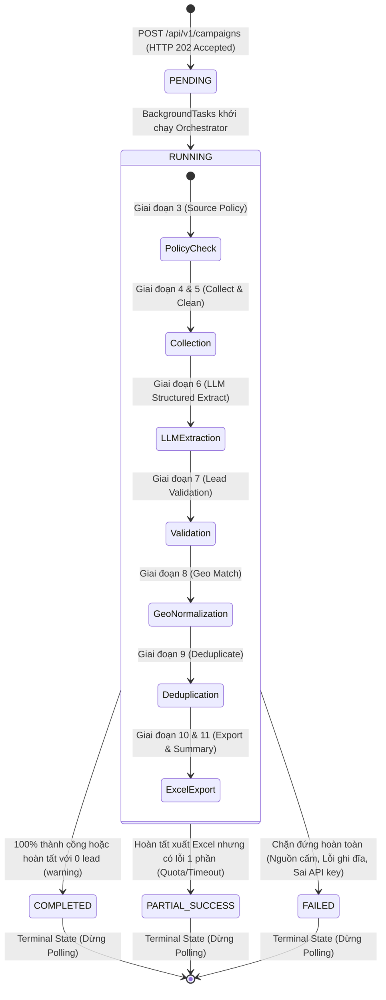

# ĐẶC TẢ HỢP ĐỒNG API VÀ CHUẨN BÁO LỖI BACKEND (API CONTRACT & ERROR SPECIFICATION)
# AI RPA Lead Collector MVP

---

## 1. Mục tiêu và Phạm vi (Goals and Scope)

### 1.1 Mục tiêu Tài liệu
Tài liệu này xác lập **Hợp đồng Giao tiếp API (API Contract)** chính thức và **Chuẩn Báo lỗi Tập trung (Standardized Backend Error Reporting Specification)** giữa Backend (Python + FastAPI) và Frontend (React 18 + Vite + TypeScript + Tailwind CSS) cho dự án **AI RPA Lead Collector MVP**.

Mục tiêu kỹ thuật cốt lõi:
1. **Chuẩn hóa Hợp đồng Giao tiếp (Communication Contract):** Định nghĩa cấu trúc request/response, kiểu dữ liệu, các ràng buộc xác thực Pydantic v2 và mã trạng thái HTTP (HTTP Status Codes) cho toàn bộ các endpoint của hệ thống.
2. **Đặc tả Cơ chế Báo lỗi Nhất quán (Consistent Error Reporting):** Thiết lập định dạng vỏ bọc phản hồi lỗi chuẩn (`StandardErrorResponse Envelope`) cho 100% các lỗi phát sinh từ Backend (kể cả lỗi do framework FastAPI sinh ra), ngăn ngừa tình trạng rò rỉ stack trace hoặc trả về cấu trúc lỗi không đồng nhất gây gãy giao diện.
3. **Phân định Rạch ròi Hai Tầng Báo lỗi (Decoupled Error Layers):**
   * **Lỗi Đồng bộ Tầng HTTP API (Synchronous API Errors):** Xảy ra khi request không hợp lệ, không tìm thấy tài nguyên, hoặc vi phạm bảo mật. Trả về mã lỗi HTTP 4xx/5xx ngay lập tức kèm payload lỗi chi tiết.
   * **Lỗi Bất đồng bộ Tầng Pipeline (Asynchronous Pipeline Errors):** Xảy ra trong quá trình xử lý nền (`BackgroundTasks`). Được bắt giữ an toàn, ghi nhận vào ngữ cảnh `CampaignState.errors[]`, và phản hồi qua endpoint Polling trạng thái (`GET /api/v1/campaigns/{id}`) để hiển thị trực quan trên Web UI mà không làm sập server hay trả HTTP 500 sai lệch.
4. **Bảo mật và Trải nghiệm Người dùng (Security & UX):**
   * Tuyệt đối không để lộ đường dẫn file hệ thống, khóa bí mật API (API keys) hoặc stack trace kỹ thuật cho client.
   * Mọi thông điệp lỗi gửi về client đều có mô tả tiếng Việt thân thiện, rõ ràng, giúp người dùng biết chính xác nguyên nhân và hành động khắc phục.

### 1.2 Phạm vi Ứng dụng
* **Trong phạm vi:**
  * Ứng dụng cục bộ (Local PoC/Demo) phục vụ giai đoạn phát hành ban đầu (Phase 1: Foundation & Core Modular Monolith).
  * Tích hợp giữa FastAPI Backend và Frontend Single-Page Application (React 18 + Vite + TypeScript + Tailwind CSS).
  * 06 Endpoint RESTful phục vụ trọn vẹn vòng đời chiến dịch: Khởi tạo, Thăm dò trạng thái, Xem trước dữ liệu lead, Tải file Excel, Lấy danh mục địa lý và Kiểm tra sức khỏe.
  * Hỗ trợ 2 ngành mục tiêu ban đầu: **Giáo dục (Education)** và **Sản xuất (Manufacturing)**.
  * Hỗ trợ phạm vi địa lý: **Toàn quốc (`NATIONWIDE`)** hoặc **Tỉnh/Thành cụ thể (`PROVINCE`)**, bắt buộc hỗ trợ và kiểm chứng **Thành phố Đà Nẵng**.
  * Hỗ trợ 2 chế độ thực thi: **`FIXTURE` (Mặc định)** và **`LIVE` (Chỉ áp dụng với nguồn được phê duyệt chính thức)**.
* **Ngoài phạm vi (Out of Scope):**
  * Các giao thức Streaming thời gian thực phức tạp (WebSocket, Server-Sent Events). Hệ thống thống nhất dùng cơ chế **Polling định kỳ (1.5s – 2.0s)**.
  * Hệ thống xác thực/phân quyền người dùng phức tạp (OAuth2, JWT, Multi-tenant, RBAC).
  * Cơ sở dữ liệu quan hệ hoặc NoSQL phân tán (PostgreSQL, MySQL, Redis, MongoDB). Toàn bộ trạng thái lưu trong bộ nhớ RAM (`InMemoryCampaignStore`), tệp Excel lưu tại thư mục `exports/`.

---

## 2. Các Quyết định, Giả định và Giới hạn MVP (Decisions, Assumptions & MVP Boundaries)

### 2.1 Các Quyết định Kỹ thuật Đã Phê duyệt (Dẫn chiếu ADR)
Tài liệu này kế thừa và tuân thủ tuyệt đối các Quyết định Kiến trúc (Architectural Decision Records) từ [`docs/architecture.md`](architecture.md):
* **ADR-01: Modular Monolith với Python + FastAPI:** Đóng gói toàn bộ chức năng trong một ứng dụng duy nhất, giao tiếp REST/JSON.
* **ADR-02: Lưu trữ Bộ nhớ Tạm thời (`InMemoryCampaignStore`) và Tệp Cục bộ:** Quản lý trạng thái chiến dịch trong RAM; tệp kết quả xuất trực tiếp ra `exports/`.
* **ADR-03: Frontend React 18 + Vite + TypeScript + Tailwind CSS:** Xây dựng giao diện SPA hiện đại, phân loại component rõ ràng, giao tiếp API qua custom hook và polling.
* **ADR-04: Xử lý Bất đồng bộ với `FastAPI BackgroundTasks`:** Khởi chạy tiến trình pipeline trong nền của cùng tiến trình server, không dùng worker Celery hay Redis.
* **ADR-05: Độc lập LLM Provider Adapter:** Tách biệt module gọi mô hình AI; sử dụng chế độ JSON Schema Mode bắt buộc.
* **ADR-06: Tham chiếu Địa lý Có Phiên bản:** Không hard-code danh sách 63 tỉnh/thành cũ; nạp động từ bộ dữ liệu tham chiếu có phiên bản, bao gồm Đà Nẵng.
* **ADR-07: Chính sách Nguồn Dữ liệu và 2 Chế độ Chạy Nghiêm ngặt:** Chế độ mặc định là `FIXTURE`. Nguồn `LIVE` chỉ chạy khi được phê duyệt bằng văn bản. Tuyệt đối không âm thầm chuyển đổi (silent fallback) từ LIVE sang FIXTURE khi gặp lỗi.
* **ADR-08: Chuẩn hóa 11 Trường Nghiệp vụ Canonical & 12 Cột Excel:** Tuân thủ từ điển dữ liệu tại [`docs/data-dictionary.md`](data-dictionary.md).

### 2.2 Các Giả định Kỹ thuật Cốt lõi
1. **Môi trường Vận hành Đơn Người dùng:** Backend chạy tại `http://localhost:8000`, Frontend chạy tại `http://localhost:5173`. Không có xung đột truy cập đồng thời từ nhiều người dùng độc lập.
2. **Vòng đời Bộ nhớ RAM:** Khi máy chủ FastAPI khởi động lại (restart), toàn bộ dữ liệu chiến dịch trong `InMemoryCampaignStore` sẽ bị xóa sạch. Các tệp Excel đã xuất thành công trong thư mục `exports/` vẫn được bảo toàn trên đĩa cứng.
3. **Chính sách Nguồn LIVE Giai đoạn đầu (Phase 1):** Chưa có nguồn dữ liệu trực tiếp (LIVE) nào được phê duyệt chính thức theo [`docs/source-research.md`](source-research.md) cho Phase 1. Mọi lệnh chạy LIVE sẽ bị từ chối chính sách (trả lỗi `ERR_SRC_UNAPPROVED`), trừ khi cấu hình cho phép hoặc có phê duyệt mới.

### 2.3 Ranh giới và Giới hạn Bảo mật MVP
* **Phòng thủ Thoát Thư mục (Path Traversal Defense):** Endpoint tải file Excel tuyệt đối không nhận đường dẫn tệp tùy ý từ client; chỉ nhận `campaign_id` và xác thực đường dẫn lưu trữ bằng `Path.resolve().is_relative_to()`.
* **Che giấu Thông tin Kỹ thuật (Information Hiding):** Không bao giờ đưa API Key, token, mật khẩu, đường dẫn thư mục nội bộ máy chủ, hoặc stack trace Python vào payload phản hồi (kể cả trong phản hồi lỗi).
* **Sanitize Dữ liệu Nguồn:** Dữ liệu text thô thu thập từ web hoặc LLM phải được lọc thẻ HTML (`strip_tags`) và cắt ngắn an toàn trước khi hiển thị trên UI hoặc ghi vào log lỗi, tránh tấn công XSS hoặc làm tràn giao diện.
* **Giới hạn Cú pháp Liên hệ:** Xác thực số điện thoại và email bằng Regex chỉ đảm bảo tính hợp lệ về mặt cấu trúc cú pháp, không khẳng định số điện thoại hoặc hộp thư có người trực thực tế.

---

## 3. Quy ước Chung của API (API Conventions & Standards)

### 3.1 Định dạng và Giao thức
* **Giao thức:** HTTP/1.1 RESTful.
* **Content-Type Mặc định:** `application/json; charset=utf-8` cho toàn bộ các endpoint dữ liệu.
* **Content-Type Tải File:** `application/vnd.openxmlformats-officedocument.spreadsheetml.sheet` cho endpoint tải file Excel.
* **Bảng mã Ký tự:** 100% UTF-8 toàn hệ thống, hỗ trợ tiếng Việt có dấu đầy đủ và chính xác.

### 3.2 Quy ước Đường dẫn và Định tuyến Phiên bản (Path & Versioning)
Nhằm đồng bộ hoàn toàn với kiến trúc hệ thống tại [`docs/architecture.md`](architecture.md) (module `backend/src/app/api/v1/`), toàn bộ các endpoint nghiệp vụ được tổ chức theo quy chuẩn phiên bản `/api/v1/`.

Đồng thời, để đảm bảo tính linh hoạt tối đa trong giai đoạn MVP và tương thích ngược với các ví dụ gọi trực tiếp, Backend FastAPI hỗ trợ cả hai tiền tố đường dẫn (Canonical Prefix `/api/v1/...` và Alias `/api/...` trỏ cùng router):

| STT | Endpoint Canonical (Khuyên dùng) | Endpoint Alias (Tương thích) | HTTP Method | Mục đích Nghiệp vụ |
| :---: | :--- | :--- | :---: | :--- |
| 1 | `/api/v1/campaigns` | `/api/campaigns` | `POST` | Khởi tạo chiến dịch thu thập mới |
| 2 | `/api/v1/campaigns/{campaign_id}` | `/api/campaigns/{campaign_id}` | `GET` | Thăm dò trạng thái, tiến độ và lỗi pipeline |
| 3 | `/api/v1/campaigns/{campaign_id}/leads` | `/api/campaigns/{campaign_id}/leads` | `GET` | Xem trước danh sách dữ liệu lead đã thu thập |
| 4 | `/api/v1/campaigns/{campaign_id}/export` | `/api/campaigns/{campaign_id}/export` | `GET` | Tải về tệp bảng tính Microsoft Excel (`.xlsx`) |
| 5 | `/api/v1/provinces` | `/api/provinces` | `GET` | Lấy danh mục tỉnh/thành phố tham chiếu |
| 6 | `/api/v1/health` | `/api/health` | `GET` | Kiểm tra sức khỏe và tính sẵn sàng của hệ thống |

> [!NOTE]
> Trong toàn bộ phần còn lại của tài liệu này, tiền tố canonical `/api/v1/` được sử dụng làm chuẩn mực thiết kế chính thức.

### 3.3 Chuẩn Thời gian (Timestamp)
Mọi mốc thời gian trao đổi qua API bắt buộc phải tuân theo chuẩn **ISO 8601 UTC**, có ký tự `Z` ở cuối:
* Định dạng chuẩn: `YYYY-MM-DDTHH:mm:ss.sssZ` hoặc `YYYY-MM-DDTHH:mm:ssZ`.
* Ví dụ: `"2026-10-13T09:30:00.000Z"`.

### 3.4 Quy ước Giá trị Khuyết thiếu (Missing Values)
* Các trường tùy chọn (optional) nếu không có giá trị phải trả về `null` trong JSON.
* Tuyệt đối không trả về chuỗi `"null"`, `"undefined"`, `"None"` hay chuỗi rỗng có khoảng trắng `" "`.
* Phía Frontend React hiển thị giá trị khuyết thiếu dưới dạng ô trống hoặc ký tự gạch ngang nhẹ (`-`).

### 3.5 Bảng Ánh xạ Mã Trạng thái HTTP (HTTP Status Code Mapping)
| HTTP Status | Tên Chuẩn | Ý nghĩa trong AI RPA Lead Collector |
| :---: | :--- | :--- |
| **`200 OK`** | Success | Request đồng bộ thành công (GET trạng thái, leads, provinces, health, tải file). |
| **`202 Accepted`** | Accepted | Tiếp nhận tạo chiến dịch thành công; tiến trình được chuyển giao cho BackgroundTasks. |
| **`400 Bad Request`** | Bad Request | Yêu cầu không hợp lệ về mặt ngữ cảnh (ví dụ: tải file khi file chưa sẵn sàng `ERR_EXPORT_NOT_READY`). |
| **`403 Forbidden`** | Forbidden | Bị từ chối truy cập do vi phạm an toàn (Path Traversal `ERR_PATH_TRAVERSAL` hoặc nguồn cấm `ERR_SRC_UNAPPROVED`). |
| **`404 Not Found`** | Not Found | Không tìm thấy tài nguyên: phân biệt rõ `ERR_ROUTE_NOT_FOUND` (đường dẫn URL không tồn tại) và `ERR_CAMPAIGN_NOT_FOUND` (chiến dịch không tồn tại trong store). |
| **`409 Conflict`** | Conflict | *[Đề xuất đang chờ xác nhận]* Trạng thái tài nguyên xung đột khi yêu cầu tải file trước khi pipeline hoàn tất. |
| **`422 Unprocessable Entity`** | Validation Error | Dữ liệu đầu vào vi phạm schema Pydantic (`ERR_CFG_INVALID`). |
| **`500 Internal Server Error`** | Server Error | Lỗi hệ thống nội bộ chưa được bắt (Unhandled Exception), che giấu stack trace (`ERR_SYS_INTERNAL`). |

---

## 4. Schema Dùng Chung (Shared Schemas & Data Models)

### 4.1 Mô hình Thực thể Lead Nghiệp vụ Chuẩn (Canonical Lead Model)
Tuân thủ nghiêm ngặt [`docs/data-dictionary.md`](data-dictionary.md), mô hình dữ liệu lead nghiệp vụ chuẩn gồm đúng **11 trường dữ liệu canonical**:

| STT | Tên Trường Canonical | Kiểu Dữ liệu | Bắt buộc | Cho phép Null | Ràng buộc & Quy tắc Chuẩn hóa |
| :---: | :--- | :---: | :---: | :---: | :--- |
| 1 | `company_name` | `string` | **Có** | Không | Tên doanh nghiệp/cơ sở (2 – 200 ký tự). Bắt buộc phải có, không phải placeholder rác. |
| 2 | `industry` | `string` | **Có** | Không | Ngành mục tiêu: `"Education"` hoặc `"Manufacturing"`. |
| 3 | `sub_industry` | `string` | Không | **Có** | Phân ngành chi tiết (tối đa 100 ký tự), ví dụ: `"Trung tâm Ngoại ngữ"`, `"Gia công CNC"`. |
| 4 | `province` | `string` | Không | **Có** | Tên tỉnh/thành chuẩn hóa theo bộ tham chiếu địa lý. Không nhận diện được gán `null`. |
| 5 | `address` | `string` | Không | **Có** | Địa chỉ chi tiết (tối đa 300 ký tự). Cắt tỉa khoảng trắng, lọc HTML. |
| 6 | `website` | `string` | Không | **Có** | URL hợp lệ có scheme `http://` hoặc `https://`. Vi phạm gán `null`. |
| 7 | `public_email` | `string` | Không | **Có** | Email công khai chuẩn RFC 5322. Vi phạm gán `null`. |
| 8 | `public_phone` | `string` | Không | **Có** | Số điện thoại công khai chuẩn hóa 10-11 chữ số (chuỗi ký tự). Vi phạm gán `null`. |
| 9 | `description` | `string` | Không | **Có** | Tóm tắt ngành nghề/hoạt động chính (tối đa 500 ký tự). |
| 10 | `source_url` | `string` | **Có** | Không | URL nguồn thu thập dữ liệu phục vụ kiểm toán và truy vết gốc. |
| 11 | `collected_at` | `string` | **Có** | Không | Thời điểm bóc tách dữ liệu theo chuẩn ISO 8601 UTC. |

> [!IMPORTANT]
> **Ranh giới Schema Cốt lõi:**
> 1. **Chỉ mục hiển thị `STT` (Số thứ tự):** Là trường sinh tự động khi hiển thị bảng hoặc xuất file Excel (`1, 2, 3...`), **KHÔNG** phải là trường domain trong cơ sở dữ liệu.
> 2. **Các trường BỊ CẤM / KHÔNG TỒN TẠI trong MVP:** Tuyệt đối không thêm `tax_code` (Mã số thuế), `business_scale` (Quy mô), `contact_person` (Người liên hệ). Những trường này không có trong Data Dictionary của MVP.
> 3. **Tên trường liên hệ chuẩn:** Bắt buộc sử dụng `public_phone` và `public_email` thay vì tên viết tắt `phone` hay `email` để tránh mập mờ giữa thông tin doanh nghiệp công khai và thông tin cá nhân riêng tư.

### 4.2 Trạng thái Chất lượng Từng Bản ghi (Record Quality Status Enum)
Tách biệt hoàn toàn với trạng thái của toàn chiến dịch, chất lượng của từng lead được phân loại theo 4 trạng thái:
* **`VALID`**: Bản ghi đạt đầy đủ trường bắt buộc (`company_name`, `source_url`) và có ít nhất 01 kênh liên hệ công khai (`public_phone`, `public_email`, hoặc `website`).
* **`PARTIAL_MISSING`**: Bản ghi đạt trường bắt buộc, nhưng thiếu toàn bộ thông tin liên hệ hoặc thiếu một số trường mô tả phụ. Bản ghi vẫn được giữ lại để xuất Excel.
* **`REJECTED`**: Bản ghi bị hủy bỏ ngay tại tầng Validator do vi phạm trường bắt buộc (thiếu tên, tên dưới 2 ký tự, tên chứa từ khóa rác, hoặc thiếu source_url).
* **`DUPLICATE`**: Bản ghi bị phát hiện trùng lặp ở tầng Deduplicator (trùng website hoặc trùng tên + liên hệ). Thông tin bổ sung được gộp vào lead trước, bản sau bị loại bỏ.

### 4.3 Mô hình Số liệu Thống kê Chiến dịch (Campaign Metrics Model)
Nhằm đảm bảo tính chính xác và nhất quán toán học 100%, các trường trong đối tượng `metrics` được định nghĩa như sau:

| Tên Chỉ số (`metrics.*`) | Kiểu Dữ liệu | Tính chất | Định nghĩa & Mối quan hệ Toán học |
| :--- | :---: | :---: | :--- |
| `raw_records_scanned` | `integer` | Tích lũy | Tổng số trang web hoặc khối HTML thô được tải về từ collector engine. |
| `records_extracted` | `integer` | Tích lũy | Tổng số bản ghi thô được LLM bóc tách thành công từ các khối văn bản. |
| `valid_records` | `integer` | Tích lũy | Số bản ghi vượt qua kiểm thực và đạt trạng thái `VALID`. |
| `partial_missing_records` | `integer` | Tích lũy | Số bản ghi thiếu thông tin phụ nhưng đạt trạng thái `PARTIAL_MISSING`. |
| `rejected_records` | `integer` | Tích lũy | Số bản ghi bị loại bỏ do vi phạm quy tắc bắt buộc (`REJECTED`). |
| `duplicates_removed` | `integer` | Sau Dedupe | Số lượng bản ghi trùng lặp được phát hiện và xử lý ở Giai đoạn 9. |
| `final_unique_leads` | `integer` | Kết quả cuối | Số lượng lead độc bản cuối cùng được ghi vào file Excel. |

```text
Mối quan hệ Toán học Bắt buộc:
1. records_extracted = valid_records + partial_missing_records + rejected_records
2. final_unique_leads = (valid_records + partial_missing_records) - duplicates_removed
```

> [!NOTE]
> Khi chiến dịch hoàn tất hợp lệ nhưng không tìm thấy doanh nghiệp nào phù hợp (`final_unique_leads == 0`), chiến dịch được phân loại là **`COMPLETED`** kèm cờ cảnh báo `warning_zero_records: true`, **KHÔNG PHẢI** là trạng thái `FAILED`.

### 4.4 Mô hình Thông tin Lỗi Pipeline (Campaign Error Item Schema)
Mỗi phần tử trong mảng `errors[]` của chiến dịch mang cấu trúc chuẩn hóa:
```json
{
  "code": "ERR_SRC_TIMEOUT",
  "stage": "STAGE_COLLECTION",
  "message": "Kết nối tới nguồn dữ liệu bị quá hạn (Timeout).",
  "detail": "Trang web https://example.vn/page-2 phản hồi chậm vượt quá 15s. Đã bỏ qua an toàn.",
  "source_url": "https://example.vn/page-2",
  "timestamp": "2026-10-13T09:30:15.000Z",
  "recoverable": true
}
```

---

## 5. Campaign Lifecycle và Status Semantics (Vòng đời & Trạng thái Chiến dịch)

### 5.1 Các Trạng thái Vòng đời Chuẩn
Chiến dịch trải qua đúng **05 trạng thái vòng đời duy nhất**, đồng bộ 100% giữa API, Pipeline và Architecture:



1. **`PENDING`**: Request hợp lệ được tiếp nhận; mã `campaign_id` đã được sinh và lưu vào RAM. Tiến trình pipeline đang chờ lượt thực thi.
2. **`RUNNING`**: Pipeline đang tích cực chạy tuần tự qua 11 giai đoạn trong nền.
3. **`COMPLETED`**: Pipeline đã thực thi hoàn tất trọn vẹn và tạo xong tệp Excel (`export_file_ready = true`), hoặc chạy xong nhưng tìm thấy 0 bản ghi (`warning_zero_records = true`).
4. **`PARTIAL_SUCCESS`**: Pipeline hoàn tất và đã tạo thành công tệp Excel cho số lượng lead thu thập được (`export_file_ready = true`), tuy nhiên trong quá trình chạy đã xảy ra lỗi cục bộ ở một số trang web hoặc tài khoản AI cạn hạn mức giữa chừng.
5. **`FAILED`**: Chiến dịch bị dừng khẩn cấp và không thể tạo tệp Excel (`export_file_ready = false`). Thường do vi phạm chính sách nguồn dữ liệu, cấu hình sai API Key, hoặc đĩa cứng không cho phép ghi.

### 5.2 Bảng Điều kiện Chuyển trạng thái và Hành vi Polling

| Trạng thái Hiện tại | Trạng thái Kế tiếp | Điều kiện Kích hoạt | `export_file_ready` | Hành vi Frontend đối với Vòng lặp Polling |
| :---: | :---: | :--- | :---: | :--- |
| `PENDING` | `RUNNING` | BackgroundTask được worker asyncio kích hoạt. | `false` | **Tiếp tục Polling** mỗi 1.5s – 2.0s. |
| `RUNNING` | `COMPLETED` | Chạy hết Giai đoạn 11 không có lỗi nghiêm trọng. | `true` (hoặc `true` nếu 0 lead) | **DỪNG POLLING NGAY LẬP TỨC**. Mở nút tải Excel, hiển thị preview leads. |
| `RUNNING` | `PARTIAL_SUCCESS` | Xuất được file Excel nhưng mảng `errors[]` có chứa lỗi. | `true` | **DỪNG POLLING NGAY LẬP TỨC**. Mở nút tải Excel, hiển thị Banner cảnh báo vàng. |
| `RUNNING` | `FAILED` | Gặp lỗi chặn đứng không thể tạo file Excel. | `false` | **DỪNG POLLING NGAY LẬP TỨC**. Khóa nút tải Excel, hiển thị Banner báo lỗi đỏ. |

> [!IMPORTANT]
> **Quy tắc Dừng Polling:** Khi Frontend nhận được một trong 3 trạng thái Terminal (`COMPLETED`, `PARTIAL_SUCCESS`, `FAILED`) hoặc mã lỗi HTTP `404 Not Found`, vòng lặp polling **bắt buộc phải dừng ngay lập tức**. Tuyệt đối không tiếp tục gửi request làm hao tổn tài nguyên máy chủ.

### 5.3 Quy tắc Tính toán Tiến độ Phần trăm (`progress_percent`)
Tiến độ phần trăm được ánh xạ trực tiếp theo 11 giai đoạn thực tế của pipeline, đảm bảo sự tăng tiến mượt mà:
* `PENDING`: `0%`
* Giai đoạn 1 – 3 (Validate Request, Init State, Policy Check): `10%`
* Giai đoạn 4 – 5 (Collection & Cleaning Chunks): `30%`
* Giai đoạn 6 (LLM Structured Extraction): `40%` đến `65%` (tính theo tỷ lệ chunks đã gọi LLM thành công)
* Giai đoạn 7 (Lead Validation L1 & L2): `75%`
* Giai đoạn 8 (Geographic Normalization): `85%`
* Giai đoạn 9 (Deduplication L3): `90%`
* Giai đoạn 10 – 11 (Excel Workbook Generation & Finalize): `100%`
* Khi trạng thái là `COMPLETED` hoặc `PARTIAL_SUCCESS`: luôn là `100%`.
* Khi trạng thái là `FAILED`: giữ nguyên phần trăm tại thời điểm gặp lỗi chặn đứng.

---

## 6. Đặc tả Chi tiết Từng Endpoint (Detailed Endpoint Specifications)

---

### 6.1. Endpoint 1: Khởi tạo Chiến dịch Thu thập Mới

Tiếp nhận yêu cầu cấu hình chiến dịch, thực hiện kiểm thực cú pháp và chính sách đồng bộ, khởi tạo ngữ cảnh trong bộ nhớ và kích hoạt tiến trình xử lý nền.

* **URL Canonical:** `/api/v1/campaigns`
* **URL Alias:** `/api/campaigns`
* **HTTP Method:** `POST`
* **Content-Type:** `application/json`

#### 1. Request Body Schema (`CreateCampaignRequest`):
```json
{
  "campaign_name": "Thu thập Doanh nghiệp Giáo dục Đà Nẵng",
  "industry": "Education",
  "geographic_scope": "PROVINCE",
  "target_province": "Đà Nẵng",
  "max_records": 20,
  "execution_mode": "FIXTURE"
}
```

#### 2. Bảng Quy tắc Kiểm thực (Validation Rules):
| Tên Trường | Kiểu | Bắt buộc | Mặc định | Giới hạn & Quy tắc Kiểm thực |
| :--- | :---: | :---: | :---: | :--- |
| `campaign_name` | `string` | **Có** | — | Độ dài 3 – 100 ký tự. Không chứa ký tự điều khiển ASCII. Cắt tỉa khoảng trắng đầu cuối. |
| `industry` | `string` | **Có** | — | Chỉ chấp nhận: `"Education"` hoặc `"Manufacturing"`. Phân biệt chữ hoa/thường. |
| `geographic_scope`| `string` | **Có** | — | Chỉ chấp nhận: `"NATIONWIDE"` (Toàn quốc) hoặc `"PROVINCE"` (Theo tỉnh/thành). |
| `target_province` | `string` | Tùy biến | `null` | • Nếu `geographic_scope == "PROVINCE"`: Bắt buộc mã hoặc tên chuỗi không rỗng (ví dụ: mã `"48"` hoặc `"Đà Nẵng"`).<br>• Nếu `geographic_scope == "NATIONWIDE"`: Tự động chuẩn hóa về `null` (None). |
| `max_records` | `integer`| Không | `20` | Số nguyên trong khoảng từ `5` đến `50`. |
| `execution_mode` | `string` | Không | `"FIXTURE"` | Chỉ chấp nhận: `"FIXTURE"` hoặc `"LIVE"`. Hỗ trợ chuẩn hóa tự động cắt khoảng trắng và viết hoa (`strip().upper()`). |

#### 3. Quy tắc Kiểm tra Nguồn LIVE Đồng bộ (Synchronous Live Source Check):
Nếu client gửi `execution_mode: "LIVE"`, Backend tiến hành đối chiếu cấu hình nguồn đã duyệt ngay tại thời điểm tiếp nhận request:
* Nếu nguồn LIVE cho ngành tương ứng chưa được phê duyệt chính thức bằng văn bản (hiện tại cả 2 ngành đều chưa có nguồn LIVE được duyệt), Backend **từ chối ngay lập tức** bằng `HTTP 403 Forbidden` kèm mã lỗi `ERR_SRC_UNAPPROVED`.
* Tuyệt đối không tạo Background Task và không âm thầm chuyển đổi sang FIXTURE.

#### 4. Phản hồi Thành công (HTTP 202 Accepted):
Trả về mã định danh chiến dịch duy nhất để Frontend tiến hành Polling:
```json
{
  "success": true,
  "data": {
    "campaign_id": "cmp_20261013_093000_abc123",
    "campaign_name": "Thu thập Doanh nghiệp Giáo dục Đà Nẵng",
    "status": "PENDING",
    "execution_mode": "FIXTURE",
    "poll_interval_ms": 2000,
    "created_at": "2026-10-13T09:30:00.000Z",
    "message": "Chiến dịch đã được tiếp nhận hợp lệ và đưa vào hàng đợi xử lý nền."
  }
}
```

#### 5. Phản hồi Thất bại:
* **HTTP 422 Unprocessable Entity (`ERR_CFG_INVALID`):** Khi dữ liệu đầu vào vi phạm schema.
  ```json
  {
    "success": false,
    "error": {
      "code": "ERR_CFG_INVALID",
      "message": "Dữ liệu cấu hình chiến dịch không hợp lệ.",
      "detail": "Khi chọn phạm vi địa lý PROVINCE, trường target_province bắt buộc phải có giá trị.",
      "stage": "STAGE_REQUEST_VALIDATION",
      "timestamp": "2026-10-13T09:30:00.000Z",
      "path": "/api/v1/campaigns",
      "validation_errors": [
        {
          "field": "target_province",
          "message": "Trường này là bắt buộc khi geographic_scope là PROVINCE.",
          "input_value": null
        }
      ]
    }
  }
  ```
* **HTTP 403 Forbidden (`ERR_SRC_UNAPPROVED`):** Khi yêu cầu chế độ LIVE nhưng nguồn chưa được phê duyệt.
  ```json
  {
    "success": false,
    "error": {
      "code": "ERR_SRC_UNAPPROVED",
      "message": "Nguồn dữ liệu trực tiếp chưa được phê duyệt chính thức.",
      "detail": "Nguồn thu thập LIVE cho ngành Education chưa có văn bản phê duyệt từ TechLead (DEC-01). Vui lòng chọn execution_mode là FIXTURE.",
      "stage": "STAGE_REQUEST_VALIDATION",
      "timestamp": "2026-10-13T09:30:00.000Z",
      "path": "/api/v1/campaigns",
      "validation_errors": null
    }
  }
  ```

---

### 6.2. Endpoint 2: Thăm dò Trạng thái, Tiến độ & Báo lỗi Pipeline

Endpoint phục vụ cơ chế **Polling định kỳ (1.5s – 2.0s)** từ Web UI. Trả về toàn bộ vòng đời, phần trăm tiến độ, số liệu thống kê nhất quán và danh sách lỗi phát sinh trong tiến trình nền.

* **URL Canonical:** `/api/v1/campaigns/{campaign_id}`
* **URL Alias:** `/api/campaigns/{campaign_id}`
* **HTTP Method:** `GET`
* **Path Parameter:** `campaign_id` (chuỗi định danh chiến dịch, ví dụ: `cmp_20261013_093000_abc123`).

#### 1. Phản hồi Thành công khi Đang Chạy (HTTP 200 OK - RUNNING):
```json
{
  "success": true,
  "data": {
    "campaign_id": "cmp_20261013_093000_abc123",
    "campaign_name": "Thu thập Doanh nghiệp Giáo dục Đà Nẵng",
    "status": "RUNNING",
    "current_step": "STEP_LLM_EXTRACTION",
    "current_step_display": "Đang trích xuất cấu trúc dữ liệu doanh nghiệp bằng mô hình AI...",
    "progress_percent": 55,
    "execution_mode": "FIXTURE",
    "is_fixture_mode": true,
    "metrics": {
      "raw_records_scanned": 15,
      "records_extracted": 12,
      "valid_records": 10,
      "partial_missing_records": 1,
      "rejected_records": 1,
      "duplicates_removed": 0,
      "final_unique_leads": 0
    },
    "errors": [],
    "total_records": 0,
    "warning_zero_records": false,
    "export_file": null,
    "export_file_ready": false,
    "export_url": null,
    "created_at": "2026-10-13T09:30:00.000Z",
    "updated_at": "2026-10-13T09:30:02.000Z",
    "started_at": "2026-10-13T09:30:02.000Z",
    "completed_at": null
  }
}
```

#### 2. Phản hồi Thành công Hoàn tất Trọn vẹn (HTTP 200 OK - COMPLETED):
```json
{
  "success": true,
  "data": {
    "campaign_id": "cmp_20261013_093000_abc123",
    "campaign_name": "Thu thập Doanh nghiệp Giáo dục Đà Nẵng",
    "status": "COMPLETED",
    "current_step": "STEP_COMPLETED",
    "current_step_display": "Chiến dịch hoàn tất thành công. Tệp Excel đã sẵn sàng để tải về.",
    "progress_percent": 100,
    "execution_mode": "FIXTURE",
    "is_fixture_mode": true,
    "metrics": {
      "raw_records_scanned": 20,
      "records_extracted": 18,
      "valid_records": 14,
      "partial_missing_records": 2,
      "rejected_records": 2,
      "duplicates_removed": 1,
      "final_unique_leads": 15
    },
    "errors": [],
    "total_records": 15,
    "warning_zero_records": false,
    "export_file": "exports/cmp_20261013_093000_abc123.xlsx",
    "export_file_ready": true,
    "export_url": "/api/v1/campaigns/cmp_20261013_093000_abc123/export",
    "created_at": "2026-10-13T09:30:00.000Z",
    "updated_at": "2026-10-13T09:30:25.000Z",
    "started_at": "2026-10-13T09:30:02.000Z",
    "completed_at": "2026-10-13T09:30:25.000Z"
  }
}
```

#### 3. Phản hồi Thành công Hoàn tất nhưng Có Lỗi một phần (HTTP 200 OK - PARTIAL_SUCCESS):
Pipeline xuất được Excel cho 11 lead hợp lệ, nhưng trong quá trình cào web có 1 URL bị timeout và tài khoản AI cạn quota ở khối tin cuối cùng:
```json
{
  "success": true,
  "data": {
    "campaign_id": "cmp_20261013_093000_abc123",
    "campaign_name": "Thu thập Doanh nghiệp Giáo dục Đà Nẵng",
    "status": "PARTIAL_SUCCESS",
    "current_step": "STEP_EXPORT_COMPLETED",
    "current_step_display": "Đã xuất bảng tính Excel thành công (Có cảnh báo lỗi một phần).",
    "progress_percent": 100,
    "execution_mode": "LIVE",
    "is_fixture_mode": false,
    "metrics": {
      "raw_records_scanned": 16,
      "records_extracted": 13,
      "valid_records": 10,
      "partial_missing_records": 2,
      "rejected_records": 1,
      "duplicates_removed": 1,
      "final_unique_leads": 11
    },
    "errors": [
      {
        "code": "ERR_SRC_TIMEOUT",
        "stage": "STAGE_COLLECTION",
        "message": "Kết nối tới nguồn dữ liệu bị quá hạn (Timeout).",
        "detail": "Máy chủ nguồn phản hồi chậm vượt quá 15s tại trang https://example-edu.vn/page-3.html. Đã bỏ qua an toàn.",
        "source_url": "https://example-edu.vn/page-3.html",
        "timestamp": "2026-10-13T09:30:15.000Z",
        "recoverable": true
      },
      {
        "code": "ERR_LLM_QUOTA",
        "stage": "STAGE_LLM_EXTRACTION",
        "message": "Tài khoản AI cạn hạn mức token (Quota Exceeded).",
        "detail": "LLM API trả về mã HTTP 429. Hệ thống dừng gọi mô hình và bảo toàn 11 lead hợp lệ để xuất bảng tính.",
        "source_url": null,
        "timestamp": "2026-10-13T09:30:28.000Z",
        "recoverable": false
      }
    ],
    "warning_zero_records": false,
    "total_records": 11,
    "export_file": "exports/cmp_20261013_093000_abc123.xlsx",
    "export_file_ready": true,
    "export_url": "/api/v1/campaigns/cmp_20261013_093000_abc123/export",
    "created_at": "2026-10-13T09:30:00.000Z",
    "updated_at": "2026-10-13T09:30:35.000Z",
    "started_at": "2026-10-13T09:30:02.000Z",
    "completed_at": "2026-10-13T09:30:35.000Z"
  }
}
```

#### 4. Phản hồi khi Chiến dịch Thất bại Hoàn toàn (HTTP 200 OK - FAILED):
*Lưu ý quan trọng:* Request polling vẫn thành công về mặt giao thức HTTP (trả HTTP 200), nhưng đối tượng `data.status` mang giá trị `"FAILED"`:
```json
{
  "success": true,
  "data": {
    "campaign_id": "cmp_20261013_093000_abc123",
    "campaign_name": "Thu thập Doanh nghiệp Giáo dục Đà Nẵng",
    "status": "FAILED",
    "current_step": "STEP_POLICY_CHECK",
    "current_step_display": "Chiến dịch thất bại do vi phạm chính sách nguồn dữ liệu.",
    "progress_percent": 10,
    "execution_mode": "LIVE",
    "is_fixture_mode": false,
    "metrics": {
      "raw_records_scanned": 0,
      "records_extracted": 0,
      "valid_records": 0,
      "partial_missing_records": 0,
      "rejected_records": 0,
      "duplicates_removed": 0,
      "final_unique_leads": 0
    },
    "errors": [
      {
        "code": "ERR_SRC_UNAPPROVED",
        "stage": "STAGE_POLICY_CHECK",
        "message": "Nguồn thu thập trực tiếp chưa được cấp phép.",
        "detail": "Nguồn dữ liệu chưa có văn bản phê duyệt chính thức từ TechLead. Hệ thống từ chối cào trực tiếp.",
        "source_url": "https://unapproved-source.vn",
        "timestamp": "2026-10-13T09:30:04.000Z",
        "recoverable": false
      }
    ],
    "total_records": 0,
    "warning_zero_records": false,
    "export_file": null,
    "export_file_ready": false,
    "export_url": null,
    "created_at": "2026-10-13T09:30:00.000Z",
    "updated_at": "2026-10-13T09:30:05.000Z",
    "started_at": "2026-10-13T09:30:02.000Z",
    "completed_at": "2026-10-13T09:30:05.000Z"
  }
}
```

#### 5. Phản hồi Thất bại (Lỗi HTTP):
* **HTTP 404 Not Found (`ERR_CAMPAIGN_NOT_FOUND`):** Nếu `campaign_id` không tồn tại trong bộ nhớ RAM:
  ```json
  {
    "success": false,
    "error": {
      "code": "ERR_CAMPAIGN_NOT_FOUND",
      "message": "Không tìm thấy chiến dịch yêu cầu.",
      "detail": "Mã chiến dịch 'cmp_invalid_id' không tồn tại trong bộ nhớ RAM hoặc máy chủ vừa khởi động lại.",
      "stage": null,
      "timestamp": "2026-10-13T09:30:00.000Z",
      "path": "/api/v1/campaigns/cmp_invalid_id",
      "validation_errors": null
    }
  }
  ```

---

### 6.3. Endpoint 3: Xem trước Danh sách Lead Thu thập Được

Cung cấp danh sách các bản ghi lead thành phẩm để hiển thị bảng dữ liệu xem trước (Data Preview Table) trên Web UI trước hoặc sau khi tải file Excel.

* **URL Canonical:** `/api/v1/campaigns/{campaign_id}/leads`
* **URL Alias:** `/api/campaigns/{campaign_id}/leads`
* **HTTP Method:** `GET`
* **Path Parameter:** `campaign_id` (chuỗi định danh chiến dịch).
* **Query Parameters:**
  * `quality_filter` (tùy chọn, string): Lọc theo chất lượng bản ghi (`"VALID"`, `"PARTIAL_MISSING"`, hoặc `"ALL"`). Mặc định là `"ALL"`.
  * `limit` (tùy chọn, integer): Giới hạn số lượng bản ghi xem trước (từ `1` đến `50`, mặc định là `20`).
  * `offset` (tùy chọn, integer): Vị trí bắt đầu lấy bản ghi (mặc định là `0`).

#### 1. Phản hồi Thành công (HTTP 200 OK):
```json
{
  "success": true,
  "data": {
    "campaign_id": "cmp_20261013_093000_abc123",
    "total_leads": 2,
    "limit": 20,
    "offset": 0,
    "has_more": false,
    "leads": [
      {
        "stt": 1,
        "company_name": "Trung tâm Đào tạo Ngoại ngữ Quốc tế Đà Nẵng",
        "industry": "Education",
        "sub_industry": "Trung tâm Ngoại ngữ",
        "province": "Đà Nẵng",
        "address": "Số 123 Đường Lê Lợi, Phường Thạch Thang, Quận Hải Châu, Đà Nẵng",
        "website": "https://danang-languages.edu.vn",
        "public_email": "tuyensinh@danang-languages.edu.vn",
        "public_phone": "02363889988",
        "description": "Đào tạo các khóa học tiếng Anh giao tiếp và luyện thi chứng chỉ quốc tế.",
        "source_url": "https://trangvangvietnam.com/listings/12345/ngoai-ngu-da-nang.html",
        "collected_at": "2026-10-13T09:30:15.000Z",
        "quality_status": "VALID"
      },
      {
        "stt": 2,
        "company_name": "Cơ sở Đào tạo Kỹ năng Sáng Tạo",
        "industry": "Education",
        "sub_industry": null,
        "province": "Đà Nẵng",
        "address": "45 Lê Duẩn, Quận Hải Châu, Đà Nẵng",
        "website": null,
        "public_email": null,
        "public_phone": "0905123456",
        "description": null,
        "source_url": "https://trangvangvietnam.com/listings/12346/sang-tao.html",
        "collected_at": "2026-10-13T09:30:16.000Z",
        "quality_status": "PARTIAL_MISSING"
      }
    ]
  }
}
```

#### 2. Quy tắc Nghiệp vụ Nghiêm ngặt:
1. **Chỉ chứa 11 trường canonical:** Không bao giờ chứa các trường ngoài hợp đồng (`tax_code`, `business_scale`, `contact_person`).
2. **Trường `stt`:** Là chỉ mục tăng dần phục vụ hiển thị trên giao diện người dùng.
3. **Cách ly Dữ liệu:** Tuyệt đối không trả về bản ghi của chiến dịch khác.
4. **Trường hợp khuyết thiếu:** Trả về `null` nguyên bản, không trả về chuỗi `"null"`.

---

### 6.4. Endpoint 4: Tải File Bảng tính Microsoft Excel (`.xlsx`)

Endpoint cho phép người dùng tải tệp Microsoft Excel `.xlsx` chứa dữ liệu 2 worksheet (`Leads` và `Summary`) về máy tính cá nhân.

* **URL Canonical:** `/api/v1/campaigns/{campaign_id}/export`
* **URL Alias:** `/api/campaigns/{campaign_id}/export`
* **HTTP Method:** `GET`
* **Path Parameter:** `campaign_id` (chuỗi định danh chiến dịch).

#### 1. Headers Phản hồi Bắt buộc khi Thành công:
* **HTTP Status:** `200 OK`
* **Content-Type:** `application/vnd.openxmlformats-officedocument.spreadsheetml.sheet`
* **Content-Disposition:** `attachment; filename="leads_education_20261013_093035_cmp_20261013_093000_abc123.xlsx"`
* **Body:** Binary Stream của tệp `.xlsx`.

#### 2. Thuật toán Bảo vệ Chống Thoát Thư mục Tuyệt đối (Path Traversal Defense):
Để ngăn ngừa triệt để lỗ hổng an ninh mạng CWE-22:
1. Backend trích xuất đường dẫn file `export_file_path` đã được hệ thống lưu trong ngữ cảnh `CampaignState`.
2. Chuyển đổi đường dẫn thành đối tượng tuyệt đối đã chuẩn hóa bằng `pathlib.Path(export_file_path).resolve()`.
3. Kiểm tra tính bao hàm an toàn bằng `resolved_file.is_relative_to(exports_dir.resolve())`. Nếu phát hiện tệp nằm ngoài thư mục `exports/`, Backend lập tức ghi log cảnh báo bảo mật và trả về `HTTP 403 Forbidden` (`ERR_PATH_TRAVERSAL`).
4. Kiểm tra tệp thực sự tồn tại trên đĩa cứng và có phần mở rộng đúng đuôi `.xlsx`.

#### 3. Phản hồi Thất bại:
* **HTTP 400 Bad Request (`ERR_EXPORT_NOT_READY`):** Khi tệp Excel chưa sẵn sàng (`export_file_ready == false`):
  ```json
  {
    "success": false,
    "error": {
      "code": "ERR_EXPORT_NOT_READY",
      "message": "Tệp bảng tính Excel chưa sẵn sàng.",
      "detail": "Chiến dịch đang trong tiến trình xử lý hoặc đã gặp sự cố chặn đứng trước khi tạo file.",
      "stage": "STAGE_EXPORT",
      "timestamp": "2026-10-13T09:30:00.000Z",
      "path": "/api/v1/campaigns/cmp_abc123/export",
      "validation_errors": null
    }
  }
  ```
  *(Lưu ý: Mã HTTP 409 Conflict đang được đề xuất làm phương án thay thế trong tương lai, xem DEC-API-01).*
* **HTTP 403 Forbidden (`ERR_PATH_TRAVERSAL`):** Khi phát hiện vi phạm an toàn đường dẫn.
* **HTTP 404 Not Found (`ERR_EXPORT_FILE_MISSING`):** Khi trạng thái ghi nhận có file nhưng tệp vật lý trên đĩa đã bị xóa.

---

### 6.5. Endpoint 5: Lấy Danh mục Tỉnh/Thành phố Tham chiếu

Cung cấp danh mục tỉnh/thành phố chuẩn hóa kèm siêu dữ liệu phiên bản phục vụ dropdown lựa chọn trên biểu mẫu Web UI.

* **URL Canonical:** `/api/v1/provinces`
* **URL Alias:** `/api/provinces`
* **HTTP Method:** `GET`

#### 1. Phản hồi Thành công (HTTP 200 OK):
```json
{
  "success": true,
  "data": {
    "version": "TBD (Nạp từ provinces_reference.json)",
    "source_reference": "TBD (Bộ dữ liệu tham chiếu địa lý có căn cứ)",
    "last_updated": "TBD",
    "total_count": 63,
    "default_selection": "Đà Nẵng",
    "provinces": [
      {
        "code": "48",
        "name": "Đà Nẵng",
        "region": "Miền Trung",
        "aliases": ["Da Nang", "TP Da Nang", "TP. Đà Nẵng"]
      },
      {
        "code": "01",
        "name": "Hà Nội",
        "region": "Miền Bắc",
        "aliases": ["Ha Noi", "HN", "TP. Hà Nội"]
      },
      {
        "code": "79",
        "name": "Hồ Chí Minh",
        "region": "Miền Nam",
        "aliases": ["Ho Chi Minh", "TPHCM", "TP. Hồ Chí Minh", "Sài Gòn"]
      }
    ]
  }
}
```

#### 2. Các Ràng buộc Nghiệp vụ Cốt lõi:
1. **Không Hard-code Tĩnh:** Backend nạp dữ liệu trực tiếp từ tệp `data/provinces_reference.json`. Nếu tệp chưa được cấu hình phiên bản chính thức, các trường metadata trả về trạng thái `TBD` thay vì tự ý bịa số liệu.
2. **Xác minh Thành phố Đà Nẵng:** Đà Nẵng bắt buộc phải có mặt trong danh sách tham chiếu để đáp ứng yêu cầu PoC/Demo của dự án.
3. **Phân biệt Rạch ròi Dữ liệu:** Dữ liệu danh mục này phục vụ bộ lọc tìm kiếm; tuyệt đối không dùng để ghi đè làm biến dạng địa chỉ nguyên bản do doanh nghiệp công bố trên website.

---

### 6.6. Endpoint 6: Kiểm tra Sức khỏe Hệ thống (Health Check)

Endpoint giám sát trạng thái hoạt động cục bộ của Backend API, phục vụ kiểm thử tự động, liveness probe và xác minh trước buổi demo.

* **URL Canonical:** `/api/v1/health`
* **URL Alias:** `/api/health`
* **HTTP Method:** `GET`

#### 1. Phản hồi Thành công (HTTP 200 OK):
```json
{
  "success": true,
  "data": {
    "status": "HEALTHY",
    "service": "ai-rpa-lead-collector-backend",
    "version": "1.0.0",
    "environment": "local_mvp",
    "uptime_seconds": 1245,
    "active_campaigns_in_ram": 1,
    "exports_directory_accessible": true,
    "timestamp": "2026-10-13T09:30:00.000Z"
  }
}
```

#### 2. Ranh giới Bảo mật:
* Không kiểm tra các dependency ngoài phạm vi (như Database server hay Redis).
* Tuyệt đối không trả về API Key LLM, chuỗi cấu hình nhạy cảm, hay đường dẫn thư mục tuyệt đối trên máy tính developer.

---

## 7. Chuẩn Vỏ Bọc Lỗi API (Standard Error Response Envelope)

### 7.1 Cấu trúc Vỏ bọc Lỗi Chuẩn (`StandardErrorResponse`)
Mọi phản hồi lỗi từ Backend (khi mã trạng thái HTTP >= 400) **bắt buộc** phải tuân thủ cấu trúc JSON duy nhất dưới đây:

```json
{
  "success": false,
  "error": {
    "code": "ERR_CFG_INVALID",
    "message": "Cấu hình chiến dịch không hợp lệ.",
    "detail": "Khi chọn phạm vi địa lý PROVINCE, trường target_province bắt buộc phải có giá trị.",
    "stage": "STAGE_REQUEST_VALIDATION",
    "timestamp": "2026-10-13T09:30:00.000Z",
    "path": "/api/v1/campaigns",
    "validation_errors": null
  }
}
```

### 7.2 Bảng Đặc tả Các Trường trong `StandardErrorResponse`

| Tên Trường | Kiểu Dữ liệu | Bắt buộc | Mô tả & Ràng buộc |
| :--- | :---: | :---: | :--- |
| `success` | `boolean` | **Có** | Luôn luôn bằng `false` đối với mọi phản hồi lỗi. Giúp Frontend phân nhánh tức thì (`if (!data.success)`). |
| `error` | `object` | **Có** | Đối tượng chứa toàn bộ thông tin chi tiết về lỗi phát sinh. |
| `error.code` | `string` | **Có** | Mã lỗi định danh theo bảng mã lỗi chuẩn hệ thống (xem Mục 8), ví dụ: `ERR_CFG_INVALID`, `ERR_SRC_UNAPPROVED`, `ERR_EXPORT_NOT_READY`. |
| `error.message` | `string` | **Có** | Thông điệp lỗi tóm tắt ngắn gọn, viết bằng **tiếng Việt có dấu**, thân thiện để hiển thị trực tiếp lên Toast thông báo hoặc Modal cảnh báo. |
| `error.detail` | `string \| null`| **Có** | Giải thích chi tiết nguyên nhân và hướng dẫn khắc phục cụ thể cho người dùng cuối (đã được sanitize, không chứa thông tin nhạy cảm). |
| `error.stage` | `string \| null`| Tùy chọn | Tên giai đoạn pipeline phát sinh lỗi (ví dụ: `STAGE_COLLECTION`, `STAGE_LLM_EXTRACTION`). Gán `null` nếu lỗi xảy ra ngoài quy trình pipeline. |
| `error.timestamp`| `string` | **Có** | Thời điểm phát sinh lỗi theo chuẩn ISO 8601 UTC. |
| `error.path` | `string` | **Có** | Đường dẫn API endpoint của request gây ra lỗi (ví dụ: `"/api/v1/campaigns"`). |
| `error.validation_errors` | `array \| null`| Tùy chọn | Danh sách chi tiết các lỗi trường dữ liệu khi xảy ra lỗi `HTTP 422 Unprocessable Entity`. Gán `null` cho các mã lỗi khác. |

### 7.3 Chuẩn Phản hồi Lỗi Kiểm thực Dữ liệu (Validation Error - HTTP 422)
Khi request vi phạm schema Pydantic, Custom Exception Handler của Backend sẽ chuyển đổi lỗi thành mảng `validation_errors` tiếng Việt rõ ràng:

```json
{
  "success": false,
  "error": {
    "code": "ERR_CFG_INVALID",
    "message": "Dữ liệu gửi lên không đúng định dạng yêu cầu.",
    "detail": "Vui lòng kiểm tra lại các trường thông tin trong biểu mẫu tạo chiến dịch.",
    "stage": "STAGE_REQUEST_VALIDATION",
    "timestamp": "2026-10-13T09:30:00.000Z",
    "path": "/api/v1/campaigns",
    "validation_errors": [
      {
        "field": "target_province",
        "message": "Trường này là bắt buộc khi chọn phạm vi PROVINCE.",
        "input_value": null
      },
      {
        "field": "max_records",
        "message": "Số lượng bản ghi phải nằm trong khoảng từ 5 đến 50.",
        "input_value": 100
      }
    ]
  }
}
```

*Quy tắc An toàn đối với `input_value`:* Giá trị `input_value` được giới hạn độ dài tối đa 50 ký tự và loại bỏ ký tự điều khiển để tránh tấn công phản xạ hoặc tràn bộ nhớ đệm client.

### 7.4 Xử lý Lỗi Hệ thống Chưa Bắt (HTTP 500) và Che giấu Stack Trace
Khi phát sinh lỗi ngoại lệ Python chưa lường trước (`Exception`):
* Backend ghi lại stack trace đầy đủ vào logger nội bộ máy chủ (`logger.exception`).
* Phản hồi trả về client che giấu 100% chi tiết kỹ thuật, chỉ trả về mã chuẩn:
```json
{
  "success": false,
  "error": {
    "code": "ERR_SYS_INTERNAL",
    "message": "Đã xảy ra sự cố nội bộ trên máy chủ.",
    "detail": "Hệ thống gặp lỗi không mong muốn. Chi tiết đã được ghi nhận trong file log máy chủ.",
    "stage": null,
    "timestamp": "2026-10-13T09:30:00.000Z",
    "path": "/api/v1/campaigns",
    "validation_errors": null
  }
}
```

### 7.5 Xử lý Lỗi HTTP 404 / 405 do Framework Sinh ra
Khi client gọi sai URL hoặc sai HTTP method, middleware của Backend tự động đóng gói lỗi theo cấu trúc `StandardErrorResponse` (mã lỗi `ERR_CAMPAIGN_NOT_FOUND` hoặc `ERR_SYS_INTERNAL` tương ứng), bảo đảm giao diện Frontend không bao giờ nhận về payload lỗi dạng HTML hay format lạ.

---

## 8. Danh Mục Bảng Mã Lỗi Toàn Hệ Thống (Canonical Error Code Dictionary)

### 8.1 Kiểm kê Chính xác Mã Lỗi Hệ thống
Toàn bộ hệ thống AI RPA Lead Collector sở hữu chính xác **19 mã lỗi chuẩn**, được phân định rõ ràng giữa tầng API đồng bộ và tầng Pipeline bất đồng bộ:
* **Tầng 1 — Lỗi Đồng bộ Tầng HTTP API (05 mã):** `ERR_CFG_INVALID`, `ERR_CAMPAIGN_NOT_FOUND`, `ERR_EXPORT_NOT_READY`, `ERR_EXPORT_FILE_MISSING`, `ERR_PATH_TRAVERSAL`.
* **Tầng 2 — Lỗi Bất đồng bộ Tầng Pipeline (14 mã):** `ERR_SRC_UNAPPROVED`, `ERR_SRC_FIXTURE_MISSING`, `ERR_SRC_TIMEOUT`, `ERR_SRC_HTTP_RATE_LIMIT`, `ERR_SRC_HTTP_CLIENT_ERR`, `ERR_SRC_EMPTY`, `ERR_LLM_TIMEOUT`, `ERR_LLM_QUOTA`, `ERR_LLM_INVALID_OUTPUT`, `ERR_VAL_REQUIRED_MISSING`, `ERR_GEO_UNRESOLVED`, `ERR_DEDUP_DUPLICATE`, `ERR_EXP_FAILURE`, `ERR_SYS_INTERNAL`.

### 8.2 Bảng Tra cứu Chi tiết 19 Mã Lỗi Hệ thống

| Mã Lỗi (`code`) | HTTP Status Đồng bộ | Tầng Phát sinh | Phương thức Truyền tải | Thông điệp Mặc định (`message`) | Hướng dẫn Khắc phục (`detail`) | Retry Policy | Bảo toàn Lead? | Hành động Phù hợp của Frontend |
| :--- | :---: | :---: | :---: | :--- | :--- | :---: | :---: | :--- |
| **`ERR_CFG_INVALID`** | `422` | API Layer | Đồng bộ (Sync HTTP) | Cấu hình chiến dịch không hợp lệ. | Kiểm tra lại các trường bắt buộc, giá trị `industry` hoặc `max_records`. | Không (0) | Không có lead | Bôi đỏ ô nhập liệu, hiển thị Toast cảnh báo form. |
| **`ERR_CAMPAIGN_NOT_FOUND`**| `404` | API Layer | Đồng bộ (Sync HTTP) | Không tìm thấy chiến dịch yêu cầu. | Mã `campaign_id` không tồn tại trong bộ nhớ RAM hoặc máy chủ vừa restart. | Không (0) | Không có lead | Ngừng polling ngay, hiển thị Modal thông báo hết phiên. |
| **`ERR_EXPORT_NOT_READY`** | `400` / `409` | Exporter | Đồng bộ (Sync HTTP) | Tệp Excel chưa sẵn sàng để tải về. | Chiến dịch đang trong tiến trình xử lý hoặc chưa xuất file thành công. | Không (0) | Đang xử lý | Giữ nút tải file ở trạng thái Disabled (vô hiệu hóa). |
| **`ERR_EXPORT_FILE_MISSING`**| `404` | Exporter | Đồng bộ (Sync HTTP) | Không tìm thấy tệp bảng tính trên đĩa. | Tệp vật lý trong thư mục `exports/` có thể đã bị xóa trên đĩa cứng. | Không (0) | Bị mất file | Hiển thị Toast đỏ: "Tệp đã bị xóa khỏi máy chủ". |
| **`ERR_PATH_TRAVERSAL`** | `403` | API Layer | Đồng bộ (Sync HTTP) | Yêu cầu truy cập tệp bị từ chối do vi phạm an toàn. | Phát hiện dấu hiệu thoát thư mục lưu trữ `exports/`. Hệ thống chặn truy cập. | Không (0) | Giữ nguyên | Hiển thị cảnh báo bảo mật màu đỏ đậm. |
| **`ERR_SRC_UNAPPROVED`** | `403` / Polling | Source Policy | Đồng bộ hoặc Polling | Nguồn dữ liệu chưa được phê duyệt chính thức. | Nguồn thu thập trực tiếp chưa có văn bản duyệt. Vui lòng chuyển sang Fixture Mode. | Không (0) | Không có lead | Nếu tạo form: Toast đỏ. Nếu Polling: Banner đỏ `FAILED`. |
| **`ERR_SRC_FIXTURE_MISSING`**| Polling | Collector | Polling `errors[]` | Thiếu tệp dữ liệu mẫu tĩnh (Fixture). | Tệp HTML mô phỏng không tồn tại trong thư mục `tests/fixtures/`. | Không (0) | Không có lead | Banner đỏ `FAILED`, báo lập trình viên kiểm tra fixture. |
| **`ERR_SRC_TIMEOUT`** | Polling | Collector | Polling `errors[]` | Kết nối tới nguồn dữ liệu bị quá hạn (Timeout). | Máy chủ nguồn phản hồi chậm vượt quá 15s. Trang này đã được bỏ qua an toàn. | 1 lần (sau 3s)| **Có** | Banner vàng `PARTIAL_SUCCESS`, cho phép tải file. |
| **`ERR_SRC_HTTP_RATE_LIMIT`**| Polling | Collector | Polling `errors[]` | Bị giới hạn tần suất truy cập từ máy chủ nguồn. | Máy chủ trả về mã HTTP 429/503. Hệ thống đã giãn cách truy cập và thử lại. | 2 lần (backoff)| **Có** | Banner vàng cảnh báo giãn cách cào dữ liệu. |
| **`ERR_SRC_HTTP_CLIENT_ERR`**| Polling | Collector | Polling `errors[]` | Không thể truy cập trang web nguồn. | Trang web trả về mã HTTP 403 hoặc 404. Hệ thống tự động bỏ qua trang này. | Không (0) | **Có** | Banner vàng `PARTIAL_SUCCESS`, cho phép tải file. |
| **`ERR_SRC_EMPTY`** | Polling | Collector | Polling `errors[]` | Không tìm thấy nội dung doanh nghiệp hợp lệ. | Trang web nguồn rỗng hoặc không chứa dữ liệu. Bỏ qua khối văn bản này. | Không (0) | **Có** | Cảnh báo nội bộ; nếu 0 lead thì cờ `warning_zero_records`.|
| **`ERR_LLM_TIMEOUT`** | Polling | Extractor | Polling `errors[]` | Quá hạn thời gian gọi mô hình AI (LLM Timeout). | LLM API không phản hồi trong 30s. Khối nội dung này đã được bỏ qua. | 1 lần | **Có** | Banner vàng `PARTIAL_SUCCESS`, bảo toàn lead đã lấy. |
| **`ERR_LLM_QUOTA`** | Polling | Extractor | Polling `errors[]` | Hết hạn mức gọi mô hình AI (LLM Quota Exceeded). | Tài khoản AI cạn hạn mức token. Hệ thống dừng bóc tách nhưng bảo toàn kết quả. | Không (0) | **Có** | Banner vàng cảnh báo hết Quota, kích hoạt nút tải Excel.|
| **`ERR_LLM_INVALID_OUTPUT`**| Polling | Extractor | Polling `errors[]` | Kết quả từ mô hình AI không đúng định dạng JSON. | Mô hình trả về văn bản không phân tích được cú pháp. Đã thử lại với prompt strict. | 1 lần (prompt) | **Có** | Ghi log cảnh báo; bỏ qua bản ghi lỗi cú pháp. |
| **`ERR_VAL_REQUIRED_MISSING`**| Polling | Validator | Polling `errors[]` | Bản ghi thiếu thông tin bắt buộc tối thiểu. | Thiếu `company_name` hoặc `source_url`. Bản ghi được đưa vào nhóm Rejected. | Không (0) | **Có** | Thể hiện qua metric `rejected_records`. |
| **`ERR_GEO_UNRESOLVED`** | Polling | Normalizer | Polling `errors[]` | Không nhận diện được tỉnh/thành phố hợp lệ. | Địa chỉ thô thiếu căn cứ; hệ thống gán `null` để bảo đảm tính trung thực. | Không (0) | **Có** | Bản ghi vẫn được giữ; hiển thị ô trống cột Province. |
| **`ERR_DEDUP_DUPLICATE`**| Polling | Deduplicator| Polling `errors[]` | Bản ghi trùng lặp thông tin doanh nghiệp. | Trùng website hoặc tên kèm số liên hệ. Đã gộp thông tin vào lead trước. | Không (0) | **Có** | Thể hiện qua metric `duplicates_removed` (bình thường).|
| **`ERR_EXP_FAILURE`** | Polling | Exporter | Polling `errors[]` | Lỗi ghi tệp bảng tính Excel ra đĩa cứng. | Không thể tạo tệp `.xlsx` do lỗi quyền đĩa hoặc tệp bị ứng dụng khác khóa. | 1 lần (recover)| Phục hồi | Banner đỏ `FAILED` (nếu không tạo được cả file phụ). |
| **`ERR_SYS_INTERNAL`** | `500` / Polling | Core System | Đồng bộ hoặc Polling | Lỗi hệ thống nội bộ không lường trước. | Phát sinh ngoại lệ Python chưa xử lý. Stack trace đã được ghi vào log server. | Không (0) | Tùy thời điểm | Toast đỏ hoặc Banner đỏ `FAILED`, báo kỹ thuật viên. |

### 8.3 Làm rõ Ngữ nghĩa Nghiệp vụ Đặc thù
1. **Xử lý Bản ghi Trùng lặp (`ERR_DEDUP_DUPLICATE`):** Khử trùng lặp là hành vi nghiệp vụ bình thường và tất yếu của pipeline. Khi phát hiện trùng lặp, hệ thống gộp dữ liệu và tăng biến đếm `duplicates_removed`, **KHÔNG** coi đây là lỗi hệ thống làm hỏng chiến dịch. Mã này chỉ ghi nhận ở mức log kiểm toán nếu cần thiết.
2. **Nguồn Rỗng (`ERR_SRC_EMPTY`):** Không làm sập chiến dịch. Nếu toàn bộ nguồn đều không có dữ liệu, chiến dịch kết thúc với `status = "COMPLETED"` và `warning_zero_records = true`.
3. **Phân định Nguồn LIVE Chưa Duyệt:**
   * **Từ chối Đồng bộ:** Xảy ra ngay khi gọi `POST /api/v1/campaigns` nếu backend kiểm tra chính sách trước khi tạo (trả HTTP 403, không sinh task).
   * **Từ chối Bất đồng bộ:** Nếu kiểm tra trong background pipeline (Giai đoạn 3), chiến dịch chuyển sang `status = "FAILED"`, ghi `ERR_SRC_UNAPPROVED` vào `errors[]`.

---

## 9. Retry, Timeout và Xử lý Lỗi Bất Đồng Bộ (Retry, Timeout & Asynchronous Errors)

### 9.1 Ma trận Thời gian Chờ (Timeout) và Thử lại (Retry)
Được chuẩn hóa đồng bộ với [`docs/pipeline.md`](pipeline.md):

| Khâu Xử lý | Timeout | Số lần Retry Tối đa | Cơ chế Thử lại (Retry Strategy) | Cách Xử lý khi Hết Lượt Thử lại |
| :--- | :---: | :---: | :--- | :--- |
| **HTTP Collector (Tải web nguồn)** | `15.0s` | `1 lần` | Chờ 3.0s rồi gửi lại request 1 lần duy nhất. | Ghi nhận `ERR_SRC_TIMEOUT`, bỏ qua trang, tiếp tục các trang còn lại. |
| **Rate Limit Nguồn (HTTP 429/503)** | — | `2 lần` | Exponential Backoff (2.0s → 4.0s); tôn trọng header `Retry-After` nếu có. | Ghi nhận `ERR_SRC_HTTP_RATE_LIMIT`, bỏ qua trang nguồn. |
| **HTTP Client Error (HTTP 403/404)** | — | `0 lần` | Không thử lại trang bị cấm hoặc không tồn tại. | Ghi nhận `ERR_SRC_HTTP_CLIENT_ERR`, bỏ qua trang ngay lập tức. |
| **Gọi Mô hình AI (LLM Extraction)** | `30.0s` | `1 lần` | Thử gọi lại 1 lần duy nhất với khối nội dung đó. | Ghi nhận `ERR_LLM_TIMEOUT`, bỏ qua chunk, tiếp tục chunk sau. |
| **LLM Cạn Hạn mức (HTTP 429 / Quota)** | — | `0 lần` | Không thử lại khi tài khoản hết tiền/token. | Ghi nhận `ERR_LLM_QUOTA`, dừng gọi LLM, bảo toàn lead để xuất file. |
| **LLM Lỗi Cú pháp JSON Output** | — | `1 lần` | Thử lại 1 lần với prompt ép định dạng JSON strict. | Bỏ qua chunk bị lỗi cú pháp, tăng biến đếm cảnh báo. |
| **Ghi file Excel ra Đĩa cứng** | — | `1 lần` | Thử lưu với tên tệp phục hồi: `leads_<ind>_<time>_recovered.xlsx`. | Ghi nhận `ERR_EXP_FAILURE`, đánh dấu chiến dịch `FAILED`. |

### 9.2 Nguyên tắc Bảo toàn Dữ liệu Đã Thu thập (Data Preservation Policy)
> [!IMPORTANT]
> Khi một lỗi không nghiêm trọng xảy ra ở các giai đoạn sau (ví dụ: máy chủ nguồn bị timeout ở trang thứ 3, hoặc LLM cạn quota ở khối tin cuối cùng), hệ thống **bắt buộc phải bảo toàn toàn bộ dữ liệu lead đã được xác thực hợp lệ trước đó**.
> 
> Pipeline sẽ chuyển sang Giai đoạn 10 để xuất tệp Excel hoàn chỉnh cho số lượng lead đã thu thập được, gắn nhãn trạng thái chiến dịch là **`PARTIAL_SUCCESS`** và kích hoạt nút tải file trên giao diện. Tuyệt đối không xóa bỏ dữ liệu hợp lệ đã có.

### 9.3 Ranh giới Thử lại từ Phía Giao diện Người dùng (Frontend Retry Boundary)
* Frontend **tuyệt đối không tự động retry ngầm** request tạo chiến dịch `POST /api/v1/campaigns` khi gặp lỗi mạng, nhằm tránh sinh ra nhiều chiến dịch rác chạy song song gây cạn kiệt tài nguyên RAM và LLM quota.
* Khi chiến dịch kết thúc ở trạng thái `FAILED` hoặc gặp lỗi mạng, giao diện hiển thị nút bấm rõ ràng: `"Thử lại với Chế độ Dữ liệu Mô phỏng (Fixture Mode)"`. Chỉ khi người dùng chủ động click, Frontend mới khởi tạo một request mới.

---

## 10. Polling và Tích hợp Frontend (Polling Strategy & Frontend Integration)

### 10.1 Chiến lược Polling Phía Frontend
Hệ thống sử dụng cơ chế Polling định kỳ đơn giản, tối ưu cho môi trường MVP cục bộ:
* **Chu kỳ Polling:** Định kỳ từ **`1.5s đến 2.0s`** (giá trị khuyến nghị `2000ms` được trả về trong trường `poll_interval_ms` của response 202).
* **Ngăn chặn Request Chồng lấn (Overlapping Protection):** Không sử dụng `setInterval` mù quáng. Bắt buộc sử dụng đệ quy `setTimeout` hoặc useEffect hook có cờ kiểm soát trạng thái chờ, bảo đảm request trước đã phản hồi (hoặc timeout) xong mới lên lịch cho request tiếp theo.
* **Điều kiện Dừng Polling:**
  1. `data.status` chuyển thành `COMPLETED`, `PARTIAL_SUCCESS`, hoặc `FAILED`.
  2. Nhận mã lỗi HTTP `404 Not Found` (chiến dịch không tồn tại).
  3. Lỗi mất kết nối mạng liên tiếp vượt quá 5 lần (khoảng 10 giây).

### 10.2 Kiến trúc Tích hợp Frontend (React 18 + Vite + TypeScript)

#### 1. Định nghĩa TypeScript Types Chuẩn (`src/types/api.ts`):
```typescript
export type CampaignStatus = 'PENDING' | 'RUNNING' | 'COMPLETED' | 'PARTIAL_SUCCESS' | 'FAILED';
export type QualityStatus = 'VALID' | 'PARTIAL_MISSING' | 'REJECTED' | 'DUPLICATE';

export interface CreateCampaignRequest {
  campaign_name: string;
  industry: 'Education' | 'Manufacturing';
  geographic_scope: 'NATIONWIDE' | 'PROVINCE';
  target_province?: string | null;
  max_records?: number;
  execution_mode?: 'FIXTURE' | 'LIVE';
}

export interface CampaignMetrics {
  raw_records_scanned: number;
  records_extracted: number;
  valid_records: number;
  partial_missing_records: number;
  rejected_records: number;
  duplicates_removed: number;
  final_unique_leads: number;
}

export interface CampaignErrorItem {
  code: string;
  stage: string | null;
  message: string;
  detail: string | null;
  source_url: string | null;
  timestamp: string;
  recoverable: boolean;
}

export interface CampaignStatusData {
  campaign_id: string;
  campaign_name: string;
  status: CampaignStatus;
  current_step: string;
  current_step_display: string;
  progress_percent: number;
  execution_mode: 'FIXTURE' | 'LIVE';
  is_fixture_mode: boolean;
  metrics: CampaignMetrics;
  errors: CampaignErrorItem[];
  warning_zero_records: boolean;
  export_file_ready: boolean;
  export_url: string | null;
  created_at: string;
  started_at: string | null;
  completed_at: string | null;
}

export interface StandardErrorPayload {
  code: string;
  message: string;
  detail: string | null;
  stage: string | null;
  timestamp: string;
  path: string;
  validation_errors: Array<{
    field: string;
    message: string;
    input_value?: unknown;
  }> | null;
}

export interface StandardErrorResponse {
  success: false;
  error: StandardErrorPayload;
}
```

#### 2. Service Gọi API An toàn (`src/services/apiClient.ts`):
```typescript
import { StandardErrorResponse } from '../types/api';

export async function fetchApi<T>(url: string, options?: RequestInit): Promise<T> {
  let response: Response;
  try {
    response = await fetch(url, options);
  } catch (networkError) {
    throw new Error('Không thể kết nối tới Backend (http://localhost:8000). Vui lòng kiểm tra server.');
  }

  // Kiểm tra Content-Type có phải JSON không
  const contentType = response.headers.get('content-type');
  if (!contentType || !contentType.includes('application/json')) {
    if (!response.ok) {
      throw new Error(`Máy chủ phản hồi mã lỗi HTTP ${response.status} không đúng định dạng JSON.`);
    }
    return (await response.blob()) as unknown as T;
  }

  const result = await response.json();

  if (!response.ok || !result.success) {
    const errorResponse = result as StandardErrorResponse;
    const error = new Error(errorResponse.error?.message || 'Yêu cầu API thất bại');
    (error as any).apiError = errorResponse.error;
    (error as any).status = response.status;
    throw error;
  }

  return result.data as T;
}
```

#### 3. Custom Hook Quản lý Polling An toàn (`src/hooks/useCampaignPolling.ts`):
```typescript
import { useState, useEffect, useRef, useCallback } from 'react';
import { CampaignStatusData } from '../types/api';
import { fetchApi } from '../services/apiClient';

export function useCampaignPolling(campaignId: string | null) {
  const [data, setData] = useState<CampaignStatusData | null>(null);
  const [error, setError] = useState<string | null>(null);
  const [isPolling, setIsPolling] = useState<boolean>(false);
  const timerRef = useRef<NodeJS.Timeout | null>(null);

  const poll = useCallback(async () => {
    if (!campaignId) return;

    try {
      const statusData = await fetchApi<CampaignStatusData>(`/api/v1/campaigns/${campaignId}`);
      setData(statusData);

      // Điều kiện dừng polling: trạng thái terminal
      if (['COMPLETED', 'PARTIAL_SUCCESS', 'FAILED'].includes(statusData.status)) {
        setIsPolling(false);
        return;
      }

      // Tiếp tục lên lịch polling cho lượt tiếp theo
      timerRef.current = setTimeout(poll, 2000);
    } catch (err: any) {
      setError(err.message || 'Lỗi khi kiểm tra tiến độ chiến dịch.');
      setIsPolling(false);
    }
  }, [campaignId]);

  useEffect(() => {
    if (campaignId) {
      setIsPolling(true);
      setError(null);
      poll();
    }

    return () => {
      if (timerRef.current) clearTimeout(timerRef.current);
    };
  }, [campaignId, poll]);

  return { data, error, isPolling };
}
```

### 10.3 Phân loại Hiển thị Giao diện Người dùng theo Trạng thái
1. **Trạng thái `COMPLETED`:**
   * Thanh tiến trình xanh lục hiển thị 100%.
   * Kích hoạt nút **"Tải File Excel (.xlsx)"** màu xanh.
   * Gọi `GET /api/v1/campaigns/{id}/leads` và hiển thị bảng dữ liệu Data Preview.
   * Nếu `warning_zero_records == true`: Hiển thị thông báo màu xanh dương: *"Chiến dịch hoàn tất nhưng không tìm thấy doanh nghiệp phù hợp trong nguồn dữ liệu."*
2. **Trạng thái `PARTIAL_SUCCESS`:**
   * Giữ nút **"Tải File Excel"** ở trạng thái **Khả dụng (Active/Enabled)**.
   * Hiển thị **Banner Cảnh báo Màu Vàng (Warning Banner)**:
     > ⚠️ **Hoàn tất có cảnh báo:** Đã xuất bảng tính thành công cho các lead thu thập được. Tuy nhiên, có sự cố gián đoạn đã xảy ra (ví dụ: máy chủ nguồn quá hạn hoặc tài khoản AI cạn quota). Bấm vào *"Chi tiết cảnh báo kỹ thuật"* để xem chi tiết.
   * Accordion mở rộng danh sách lỗi từ mảng `errors[]`.
3. **Trạng thái `FAILED`:**
   * Vô hiệu hóa nút **"Tải File Excel"** (`disabled`).
   * Hiển thị **Banner Báo Lỗi Màu Đỏ (Error Banner)**:
     > ❌ **Chiến dịch thất bại:** [Mô tả từ error.message]. Chi tiết: [error.detail].
   * Hiển thị nút bấm hành động: `"Thử lại với Chế độ Dữ liệu Mô phỏng (Fixture Mode)"`.

---

## 11. Quy Tắc Bảo Mật và Giới Hạn Cục Bộ (Security Rules & Local Boundaries)

1. **Chống Path Traversal Tuyệt đối (CWE-22):**
   * Endpoint tải Excel không chấp nhận bất kỳ đường dẫn tệp nào từ phía người dùng (`query param`, `header`, hoặc `body`).
   * Chỉ nhận `campaign_id`, tra cứu đường dẫn đã lưu trong bộ nhớ `InMemoryCampaignStore`, và xác thực bằng `pathlib.Path.resolve().is_relative_to(exports_dir)`.
2. **Không Rò rỉ Thông tin Nhạy cảm (No Secret Leakage):**
   * Không bao giờ đưa LLM API Key, token xác thực, hoặc đường dẫn thư mục máy tính cá nhân vào log client hoặc API response.
3. **Không Đoán mò Thông tin Liên hệ (No Speculative Contact Info):**
   * Dữ liệu bóc tách được kiểm thực xác định bằng Regex. Nếu cú pháp email hoặc số điện thoại không hợp lệ, lập tức gán `null`. Hệ thống không suy diễn hoặc tự sinh số điện thoại/email giả định.
4. **Cách ly Dữ liệu Chiến dịch (Campaign Data Isolation):**
   * Mọi thao tác xem trước hoặc tải file đều được định danh bằng `campaign_id` duy nhất, không để lộ dữ liệu của các chiến dịch khác.
5. **Chính sách Nguồn Nghiêm ngặt (No Silent Fallback):**
   * Tuyệt đối không tự động chuyển đổi ngầm từ LIVE sang FIXTURE khi LIVE gặp lỗi. Mọi thất bại của chế độ LIVE phải được thông báo trung thực để người dùng nắm rõ.
6. **Ranh giới Cục bộ (Localhost Boundary):**
   * Ứng dụng MVP được thiết kế để chạy cục bộ trên máy tính cá nhân (`localhost`), phục vụ 01 người dùng trong thời gian PoC. Không mở port ra mạng công cộng mà không có lớp bảo vệ mạng (reverse proxy / firewall).

---

## 12. Ví Dụ End-to-End Thực Tế (End-to-End Scenarios & JSON Payloads)

### Kịch bản 1: Thu thập Thành công Trọn vẹn ở Chế độ FIXTURE (Đà Nẵng, Education)
1. **Bước 1 — Frontend gửi yêu cầu:**
   * `POST /api/v1/campaigns`
   * Body:
     ```json
     {
       "campaign_name": "Demo Giáo dục Đà Nẵng",
       "industry": "Education",
       "geographic_scope": "PROVINCE",
       "target_province": "Đà Nẵng",
       "max_records": 15,
       "execution_mode": "FIXTURE"
     }
     ```
2. **Bước 2 — Backend tiếp nhận:**
   * Response: `HTTP 202 Accepted`
   * Data: `{"campaign_id": "cmp_20261013_100000_edu01", "status": "PENDING", "poll_interval_ms": 2000}`
3. **Bước 3 — Frontend Polling:**
   * `GET /api/v1/campaigns/cmp_20261013_100000_edu01`
   * Lần 1 (sau 2s): `HTTP 200 OK`, `status: "RUNNING"`, `progress_percent: 40`.
   * Lần 2 (sau 4s): `HTTP 200 OK`, `status: "COMPLETED"`, `progress_percent: 100`, `export_file_ready: true`.
   * Số liệu Metrics nhất quán:
     * `raw_records_scanned`: 20
     * `records_extracted`: 18
     * `valid_records`: 14
     * `partial_missing_records`: 2
     * `rejected_records`: 2
     * `duplicates_removed`: 1
     * `final_unique_leads`: 15
4. **Bước 4 — Frontend xem trước leads và tải Excel:**
   * `GET /api/v1/campaigns/cmp_20261013_100000_edu01/leads` → `HTTP 200 OK` (15 leads hiển thị trên bảng).
   * `GET /api/v1/campaigns/cmp_20261013_100000_edu01/export` → `HTTP 200 OK` (Tải tệp `.xlsx` về máy).

---

### Kịch bản 2: Hoàn tất có Lỗi Một phần ở Chế độ LIVE (Manufacturing)
1. **Khởi tạo:** `POST /api/v1/campaigns` với `execution_mode: "LIVE"`, `industry: "Manufacturing"`.
2. **Quá trình chạy:** Trong quá trình xử lý, 1 URL nguồn bị lỗi HTTP 404 và hạn mức LLM bị cạn ở chunk cuối.
3. **Kết quả Polling:**
   * Response: `HTTP 200 OK`
   * Status: `PARTIAL_SUCCESS`
   * `progress_percent`: 100
   * `export_file_ready`: true
   * `metrics`: `raw_records_scanned`: 12, `records_extracted`: 10, `valid_records`: 8, `partial_missing_records`: 1, `rejected_records`: 1, `duplicates_removed`: 1, `final_unique_leads`: 8.
   * `errors`: Chứa 2 lỗi (`ERR_SRC_HTTP_CLIENT_ERR` và `ERR_LLM_QUOTA`).
4. **Giao diện:** Hiển thị Banner cảnh báo vàng, mở nút tải file Excel cho 8 lead hợp lệ đã bóc tách.

---

### Kịch bản 3: Thất bại do Nguồn LIVE Chưa Duyệt (Chính sách Nguồn)
1. **Khởi tạo:** `POST /api/v1/campaigns` với `execution_mode: "LIVE"`.
2. **Xử lý:** Backend kiểm tra danh mục nguồn duyệt tại thời điểm request.
3. **Kết quả:** Trả về ngay lập tức `HTTP 403 Forbidden`:
   ```json
   {
     "success": false,
     "error": {
       "code": "ERR_SRC_UNAPPROVED",
       "message": "Nguồn dữ liệu trực tiếp chưa được phê duyệt chính thức.",
       "detail": "Nguồn Trang Vàng chưa có văn bản phê duyệt từ TechLead (DEC-01). Vui lòng chọn execution_mode là FIXTURE.",
       "stage": "STAGE_REQUEST_VALIDATION",
       "timestamp": "2026-10-13T10:05:00.000Z",
       "path": "/api/v1/campaigns",
       "validation_errors": null
     }
   }
   ```
4. **Giao diện:** Hiển thị Modal/Toast cảnh báo đỏ, không tạo chiến dịch nền.

---

### Kịch bản 4: Chiến dịch Hoàn tất Hợp lệ nhưng Tìm thấy 0 Bản ghi
1. **Khởi tạo:** Chạy với từ khóa hoặc phạm vi địa lý không có cơ sở nào trong fixture mẫu.
2. **Kết quả Polling:**
   * Response: `HTTP 200 OK`
   * Status: `COMPLETED`
   * `warning_zero_records`: true
   * `export_file_ready`: true
   * `metrics`: `raw_records_scanned`: 5, `records_extracted`: 0, `valid_records`: 0, `partial_missing_records`: 0, `rejected_records`: 0, `duplicates_removed`: 0, `final_unique_leads`: 0.
3. **Giao diện:** Hiển thị thông báo: *"Chiến dịch hoàn tất. Không tìm thấy doanh nghiệp phù hợp trong nguồn dữ liệu."* Tệp Excel xuất ra chứa 2 sheet với header chuẩn và 0 dòng dữ liệu.

---

### Kịch bản 5: Lỗi Kiểm thực Dữ liệu Đầu vào (HTTP 422)
* Frontend gửi thiếu `campaign_name` và nhập `max_records: 100`:
* Phản hồi: `HTTP 422 Unprocessable Entity`
```json
{
  "success": false,
  "error": {
    "code": "ERR_CFG_INVALID",
    "message": "Dữ liệu cấu hình chiến dịch không hợp lệ.",
    "detail": "Vui lòng kiểm tra lại các trường thông tin trong biểu mẫu tạo chiến dịch.",
    "stage": "STAGE_REQUEST_VALIDATION",
    "timestamp": "2026-10-13T10:10:00.000Z",
    "path": "/api/v1/campaigns",
    "validation_errors": [
      {
        "field": "campaign_name",
        "message": "Tên chiến dịch là bắt buộc và phải có ít nhất 3 ký tự.",
        "input_value": null
      },
      {
        "field": "max_records",
        "message": "Số lượng bản ghi tối đa không được vượt quá 50.",
        "input_value": 100
      }
    ]
  }
}
```

---

### Kịch bản 6: Lỗi Tải File khi Chưa Sẵn sàng (HTTP 400)
* Người dùng cố tình gọi tải file khi chiến dịch đang ở trạng thái `RUNNING`:
* Phản hồi: `HTTP 400 Bad Request`
```json
{
  "success": false,
  "error": {
    "code": "ERR_EXPORT_NOT_READY",
    "message": "Tệp bảng tính Excel chưa sẵn sàng.",
    "detail": "Chiến dịch 'cmp_20261013_100000_edu01' đang ở trạng thái 'RUNNING'. Vui lòng chờ đến khi hoàn tất.",
    "stage": "STAGE_EXPORT",
    "timestamp": "2026-10-13T10:10:05.000Z",
    "path": "/api/v1/campaigns/cmp_20261013_100000_edu01/export",
    "validation_errors": null
  }
}
```

---

## 13. Ma Trận Mức Độ Hoàn Thiện & Các Quyết Định Còn Mở (Readiness Matrix & Open Decisions)

### 13.1 Bảng Trạng thái Hiện thực Hợp đồng (Contract vs Implementation vs Testing)
Nhằm phản ánh trung thực thực tế kỹ thuật của dự án (mã nguồn backend và frontend đang trong giai đoạn scaffolding, thư mục `backend/` và `web/` mới chỉ chứa `.gitkeep`), bảng dưới đây phân định rõ mức độ hoàn thiện của từng khâu:

| Hạng mục Chức năng | Trạng thái Đặc tả Hợp đồng (Contract Spec) | Trạng thái Triển khai Code (Implementation) | Trạng thái Kiểm thử (Automated Tests) | Ghi chú Tiến độ Kỹ thuật |
| :--- | :---: | :---: | :---: | :--- |
| **Vỏ bọc Lỗi `StandardErrorResponse`** | **ĐÃ ĐẶC TẢ HOÀN TẤT** | **CHƯA TRIỂN KHAI** | **CHƯA KIỂM THỬ** | Đã sẵn sàng làm chuẩn cho Custom Exception Handlers tại `src/api/`. |
| **Endpoint 1: Tạo Chiến dịch (`POST /campaigns`)** | **ĐÃ ĐẶC TẢ HOÀN TẤT** | **CHƯA TRIỂN KHAI** | **CHƯA KIỂM THỬ** | Đã chốt schema `CreateCampaignRequest`, HTTP 202, 422, 403. |
| **Endpoint 2: Thăm dò Trạng thái (`GET /{id}`)** | **ĐÃ ĐẶC TẢ HOÀN TẤT** | **CHƯA TRIỂN KHAI** | **CHƯA KIỂM THỬ** | Đã chốt 5 trạng thái lifecycle, 7 chỉ số metrics, mảng `errors[]`. |
| **Endpoint 3: Xem trước Leads (`GET /{id}/leads`)** | **ĐÃ ĐẶC TẢ HOÀN TẤT** | **CHƯA TRIỂN KHAI** | **CHƯA KIỂM THỬ** | Đã chốt 11 trường canonical, phân tách `stt`, loại bỏ `tax_code`. |
| **Endpoint 4: Tải File Excel (`GET /{id}/export`)** | **ĐÃ ĐẶC TẢ HOÀN TẤT** | **CHƯA TRIỂN KHAI** | **CHƯA KIỂM THỬ** | Đã chốt cơ chế Path Traversal Defense và MIME type XLSX. |
| **Endpoint 5: Danh mục Tỉnh/Thành (`GET /provinces`)**| **ĐÃ ĐẶC TẢ HOÀN TẤT** | **CHƯA TRIỂN KHAI** | **CHƯA KIỂM THỬ** | Đã chốt schema nạp từ file tham chiếu, bắt buộc có Đà Nẵng. |
| **Endpoint 6: Kiểm tra Sức khỏe (`GET /health`)** | **ĐÃ ĐẶC TẢ HOÀN TẤT** | **CHƯA TRIỂN KHAI** | **CHƯA KIỂM THỬ** | Đã chốt schema liveness an toàn, không lộ secrets. |
| **Danh mục 19 Mã Lỗi Chuẩn Toàn Hệ Thống** | **ĐÃ ĐẶC TẢ HOÀN TẤT** | **CHƯA TRIỂN KHAI** | **CHƯA KIỂM THỬ** | Đã ánh xạ 1:1 với Pipeline Spec và API layer. |

---

### 13.2 Ma trận Các Quyết định Kỹ thuật Còn Mở (Open Decisions Matrix)

| Mã Quyết định | Nội dung Vấn đề Cần Xác nhận | Phương án Đề xuất trong Contract | Phương án Thay thế | Tác động Kiến trúc & API | Cấp Thẩm quyền Quyết định |
| :---: | :--- | :--- | :--- | :--- | :---: |
| **DEC-API-01** | **Mã HTTP Status khi Tải File Chưa Sẵn Sàng** | Sử dụng **`HTTP 400 Bad Request`** kèm mã `ERR_EXPORT_NOT_READY`. | Sử dụng **`HTTP 409 Conflict`** để thể hiện trạng thái xung đột vòng đời. | Cả 2 phương án đều trả về vỏ bọc `StandardErrorResponse`. Đề xuất giữ `400` cho đơn giản hoặc `409` chuẩn RESTful. | TechLead |
| **DEC-API-02** | **Thời điểm Từ chối Nguồn LIVE Chưa Duyệt** | **Từ chối Đồng bộ ngay tại `POST /api/v1/campaigns` (HTTP 403)** nếu nguồn chưa duyệt. | Tiếp nhận `HTTP 202` rồi chuyển trạng thái sang `FAILED` ở Giai đoạn 3 của pipeline. | Từ chối đồng bộ giúp tiết kiệm RAM và phản hồi tức thì cho người dùng trên form tạo chiến dịch. | TechLead |
| **DEC-API-03** | **Bộ Dữ liệu Tham chiếu Tỉnh/Thành Chính thức** | Sử dụng tệp `data/provinces_reference.json` có phiên bản, bao gồm Đà Nẵng; metadata đánh dấu `TBD`. | Tích hợp thư viện Python hành chính bên thứ ba. | Giữ nguyên kiến trúc file JSON cục bộ độc lập; cần nạp bộ dữ liệu thực tế trước khi kích hoạt bộ lọc địa phương. | Data Lead / TechLead |
| **DEC-API-04** | **Cơ chế Giới hạn Thời gian Polling khi Mất Mạng** | Tự động ngừng Polling sau **5 lần lỗi liên tiếp** (khoảng 10s) và hiển thị thông báo kết nối. | Polling vô hạn với khoảng cách tăng dần (Exponential Backoff). | Giới hạn 5 lần giúp bảo vệ pin và hiệu năng máy khách, ngăn treo tab trình duyệt. | Frontend Lead |
| **DEC-API-05** | **Ánh xạ Tên Trường Liên hệ trên Giao diện Web** | Frontend hiển thị nhãn cột là "Điện thoại công khai" và "Email công khai" ứng với `public_phone` và `public_email`. | Cho phép alias `phone` và `email` trên tầng DTO xem trước. | Giữ tên canonical `public_phone` và `public_email` để thống nhất 100% với Data Dictionary và tránh nhầm lẫn. | Product Owner |

---

*Tài liệu này là quy chuẩn giao tiếp và báo lỗi kỹ thuật bắt buộc cho toàn bộ quá trình phát triển mã nguồn backend FastAPI (`backend/src/app/api/`) và frontend React (`web/src/`) của dự án AI RPA Lead Collector MVP.*
