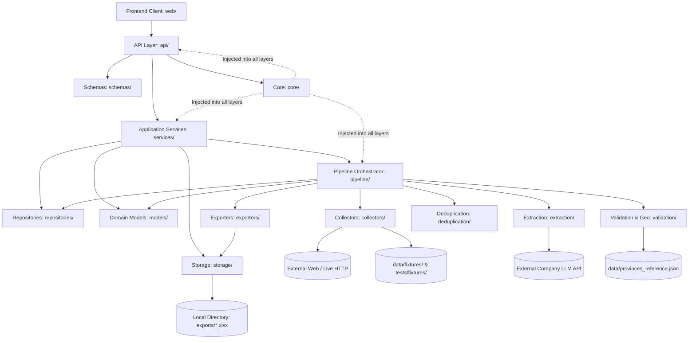
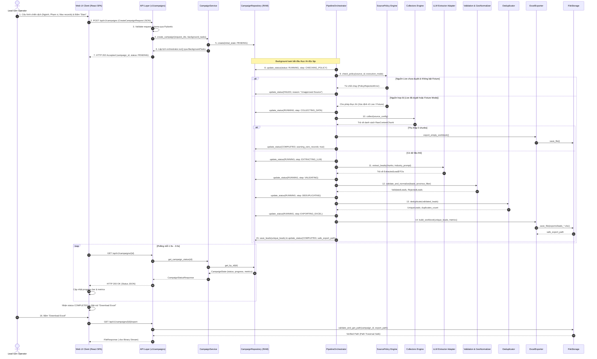
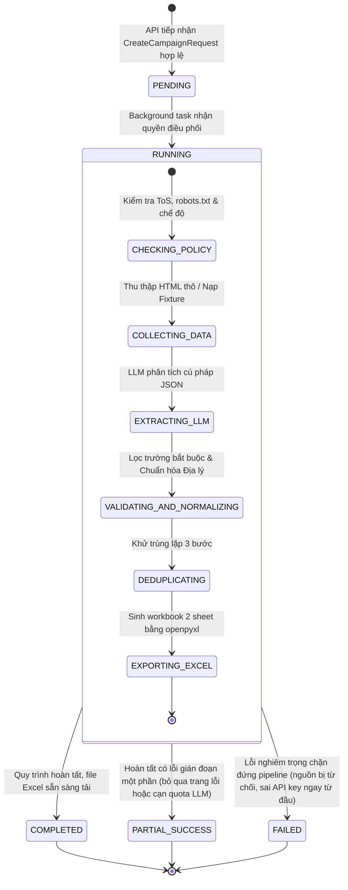

# TÀI LIỆU THIẾT KẾ KIẾN TRÚC HỆ THỐNG (SYSTEM ARCHITECTURE DOCUMENT)
# AI RPA Lead Collector MVP

---

## 1. Mục tiêu và Phạm vi Kiến trúc (Architecture Goals and Scope)

### 1.1 Mục tiêu Kiến trúc
Tài liệu này xác lập thiết kế kiến trúc kỹ thuật chi tiết cho dự án **AI RPA Lead Collector MVP**. Thiết kế được tối ưu hóa cho mục tiêu phát triển và chuyển giao trong **05 ngày làm việc (5 working days)** bởi **01 lập trình viên độc lập (Sole Developer)**, vận hành trên môi trường máy tính cá nhân (**Local PoC/Demo**).

Mục tiêu cốt lõi của kiến trúc:
1. **Kiến trúc Tối giản & Đúng hạn (Pragmatic & Delivery-Focused):** Loại bỏ toàn bộ sự phức tạp không cần thiết (không microservices, không database server, không hàng đợi Celery/Redis, không framework multi-agent phức tạp).
2. **Đường ống Xử lý Dùng chung (Single Shared Pipeline):** Hỗ trợ đồng thời 2 ngành mục tiêu **Giáo dục (Education)** và **Sản xuất (Manufacturing)** trên cùng một pipeline duy nhất; sự khác biệt giữa hai ngành được điều khiển hoàn toàn bằng tham số cấu hình (configuration-driven).
3. **Phân định Ranh giới Nghiêm ngặt (Strict Module Boundaries):** Phân định rạch ròi trách nhiệm giữa điều phối (Orchestration), thu thập (Collection), trích xuất ngữ nghĩa (LLM Extraction), xác thực/chuẩn hóa (Validation & Normalization), khử trùng lặp (Deduplication) và xuất bảng tính (Excel Export).
4. **Độ tin cậy & Truy vết Nguồn gốc 100% (Traceability & No Hallucination):** Kiến trúc bảo đảm mọi lead xuất ra đều truy vết được URL nguồn và thời gian thu thập; cấm tuyệt đối việc LLM tự sinh dữ liệu giả mạo hoặc tự điền thông tin khuyết thiếu.
5. **Minh bạch Chế độ Thực thi (Transparent Execution Modes):** Phân định rõ ràng giữa chế độ thu thập trực tiếp (**Live Mode**) và chế độ dữ liệu mẫu ngoại tuyến (**Fixture Mode**). Nếu nguồn live chưa có phê duyệt chính thức từ TechLead, hệ thống mặc định vận hành ở Fixture Mode. Tuyệt đối không đánh tráo dữ liệu mẫu thành dữ liệu cào thật.

### 1.2 Phạm vi Kiến trúc
* **Trong phạm vi kiến trúc MVP:**
  * Ứng dụng cục bộ (Local Application) với giao diện người dùng trực quan và tầng dịch vụ backend sử dụng **FastAPI**.
  * Quản lý vòng đời chiến dịch đơn lẻ (Single Campaign Lifecycle) trong bộ nhớ RAM (`InMemoryCampaignStore`).
  * Thu thập dữ liệu web theo chính sách từng nguồn cụ thể (Polite Crawling per source) và cơ chế nạp Fixture ngoại tuyến có kiểm chứng.
  * Tích hợp LLM API thông qua lớp trừu tượng nhà cung cấp (LLM Provider Abstraction) đọc từ biến môi trường `.env`.
  * Bộ chuẩn hóa dữ liệu xác định (Deterministic Normalization), chuẩn hóa địa lý theo danh mục có phiên bản (Versioned Geographic Normalizer) và khử trùng lặp xác định (Deterministic Deduplication).
  * Module xuất bảng tính Microsoft Excel (`.xlsx`) hai sheet (`Leads` và `Summary`) tuân thủ nghiêm ngặt [`docs/data-dictionary.md`](docs/data-dictionary.md).
  * Quản lý file xuất cục bộ an toàn (Path Traversal Protection) và ghi log kiểm toán kỹ thuật lọc thông tin nhạy cảm.
* **Ngoài phạm vi kiến trúc MVP:**
  * Triển khai Cloud (AWS/GCP/Azure), Docker Swarm/Kubernetes, CI/CD tự động hóa hạ tầng phức tạp.
  * Hệ thống xác thực người dùng (Authentication), phân quyền (RBAC), Multi-tenancy.
  * Cơ sở dữ liệu quan hệ (PostgreSQL/MySQL), NoSQL hay ORM/migration nặng nề.
  * Xử lý đa chiến dịch đồng thời (Concurrent Multi-campaign Execution) hoặc phân tán qua worker nodes.
  * Chấm điểm tiềm năng (AI Lead Scoring), dự đoán ý định mua hàng, và tự động gửi email (Automated Outreach).
  * Vượt tường lửa, bẻ khóa CAPTCHA, bypass Cloudflare Turnstile hay cào dữ liệu sau màn hình đăng nhập trả phí.

---

## 2. Bối cảnh Dự án và Các Ràng buộc (Project Context & Constraints)

### 2.1 Bối cảnh Triển khai
* **Nhân sự & Thời gian:** 01 developer chịu trách nhiệm độc lập từ khâu kiến trúc, lập trình backend, giao diện frontend đến kiểm thử E2E trong vòng 5 ngày làm việc.
* **Môi trường vận hành:** Ứng dụng chạy trên máy trạm cá nhân tiêu chuẩn của người dùng (Windows/macOS/Linux, tối thiểu 8GB RAM, không yêu cầu GPU).
* **Nguồn dữ liệu:** Nguồn dữ liệu trực tiếp **chưa có phê duyệt chính thức từ TechLead**. Các nguồn ứng viên khảo sát (Trang Vàng, VASI, Cổng dữ liệu mở) có độ phủ địa lý và điều khoản pháp lý khác nhau. Do đó, hệ thống mặc định vận hành ở **Fixture Mode** để đảm bảo khả năng chạy thử và demo độc lập hoàn toàn với Internet.
* **LLM API:** Công ty cấp thông số kết nối qua biến môi trường; kiến trúc phải xử lý an toàn các rủi ro mạng, timeout, rate limit (HTTP 429), cạn quota và sai lệch định dạng JSON từ model.

### 2.2 Các Ràng buộc Kỹ thuật Cốt lõi
| Ràng buộc | Chi tiết Kỹ thuật | Tác động Kiến trúc |
| :--- | :--- | :--- |
| **CON-01: Ngôn ngữ & Framework** | Backend sử dụng Python 3.10+ kết hợp FastAPI. | Tận dụng Pydantic v2 để xác thực schema tốc độ cao; hỗ trợ xử lý bất đồng bộ (`async/await`) cho I/O mạng. |
| **CON-02: Không Database Server** | Không cài đặt PostgreSQL, MySQL, Redis hay SQLite ORM nặng. | Trạng thái chiến dịch lưu trong `InMemoryCampaignStore`; kết quả xuất trực tiếp ra file Excel trong thư mục `exports/`. |
| **CON-03: Khóa Bí mật & Bảo mật** | Tuyệt đối không hard-code API Key, endpoint hoặc token trong code hay frontend. | Toàn bộ cấu hình nhạy cảm nạp qua file `.env`; frontend chỉ giao tiếp qua API proxy nội bộ. |
| **CON-04: Giới hạn Thu thập Từng Nguồn** | Tôn trọng `robots.txt`, ToS và áp dụng thời gian chờ (delay) riêng biệt theo từng nguồn đã duyệt. | Module Collector áp dụng chính sách cấu hình theo từng nguồn (per-source rate limiter). Tuyệt đối không áp đặt một mức delay cố định chung cho mọi website. |
| **CON-05: Ràng buộc Địa lý Có Phiên bản** | Hỗ trợ phạm vi Toàn quốc hoặc một tỉnh/thành cụ thể; bắt buộc hỗ trợ và kiểm thử Đà Nẵng. | Module Geographic Normalizer độc lập logic, chuẩn hóa theo bộ dữ liệu địa lý có phiên bản (`version`, `source_reference`, `last_updated`); khuyết thiếu hoặc không đủ căn cứ gán `null`, không đoán mò. |
| **CON-06: Ngân sách Thời gian** | 5 ngày triển khai: Ngày 1 (Kiến trúc & Setup) → Ngày 2 (Collector & Fixture) → Ngày 3 (LLM & Validator) → Ngày 4 (UI & Excel) → Ngày 5 (Test & Demo). | Thiết kế phẳng, ít tầng gián tiếp (low indirection), tái sử dụng thư viện chuẩn (`openpyxl`, `httpx`, `pydantic`). |

---

## 3. Các Quyết định Kiến trúc (Architectural Decision Records - ADR)

Tài liệu phân định minh bạch các quyết định theo 3 trạng thái chuẩn:

| Mã ADR | Chủ đề Quyết định | Trạng thái | Nội dung Quyết định & Cơ sở Kỹ thuật |
| :---: | :--- | :---: | :--- |
| **ADR-01** | **Shared Processing Pipeline** | `[CONFIRMED]` | Sử dụng **01 Shared Pipeline duy nhất** cho cả 2 ngành Education và Manufacturing. Sự khác biệt chỉ nằm ở tham số cấu hình (`industry`, prompt template ngữ cảnh, danh mục từ khóa). Tránh nhân đôi mã nguồn và giảm tải bảo trì trong 5 ngày. |
| **ADR-02** | **Backend Framework & Runtime** | `[CONFIRMED]` | Sử dụng **FastAPI** làm nền tảng backend chính. FastAPI cung cấp khả năng tự động sinh tài liệu Swagger UI, xác thực dữ liệu qua Pydantic v2 mạnh mẽ, và xử lý tác vụ nền (`BackgroundTasks`) dễ dàng trên môi trường local. |
| **ADR-03** | **Công nghệ Frontend Local** | `[CONFIRMED]` | Lựa chọn kiến trúc Single-Page Application (SPA) xây dựng bằng **React 18+ kết hợp TypeScript và Vite** (đặt tại thư mục `web/` hoặc `frontend/`). Quản lý state cục bộ bằng React hooks (`useState`, `useEffect`); styling bằng Tailwind CSS bundled tĩnh (không dùng CDN công cộng để đảm bảo chạy ngoại tuyến 100%); giao tiếp backend qua HTTP REST Polling định kỳ (1.5s – 2.0s). Phương án fallback HTML5/Vanilla JS tĩnh được lưu giữ làm tùy chọn dự phòng nếu cần chạy trực tiếp từ FastAPI mà không qua bước build npm. |
| **ADR-04** | **Vị trí của Geographic Normalizer** | `[PROPOSED]` | Tích hợp **Geographic Normalizer như một thành phần chuyên trách (Dedicated Sub-component)** nằm trong Module Validation (`backend/src/app/validation/geo_normalizer.py`), không tách thành Microservice riêng. Giữ nguyên ranh giới pure functions để kiểm thử độc lập mà không tăng chi phí điều phối. |
| **ADR-05** | **Cơ chế Quản lý Trạng thái Chiến dịch** | `[PROPOSED]` | Sử dụng **Trừu tượng hóa Repository (`CampaignRepository`)** với cài đặt mặc định **InMemoryCampaignRepository** kết hợp khóa luồng (`asyncio.Lock` / `threading.Lock`) phục vụ chế độ Single Campaign MVP. Trạng thái trong RAM sẽ mất khi backend khởi động lại, nhưng file Excel trong `exports/` được bảo toàn trên đĩa cứng; lớp trừu tượng cho phép chuyển đổi sang PostgreSQL mà không thay đổi pipeline. |
| **ADR-06** | **Chính sách Chế độ Thu thập (Live vs Fixture)** | `[PROPOSED]` | Phân biệt rõ hai chế độ `LIVE` và `FIXTURE`. Do chưa có nguồn live nào được duyệt chính thức, hệ thống **mặc định chạy Fixture Mode**. Tuyệt đối không tự ý thay thế dữ liệu live bị lỗi bằng fixture mà không ghi nhận; mọi dữ liệu fixture phải được gắn nhãn minh bạch trên UI, Log và Excel Summary. |
| **ADR-07** | **Trừu tượng hóa LLM Provider** | `[CONFIRMED]` | Đóng gói qua Interface `BaseLLMAdapter` (`backend/src/app/extraction/base.py`) và adapter cụ thể `CompanyLLMAdapter` (`backend/src/app/extraction/llm_adapter.py`). Cấu hình thông qua `.env` (`LLM_API_KEY`, `LLM_API_BASE_URL`, `LLM_MODEL_NAME`). Tuyệt đối không phụ thuộc vào framework đa tác tử nặng (CrewAI, LangGraph, LangChain). |
| **ADR-08** | **Chính sách Khử trùng lặp Xác định** | `[PROPOSED]` | Áp dụng chiến lược 3 bước: Ưu tiên Domain Website → Tên chuẩn hóa kết hợp SĐT/Địa chỉ → Nguyên tắc phủ định nghiêm ngặt (không gộp nếu chỉ trùng tên chung; thiếu dữ liệu không phải bằng chứng trùng lặp). |
| **ADR-09** | **Giải quyết Mâu thuẫn 11 Trường vs 12 Cột Excel** | `[CONFIRMED]` | Lược đồ dữ liệu nghiệp vụ chuẩn gồm 11 trường canonical. Cột thứ 1 trong sheet `Leads` của file Excel là cột `STT` (chỉ số số nguyên tăng dần tự sinh khi xuất file, bắt đầu từ 1), hoàn toàn không nằm trong domain model của lead. |
| **ADR-10** | **Bộ Dữ liệu Địa lý Có Phiên bản** | `[TBD — Open Decision]` | Loại bỏ đề xuất đóng băng cố định 63 tỉnh/thành. Thiết kế bộ dữ liệu địa lý có metadata (`version`, `source_reference`, `last_updated`). Hỗ trợ chọn Toàn quốc hoặc một tỉnh/thành (bao gồm Đà Nẵng). Ánh xạ tên địa phương lịch sử chỉ khi có quy tắc tin cậy; thiếu thông tin thì gán `null`. Nguồn tham chiếu chính thức và cách xử lý dữ liệu lịch sử chờ TechLead xác nhận. |
| **ADR-11** | **Phê duyệt Nguồn Dữ liệu Live Chính thức** | `[TBD — Open Decision]` | Chờ TechLead phê duyệt: Cho phép cào live Trang Vàng kèm điều kiện sử dụng, hay giữ nguyên chế độ chạy Fixture mẫu cho buổi demo ngày thứ 5. |
| **ADR-12** | **Giới hạn Bản ghi Chiến dịch (`max_records`)** | `[TBD — Open Decision]` | Đề xuất giá trị mặc định `max_records = 20` và trần tối đa 50 bản ghi cho mỗi lượt demo nhằm kiểm soát quota LLM và thời gian phản hồi. Chờ TechLead xác nhận hạn mức chính thức. |

---

## 4. Tổng quan Kiến trúc Hệ thống (System Architecture Overview)

Hệ thống được thiết kế theo phong cách kiến trúc **Modular Monolith (Đơn khối Mô-đun hóa)** tại `backend/`, kết hợp giao diện người dùng Single-Page Application (SPA) tại `web/`. Kiến trúc phân định ranh giới trách nhiệm mạch lạc, độc lập kiểm thử và sẵn sàng cho 01 lập trình viên triển khai trong 5 ngày làm việc mà không cần cài đặt các hạ tầng phân tán phức tạp:

1. **Tầng Trình diễn (Presentation Layer - `web/`):**
   * Xây dựng bằng **React 18+ kết hợp TypeScript, Vite và Tailwind CSS**, giao tiếp với Backend qua RESTful API tiêu chuẩn (JSON).
   * Chịu trách nhiệm hiển thị form tham số chiến dịch, kích hoạt chiến dịch, thăm dò tiến độ định kỳ (HTTP Polling mỗi 1.5s – 2.0s), hiển thị bảng kết quả xem trước, và cung cấp nút tải file Excel.
   * **Nguyên tắc an toàn:** Không chứa API key, không tự gọi LLM Provider, không trực tiếp cào web, không truy cập file storage backend, và không chứa logic nghiệp vụ.
2. **Tầng Giao tiếp API (API Layer - `backend/src/app/api/`):**
   * Xây dựng trên nền tảng **FastAPI**, phục vụ bởi ASGI server **Uvicorn**.
   * Điểm tiếp nhận và phân phối HTTP RESTful duy nhất cho client (`api/v1/campaigns.py`, `api/v1/leads.py`, `api/v1/health.py`).
   * Xác thực cú pháp request/response payload thông qua Pydantic DTOs (`schemas/`), tiêm phụ thuộc qua FastAPI Dependency Injection (`dependencies.py`).
   * **Nguyên tắc controller mỏng (Thin Controller):** Route handler chỉ nhận request, gọi Application Service và trả về response; tuyệt đối không triển khai cào web, prompt LLM, khử trùng lặp hay tạo Excel trực tiếp trong router.
3. **Tầng Dịch vụ Ứng dụng (Application Services Layer - `backend/src/app/services/`):**
   * Đóng gói các trường hợp sử dụng nghiệp vụ cấp ứng dụng (`CampaignService`, `LeadService`).
   * Quản lý tạo chiến dịch, điều phối lập lịch pipeline nền thông qua cơ chế thực thi MVP (`FastAPI BackgroundTasks`), và truy vấn dữ liệu từ repository.
4. **Tầng Trừu tượng Dữ liệu (Persistence & Repositories Layer - `backend/src/app/repositories/`):**
   * Định nghĩa giao diện trừu tượng (`CampaignRepository`, `LeadRepository`) để thao tác dữ liệu chiến dịch và leads.
   * Cài đặt mặc định cho MVP cục bộ: `InMemoryCampaignRepository` và `InMemoryLeadRepository` (quản lý state trên RAM, thread-safe bằng lock). Thiết kế này cho phép nâng cấp sang PostgreSQL trong tương lai mà không cần viết lại pipeline.
5. **Tầng Điều phối Đường ống (Pipeline Orchestration Layer - `backend/src/app/pipeline/`):**
   * Bao gồm `PipelineOrchestrator`, định nghĩa các giai đoạn (`stages.py`) và ngữ cảnh thực thi (`context.py`).
   * Điều phối tuần tự các giai đoạn của Shared Pipeline dùng chung cho cả 2 ngành Education và Manufacturing.
   * Hoàn toàn độc lập với chi tiết giao thức HTTP của nguồn web hoặc SDK riêng của từng nhà cung cấp LLM.
6. **Các Mô-đun Chuyên trách của Đường ống (Specialized Pipeline Modules):**
   * **`collectors/`:** Quản lý source adapters, kiểm tra chính sách nguồn (`policy.py`), client HTTP (`http_client.py` với `httpx`), registry đăng ký nguồn, và nạp dữ liệu offline (Fixture loader).
   * **`extraction/`:** Trừu tượng hóa nhà cung cấp LLM (`base.py`, `llm_adapter.py`) và quản lý prompt theo ngành (`prompts.py`), cô lập hoàn toàn SDK và logic parse JSON.
   * **`validation/`:** Kiểm tra trường bắt buộc, cú pháp liên hệ (`lead_validator.py`), chuẩn hóa địa lý theo danh mục có phiên bản (`geo_normalizer.py`), phân loại chất lượng bản ghi.
   * **`deduplication/`:** Khử trùng lặp xác định theo thuật toán 3 bước nghiêm ngặt (`deduplicator.py`), bảo toàn tính truy vết nguồn gốc.
   * **`exporters/`:** Sinh file Microsoft Excel `.xlsx` hai sheet `Leads` (12 cột) và `Summary` (16 chỉ số) bằng `openpyxl` (`excel_exporter.py`).
   * **`storage/`:** Quản lý lưu trữ file cục bộ an toàn (`file_storage.py`), kiểm tra chống tấn công Path Traversal.
7. **Tầng Lõi Dùng chung & Mô hình Miền (Core & Domain Models - `backend/src/app/core/` & `models/`):**
   * **`core/`:** Quản lý cấu hình kiểu mạnh (`config.py` với `pydantic-settings`), logging có cấu trúc và che giấu secret (`logging.py`), ngoại lệ nghiệp vụ tập trung (`exceptions.py`), và hằng số toàn hệ thống (`constants.py`).
   * **`models/`:** Chứa domain models và typed business objects (`campaign.py`, `lead.py`) — đóng vai trò thực thể nghiệp vụ thuần túy, không giả định bất kỳ ORM nào.

---

## 5. Sơ đồ Thành phần Hệ thống (Component Diagram)

Sơ đồ Mermaid dưới đây mô tả chi tiết các thành phần phần mềm cấu thành hệ thống Modular Monolith và luồng tương tác giữa chúng:

```mermaid
graph TD
    subgraph Presentation_Layer["Presentation Layer (Local Browser / web)"]
        UI["Web UI Client (React + Vite + TS)<br/>Form, Polling Progress, Preview Table, Download Button"]
    end

    subgraph API_Layer["API Layer (backend/src/app/api/)"]
        Router["API Router (v1/campaigns, leads, health)<br/>Request Validation, Dependency Injection, Error Handling"]
        Schemas["Pydantic Schemas (backend/src/app/schemas/)<br/>Request / Response DTOs"]
    end

    subgraph Service_and_Repo_Layer["Application Services & Repositories"]
        Services["CampaignService & LeadService<br/>(backend/src/app/services/)"]
        Repo[("CampaignRepository & LeadRepository<br/>(backend/src/app/repositories/)<br/>MVP: In-Memory (RAM, Thread-safe)")]
    end

    subgraph Pipeline_Layer["Pipeline Orchestration (backend/src/app/pipeline/)"]
        Orchestrator["Pipeline Orchestrator<br/>(Stage Controller, Lifecycle Management)"]
        Context["Pipeline Context & Stage Definitions<br/>(stages.py, context.py)"]
    end

    subgraph Pipeline_Modules["Specialized Domain Modules"]
        Collectors["Collectors (collectors/)<br/>Policy Engine, HttpClient, Source Adapters"]
        Extraction["Extraction (extraction/)<br/>LLM Adapter Interface & Prompts"]
        Validation["Validation (validation/)<br/>Lead Validator & Versioned Geo Normalizer"]
        Dedupe["Deduplication (deduplication/)<br/>Deterministic 3-Step Deduplicator"]
        Exporters["Exporters (exporters/)<br/>openpyxl: Sheet Leads (12 cols) & Summary"]
        Storage["Storage (storage/)<br/>FileStorage & Path Traversal Guard"]
    end

    subgraph Core_and_Models["Core & Domain Models"]
        Core["Core (core/)<br/>pydantic-settings Config, Logging, Exceptions"]
        Models["Domain Models (models/)<br/>Typed Business Objects (No ORM)"]
    end

    subgraph External_and_Artifacts["External Infrastructure & Local Artifacts"]
        ExtWeb["Target Web Sources<br/>(Approved Sources Only)"]
        ExtLLM["Company LLM Provider Endpoint<br/>(External API via httpx)"]
        Fixtures[("Local Fixtures<br/>data/fixtures/ & tests/fixtures/*.html")]
        GeoData[("Versioned Geo Reference<br/>data/provinces_reference.json")]
        ExportDir[("Local Export Directory<br/>exports/*.xlsx")]
        LogDir[("Audit Log Directory<br/>logs/campaign_*.log")]
    end

    %% Presentation to API
    UI -->|"POST /api/v1/campaigns<br/>GET /api/v1/campaigns/{id}<br/>GET /api/v1/campaigns/{id}/leads<br/>GET /api/v1/campaigns/{id}/export"| Router
    Router -.->|"Validate DTOs"| Schemas

    %% API to Services
    Router -->|"Invoke Use Cases"| Services
    Services <-->|"Read / Write State"| Repo
    Services -->|"Schedule Background Task"| Orchestrator

    %% Orchestrator to Pipeline Modules
    Orchestrator -.->|"Manage Execution State"| Context
    Orchestrator -->|"1. Policy Check & Fetch"| Collectors
    Collectors -->|"Polite HTTP Fetch (Live)"| ExtWeb
    Collectors -->|"Load Deterministic HTML"| Fixtures

    Orchestrator -->|"2. Semantic Extraction"| Extraction
    Extraction -->|"API Call (JSON Mode)"| ExtLLM

    Orchestrator -->|"3. Validate & Geo Normalize"| Validation
    Validation <-->|"Read Metadata & Lookup"| GeoData

    Orchestrator -->|"4. Deduplicate Leads"| Dedupe
    Orchestrator -->|"5. Generate Excel"| Exporters
    Exporters -->|"Write .xlsx"| Storage
    Storage -->|"Save File"| ExportDir

    %% Orchestrator updates Repository & Core Logging
    Orchestrator -->|"Update Final State & Metrics"| Repo
    Orchestrator -.->|"Structured Audit Log (Redacted)"| LogDir
    Router -->|"Stream File Download (Secure Path)"| UI

    %% Cross-cutting references
    Core -.->|"Inject Config & Logger"| Services
    Core -.->|"Inject Config & Logger"| Orchestrator
    Models -.->|"Shared Entities"| Services
    Models -.->|"Shared Entities"| Pipeline_Layer

---

## 6. Danh sách Module và Trách nhiệm (Modules and Responsibilities)

Để đảm bảo kỷ luật tiến độ 5 ngày cho 1 lập trình viên, hệ thống được cấu trúc thành **8 module kỹ thuật trọng tâm**:

### 6.1. Module Frontend (`web/` hoặc `frontend/`)

* **Trạng thái quyết định công nghệ:** `[CONFIRMED]` — Xây dựng ứng dụng Web UI một trang (Single Page Application - SPA) bằng **React 18+ kết hợp TypeScript và Vite** (đặt tại thư mục `web/` hoặc `frontend/`).
* **Phân định Công nghệ (Technology Stack Allocation):**
  * **Công nghệ Bắt buộc (Mandatory):**
    * Runtime & Framework: React 18+ với TypeScript (chế độ strict).
    * Build Tool: Vite (khởi động nhanh, hỗ trợ dev server proxy).
    * Styling: Tailwind CSS được cấu hình build tĩnh nội bộ (bundled CSS) hoặc tệp CSS cục bộ (`src/styles/index.css`), **tuyệt đối không sử dụng Tailwind CDN (`cdn.tailwindcss.com`)** để đảm bảo ứng dụng hiển thị hoàn hảo 100% khi demo ngoại tuyến (offline).
    * Quản lý State: React built-in hooks (`useState`, `useEffect`, `useCallback`, `useRef`). Tuyệt đối không cài đặt Redux, MobX hay Zustand để tránh over-engineering trong 5 ngày.
    * HTTP Client: Native Fetch API wrapper hoặc Axios có hỗ trợ `AbortController` và xử lý timeout.
  * **Công nghệ Tùy chọn / Fallback (Optional):**
    * Thư viện Icon: Lucide-React tối giản hoặc nhúng trực tiếp SVG nội bộ.
    * Phương án Dự phòng Không Cần Build (Zero-Build Fallback): Bản giao diện tĩnh HTML5/Vanilla JS phục vụ trực tiếp qua FastAPI static/templates trong trường hợp máy trạm chạy demo không cài đặt môi trường Node.js.

---

#### 6.1.1. Ranh giới Kiến trúc và Phân tầng Frontend (Architecture Layers & Boundaries)

Frontend được tổ chức theo mô hình phân tầng chặt chẽ nhằm tách biệt mối quan tâm:

```text
┌────────────────────────────────────────────────────────┐
│  Presentation Layer (Pages, Layouts, UI Components)   │
│  - Forms, Data Tables, Toast, Modal, AlertBanner      │
│  - 6 UX States: Initial, Loading, Empty, Success, ... │
└──────────────────────────┬─────────────────────────────┘
                           │
┌──────────────────────────▼─────────────────────────────┐
│  Feature Layer (Business Screens & Interactions)       │
│  - Campaign Creation: Biểu mẫu cấu hình chiến dịch     │
│  - Campaign Monitor: Polling tiến độ & chỉ số metrics  │
│  - Lead Results: Xem trước dữ liệu & Tải file Excel   │
└──────────────────────────┬─────────────────────────────┘
                           │
┌──────────────────────────▼─────────────────────────────┐
│  API Client Layer (HTTP Communication & DTOs)          │
│  - api-client.ts (Fetch wrapper, Base URL, Error env)  │
│  - campaigns-api.ts / leads-api.ts                     │
│  - TypeScript Interfaces (Khớp 1:1 API Contract)       │
└──────────────────────────┬─────────────────────────────┘
                           │ HTTP REST (JSON / Blob)
                           ▼
              FastAPI Backend (Port 8000)
```

1. **Presentation Layer (Tầng Trình diễn):**
   * Chứa các thành phần giao diện thuần túy: Page Shell (`App.tsx`), Layout Container, Form Controls, Bảng dữ liệu (`Table.tsx`), Thẻ trạng thái (`Badge.tsx`), Banner thông báo (`AlertBanner.tsx`) và Toast thông báo lỗi.
   * Xử lý hiển thị đầy đủ 6 trạng thái UX: `Initial`, `Loading`, `Empty`, `Success`, `Error`, và `Disabled`.
2. **Feature Layer (Tầng Tính năng):**
   * `CampaignCreation`: Quản lý biểu mẫu khởi tạo, kiểm thực tính hợp lệ trước khi gửi, hiển thị lỗi trường dữ liệu từ backend.
   * `CampaignMonitoring`: Điều phối chu kỳ Polling (1.5s – 2.0s), hiển thị tiến trình, chỉ số xử lý và cảnh báo phân tầng (`PARTIAL_SUCCESS`, `FAILED`).
   * `LeadResults`: Hiển thị bảng xem trước 11 trường canonical, hỗ trợ tìm kiếm tên doanh nghiệp và lọc theo chất lượng bản ghi (`VALID` / `PARTIAL_MISSING`).
   * `ExcelExport`: Điều khiển nút tải file Excel `.xlsx`, kích hoạt tải binary blob an toàn khi backend xác nhận file đã sẵn sàng.
3. **API Client Layer (Tầng Giao tiếp API):**
   * Đóng gói toàn bộ các cuộc gọi HTTP tới FastAPI Backend vào các hàm chuyên trách (`campaigns-api.ts`, `leads-api.ts`).
   * Phân tích và bắt giữ toàn bộ mã lỗi HTTP (400, 403, 404, 422, 500) và chuẩn hóa thành đối tượng `StandardErrorResponse` theo đúng [docs/api-contract.md](file:///D:/ai-rpa-lead-generator/docs/api-contract.md).
   * Định nghĩa các kiểu dữ liệu TypeScript tương ứng chính xác với Pydantic Schemas của Backend.
   * **Nguyên tắc an toàn:** Không chứa logic nghiệp vụ pipeline, không lưu trữ hoặc sử dụng bất kỳ API key nào, và không bao giờ gọi trực tiếp nhà cung cấp LLM bên ngoài.
4. **Frontend State Management (Quản lý Trạng thái):**
   * Sử dụng React hooks cục bộ (`useState`, `useEffect`).
   * **Backend là nguồn dữ liệu duy nhất có thẩm quyền (Single Source of Truth):** Frontend không tự quyết định trạng thái của chiến dịch; toàn bộ thông tin vòng đời (`PENDING`, `RUNNING`, `COMPLETED`, `PARTIAL_SUCCESS`, `FAILED`) và các con số đo lường đều phản ánh trung thực từ kết quả trả về của Backend.
   * Không coi bộ nhớ trình duyệt là kho lưu trữ lâu dài. Nếu người dùng tải lại trang (reload), giao diện kiểm tra `campaign_id` hiện tại (qua URL param hoặc sessionStorage) để gọi API đồng bộ lại trạng thái; nếu không có, giao diện hiển thị lại form tạo mới ban đầu.
5. **Ranh giới Nghiêm ngặt — Những điều Frontend TUYỆT ĐỐI KHÔNG LÀM:**
   * Không tự cào web hoặc gửi HTTP request đến bất kỳ website mục tiêu bên ngoài nào.
   * Không gọi trực tiếp LLM provider API; không lưu trữ bất kỳ API key, token hay secret nào trong mã nguồn hoặc biến môi trường frontend.
   * Không thực hiện logic validation nghiệp vụ thay thế Backend (chỉ thực hiện kiểm tra cơ bản về trường rỗng trước khi submit).
   * Không tự quyết định trạng thái thành công/thất bại cuối cùng của chiến dịch.
   * Không tự ý gán nhãn "Đã xác minh" cho email hay số điện thoại trên giao diện chỉ vì dữ liệu đúng định dạng regex.
   * Không tự tạo file Excel client-side từ dữ liệu xem trước khi hợp đồng yêu cầu Backend xuất file 2 sheet chuẩn mực.

---

#### 6.1.2. Cấu trúc Thư mục Đề xuất (`web/` hoặc `frontend/`)

Cấu trúc thư mục được thiết kế theo module hóa hướng tính năng (Feature-driven structure), phù hợp trực tiếp với thư mục `web/` đã có trong repository:

```text
web/  (hoặc frontend/)
├── public/
│   └── favicon.ico
├── src/
│   ├── app/
│   │   └── App.tsx                 # App Shell & phối hợp các Feature components
│   ├── components/                 # Reusable UI Components
│   │   ├── AlertBanner.tsx         # Banner cảnh báo vàng / lỗi đỏ
│   │   ├── Badge.tsx               # Huy hiệu trạng thái (VALID, FIXTURE, ...)
│   │   ├── Button.tsx              # Nút bấm tích hợp loading & disabled states
│   │   ├── Card.tsx                # Khối thẻ container giao diện
│   │   ├── Input.tsx               # Ô nhập liệu có nhãn & thông báo lỗi
│   │   ├── Select.tsx              # Dropdown chọn ngành, phạm vi, tỉnh/thành
│   │   └── Table.tsx               # Bảng hiển thị dữ liệu tĩnh
│   ├── features/                   # Các màn hình tính năng chính
│   │   ├── dashboard/
│   │   │   └── DashboardView.tsx   # Khung điều phối trung tâm
│   │   ├── campaigns/
│   │   │   ├── CampaignForm.tsx    # Biểu mẫu cấu hình tạo chiến dịch
│   │   │   └── CampaignMonitor.tsx # Khối giám sát trạng thái & metrics
│   │   └── leads/
│   │       ├── LeadTable.tsx       # Bảng hiển thị lead & bộ lọc tìm kiếm
│   │       └── ExportButton.tsx    # Nút tải file Excel (.xlsx) an toàn
│   ├── services/                   # API Client Layer tập trung
│   │   ├── api-client.ts           # Wrapper Fetch API, base URL, xử lý lỗi chuẩn
│   │   ├── campaigns-api.ts        # createCampaign, getCampaignStatus, getProvinces
│   │   └── leads-api.ts            # getLeadsPreview, downloadExcelFile
│   ├── types/                      # TypeScript Interfaces khớp 1:1 API Contract
│   │   ├── campaign.ts             # CampaignConfig, CampaignStatus, CampaignMetrics
│   │   ├── lead.ts                 # LeadRecord (11 trường canonical), QualityStatus
│   │   └── error.ts                # StandardErrorResponse, ValidationErrorItem
│   ├── hooks/                      # Custom React Hooks
│   │   ├── useCampaignPolling.ts   # Quản lý chu kỳ Polling & hủy AbortController
│   │   └── useProvinces.ts         # Tải danh mục tỉnh/thành có phiên bản từ API
│   ├── utils/                      # Helper Utilities
│   │   ├── formatters.ts           # Định dạng ngày giờ ISO 8601, số liệu
│   │   └── download.ts             # Kích hoạt tải Blob qua thẻ a an toàn
│   ├── styles/
│   │   └── index.css               # CSS cấu hình nội bộ (Tailwind utilities)
│   └── main.tsx                    # React DOM Render Entrypoint
├── index.html                      # File HTML gốc (không nạp CDN bên ngoài)
├── package.json                    # Khai báo dependencies (React, Vite, TypeScript)
├── tsconfig.json                   # Cấu hình TypeScript Strict Mode
└── vite.config.ts                  # Cấu hình Vite Dev Server & Proxy API
```

* **Nguyên tắc tinh giản:** Không tạo các thư mục rỗng khi chưa có mã nguồn; không tạo các abstraction layer thừa thãi (như Redux slices, repository pattern client-side) khi chưa có yêu cầu thực tế.

---

#### 6.1.3. Thiết kế Chi tiết 4 Nhóm Tính năng Trọng tâm (Feature Specifications)

##### A. Biểu mẫu Tạo Chiến dịch (Campaign Creation Form)
* **Các trường nhập liệu:**
  1. `campaign_name`: Nhập tên gợi nhớ (từ 3 đến 100 ký tự). Có nhãn rõ ràng, tự động trim ký tự trắng.
  2. `industry`: Dropdown chọn 1 trong 2 ngành: `"Education"` (Giáo dục) hoặc `"Manufacturing"` (Sản xuất).
  3. `geographic_scope`: Radio/Select chọn `"NATIONWIDE"` (Toàn quốc) hoặc `"PROVINCE"` (Một tỉnh/thành cụ thể).
  4. `target_province`:
     * Bị ẩn hoặc disabled khi chọn `NATIONWIDE`.
     * Bắt buộc phải chọn khi `geographic_scope == "PROVINCE"`.
     * **Không hard-code danh mục 63 tỉnh/thành cũ:** Danh sách tỉnh/thành được nạp động từ endpoint `GET /api/provinces` (đọc từ `data/provinces_reference.json` có phiên bản).
     * Bắt buộc có bản ghi Thành phố **Đà Nẵng** trong danh sách dropdown và được thiết lập làm lựa chọn mẫu mặc định.
  5. `max_records`: Ô nhập số bản ghi mục tiêu (giới hạn từ 5 đến 50, mặc định là 20 bản ghi).
  6. `execution_mode`: Lựa chọn chế độ vận hành:
     * `"FIXTURE"` (Mặc định): Đi kèm huy hiệu nổi bật **`[DỮ LIỆU MÔ PHỎNG]`** và dòng giải thích minh bạch: *"Sử dụng dữ liệu mẫu offline để kiểm thử chức năng."*
     * `"LIVE"`: Chỉ cho phép chọn nếu nguồn đã có phê duyệt chính thức từ TechLead (`DEC-01`). Nếu chưa có duyệt, hiển thị cảnh báo giải thích rõ ràng và ngăn chặn kích hoạt cào trực tiếp.
* **Quy tắc An toàn Nghiêm ngặt:**
  * **Cấm Silent Fallback trên giao diện:** Nếu người dùng chọn chạy LIVE mà gặp sự cố mạng hoặc lỗi quyền, giao diện báo lỗi kết nối trung thực; tuyệt đối không tự ý chuyển ngầm sang FIXTURE để đánh lừa người dùng.
  * **Hiển thị lỗi xác thực cạnh trường (Field-level Validation Errors):** Khi Backend trả về mã lỗi `HTTP 422 Unprocessable Entity`, Frontend duyệt qua mảng `validation_errors` trong `StandardErrorResponse` để bôi đỏ ô input và hiển thị câu thông báo lỗi bằng tiếng Việt ngay dưới trường tương ứng.

##### B. Giám sát Vòng đời Chiến dịch (Campaign Monitor & Polling Strategy)
* **Thông tin hiển thị:**
  * Mã định danh chiến dịch (`campaign_id`).
  * Trạng thái vòng đời hiện tại (`status`).
  * Giai đoạn pipeline đang thực thi (`current_step_display` và `current_step`).
  * Thẻ đo lường số liệu đã xử lý (`metrics`): Tổng quét, Bóc tách, Hợp lệ, Thiếu một phần, Bị từ chối, Trùng lặp.
  * Cảnh báo và lỗi an toàn cho người dùng (nếu có lỗi trong mảng `errors[]`).
  * Thời điểm bắt đầu (`started_at`) và thời điểm hoàn thành (`completed_at`).
* **Phân biệt rạch ròi 5 trạng thái vòng đời:**
  * `PENDING`: Hiển thị trạng thái chờ tiếp nhận xử lý.
  * `RUNNING`: Hiển thị trạng thái đang thực thi và tên bước hiện tại. **Không sử dụng thanh tiến độ phần trăm (%) ảo** nếu backend không cung cấp số liệu đáng tin cậy để tính tiến độ chính xác.
  * `COMPLETED`: Toàn bộ dữ liệu được xử lý trơn tru, file Excel sẵn sàng tải về. Hiển thị huy hiệu màu xanh lục.
  * `COMPLETED (Warning 0 Records)`: Pipeline chạy xong nhưng không tìm thấy lead nào. Hiển thị banner cảnh báo màu vàng: *"Không tìm thấy dữ liệu doanh nghiệp phù hợp."* Nút tải file vẫn mở để tải file header rỗng.
  * `PARTIAL_SUCCESS`: Hoàn tất xuất file cho một phần dữ liệu nhưng có trang web bị lỗi hoặc LLM API cạn Quota. Hiển thị banner cảnh báo màu vàng kèm danh sách lỗi gián đoạn an toàn; nút tải Excel vẫn khả dụng cho tập lead đã lấy.
  * `FAILED`: Pipeline bị chặn đứng (do nguồn bị từ chối hoặc lỗi ghi đĩa). Hiển thị banner báo lỗi màu đỏ kèm thông điệp giải thích; nút tải file bị khóa.
* **Chiến lược Polling An toàn (Safe Polling Strategy):**
  * Khoảng thời gian Polling được cấu hình hợp lý: **mỗi 1.5s – 2.0s**, không gọi API dồn dập gây quá tải server local.
  * **Chỉ Polling khi chiến dịch đang hoạt động:** Polling chỉ kích hoạt khi trạng thái là `PENDING` hoặc `RUNNING`.
  * **Dừng Polling tức thì:** Ngay khi chiến dịch chuyển sang trạng thái cuối (`COMPLETED`, `PARTIAL_SUCCESS`, `FAILED`), vòng lặp polling bị ngắt hoàn toàn (`clearInterval` hoặc thoát đệ quy).
  * **Xử lý Hủy Request & Component Unmount:** Sử dụng `AbortController` gắn vào mỗi request fetch. Nếu người dùng chuyển màn hình hoặc component bị unmount, request đang chờ sẽ được hủy an toàn, ngăn chặn rò rỉ bộ nhớ (memory leak).
  * **Chống Đua Vòng Lặp (Concurrency Guard):** Sử dụng cờ khóa (`isPollingRef`) để đảm bảo không phát sinh nhiều vòng polling song song cùng lúc nếu một request trước đó phản hồi chậm.
  * **Xử lý Mất Kết nối Mạng:** Nếu polling gặp lỗi mạng (server backend tạm thời ngắt), giao diện hiển thị cảnh báo kết nối và thử lại với độ trễ giãn cách (3s), không spam lỗi liên tục.

##### C. Danh sách Lead & Tải File Excel (Lead Results & Excel Export)
* **Bảng xem trước dữ liệu Lead (Data Preview Table):**
  * Hiển thị danh sách lead với đầy đủ các trường dữ liệu canonical theo [docs/data-dictionary.md](file:///D:/ai-rpa-lead-generator/docs/data-dictionary.md):
    * Cột 1: STT (Số thứ tự hiển thị).
    * Cột 2: Tên doanh nghiệp (`company_name`).
    * Cột 3: Mã số thuế (`tax_code`).
    * Cột 4: Ngành nghề (`industry`).
    * Cột 5: Tỉnh/thành phố (`province`).
    * Cột 6: Địa chỉ (`address`).
    * Cột 7: Số điện thoại (`phone`).
    * Cột 8: Email (`email`).
    * Cột 9: Website (`website`).
    * Cột 10: Quy mô doanh nghiệp (`business_scale`).
    * Cột 11: Người liên hệ (`contact_person`).
    * Cột 12: URL Nguồn (`source_url` - hiển thị link rút gọn mở tab mới).
    * Cột 13: Trạng thái Chất lượng (`quality_status` - Huy hiệu `VALID` xanh lá, `PARTIAL_MISSING` vàng nhạt).
  * **Nguyên tắc Trung thực Dữ liệu:**
    * Các trường giá trị `null` được hiển thị bằng ô trống hoặc dấu gạch ngang nhẹ (`-`), tuyệt đối không hiển thị chuỗi chữ `"null"` hay `"undefined"`.
    * **Tuyệt đối không tự xác minh email hoặc số điện thoại từ giao diện:** Không gán nhãn "Đã xác minh" (Verified) cho bất kỳ email hay số điện thoại nào chỉ vì chúng khớp biểu thức chính quy (Regex).
  * **Tìm kiếm & Lọc Tối giản (Client-side):**
    * Ô tìm kiếm nhanh theo tên doanh nghiệp (lọc trực tiếp trên danh sách hiện có trong bộ nhớ giao diện).
    * Bộ lọc thả xuống theo chất lượng: "Tất cả", "Đầy đủ thông tin (VALID)", "Khuyết thiếu thông tin phụ (PARTIAL_MISSING)".
    * Không cài đặt các thư viện bảng nâng cao phức tạp (như Ag-Grid hay TanStack Table) khi PRD chưa yêu cầu phân trang server-side trong phạm vi MVP.
* **Nút Tải File Excel (.xlsx):**
  * **Điều kiện kích hoạt:** Nút tải file chỉ chuyển sang trạng thái khả dụng (Enabled/Active) khi Backend gửi cờ `export_file_ready = true` và có đường dẫn `export_url`.
  * Trước khi sẵn sàng, nút hiển thị trạng thái Disabled kèm gợi ý: *"Đang xử lý xuất dữ liệu..."*.
  * **Cơ chế Tải File An toàn:**
    1. Gửi request `GET /api/campaigns/{id}/export` với response type là `blob`.
    2. Kiểm tra mã trạng thái HTTP: Nếu trả về 400 hoặc 404, hiển thị Toast báo lỗi từ `StandardErrorResponse`.
    3. Đọc tiêu đề `Content-Disposition` để lấy tên file chuẩn do backend chỉ định (ví dụ: `leads_education_20261013_093035_cmp_abc123.xlsx`).
    4. Tạo đối tượng `window.URL.createObjectURL(blob)` và kích hoạt tải ngầm qua thẻ `<a>`, sau đó thu hồi URL đối tượng bằng `revokeObjectURL`.
    5. **Tuyệt đối không cho phép người dùng tự nhập đường dẫn tệp tải về:** Mọi đường dẫn xuất phát từ mã định danh chiến dịch an toàn được quản lý bởi Backend.

---

#### 6.1.4. Tích hợp Frontend & Backend (Integration & Environment Configuration)

1. **Giao tiếp RESTful & Base URL:**
   * Frontend giao tiếp với Backend hoàn toàn thông qua giao thức HTTP RESTful JSON và Binary Stream (cho file Excel).
   * URL gốc của Backend được cấu hình qua biến môi trường tiêu chuẩn của Vite: `VITE_API_BASE_URL` (ví dụ: `http://127.0.0.1:8000`).
2. **Kỷ luật An toàn Môi trường (Environment Security):**
   * Chỉ đưa các biến cấu hình công khai, không nhạy cảm vào file `.env` của frontend (bắt đầu bằng tiền tố `VITE_`).
   * **Tuyệt đối không đưa API Key, LLM Token hay mật khẩu vào bất kỳ biến `VITE_*` nào.** Mọi cuộc gọi LLM bắt buộc đi qua Backend FastAPI.
3. **Cấu hình Môi trường Phát triển (Development Setup):**
   * Trong quá trình lập trình cục bộ, cấu hình `vite.config.ts` sử dụng tính năng Proxy:
     ```typescript
     // vite.config.ts
     import { defineConfig } from 'vite';
     import react from '@vitejs/plugin-react';

     export default defineConfig({
       plugins: [react()],
       server: {
         port: 5173,
         proxy: {
           '/api': {
             target: 'http://127.0.0.1:8000',
             changeOrigin: true,
           },
         },
       },
     });
     ```
   * Phía Backend FastAPI cài đặt `CORSMiddleware` cho phép origin `http://localhost:5173` và `http://127.0.0.1:5173` để hỗ trợ kiểm thử song song cả chế độ proxy và trực tiếp.
4. **Phương án Triển khai Local Demo (Production / Demo Mode):**
   * Lựa chọn 1: Build ứng dụng frontend (`npm run build`) và cấu hình FastAPI mount thư mục `web/dist/` thành static files tại route gốc `/`. Đây là phương án demo thuận tiện nhất vì chỉ cần chạy 01 lệnh khởi động Backend.
   * Lựa chọn 2: Chạy song song 2 terminal (Terminal 1 chạy Uvicorn Backend port 8000; Terminal 2 chạy Vite preview/dev port 5173).

---

#### 6.1.5. Trạng thái Trải nghiệm Người dùng & Khả năng Tiếp cận (UX States & Accessibility)

Để đảm bảo chất lượng công nghiệp và tính trực quan khi demo, mọi tính năng đều tuân thủ 6 trạng thái UX chuẩn mực:

| Trạng thái UX | Biểu mẫu Tạo Chiến dịch | Khối Giám sát Tiến độ | Bảng Xem trước Lead | Nút Tải Excel |
| :--- | :--- | :--- | :--- | :--- |
| **1. Initial** | Hiển thị form trống, chọn sẵn Giáo dục, Toàn quốc, 20 bản ghi, Fixture Mode. | Ẩn hoặc hiển thị khung chờ bắt đầu. | Hiển thị thông báo: *"Chưa có dữ liệu chiến dịch."* | Ẩn hoặc Disabled xám. |
| **2. Loading** | Nút "Tạo chiến dịch" hiển thị spinner xoay, vô hiệu hóa form. | Hiển thị thẻ bước đang chạy, spinner quay nhẹ ở bước hiện tại. | Hiển thị khung xương (Skeleton loader) mờ. | Hiển thị chữ: *"Đang xuất file..."* kèm spinner. |
| **3. Empty** | N/A | N/A | Hiển thị thông báo màu vàng: *"Không có bản ghi nào được tìm thấy."* | Kích hoạt (tải file mẫu header rỗng). |
| **4. Success** | Reset form hoặc điều hướng mượt sang tab Giám sát. | Hiển thị huy hiệu xanh lá `COMPLETED` cùng toàn bộ metrics. | Hiển thị đầy đủ danh sách lead kèm huy hiệu chất lượng. | Kích hoạt nút xanh lá **"Tải File Excel (.xlsx)"**. |
| **5. Error** | Viền đỏ ô nhập sai, hiển thị câu lỗi tiếng Việt cạnh trường. | Hiển thị Banner đỏ `FAILED` kèm giải thích nguyên nhân kỹ thuật. | Giữ nguyên dữ liệu cũ kèm thông báo cảnh báo lỗi truy vấn. | Khóa nút màu đỏ, hiển thị tooltip giải thích lỗi. |
| **6. Disabled** | Nút submit bị vô hiệu hóa khi form chưa hợp lệ. | N/A | Các chức năng lọc bị khóa khi bảng rỗng. | Bị khóa khi file chưa được tạo (`export_file_ready = false`). |

* **Yêu cầu Khả năng Tiếp cận (Accessibility - a11y):**
  * Toàn bộ các trường form đều có `<label>` gắn liên kết thuộc tính `htmlFor` tường minh.
  * Hỗ trợ điều hướng bằng bàn phím (Keyboard Navigation): Phím Tab di chuyển tuần tự giữa các ô nhập và nút bấm; phím Enter để gửi form.
  * **Không dùng màu sắc làm tín hiệu duy nhất:** Mọi trạng thái thành công, cảnh báo hay lỗi đều kết hợp giữa màu nền, icon nhận diện (✓, ⚠️, ❌) và nhãn chữ mô tả rõ ràng để người khiếm thị màu vẫn nhận biết chính xác.
  * Không sử dụng các hiệu ứng chuyển động (animation) nặng nề hoặc biểu đồ trang trí vô ích không phục vụ nghiệp vụ.

---

#### 6.1.6. Chiến lược Kiểm thử Frontend (Frontend Testing Strategy)

Hệ thống thiết lập 10 nhóm kiểm thử tối thiểu để nghiệm thu chức năng giao diện:

1. **Form Validation Cơ bản:** Kiểm tra việc chặn gửi form khi `campaign_name` để trống hoặc chứa toàn khoảng trắng.
2. **Ràng buộc Địa lý Khi chọn PROVINCE:** Kiểm tra việc bắt buộc chọn `target_province` khi `geographic_scope == "PROVINCE"`; kiểm tra việc xóa trắng trường này khi chọn `NATIONWIDE`.
3. **Hiển thị Đúng 5 Trạng thái Chiến dịch:** Kiểm tra giao diện hiển thị chính xác các trạng thái `PENDING`, `RUNNING`, `COMPLETED`, `PARTIAL_SUCCESS`, và `FAILED`.
4. **Chu kỳ Polling & Điều kiện Dừng:** Kiểm tra chu kỳ polling thực hiện mỗi 1.5s – 2.0s khi `RUNNING`, và ngắt hoàn toàn ngay khi nhận được trạng thái kết thúc.
5. **Xử lý Lỗi API & Lỗi Mất Kết nối Mạng:** Kiểm tra hiển thị Toast thông báo tiếng Việt khi Backend trả về mã lỗi 422, 404, 500 hoặc khi server backend bị tắt đột ngột.
6. **Kiểm soát Nút Tải Excel Trước Khi Sẵn sàng:** Kiểm tra nút tải file bị disabled và không thể click khi `export_file_ready == false`.
7. **Tải File Excel Thành công:** Kiểm tra việc nhận luồng binary blob, trích xuất tên file từ header `Content-Disposition` và kích hoạt tải tệp `.xlsx` hợp lệ.
8. **Hiển thị Đúng 11 Trường Dữ liệu Canonical:** Kiểm tra bảng kết quả render đúng 11 trường thông tin theo `docs/data-dictionary.md`, các trường `null` hiển thị ô trống hoặc gạch ngang nhẹ.
9. **Minh bạch Huy hiệu FIXTURE:** Kiểm tra nhãn `[DỮ LIỆU MÔ PHỎNG]` hiển thị nổi bật trên giao diện khi chọn hoặc chạy ở Fixture Mode.
10. **Bảo mật Bundle Frontend:** Kiểm tra việc kiểm tra mã nguồn sau khi build (`web/dist/`) bảo đảm không chứa bất kỳ chuỗi API key, token hay bí mật nào.

---

#### 6.1.7. Giới hạn Phạm vi Frontend trong MVP (Out of Scope for Frontend MVP)

Để bảo đảm bàn giao đúng hạn trong 5 ngày, các tính năng sau **nằm ngoài phạm vi của Frontend MVP**:
* Không xây dựng màn hình Đăng nhập, Đăng ký hay Quản trị phân quyền (Auth / RBAC).
* Không cài đặt framework quản lý state toàn cục (Redux, MobX, Zustand).
* Không tích hợp giao thức WebSocket hoặc Server-Sent Events (SSE).
* Không tích hợp thư viện biểu đồ thống kê nâng cao (Recharts, Chart.js, D3.js).
* Không tích hợp các luồng CRM (soạn email gửi tự động, tích hợp nút gọi điện thoại trực tiếp).
* Không phát triển hệ thống Design System tùy biến quy mô lớn hay dark-mode phức tạp.

### 6.2. Module API Layer (`backend/src/app/api/`)
* **Tổ chức thư mục:** `router.py`, `dependencies.py`, và các router phiên bản `v1/` (`campaigns.py`, `leads.py`, `health.py`).
* **Trách nhiệm trong MVP:**
  * Điểm tiếp nhận và phân phối HTTP RESTful duy nhất cho client theo chuẩn JSON.
  * Phân tích cú pháp request payload, xác thực dữ liệu qua Pydantic DTOs trong `schemas/`.
  * Tiêm phụ thuộc (Dependency Injection) qua `dependencies.py` (cung cấp instance của `CampaignService`, `LeadService`, cấu hình `Settings`).
  * Định dạng response payload và ánh xạ lỗi sang cấu trúc `StandardErrorResponse` (HTTP 400, 403, 404, 422, 500) theo đúng [`docs/api-contract.md`](api-contract.md).
  * Định tuyến tải file Excel an toàn qua endpoint `GET /api/v1/campaigns/{id}/export` kết hợp `FileStorage`.
* **Ranh giới nghiêm ngặt:** Route handlers là controller mỏng (thin controllers). Route **tuyệt đối không được** tự ý thực hiện cào web, gọi trực tiếp LLM, thực hiện khử trùng lặp, hay gọi thư viện `openpyxl` để sinh file Excel. Mọi nghiệp vụ phải được ủy quyền cho Application Services.

### 6.3. Module Schemas (`backend/src/app/schemas/`)
* **Tổ chức thư mục:** `campaign.py`, `lead.py`, `common.py`.
* **Trách nhiệm trong MVP:**
  * Định nghĩa các Pydantic DTOs phục vụ xác thực request đầu vào và tuần tự hóa response đầu ra của API Layer.
  * `campaign.py`: `CreateCampaignRequest`, `CampaignResponse`, `CampaignStatusResponse`, `CampaignMetricsResponse`.
  * `lead.py`: `LeadResponseDTO`, `LeadPreviewListResponse`.
  * `common.py`: `StandardErrorResponse`, `ErrorDetail`, `PaginationParams`, `EnvelopeResponse[T]`.
* **Ranh giới nghiêm ngặt:** Schemas chỉ phục vụ tầng giao tiếp (Data Transfer Objects). Không nhầm lẫn Schemas với Domain Models hay Entity của tầng lưu trữ.

### 6.4. Module Domain Models (`backend/src/app/models/`)
* **Tổ chức thư mục:** `campaign.py`, `lead.py`.
* **Trách nhiệm trong MVP:**
  * Định nghĩa các Domain Models và đối tượng nghiệp vụ có kiểu mạnh (Typed Business Objects):
    * `CampaignConfig`: Chứa tham số cấu hình nghiệp vụ của chiến dịch (`industry`, `geographic_scope`, `target_province`, `max_records`, `execution_mode`).
    * `CampaignStatus (Enum)`: 5 trạng thái vòng đời chuẩn (`PENDING`, `RUNNING`, `COMPLETED`, `PARTIAL_SUCCESS`, `FAILED`).
    * `LeadRecord`: Đối tượng nghiệp vụ trung tâm chứa đúng **11 trường dữ liệu canonical** theo [`docs/data-dictionary.md`](data-dictionary.md).
    * `RecordQualityStatus (Enum)`: 4 trạng thái chất lượng bản ghi (`VALID`, `PARTIAL_MISSING`, `REJECTED`, `DUPLICATE`).
    * `CampaignMetrics`: Đối tượng đo lường thống kê hiệu năng toàn pipeline.
* **Ranh giới nghiêm ngặt:** `models/` đại diện cho các thực thể miền nghiệp vụ thuần túy. **Tuyệt đối không giả định ORM hay Database** nào đã được lựa chọn trong mã nguồn MVP.

### 6.5. Module Application Services (`backend/src/app/services/`)
* **Tổ chức thư mục:** `campaign_service.py`, `lead_service.py`.
* **Trách nhiệm trong MVP:**
  * Đóng gói toàn bộ các trường hợp sử dụng nghiệp vụ cấp ứng dụng (Application Use Cases).
  * `CampaignService`:
    * Khởi tạo chiến dịch mới, lưu trạng thái khởi đầu vào `CampaignRepository`.
    * Lập lịch điều phối pipeline bất đồng bộ bằng `FastAPI BackgroundTasks`.
    * Truy vấn trạng thái chiến dịch, tiến trình (`current_step`), và số liệu metrics.
  * `LeadService`:
    * Truy vấn danh sách lead thu thập được từ `LeadRepository` phục vụ API preview.
    * Xác minh tính sẵn sàng và tính hợp lệ của file Excel xuất ra thông qua `FileStorage`.
* **Ranh giới nghiêm ngặt:** Services đóng vai trò nhạc trưởng điều phối use case, gọi Pipeline và Repositories qua giao diện chuẩn. Services không phụ thuộc vào các đối tượng HTTP request cụ thể của FastAPI.

### 6.6. Module Pipeline Orchestration (`backend/src/app/pipeline/`)
* **Tổ chức thư mục:** `orchestrator.py`, `stages.py`, `context.py`.
* **Trách nhiệm trong MVP:**
  * `PipelineOrchestrator`: Điều phối tuần tự các giai đoạn của Shared Pipeline dùng chung cho cả 2 ngành Education và Manufacturing.
  * `PipelineContext`: Quản lý ngữ cảnh trạng thái trong suốt phiên chạy (`campaign_id`, `config`, `raw_chunks`, `extracted_leads`, `validated_leads`, `unique_leads`, `export_path`, `metrics`).
  * `stages.py`: Định nghĩa các bước thực thi độc lập (Validation, Policy Check, Collection, Extraction, Cleansing, Geo Normalization, Deduplication, Excel Export).
  * Cập nhật trạng thái chiến dịch theo thời gian thực vào Repository và bắt lỗi phân tầng.
* **Ranh giới nghiêm ngặt:** Pipeline Orchestrator chỉ điều phối các giai đoạn; không chứa mã nguồn triển khai chi tiết của HTTP client, LLM prompts hay giải thuật khử trùng lặp.

### 6.7. Module Collectors (`backend/src/app/collectors/`)
* **Tổ chức thư mục:** `base.py`, `policy.py`, `http_client.py`, `registry.py`, và thư mục con `sources/`.
* **Trách nhiệm trong MVP:**
  * `base.py`: Định nghĩa abstract class `BaseCollector` cho mọi nguồn thu thập.
  * `policy.py`: Thực thi kiểm tra chính sách nguồn (`SourcePolicy`). Đối chiếu danh sách nguồn được duyệt, `robots.txt`, ToS, và chế độ chạy (`LIVE` vs `FIXTURE`).
  * `http_client.py`: Đóng gói `httpx.AsyncClient` với cấu hình User-Agent minh bạch (`AI-RPA-LeadCollector-PoC/1.0`), kiểm soát timeout kết nối (10s), timeout đọc (30s), và giãn cách request theo từng nguồn (Per-source Rate Limiting).
  * `registry.py`: Đăng ký các adapter nguồn thu thập theo ngành.
  * `sources/`: Chứa collector cụ thể (ví dụ: `yellowpages_collector.py`) và bộ nạp fixture ngoại tuyến (`fixture_loader.py` đọc tệp HTML từ `data/fixtures/` và `tests/fixtures/`).
  * **Nguyên tắc bất biến:** Nếu nguồn chưa được TechLead phê duyệt, Policy chặn đứng Live crawl và chỉ cho phép chạy Fixture Mode. Lỗi khi chạy Live tuyệt đối không tự ý chuyển ngầm sang nạp Fixture.
* **Ranh giới nghiêm ngặt:** Collectors chỉ tải văn bản HTML/text thô và lưu vết `source_url`, `collected_at`; không bóc tách thực thể lead và không sinh file Excel.

### 6.8. Module Extraction (`backend/src/app/extraction/`)
* **Tổ chức thư mục:** `base.py`, `llm_adapter.py`, `prompts.py`.
* **Trách nhiệm trong MVP:**
  * `base.py`: Định nghĩa interface `BaseLLMAdapter` chuẩn hóa các phương thức trích xuất (`extract_leads(raw_content: str, industry: str) -> List[ExtractedLeadDTO]`).
  * `llm_adapter.py`: Adapter cụ thể kết nối LLM API Endpoint của công ty qua HTTPX (hoặc model SDK tương ứng), xử lý cấu hình `.env` (`LLM_API_KEY`, `LLM_API_BASE_URL`, `LLM_MODEL_NAME`, `LLM_TIMEOUT_SECONDS`), kích hoạt JSON Mode / Structured Outputs.
  * `prompts.py`: Quản lý prompt hệ thống và prompt ngữ cảnh ngành (`Education` vs `Manufacturing`).
  * **Ranh giới Semantic Parser thuần túy:** LLM chỉ bóc tách dữ liệu có bằng chứng rõ ràng trong văn bản nguồn; nếu trường tùy chọn khuyết thiếu, **bắt buộc trả về `null`**. Tuyệt đối không suy đoán số điện thoại, bịa đặt địa chỉ hay tự sinh thông tin liên hệ (No hallucination).
  * **Xử lý sự cố an toàn:** Bắt ngoại lệ timeout (30s), lỗi cú pháp JSON và đặc biệt là cạn Quota (HTTP 429). Khi cạn quota, dừng gọi LLM an toàn và **bảo toàn các lead đã bóc tách trước đó** để tiếp tục xuất file.
* **Ranh giới nghiêm ngặt:** Module extraction hoàn toàn độc lập với các thư viện framework đa tác tử nặng (CrewAI, LangChain, LangGraph).

### 6.9. Module Validation & Geographic Normalization (`backend/src/app/validation/`)
* **Tổ chức thư mục:** `lead_validator.py`, `geo_normalizer.py`.
* **Trách nhiệm trong MVP:**
  * `lead_validator.py`:
    * Kiểm tra bắt buộc trường `company_name` (độ dài >= 2, không chứa placeholder rác như "N/A", "Unknown") và `source_url`. Bản ghi thiếu bị chuyển trạng thái `REJECTED` và loại khỏi danh sách xuất.
    * Kiểm tra cú pháp hình thức (Syntactic Check) cho `website`, `public_email`, `public_phone`. Lưu ý: Đây là kiểm tra cú pháp, không phải bằng chứng xác minh số điện thoại hay email đang hoạt động thực tế.
    * Thoái lui an toàn (Graceful Degradation): Các trường tùy chọn sai cú pháp được gán `null` (`PARTIAL_MISSING`), không làm gián đoạn pipeline.
    * Phân loại bản ghi vào 4 trạng thái chất lượng (`VALID`, `PARTIAL_MISSING`, `REJECTED`, `DUPLICATE`).
  * `geo_normalizer.py`:
    * Đọc dữ liệu danh mục hành chính có phiên bản từ `data/provinces_reference.json` (metadata: `version`, `source_reference`, `last_updated`).
    * Ánh xạ tên tỉnh/thành phố chuẩn (hỗ trợ Toàn quốc và bắt buộc hỗ trợ Đà Nẵng).
    * Ánh xạ địa danh lịch sử thông qua bảng `historical_mappings` đã kiểm chứng.
    * **Nguyên tắc an toàn:** Không đủ căn cứ hoặc địa chỉ mơ hồ thì gán `province = null`; tuyệt đối không tự đoán mò địa phương lân cận.
* **Ranh giới nghiêm ngặt:** Module validation là pure functions hoặc service độc lập, **tuyệt đối không phụ thuộc** vào đối tượng HTTP Request của FastAPI.

### 6.10. Module Deduplication (`backend/src/app/deduplication/`)
* **Tổ chức thư mục:** `deduplicator.py`.
* **Trách nhiệm trong MVP:**
  * Khử trùng lặp xác định theo giải thuật 3 bước nghiêm ngặt:
    * *Bước 1 (Domain Matching):* So sánh hostname website chuẩn hóa (loại bỏ `www.`, scheme, path).
    * *Bước 2 (Name + Contact Matching):* So sánh tên công ty chuẩn hóa (bỏ loại hình TNHH, CP...) kết hợp cùng `public_phone` HOẶC cùng `province` + địa chỉ cốt lõi.
    * *Bước 3 (Nguyên tắc Phủ định Nghiêm ngặt - Strict Negative):* Tuyệt đối không gộp bản ghi chỉ vì trùng tên nếu số điện thoại hoặc địa chỉ khác nhau. Thiếu dữ liệu không phải là bằng chứng trùng lặp.
  * Hợp nhất dữ liệu (Merge Policy): Giữ bản ghi đến trước (`Record_A`), điền các trường không rỗng từ bản ghi đến sau (`Record_B`), giữ nguyên `source_url` và `collected_at` gốc để bảo toàn nguồn gốc truy vết.
  * Đếm số lượng trùng lặp (`duplicates_removed`) phục vụ báo cáo.
* **Ranh giới nghiêm ngặt:** Độc lập hoàn toàn với tầng web API và database.

### 6.11. Module Exporters (`backend/src/app/exporters/`)
* **Tổ chức thư mục:** `excel_exporter.py`.
* **Trách nhiệm trong MVP:**
  * Sử dụng thư viện `openpyxl` tạo file Microsoft Excel `.xlsx` hai sheet hoàn chỉnh theo [`docs/data-dictionary.md`](data-dictionary.md):
    * **Sheet `Leads` (12 Cột Bảng tính):** Cột A là `STT` (chỉ số tự sinh khi xuất, bắt đầu từ 1); Cột B đến L là 11 trường canonical theo thứ tự chuẩn (`Company Name`, `Industry`, `Sub-Industry`, `Province`, `Address`, `Website`, `Public Email`, `Public Phone`, `Description`, `Source URL`, `Collected At`). Dòng header 28pt in đậm nền xám `#F2F4F7`, Freeze Panes tại A2, AutoFilter toàn dải cột, hyperlink cho Website và Source URL, Wrap Text cho Address và Description.
    * **Quy chuẩn giá trị khuyết thiếu:** Xuất ra **ô trống hoàn toàn (Empty Cell)**; tuyệt đối không ghi chữ `"None"`, `"null"`, `"undefined"` hay `"N/A"`.
    * Cột `Public Phone` được định dạng kiểu text để tránh mất số `0` ở đầu.
    * **Sheet `Summary` (Bảng Dashboard 16 Chỉ số):** Bảng Key-Value gồm 16 thông số vận hành và chất lượng (Tên chiến dịch, Ngành, Phạm vi, Bộ lọc tỉnh, Nguồn, Chế độ thực thi, Thời gian, Số trang quét, Số bản ghi thô, Trích xuất, Bị loại bỏ, Trùng lặp, Tổng lead hợp lệ, Trạng thái chiến dịch).
    * Xử lý trường hợp 0 bản ghi: Vẫn tạo file Excel hợp lệ có header đầy đủ và thông báo cảnh báo rõ ràng.
* **Ranh giới nghiêm ngặt:** Exporter chỉ là module tạo file hiển thị dữ liệu dựa trên canonical schema; không được tự ý lọc bớt bản ghi hay thay đổi dữ liệu nghiệp vụ.

### 6.12. Module Repositories (`backend/src/app/repositories/`)
* **Tổ chức thư mục:** `campaign_repository.py`, `lead_repository.py`.
* **Trách nhiệm trong MVP:**
  * Đóng vai trò là lớp trừu tượng truy cập dữ liệu (Data Access Abstraction Layer) cho thực thể Campaign và Lead.
  * Cung cấp giao diện trừu tượng (`BaseCampaignRepository`, `BaseLeadRepository`) với các thao tác chuẩn: `create()`, `get_by_id()`, `update_status()`, `save_leads()`, `get_leads_by_campaign()`.
  * **Cài đặt cho Local MVP:** `InMemoryCampaignRepository` và `InMemoryLeadRepository` quản lý dữ liệu trong bộ nhớ RAM, bảo vệ tính toàn vẹn đa luồng/bất đồng bộ bằng `asyncio.Lock`.
  * **Lợi ích kiến trúc:** Đảm bảo toàn bộ tầng Service và Pipeline không bị ràng buộc cứng vào RAM. Khi dự án chuyển sang giai đoạn Staging/Production, nhà phát triển chỉ cần bổ sung `PostgresCampaignRepository` mà không cần viết lại bất kỳ dòng code nào trong pipeline xử lý.
* **Ranh giới nghiêm ngặt:** Repositories chỉ chịu trách nhiệm lưu trữ và truy vấn dữ liệu; không chứa logic nghiệp vụ hay điều phối pipeline.

### 6.13. Module Storage (`backend/src/app/storage/`)
* **Tổ chức thư mục:** `file_storage.py`.
* **Trách nhiệm trong MVP:**
  * Quản lý lưu trữ tệp tin trên hệ thống file cục bộ an toàn.
  * Sinh đường dẫn xuất file chuẩn hóa: `exports/leads_{industry}_{YYYYMMDD_HHmmss}_{campaign_id[:8]}.xlsx`.
  * **Cơ chế Bảo vệ Chống Path Traversal (Path Traversal Guard):**
    * Giải quyết đường dẫn tuyệt đối chuẩn hóa bằng `pathlib.Path(file_path).resolve()`.
    * Kiểm tra đường dẫn yêu cầu phải nằm hoàn toàn trong thư mục gốc `exports/` (`Path.is_relative_to(exports_dir)`).
    * Từ chối ngay lập tức mọi nỗ lực thoát thư mục chứa ký tự lạ hoặc `..` (`HTTP 403 Forbidden`).
    * Chỉ cho phép truy cập các tệp tin có đuôi mở rộng `.xlsx`.
  * Bảo đảm không bao giờ để lộ file `.env`, file log hay fixture qua endpoint tải file.
* **Ranh giới nghiêm ngặt:** Storage chỉ quản lý I/O tệp tin và an toàn đường dẫn; không can thiệp vào cấu trúc nội dung file Excel.

### 6.14. Module Core & Cross-cutting (`backend/src/app/core/`)
* **Tổ chức thư mục:** `config.py`, `logging.py`, `exceptions.py`, `constants.py`.
* **Trách nhiệm trong MVP:**
  * `config.py`: Quản lý cấu hình tập trung có kiểm tra kiểu dữ liệu mạnh mẽ thông qua `pydantic-settings` (`Settings`), nạp biến môi trường từ `.env` với các giá trị mặc định an toàn.
  * `logging.py`: Thiết lập hệ thống ghi log kiểm toán kỹ thuật với bộ lọc che giấu thông tin nhạy cảm (`LogRedactionFilter` tự động che `LLM_API_KEY` thành `***REDACTED***`). Hỗ trợ xuất console (`INFO`) và file log riêng cho từng chiến dịch (`logs/campaign_{id}.log`). Bổ sung correlation ID (`campaign_id`, `request_id`).
  * `exceptions.py`: Định nghĩa cây phân cấp ngoại lệ ứng dụng (`AppException`, `CampaignNotFoundError`, `PolicyRejectionError`, `ExtractionError`, `PathTraversalError`) được ánh xạ trực tiếp sang mã lỗi `StandardErrorResponse`.
  * `constants.py`: Lưu trữ các hằng số bất biến của hệ thống (mã lỗi chuẩn, trạng thái chiến dịch, tên headers Excel).
* **Ranh giới nghiêm ngặt:** Core là tầng nền tảng dùng chung; không phụ thuộc ngược vào bất kỳ module nghiệp vụ nào ở tầng trên.

---

## 7. Bảng Trách nhiệm, Input, Output và Phụ thuộc của Từng Module

| Tên Module | Vị trí Thư mục | Trách nhiệm Cốt lõi | Input Chính | Output Chính | Phụ thuộc Hợp lệ (Calls To) |
| :--- | :--- | :--- | :--- | :--- | :--- |
| **Web UI Client** | `web/` | Giao diện SPA, form cấu hình, polling tiến độ, hiển thị bảng lead, kích hoạt tải file. | Thao tác người dùng, Form inputs, JSON phản hồi từ API. | HTTP Requests gửi tới FastAPI routes. | Chỉ gửi HTTP REST tới `api/`. |
| **API Layer** | `backend/src/app/api/` | Điểm vào HTTP RESTful, kiểm thực request DTO, inject dependencies, ánh xạ mã lỗi chuẩn. | HTTP Requests từ client (`CreateCampaignRequest`). | HTTP Responses (JSON DTOs, FileResponse `.xlsx`). | `services/`, `schemas/`, `core/`. |
| **Schemas** | `backend/src/app/schemas/` | Pydantic DTOs cho request và response, chuẩn hóa contract giao tiếp API. | Dữ liệu thô từ HTTP request body / query params. | Đối tượng Pydantic DTOs hợp lệ. | Độc lập (Chỉ dùng Pydantic). |
| **Domain Models** | `backend/src/app/models/` | Thực thể nghiệp vụ thuần túy, 11 trường canonical, Enums trạng thái. | Dữ liệu nghiệp vụ nội bộ. | Instance của Domain Models. | Độc lập (Không phụ thuộc ORM hay web). |
| **Application Services**| `backend/src/app/services/` | Điều phối use cases, khởi tạo chiến dịch, lập lịch background task, gọi repository. | DTOs từ API Layer. | DTOs / Domain Models cho API Layer. | `pipeline/`, `repositories/`, `storage/`, `models/`. |
| **Pipeline Orchestrator**| `backend/src/app/pipeline/` | Điều phối tuần tự các giai đoạn của Shared Pipeline, quản lý Context, cập nhật metrics. | `CampaignConfig`, Ngữ cảnh chiến dịch. | Kết quả hoàn tất pipeline, cập nhật trạng thái. | `collectors/`, `extraction/`, `validation/`, `deduplication/`, `exporters/`, `repositories/`. |
| **Collectors** | `backend/src/app/collectors/` | Kiểm tra chính sách nguồn, thu thập HTML/text qua HTTP polite crawling hoặc nạp Fixture. | URL nguồn, chỉ thị chế độ, tham số lọc địa lý. | Danh sách `RawContentChunk` (`source_url`, `collected_at`). | `core/`, `httpx`, Hệ thống file local (`data/fixtures/`). |
| **Extraction** | `backend/src/app/extraction/` | Semantic Parser qua LLM Provider Adapter, bóc tách JSON Lead, cô lập SDK bên ngoài. | `RawContentChunk`, Ngữ cảnh prompt ngành. | Danh sách `ExtractedLeadDTO`. | `core/` (API Key, Base URL), LLM Endpoint bên ngoài. |
| **Validation & Geo** | `backend/src/app/validation/` | Kiểm tra trường bắt buộc, cú pháp liên hệ, chuẩn hóa tỉnh/thành theo dataset có phiên bản. | Danh sách `ExtractedLeadDTO`, Bộ lọc địa lý. | `ValidationResult` (`valid_leads`, `rejected_leads`). | File `data/provinces_reference.json`, `models/`. |
| **Deduplication** | `backend/src/app/deduplication/`| Khử trùng lặp xác định theo 3 bước (Domain, Name+Contact, Strict Negative), hợp nhất trường. | Danh sách `LeadRecord` hợp lệ từ Validation. | Danh sách `LeadRecord` duy nhất, số lượng trùng lặp. | `models/`. Độc lập logic. |
| **Exporters** | `backend/src/app/exporters/` | Tạo file Microsoft Excel `.xlsx` hai sheet (`Leads` 12 cột và `Summary` Dashboard 16 metrics). | Danh sách `LeadRecord` cuối cùng, Metrics, Config. | File bảng tính `.xlsx` lưu trong `exports/`. | Thư viện `openpyxl`, `models/`. |
| **Repositories** | `backend/src/app/repositories/`| Trừu tượng hóa lưu trữ dữ liệu chiến dịch và lead (In-Memory cho MVP, sẵn sàng cho PostgreSQL). | Yêu cầu đọc/ghi từ Service hoặc Pipeline. | `CampaignState`, Danh sách `LeadRecord`. | `models/`, `core/`. |
| **Storage** | `backend/src/app/storage/` | Quản lý đường dẫn file xuất, kiểm tra an toàn chống Path Traversal (`Path.is_relative_to`). | Đường dẫn file yêu cầu tải về. | Đường dẫn tệp an toàn hoặc lỗi `PathTraversalError`. | Thư viện `pathlib`, `core/`. |
| **Core** | `backend/src/app/core/` | Cấu hình tập trung `pydantic-settings`, logging che giấu bí mật, ngoại lệ chuẩn, hằng số. | Biến môi trường `.env`, cấu hình runtime. | Đối tượng `Settings`, Logger, Custom Exceptions. | Độc lập (Không gọi module nghiệp vụ nào). |

---

## 8. Sơ đồ Dependency và Quy tắc Phụ thuộc Kiến trúc

### 8.1 Sơ đồ Phụ thuộc Một chiều (Directional Dependency Graph)

Kiến trúc tuân thủ nghiêm ngặt nguyên lý phụ thuộc một chiều trong mô hình Modular Monolith, tuyệt đối không có phụ thuộc vòng lặp (No Cyclic Dependencies):



### 8.2 Các Quy tắc Phụ thuộc Nghiêm ngặt (Strict Dependency Rules)

Nhằm bảo đảm kiến trúc sạch, dễ bảo trì và độc lập kiểm thử cho 01 lập trình viên, hệ thống áp đặt **08 quy tắc phụ thuộc bất biến**:

1. **Rule 1 — API Routes chỉ gọi Services:** Các route handler của FastAPI chỉ được phép gọi các phương thức của `Application Services` (`CampaignService`, `LeadService`). Tuyệt đối không triển khai logic cào web, prompt LLM, giải thuật khử trùng lặp hay thao tác thư viện `openpyxl` trực tiếp trong router.
2. **Rule 2 — Services gọi Pipeline và Repositories qua giao diện chuẩn:** Application Services chỉ giao tiếp với Pipeline Orchestrator và Repositories thông qua các interface hoặc phương thức đã được định nghĩa rõ ràng. Services không can thiệp sâu vào chi tiết triển khai nội bộ của từng giai đoạn pipeline.
3. **Rule 3 — Pipeline hoàn toàn độc lập với chi tiết giao thức và SDK bên ngoài:** `PipelineOrchestrator` chỉ điều phối luồng thực thi giữa các stage interfaces. Pipeline tuyệt đối không chứa chi tiết giao thức HTTP cụ thể của từng trang web hay SDK riêng biệt của từng hãng LLM.
4. **Rule 4 — Collectors và Extraction độc lập kiểm thử (Independently Testable):** Module `collectors/` và `extraction/` phải được thiết kế để có thể viết unit test và integration test độc lập hoàn toàn mà không cần khởi động FastAPI server hay gọi API tốn phí (sử dụng fixture HTML tĩnh và Mock LLM Adapter).
5. **Rule 5 — Validation và Deduplication không phụ thuộc vào FastAPI Request:** Logic kiểm thực schema, chuẩn hóa địa lý và khử trùng lặp là các pure functions hoặc domain services độc lập. Tuyệt đối không nhận đối tượng `fastapi.Request` hoặc phụ thuộc vào framework web.
6. **Rule 6 — Excel Export tuân thủ Canonical Schema:** Module `exporters/` phải ánh xạ dữ liệu trực tiếp từ `LeadRecord` (11 trường canonical) theo đúng đặc tả của [`docs/data-dictionary.md`](data-dictionary.md). Tuyệt đối không định nghĩa lại schema riêng hoặc phụ thuộc vào cấu trúc cột hiển thị của Frontend.
7. **Rule 7 — Không phụ thuộc vòng lặp (No Circular Imports):** Tầng dùng chung (`core/`, `models/`, `schemas/`) không được import bất kỳ module nào ở tầng trên (`api/`, `services/`, `pipeline/`). Các module cùng tầng chỉ giao tiếp qua interface hoặc trung gian orchestrator.
8. **Rule 8 — Frontend hoàn toàn cách ly với Backend Internals:** Mã nguồn Frontend (`web/`) chỉ được giao tiếp duy nhất qua các REST API endpoints công khai. Frontend tuyệt đối không được phép truy cập trực tiếp file storage, không gọi trực tiếp LLM Provider API và không thực hiện bất kỳ logic thu thập nào.

---

## 9. Cấu trúc Thư mục Backend Đề xuất (Backend Project Structure)

Trong cấu trúc tổng thể của kho lưu trữ monorepo (`D:\rpa-project\`), toàn bộ mã nguồn và hạ tầng backend được định vị tập trung trong thư mục con `backend/`. 

> [!IMPORTANT]
> **Lưu ý Quan trọng về Hiện trạng và Nguyên tắc Triển khai:**
> * Cấu trúc dưới đây là **cấu trúc đích khuyến nghị (Recommended Target Structure)** nhằm định hướng triển khai chuẩn mực cho kiến trúc Modular Monolith, **hoàn toàn không tuyên bố rằng mọi tệp tin đã tồn tại sẵn trong repository** (hiện tại thư mục `backend/` trong kho lưu trữ mới chỉ có tệp giữ chỗ `.gitkeep`).
> * Các tệp tin và thư mục sẽ được lập trình viên **khởi tạo theo phương thức tiệm tiến (Incremental Creation)** tương ứng với từng ngày trong kế hoạch 5 ngày khi triển khai các trách nhiệm cụ thể.
> * **Tuyệt đối không ép buộc tạo các tệp hoặc thư mục rỗng** khi chưa phát triển chức năng tương ứng, tránh gây nhiễu mã nguồn trong giai đoạn MVP.
> * `models/` đóng vai trò là **Domain Models / Typed Business Objects** đại diện cho miền nghiệp vụ, **không giả định hay cài đặt bất kỳ ORM hoặc hệ cơ sở dữ liệu** nào cho MVP.
> * `repositories/` đóng vai trò là **Lớp trừu tượng truy cập dữ liệu (Data Access Abstraction)**, cho phép cài đặt lưu trữ bộ nhớ RAM (`InMemoryCampaignRepository`) phục vụ demo cục bộ 5 ngày, đồng thời tạo tiền đề chuyển đổi sang PostgreSQL bền vững trong tương lai mà không phải sửa đổi mã nguồn pipeline.

```text
backend/
├── src/
│   └── app/
│       ├── main.py                   # Điểm khởi chạy ASGI application, cấu hình FastAPI, CORS, Global Exception Handlers
│       ├── api/                      # Tầng giao tiếp HTTP REST API (Routers & Dependencies)
│       │   ├── router.py             # Router tổng hợp đăng ký toàn bộ endpoints
│       │   ├── dependencies.py       # FastAPI Dependencies (inject Config, Services, Repositories)
│       │   └── v1/                   # Endpoints phiên bản v1
│       │       ├── campaigns.py      # POST /api/v1/campaigns, GET /api/v1/campaigns/{id}, GET /export
│       │       ├── leads.py          # GET /api/v1/campaigns/{id}/leads (Xem trước kết quả lead)
│       │       └── health.py         # GET /api/v1/health (Health check & runtime status)
│       ├── core/                     # Tầng lõi dùng chung toàn hệ thống
│       │   ├── config.py             # Typed Settings nạp từ .env qua pydantic-settings
│       │   ├── logging.py            # Structured logging, cấu hình console/file, bộ lọc Redaction secret
│       │   ├── exceptions.py         # Cây ngoại lệ ứng dụng (AppException, ValidationError, v.v.)
│       │   └── constants.py          # Hằng số hệ thống, enum nội bộ, mã lỗi chuẩn
│       ├── schemas/                  # Pydantic Request / Response DTOs
│       │   ├── campaign.py           # CreateCampaignRequest, CampaignResponse, CampaignStatusDTO
│       │   ├── lead.py               # LeadResponseDTO, LeadPreviewListResponse
│       │   └── common.py             # StandardErrorResponse, PaginationParams, EnvelopeResponse
│       ├── models/                   # Domain Models & Typed Business Objects (Không giả định ORM)
│       │   ├── campaign.py           # CampaignConfig, CampaignStatus (Enum), CampaignMetrics
│       │   └── lead.py               # LeadRecord (11 canonical fields), RecordQualityStatus (Enum)
│       ├── services/                 # Tầng Dịch vụ Ứng dụng (Application Use Cases)
│       │   ├── campaign_service.py   # Quản lý vòng đời chiến dịch, lập lịch BackgroundTasks
│       │   └── lead_service.py       # Truy vấn kết quả lead, kiểm tra tính sẵn sàng của file export
│       ├── pipeline/                 # Tầng Điều phối Đường ống Dùng chung (Shared Pipeline)
│       │   ├── orchestrator.py       # PipelineOrchestrator điều phối tuần tự 6-8 giai đoạn
│       │   ├── stages.py             # Định nghĩa giao diện và hợp đồng thực thi từng giai đoạn
│       │   └── context.py            # PipelineContext quản lý state xuyên suốt phiên xử lý
│       ├── collectors/               # Thu thập Dữ liệu & Chính sách Nguồn
│       │   ├── base.py               # Abstract class BaseCollector
│       │   ├── policy.py             # SourcePolicy (Kiểm tra duyệt nguồn, chế độ LIVE/FIXTURE)
│       │   ├── http_client.py        # Async HTTP client (httpx) với timeout và per-source rate limit
│       │   ├── registry.py           # Đăng ký collector theo ngành (Education, Manufacturing)
│       │   └── sources/              # Adapters nguồn cụ thể và bộ nạp fixture ngoại tuyến
│       ├── extraction/               # Trích xuất Ngữ nghĩa Bằng LLM (Semantic Parser)
│       │   ├── base.py               # Interface trừu tượng BaseLLMAdapter
│       │   ├── llm_adapter.py        # Adapter kết nối Company LLM API Endpoint qua HTTPX/SDK
│       │   └── prompts.py            # Quản lý prompt hệ thống và prompt ngữ cảnh ngành
│       ├── validation/               # Xác thực Dữ liệu & Chuẩn hóa Địa lý
│       │   ├── lead_validator.py     # Kiểm tra trường bắt buộc, cú pháp liên hệ, phân loại chất lượng
│       │   └── geo_normalizer.py     # Chuẩn hóa địa lý theo danh mục có phiên bản (hỗ trợ Đà Nẵng)
│       ├── deduplication/            # Khử Trùng lặp Xác định
│       │   └── deduplicator.py       # Giải thuật 3 bước (Domain -> Tên+Liên hệ -> Phủ định nghiêm ngặt)
│       ├── exporters/                # Xuất Bản tính Microsoft Excel
│       │   └── excel_exporter.py     # openpyxl: Sheet Leads (12 cột) và Sheet Summary (16 chỉ số)
│       ├── repositories/             # Trừu tượng hóa Lưu trữ Dữ liệu (Persistence Abstraction)
│       │   ├── campaign_repository.py# BaseCampaignRepository & InMemoryCampaignRepository (Lock RAM)
│       │   └── lead_repository.py    # BaseLeadRepository & InMemoryLeadRepository (Lock RAM)
│       └── storage/                  # Quản lý File Cục bộ & An toàn Đường dẫn
│           └── file_storage.py       # Quản lý lưu trữ file .xlsx, kiểm soát Path Traversal
├── data/                             # Dữ liệu Tham chiếu & Fixture Dùng chung
│   ├── provinces_reference.json      # Metadata: version, source_reference, last_updated, provinces, aliases
│   └── fixtures/                     # Dữ liệu mẫu tĩnh ngoại tuyến (.html) phục vụ Fixture Mode
├── exports/                          # Thư mục chứa file Excel (.xlsx) xuất ra (gitignore)
├── logs/                             # Thư mục lưu file log kiểm toán từng chiến dịch (gitignore)
├── tests/                            # Kiểm thử Tự động Toàn diện
│   ├── unit/                         # Unit tests: validators, geo normalizer, deduplicator, exporter
│   ├── integration/                  # Integration tests: End-to-end Fixture pipeline
│   ├── api/                          # API tests: Campaign routes, preview, export download, health
│   └── fixtures/                     # File HTML mẫu phục vụ kiểm thử đơn vị
├── .env.example                      # File mẫu khai báo biến môi trường (an toàn, không chứa secret thật)
├── .gitignore                        # Bỏ qua .env, __pycache__, exports/, logs/, v.v.
├── pyproject.toml                    # Cấu hình dependency Python hiện đại và build tool (Hatchling/Poetry/Flit)
├── README.md                         # Hướng dẫn thiết lập môi trường, cấu hình và chạy backend
└── Dockerfile                        # Docker containerization cho giai đoạn chuẩn bị Staging/Production
```

### 9.1 Trách nhiệm của Các Thư mục & Module Cốt lõi
* **`src/app/main.py`:** Điểm khởi tạo ứng dụng FastAPI. Đăng ký các router từ `api/router.py`, cài đặt CORS middleware cho phép frontend gọi cục bộ, gắn kết Global Exception Handlers để bắt mọi lỗi và trả về chuẩn `StandardErrorResponse`.
* **`src/app/api/`:** Điểm vào HTTP RESTful. Không chứa bất kỳ logic nghiệp vụ thu thập, trích xuất hay sinh file. Sử dụng Dependency Injection để nhận `CampaignService` và `LeadService`.
* **`src/app/core/`:** Quản lý hạ tầng chéo (Cross-cutting Concerns). `config.py` đọc `.env` thông qua `pydantic-settings`; `logging.py` tích hợp bộ lọc che giấu secret; `exceptions.py` định nghĩa các lỗi chuẩn hoá; `constants.py` chứa hằng số hệ thống.
* **`src/app/schemas/`:** Định nghĩa Data Transfer Objects (DTO) giữa client và server. Đảm bảo dữ liệu đầu vào và đầu ra tuân thủ nghiêm ngặt hợp đồng API.
* **`src/app/models/`:** Chứa thực thể miền nghiệp vụ thuần túy (`LeadRecord`, `CampaignConfig`, Enums). Không phụ thuộc vào database hay ORM.
* **`src/app/services/`:** Nơi thực thi các trường hợp sử dụng (Use Cases) của người dùng: tạo chiến dịch, điều phối luồng nền, lấy dữ liệu preview.
* **`src/app/pipeline/`:** Bộ điều phối Shared Pipeline. Quản lý trạng thái thực thi từng bước thông qua `PipelineContext`, đảm bảo 2 ngành Education và Manufacturing chạy chung một luồng xử lý xác định.
* **`src/app/collectors/`:** Thu thập văn bản web thô. Chịu trách nhiệm kiểm tra policy, tôn trọng rate limit theo từng nguồn (`http_client.py`), hoặc nạp dữ liệu mẫu từ `data/fixtures/` khi ở Fixture Mode.
* **`src/app/extraction/`:** Đóng vai trò Semantic Parser. Sử dụng `BaseLLMAdapter` để cô lập SDK mô hình ngôn ngữ lớn, nhận văn bản thô và trích xuất JSON Lead. Xử lý timeout và cạn quota an toàn.
* **`src/app/validation/`:** Kiểm tra tính toàn vẹn cú pháp của lead, lọc bỏ bản ghi thiếu tên, chuẩn hóa tỉnh/thành theo bộ dữ liệu tham chiếu có phiên bản (`provinces_reference.json`), phân loại chất lượng bản ghi.
* **`src/app/deduplication/`:** Loại bỏ bản ghi trùng lặp nội bộ trong chiến dịch bằng thuật toán 3 bước (Domain, Name+Contact, Strict Negative), bảo tồn thông tin nguồn gốc.
* **`src/app/exporters/`:** Chuyển đổi dữ liệu lead thành file Excel 2 sheet chuẩn mực (`Leads` 12 cột và `Summary` Dashboard 16 metrics) bằng thư viện `openpyxl`.
* **`src/app/repositories/`:** Giao diện truy xuất dữ liệu độc lập. Cài đặt In-Memory cho MVP, sẵn sàng thay thế bằng PostgreSQL trong các giai đoạn sau.
* **`src/app/storage/`:** Quản lý an toàn tệp tin trên đĩa cứng cục bộ, ngăn chặn triệt để lỗ hổng Path Traversal.

---

## 10. Luồng Xử lý Chiến dịch ở Mức Kiến trúc (Campaign Workflow)

### 10.1 Vòng đời Xử lý Chiến dịch 8 Bước (The 8-Step MVP Lifecycle)

Vòng đời thực thi của một chiến dịch thu thập lead trong hệ thống Modular Monolith trải qua 8 bước tuần tự xác định:

1. **Bước 1 — Frontend gửi yêu cầu tạo chiến dịch:** Người dùng cấu hình chiến dịch trên Web UI (chọn ngành `Education` hoặc `Manufacturing`, chọn phạm vi `Toàn quốc` hoặc một tỉnh/thành như `Đà Nẵng`, giới hạn `max_records`, chế độ thực thi) và nhấn "Bắt đầu". Frontend gửi HTTP `POST /api/v1/campaigns` kèm JSON payload.
2. **Bước 2 — FastAPI xác thực yêu cầu đầu vào:** Tầng API (`api/v1/campaigns.py`) sử dụng Pydantic DTO `CreateCampaignRequest` để kiểm thực schema. Nếu dữ liệu không hợp lệ, trả về ngay lập tức lỗi HTTP 422 (`ValidationError`) theo chuẩn `StandardErrorResponse`.
3. **Bước 3 — Campaign Service khởi tạo chiến dịch:** `CampaignService` tiếp nhận DTO hợp lệ, sinh mã định danh duy nhất (`campaign_id` dạng `cmp_YYYYMMDD_HHmmss_xxxxxx`), khởi tạo đối tượng `CampaignState` với trạng thái ban đầu `PENDING`, và ghi nhận vào `CampaignRepository`.
4. **Bước 4 — Lập lịch Pipeline nền qua BackgroundTasks:** `CampaignService` đưa tác vụ thực thi `PipelineOrchestrator.run_pipeline(campaign_id)` vào `fastapi.BackgroundTasks`. API ngay lập tức phản hồi HTTP `202 Accepted` kèm `campaign_id` và trạng thái `PENDING` để giải phóng kết nối cho client.
5. **Bước 5 — Pipeline kiểm tra chính sách nguồn & chế độ chạy:** Khi background task bắt đầu chạy, trạng thái chuyển sang `RUNNING`. Pipeline gọi `SourcePolicy` kiểm tra danh sách nguồn được duyệt và chế độ (`LIVE` hay `FIXTURE`). Nếu yêu cầu chạy Live nhưng nguồn chưa được TechLead phê duyệt, hệ thống từ chối chạy Live (`PolicyRejectionError`) và chuyển trạng thái sang `FAILED` (hoặc chuyển sang Fixture nếu được cấu hình cho phép dự phòng).
6. **Bước 6 — Pipeline thực thi chuỗi giai đoạn xử lý cốt lõi:**
   * *Thu thập:* `Collectors` tải văn bản HTML thô (polite crawling theo delay riêng từng nguồn hoặc nạp file HTML từ `data/fixtures/`).
   * *Trích xuất ngữ nghĩa:* `Extraction` gửi văn bản thô vào `BaseLLMAdapter` bóc tách ra danh sách `ExtractedLeadDTO` (JSON Mode).
   * *Xác thực & Chuẩn hóa:* `Validation` lọc trường bắt buộc (`company_name`), kiểm tra cú pháp và gọi `GeoNormalizer` chuẩn hóa tỉnh/thành theo `data/provinces_reference.json` (hỗ trợ Đà Nẵng).
   * *Khử trùng lặp:* `Deduplication` áp dụng thuật toán xác định 3 bước, bảo toàn URL nguồn gốc ban đầu.
   * *Xuất Excel:* `Exporters` sinh workbook `.xlsx` hai sheet `Leads` (12 cột) và `Summary` (16 chỉ số) qua `openpyxl`, lưu an toàn vào `exports/`.
7. **Bước 7 — Repository cập nhật trạng thái cuối cùng:** `PipelineOrchestrator` tổng hợp `CampaignMetrics`, cập nhật đường dẫn `export_file_path`, và lưu trạng thái kết thúc (`COMPLETED`, `PARTIAL_SUCCESS`, hoặc `FAILED`) vào `CampaignRepository`.
8. **Bước 8 — Frontend thăm dò tiến độ và tải kết quả:** Trong suốt quá trình, Web UI định kỳ thăm dò HTTP `GET /api/v1/campaigns/{id}` (mỗi 1.5s – 2.0s). Khi nhận trạng thái `COMPLETED` hoặc `PARTIAL_SUCCESS`, giao diện hiển thị bảng xem trước (gọi `GET /api/v1/campaigns/{id}/leads`) và kích hoạt nút tải file Excel (gọi `GET /api/v1/campaigns/{id}/export`).

---

### 10.2 Sơ đồ Trình tự Tương tác Thành phần (Component Sequence Diagram)



---

### 10.3 Cơ chế Thực thi MVP & Đánh giá Giới hạn của `FastAPI BackgroundTasks`

Đối với phiên bản MVP cục bộ bàn giao trong 5 ngày cho 01 người dùng, hệ thống sử dụng **`fastapi.BackgroundTasks`** làm cơ chế lập lịch tác vụ nền.

#### Các Giới hạn Kỹ thuật Cốt lõi của `BackgroundTasks`:
1. **Không phải Hàng đợi Tác vụ Bền vững (Not a Durable Job Queue):** `BackgroundTasks` được quản lý trực tiếp bởi Starlette/FastAPI trên event loop / thread pool của tiến trình ứng dụng. Nó không có cơ chế ghi nhận job ra ổ đĩa hay broker trung gian.
2. **Nguy cơ Mất Tác vụ khi Khởi động lại (Interrupted by Process Restart):** Nếu tiến trình Python/Uvicorn bị tắt đột ngột, khởi động lại, hoặc crash trong khi pipeline đang chạy, tác vụ đang thực thi dở sẽ bị hủy ngay lập tức và **hoàn toàn không có khả năng tự phục hồi (No Auto-recovery)**.
3. **Mất Trạng thái trong RAM khi Khởi động lại:** Do `InMemoryCampaignRepository` lưu context trong bộ nhớ RAM, khi tiến trình khởi động lại, lịch sử chiến dịch chưa kịp xuất file sẽ bị xóa trắng.
4. **Không Hỗ trợ Phối hợp Đa Worker (No Multi-Worker Coordination):** `BackgroundTasks` gắn liền với một tiến trình đơn lẻ. Nếu chạy Uvicorn ở chế độ đa tiến trình (`--workers > 1`), các worker khác sẽ không thể đọc được trạng thái chiến dịch đang lưu trong RAM của worker đang chạy task.

> [!WARNING]
> **Tuyên bố Ranh giới Kiến trúc:**
> Tuyệt đối không mô tả hay ngộ nhận `FastAPI BackgroundTasks` là hạ tầng xử lý tác vụ cấp sản xuất (Production-grade job infrastructure). Cơ chế này chỉ là giải pháp thực dụng có ý thức cho giai đoạn MVP PoC cục bộ.

#### Ranh giới và Điều kiện Kích hoạt Nâng cấp Hạ tầng (Upgrade Triggers):
Hệ thống sẽ chuyển đổi từ `BackgroundTasks` sang Hàng đợi Bền vững (Durable Queue) khi xuất hiện một trong các yêu cầu sau:
* **Trigger 1 (Độ dài tác vụ & Khối lượng):** Chiến dịch mở rộng quy mô vượt quá 50 trang web hoặc thời gian chạy kéo dài trên 5 phút, đòi hỏi khả năng tiếp tục chạy sau lỗi (resume-on-failure).
* **Trigger 2 (Đa người dùng & Xử lý đồng thời):** Cần phục vụ nhiều người dùng hoặc chạy nhiều chiến dịch đồng thời mà không làm nghẽn tài nguyên của tiến trình web.
* **Trigger 3 (Bảo đảm SLA & Auditability):** Yêu cầu cam kết không bao giờ mất tác vụ khi máy chủ gặp sự cố, đòi hỏi hàng đợi phân tán bền vững (Celery, ARQ hoặc Redis Streams) kết hợp cơ sở dữ liệu quan hệ (PostgreSQL).

---

## 11. Trạng thái Chiến dịch, Chất lượng Bản ghi và Xử lý Lỗi (State Lifecycle, Record Quality & Error Handling)

### 11.1 Phân định Rạch ròi giữa Trạng thái Chiến dịch và Chất lượng Bản ghi

Kiến trúc phân định ranh giới nghiêm ngặt giữa hai khái niệm:
1. **Trạng thái Vòng đời Chiến dịch (Campaign Lifecycle Status):** Thuộc tính của thực thể `CampaignState`, phản ánh trạng thái điều phối hạ tầng và mức độ hoàn tất của toàn bộ phiên chạy pipeline.
2. **Trạng thái Chất lượng Bản ghi (Record Quality Status):** Thuộc tính của từng thực thể `LeadRecord`, phản ánh tính đầy đủ về mặt cú pháp và giá trị dữ liệu của từng dòng lead thu thập được.

Một chiến dịch có thể đạt trạng thái hạ tầng là `COMPLETED` ngay cả khi số lượng lead chất lượng cao là 0 (ví dụ: đã quét hết nguồn nhưng không có dữ liệu phù hợp với bộ lọc); ngược lại, việc một vài bản ghi bị `REJECTED` do thiếu tên công ty hoàn toàn không làm sập trạng thái của toàn bộ chiến dịch.

---

### 11.2 Vòng đời Trạng thái Chiến dịch (Campaign Lifecycle State Machine)

Chiến dịch trải qua đúng **5 trạng thái vòng đời chuẩn mực** (được đồng bộ hoàn toàn với [`docs/pipeline.md`](pipeline.md) và [`docs/api-contract.md`](api-contract.md)):



* **Chi tiết 5 Trạng thái Vòng đời:**
  * `PENDING`: Chiến dịch đã được API tiếp nhận, sinh mã `campaign_id`, lưu context vào RAM và đang xếp hàng chờ luồng nền.
  * `RUNNING`: Đang thực thi các giai đoạn trong pipeline (kèm trường `current_step` để thông báo tiến độ chi tiết cho client polling).
  * `COMPLETED`: Quy trình chạy hoàn tất từ đầu đến cuối mà không gặp sự cố chặn đứng; file `.xlsx` được ghi an toàn tại `exports/`. Nút tải file trên UI được kích hoạt.
  * `PARTIAL_SUCCESS`: Hoàn tất và xuất được file Excel cho một phần dữ liệu, nhưng có sự cố gián đoạn không chặn đứng xảy ra (ví dụ: một số URL nguồn bị lỗi mạng HTTP 404/500/timeout bị bỏ qua; hoặc LLM API cạn quota giữa chừng buộc hệ thống dừng gọi thêm model nhưng bảo toàn toàn bộ lead đã bóc tách). Nút tải file vẫn khả dụng kèm thông báo cảnh báo màu vàng.
  * `FAILED`: Sự cố nghiêm trọng chặn đứng toàn bộ pipeline, không thể tạo được file Excel (nguồn live bị từ chối chính sách mà không cho phép fixture; thông số cấu hình LLM sai nghiêm trọng; lỗi phân quyền ghi file). Nút tải file bị vô hiệu hóa kèm thông báo lỗi màu đỏ.

---

### 11.3 Trạng thái Chất lượng Từng Bản ghi (Record Quality Status)

Mỗi bản ghi lead sau khi trích xuất được phân loại chính xác vào 1 trong 4 trạng thái chất lượng độc lập với trạng thái chiến dịch:

| Trạng thái Bản ghi | Ý nghĩa Kỹ thuật & Nghiệp vụ | Tiêu chí Xác định | Xử lý trong Excel |
| :--- | :--- | :--- | :---: |
| **`VALID`** | Bản ghi hợp lệ hoàn toàn | Có đầy đủ trường bắt buộc (`company_name`, `source_url`, `collected_at`) và các trường liên hệ/địa lý đều đạt cú pháp hợp lệ. | Xuất hiện đầy đủ trong sheet `Leads`. |
| **`PARTIAL_MISSING`** | Bản ghi hợp lệ nhưng khuyết thiếu trường tùy chọn | Đạt trường bắt buộc `company_name`, nhưng thiếu một hoặc nhiều trường tùy chọn (`province`, `website`, `public_phone`, `public_email`, `address`, `description`). | Xuất hiện trong sheet `Leads` với các **ô trống hoàn toàn (Empty Cells)** tại trường khuyết thiếu. |
| **`REJECTED`** | Bản ghi không hợp lệ, bị loại bỏ | Thiếu `company_name`, tên rỗng hoặc dưới 2 ký tự, chứa từ khóa rác placeholder ("N/A", "Unknown"), hoặc thiếu `source_url`. | **Không xuất hiện** trong sheet `Leads`. Ghi nhận lý do vào file log kiểm toán, tăng chỉ số `records_rejected`. |
| **`DUPLICATE`** | Bản ghi trùng lặp nội bộ | Trùng tên miền website hoặc trùng tên chuẩn hóa + SĐT/địa chỉ theo giải thuật 3 bước. | **Không xuất hiện** bản ghi trùng lặp thứ hai; thông tin mới được hợp nhất vào bản ghi đầu tiên, tăng chỉ số `duplicates_removed`. |

---

### 11.4 Tiêu chí Phân định Kết quả Chiến dịch (Success & Failure Criteria)

1. **Tiêu chí Thành công (`COMPLETED`):**
   * Pipeline chạy qua toàn bộ các giai đoạn từ thu thập đến xuất Excel mà không bị dừng đột ngột.
   * File `.xlsx` được tạo thành công trong `exports/` với 2 sheet đúng đặc tả.
   * *Kịch bản Thu thập được 0 bản ghi (Warning Zero Records):* Nếu pipeline chạy hoàn tất nhưng không tìm thấy dữ liệu nguồn hoặc toàn bộ lead bị reject do thiếu tên, chiến dịch vẫn chuyển sang `COMPLETED` nhưng gắn kèm cờ `warning_zero_records: true`. File Excel tạo ra chứa header và thông báo rõ ràng; giao diện hiển thị cảnh báo thay vì báo lỗi crash hệ thống.
2. **Tiêu chí Thành công có Cảnh báo (`PARTIAL_SUCCESS`):**
   * Xuất được file Excel hợp lệ cho một phần dữ liệu, nhưng có ít nhất một nguồn/trang bị lỗi mạng hoặc LLM API cạn quota (HTTP 429).
   * Sheet `Summary` ghi nhận rõ số lượng trang lỗi hoặc nguyên nhân cạn quota.
3. **Tiêu chí Thất bại (`FAILED`):**
   * Không thể xuất được file Excel thành phẩm.
   * Xảy ra khi: Toàn bộ nguồn dữ liệu đều bị lỗi hoặc bị từ chối chính sách; lỗi cấu hình xác thực LLM; lỗi ghi đĩa cứng.

---

### 11.5 Xử lý Ngoại lệ Tập trung & Vỏ bọc Báo lỗi Chuẩn (`StandardErrorResponse`)

Mọi lỗi phát sinh ở tầng API đồng bộ (Synchronous HTTP) hoặc bất đồng bộ trong pipeline đều được chuẩn hóa theo cấu trúc vỏ bọc lỗi duy nhất theo [`docs/api-contract.md`](api-contract.md):

```json
{
  "success": false,
  "error": {
    "code": "ERR_POLICY_VIOLATION",
    "message": "Nguồn dữ liệu chưa được phê duyệt.",
    "detail": "Nguồn Trang Vàng hiện chưa có phê duyệt chính thức từ TechLead để chạy chế độ trực tiếp.",
    "stage": "STAGE_POLICY_CHECK",
    "timestamp": "2026-10-13T09:30:00.000Z",
    "path": "/api/v1/campaigns",
    "validation_errors": null
  }
}
```

* **Global Exception Handler trong FastAPI:**
  * Bắt `RequestValidationError` (Pydantic) -> trả về HTTP 422 kèm danh sách chi tiết các trường vi phạm trong `validation_errors`.
  * Bắt các `AppException` nghiệp vụ -> ánh xạ sang mã HTTP tương ứng (400, 403, 404) kèm `code` chuẩn.
  * Bắt các ngoại lệ không lường trước (`Exception`) -> ghi log mức `ERROR` kèm full stack trace vào hệ thống log nội bộ, nhưng chỉ trả về client HTTP 500 với thông báo an toàn, tuyệt đối không làm lộ stack trace kỹ thuật hay đường dẫn hệ thống cho người dùng.

---

### 11.6 Quy tắc Timeout, Retry và Thu thập Nguồn Web

Nhằm bảo đảm nguyên tắc thu thập lịch sự (Polite Crawling) và không làm tắc nghẽn event loop:
1. **Kiểm soát Timeout Cuộc gọi HTTP:**
   * Cấu hình tường minh: `connect_timeout = 10.0s`, `read_timeout = 30.0s`.
2. **Giới hạn Số lần Thử lại (Finite Retries):**
   * Chỉ áp dụng thử lại cho các lỗi mạng tạm thời (Transient Network Errors: HTTP 429 Too Many Requests, HTTP 503 Service Unavailable, Connection Reset).
   * Số lần thử lại tối đa: **02 lần**, áp dụng khoảng lùi số mũ (Exponential Backoff: chờ 2s -> 4s).
   * Nếu máy chủ nguồn trả về header `Retry-After`, hệ thống bắt buộc phải tuân thủ thời gian chờ do máy chủ yêu cầu (nếu hợp lý và không vượt quá 30s).
3. **Tuyệt đối Không Thử lại Lỗi Không thể Phục hồi (Non-retryable Errors):**
   * Các mã lỗi HTTP 403 Forbidden, 404 Not Found, hoặc lỗi vi phạm chính sách (`PolicyRejectionError`) **tuyệt đối không được thử lại**. Hệ thống lập tức bỏ qua URL đó, ghi log mức `WARNING`, và tiếp tục các trang khác (đánh dấu chiến dịch ở chế độ `PARTIAL_SUCCESS`).

---

### 11.7 Xử lý Sự cố LLM Provider và Nguyên tắc Bảo toàn Dữ liệu Hợp lệ

1. **Cô lập Lỗi LLM & Nguyên tắc Không Bịa đặt (No Fabrication):**
   * Timeout cho mỗi request bóc tách LLM: tối đa **30 giây**. Thử lại tối đa **01 lần** nếu gặp timeout hoặc lỗi cú pháp JSON.
   * Nếu model tiếp tục trả về dữ liệu sai schema hoặc không parse được JSON, bản ghi thô đó bị bỏ qua; **tuyệt đối không để LLM tự bịa đặt dữ liệu (hallucination)** và không được tự động sinh dữ liệu giả tạo để bù đắp.
2. **Xử lý Cạn Quota (HTTP 429 / Quota Exceeded):**
   * Khi gặp lỗi cạn hạn mức từ nhà cung cấp LLM, hệ thống **ngừng gửi thêm request ngay lập tức**.
   * **Nguyên tắc Bảo toàn Dữ liệu Tuyệt đối (Immutable Record Preservation):** Hệ thống **tuyệt đối không hủy bỏ các bản ghi đã thu thập và trích xuất thành công trước đó**. Toàn bộ các lead hợp lệ đã bóc tách được bảo toàn trọn vẹn, chuyển tiếp vào tầng Validation -> Deduplication -> Excel Exporter để xuất file kết quả cho phần dữ liệu hiện có.
   * Chiến dịch kết thúc với trạng thái `PARTIAL_SUCCESS` kèm ghi chú nguyên nhân `LLM_QUOTA_EXCEEDED` trên sheet Summary.

---

## 12. Công nghệ Backend, Lưu trữ, Logging và Cấu hình (Backend Tech Stack, Storage, Logging & Config)

### 12.1 Cơ sở Lựa chọn Công nghệ Backend (Backend Technology Stack Rationale)

Toàn bộ ngăn xếp công nghệ backend được lựa chọn bám sát mục tiêu thực dụng: triển khai trong 5 ngày làm việc bởi 01 lập trình viên, vận hành ổn định trên máy trạm cá nhân, không phát sinh chi phí hạ tầng hay phụ thuộc dịch vụ bên ngoài phức tạp:

| Công nghệ | Vai trò trong Hệ thống | Lý do Lựa chọn & Ranh giới Kỹ thuật |
| :--- | :--- | :--- |
| **Python (3.10+)** | Ngôn ngữ triển khai Backend | Cung cấp hệ sinh thái phong phú về xử lý dữ liệu, kiểm thực schema, bóc tách web và tích hợp LLM; hỗ trợ cú pháp `async/await` tiêu chuẩn cho I/O mạng. |
| **FastAPI** | REST API Framework | Tốc độ cao, tự động sinh tài liệu chuẩn OpenAPI/Swagger UI, tích hợp sẵn Dependency Injection và xử lý tác vụ nền cục bộ (`BackgroundTasks`). |
| **Uvicorn** | ASGI Application Server | Máy chủ ứng dụng ASGI hiệu năng cao, nhẹ, chuẩn mực để chạy ứng dụng FastAPI trên môi trường phát triển cục bộ và container. |
| **Pydantic (v2)** | Request, Response & Data Validation | Khả năng kiểm thực dữ liệu tốc độ cao (nhân Rust), tự động ép kiểu và phân tích cú pháp JSON; quản lý chặt chẽ cấu trúc DTO đầu vào/đầu ra. |
| **pydantic-settings**| Quản lý Cấu hình Tập trung | Nạp và ép kiểu mạnh mẽ các biến môi trường từ file `.env`; ngăn ngừa lỗi runtime do thiếu biến cấu hình hoặc sai kiểu dữ liệu. |
| **HTTPX (`httpx`)** | HTTP Client Bất đồng bộ | Hỗ trợ cả `AsyncClient` và `Client`, tương thích hoàn hảo với event loop của FastAPI, hỗ trợ cấu hình connection/read timeout và per-source delay. |
| **openpyxl** | Xuất Microsoft Excel (`.xlsx`) | Thư viện Python chuẩn mực để tạo workbook nhiều sheet, định dạng màu sắc ô, căn lề, Wrap Text, AutoFilter, Freeze Panes, và hyperlink mà không cần cài đặt phần mềm Microsoft Excel. |
| **pytest** | Unit & Integration Testing Framework | Chuẩn công nghiệp kiểm thử trong hệ sinh thái Python, hỗ trợ fixtures phong phú, parameterized tests và báo cáo kiểm thử trực quan. |
| **FastAPI TestClient** (hoặc `httpx.AsyncClient`) | API & Integration Testing | Cho phép kiểm thử toàn diện các route HTTP, mã trạng thái và schema phản hồi mà không cần mở socket mạng thực tế. |
| **Python Standard Logging** | Ghi log Kiểm toán Kỹ thuật | Thư viện chuẩn tích hợp sẵn, không phát sinh dependency bên ngoài; hỗ trợ cấu hình đa handler (Console + File) và tích hợp bộ lọc che giấu secret tùy biến. |
| **Provider Adapter Interface** | Trừu tượng hóa LLM Provider | Cô lập hoàn toàn SDK, xác thực, format prompt và JSON parsing của nhà cung cấp LLM; bảo đảm pipeline nghiệp vụ không phụ thuộc trực tiếp vào bất kỳ nhà cung cấp nào. |

> [!IMPORTANT]
> **Cam kết Không Đưa Thư viện Dư thừa vào MVP:**
> Kiến trúc MVP **tuyệt đối không cài đặt mặc định** LangChain, LlamaIndex, CrewAI, Celery, Redis, Kafka, SQLAlchemy/Alembic hay Kubernetes. Mọi yêu cầu nghiệp vụ của PoC 5 ngày được giải quyết triệt để thông qua các thư viện tiêu chuẩn đã chọn.

---

### 12.2 Chiến lược Lưu trữ Cục bộ & Lộ trình Nâng cấp (Storage Strategy & Upgrade Path)

Hệ thống áp dụng chiến lược lưu trữ không database cho MVP 5 ngày, phân định minh bạch giữa hiện trạng và tương lai:

1. **Trừu tượng hóa Repository trong Bộ nhớ RAM (`InMemoryCampaignRepository`, `InMemoryLeadRepository`):**
   * Quản lý trạng thái chiến dịch (`CampaignState`) và danh sách lead tạm thời trong bộ nhớ RAM bằng dictionary an toàn luồng (`asyncio.Lock`).
   * **Giới hạn đã biết:** Trạng thái trong RAM **sẽ bị mất hoàn toàn nếu tiến trình backend bị tắt hoặc khởi động lại**. Điều này hoàn toàn chấp nhận được cho bản demo PoC cục bộ.
   * **Lợi ích kiến trúc:** Nhờ lớp trừu tượng `CampaignRepository` và `LeadRepository`, mã nguồn pipeline không có bất kỳ dòng code nào phụ thuộc trực tiếp vào cấu trúc RAM.
2. **Lưu trữ Bảng tính Excel trên Hệ thống File Cục bộ (`exports/`):**
   * Các file Excel thành phẩm được lưu trên ổ đĩa vật lý tại thư mục `exports/`.
   * File đã xuất thành công sẽ được bảo toàn nguyên vẹn ngay cả khi backend khởi động lại.
3. **Bộ Dữ liệu Tham chiếu Địa lý Có Phiên bản (`data/provinces_reference.json`):**
   * Lưu trữ danh mục tỉnh/thành phố chuẩn hóa kèm siêu dữ liệu (`version`, `source_reference`, `last_updated`, `provinces`, `aliases`, `historical_mappings`).
   * Được quản lý trong hệ thống kiểm soát phiên bản Git, hỗ trợ cập nhật danh mục hành chính mà không phải sửa mã nguồn pipeline.
4. **Bộ Dữ liệu Mẫu Ngoại tuyến (`data/fixtures/` và `tests/fixtures/`):**
   * Chứa các file HTML tĩnh phục vụ chế độ Fixture Mode và kiểm thử tự động, bảo đảm hệ thống có thể chạy thử nghiệm và demo ngoại tuyến 100%.
5. **Không Sử dụng Cơ sở Dữ liệu cho MVP:**
   * Không cài đặt PostgreSQL, SQLite hay MySQL trừ khi có yêu cầu được phê duyệt chính thức đòi hỏi lưu trữ bền vững qua các lần khởi động lại.

#### Bảng So sánh Hiện trạng MVP và Lộ trình Nâng cấp:
| Thành phần | Hiện trạng Local MVP | Giai đoạn Staging | Giai đoạn Production |
| :--- | :--- | :--- | :--- |
| **State & Leads** | `InMemoryRepository` (RAM, mất khi restart) | `PostgreSQL` (Relational DB + JSONB) | `PostgreSQL` Cluster (Primary / Read Replica) |
| **File Export** | Local filesystem (`exports/*.xlsx`) | Local mounted volume / MinIO S3 | Cloud Object Storage (AWS S3 / GCS) + Signed URLs |
| **Geo Reference** | Tệp JSON tĩnh (`data/provinces_reference.json`) | Tệp JSON tĩnh có caching bộ nhớ | Bảng cơ sở dữ liệu `provinces` có API quản trị |
| **Nền tảng Tác vụ** | `FastAPI BackgroundTasks` (In-process) | Background Worker (Celery / ARQ + Redis) | Distributed Task Queue (Celery / Redis / RabbitMQ) |

---

### 12.3 Quản lý Cấu hình Tập trung & Bí mật (.env, .env.example, .gitignore)

1. **Cấu trúc File Cấu hình:**
   * Tệp `.env` lưu trữ các giá trị bí mật và tham số môi trường cục bộ trên máy trạm của lập trình viên (tuyệt đối không commit vào Git).
   * Tệp `.env.example` cung cấp tài liệu mẫu với tên biến chuẩn xác và các giá trị placeholder an toàn:

```ini
# ==============================================================================
# AI RPA Lead Collector MVP - Environment Configuration Template (.env.example)
# ==============================================================================

# Cấu hình Ứng dụng & Máy chủ
APP_ENV=development
APP_HOST=127.0.0.1
APP_PORT=8000
DEBUG=true

# Chế độ Thực thi Mặc định (FIXTURE hoặc LIVE)
# Lưu ý: Khi nguồn Live chưa được TechLead phê duyệt, hệ thống bắt buộc chạy FIXTURE
EXECUTION_MODE=FIXTURE
ALLOW_FIXTURE_FALLBACK=true

# Cấu hình Thu thập & Giới hạn
DEFAULT_RATE_LIMIT_DELAY=1.5
MAX_RECORDS_DEFAULT=20
MAX_RECORDS_LIMIT=50
HTTP_CONNECT_TIMEOUT=10.0
HTTP_READ_TIMEOUT=30.0

# Cấu hình LLM Provider (do công ty cung cấp)
LLM_API_KEY=your_actual_llm_api_key_here
LLM_API_BASE_URL=https://api.company-llm.com/v1
LLM_MODEL_NAME=gpt-4o-mini
LLM_TEMPERATURE=0.0
LLM_TIMEOUT_SECONDS=30.0

# Danh sách Nguồn Live Đã Phê duyệt (Danh sách JSON, mặc định rỗng khi chưa duyệt)
APPROVED_LIVE_SOURCES=[]
```

2. **Quy tắc Kiểm soát Phiên bản (`.gitignore`):**
   * `.gitignore` bắt buộc phải loại trừ: `.env`, `.env.local`, thư mục `exports/*.xlsx`, thư mục `logs/*.log`, `__pycache__/`, `.pytest_cache/`, và các file build tĩnh.

---

### 12.4 Chiến lược Logging & Kiểm toán An toàn (Structured Audit Logging & Redaction)

1. **Kiến trúc Logging Đa Handler:**
   * **Console StreamHandler (`INFO`):** Xuất log trực tiếp ra terminal hiển thị tiến trình của từng giai đoạn pipeline phục vụ người vận hành demo.
   * **FileHandler (`DEBUG`):** Mỗi chiến dịch ghi một file log chi tiết riêng biệt tại `logs/campaign_{campaign_id}.log` để lưu vết kỹ thuật toàn diện.
2. **Mã Định danh Tương quan (Correlation Identifiers):**
   * Mọi dòng log đều gắn kèm `request_id` (từ API layer) và `campaign_id` (từ pipeline context) để phục vụ tra cứu sự cố.
3. **Bộ lọc Bảo mật Thông tin Nhạy cảm (Log Redaction Filter):**
   * Cài đặt bộ lọc log chuyên dụng (`LogRedactionFilter`): Tự động quét và thay thế bằng chuỗi `***REDACTED***` đối với:
     * Giá trị của `LLM_API_KEY` và các Bearer tokens.
     * Header `Authorization` trong các cuộc gọi HTTP outbound.
     * Thông tin thẻ tín dụng hoặc dữ liệu cá nhân nhạy cảm vô tình xuất hiện trong văn bản thô.

---

## 13. Xuất Excel, Tải File An toàn và Minh bạch Chế độ Thực thi (Excel Export, Secure Download & Execution Modes)

### 13.1 Đặc tả Xuất File Microsoft Excel (.xlsx) theo Data Dictionary

Module `exporters/` (`excel_exporter.py`) sử dụng `openpyxl` để tạo file Excel hai sheet hoàn chỉnh theo đúng [`docs/data-dictionary.md`](data-dictionary.md):

1. **Worksheet `Leads` (Bảng Dữ liệu Chi tiết - Đúng 12 Cột):**
   * **Cột A — `STT` (Export-only Sequence Index):** Chỉ số số nguyên tăng dần tự sinh khi xuất (`1, 2, 3...`), **hoàn toàn không thuộc 11 trường canonical**.
   * **Cột B đến L — 11 Trường Canonical Chuẩn:** `Company Name` (in đậm), `Industry`, `Sub-Industry`, `Province`, `Address` (Wrap text), `Website` (Hyperlink xanh), `Public Email`, `Public Phone` (Định dạng Text chuỗi để không mất số 0 đầu), `Description` (Wrap text), `Source URL` (Hyperlink xanh), `Collected At` (`YYYY-MM-DD HH:mm:ss`).
   * **Quy chuẩn ô khuyết thiếu:** Các ô có giá trị `null` hoặc chuỗi rỗng bắt buộc phải xuất ra **ô trống hoàn toàn (Empty Cell)**; tuyệt đối không ghi chữ `"None"`, `"null"`, `"undefined"` hay `"N/A"`.
   * **Định dạng bảng tính chuyên nghiệp:** Dòng header cao 28pt, in đậm, nền xám bạc (`#F2F4F7`); đóng băng dòng tiêu đề (`Freeze Panes` tại A2); kích hoạt bộ lọc tự động (`AutoFilter`) cho toàn dải ô từ cột A đến L.
2. **Worksheet `Summary` (Bảng Dashboard 16 Chỉ số):**
   * Bảng Key-Value 16 thông số vận hành và kiểm toán: Tên chiến dịch, Ngành mục tiêu, Phạm vi địa lý, Bộ lọc tỉnh/thành, Nguồn dữ liệu, Chế độ thực thi (`LIVE COLLECTION` hoặc `SAMPLE FIXTURE`), Thời gian bắt đầu, Thời gian kết thúc, Tổng thời gian chạy, Số trang quét, Tổng bản ghi thô, Số bản ghi trích xuất thành công, Số bản ghi bị loại bỏ, Số bản ghi trùng lặp đã gộp, Tổng số lead hợp lệ xuất ra, và Trạng thái chiến dịch.
3. **Xử lý Tập dữ liệu Rỗng (Zero Records Handling):**
   * Nếu không thu thập được lead nào hoặc toàn bộ bị reject: Vẫn tạo file `.xlsx` hợp lệ có cấu trúc header đầy đủ, dòng 2 ghi chú không có dữ liệu, sheet Summary ghi trạng thái cảnh báo `warning_zero_records: true`.

---

### 13.2 Cơ chế Tải File An toàn & Phòng chống Path Traversal

Endpoint `GET /api/v1/campaigns/{campaign_id}/export` tuân thủ các quy tắc bảo mật nghiêm ngặt theo [`docs/api-contract.md`](api-contract.md):

1. **Xác minh Quyền sở hữu & Trạng thái Chiến dịch:**
   * Truy vấn chiến dịch từ `CampaignRepository`. Nếu chiến dịch chưa kết thúc hoặc file chưa sẵn sàng (`export_file_ready == false`), trả về ngay `HTTP 400 Bad Request` (`ERR_EXPORT_NOT_READY`).
2. **Phòng vệ Chống Thoát Thư mục (Path Traversal Defense):**
   * Lấy đường dẫn tệp `export_file_path` đã được lưu trữ trong context của chiến dịch.
   * Tính toán đường dẫn tuyệt đối chuẩn hóa: `target_path = pathlib.Path(export_file_path).resolve()`.
   * Xác minh đường dẫn tệp nằm hoàn toàn bên trong thư mục gốc `exports/` được cấu hình: `target_path.is_relative_to(base_exports_dir)`.
   * Nếu phát hiện nỗ lực thoát thư mục (chứa `..` hoặc symlink trỏ ra ngoài), hệ thống lập tức từ chối với `HTTP 403 Forbidden` (`ERR_PATH_TRAVERSAL`).
3. **Kiểm tra Tồn tại & Phần mở rộng:**
   * Tệp phải thực sự tồn tại trên đĩa cứng và có đuôi mở rộng đúng `.xlsx`.
   * **Tuyệt đối không bao giờ chấp nhận đường dẫn file tùy ý do client truyền lên.**
   * Tuyệt đối không để lộ file `.env`, file log hay fixture qua endpoint tải file.
4. **Phân tách Lỗi Xuất file và Lỗi Thu thập:**
   * Lỗi khi tạo hoặc tải file Excel (`ExportError`) được ghi nhận độc lập với lỗi thu thập dữ liệu web (`CollectionError`).

---

### 13.3 Minh bạch Hai Chế độ Thực thi: FIXTURE Mode và LIVE Mode

Hệ thống phân định rạch ròi hành vi và trách nhiệm pháp lý giữa hai chế độ:

| Đặc tính Kỹ thuật | Chế độ Dữ liệu Mẫu (FIXTURE Mode) | Chế độ Thu thập Trực tiếp (LIVE Mode) |
| :--- | :--- | :--- |
| **Mục đích Sử dụng** | Phát triển cục bộ, kiểm thử tự động, tích hợp E2E và trình diễn (Demo) an toàn. | Thu thập dữ liệu thực tế từ các nguồn trực tuyến công khai. |
| **Điều kiện Kích hoạt** | Người dùng chọn trên UI hoặc **Mặc định tự động kích hoạt** khi nguồn Live chưa có phê duyệt chính thức. | **Chỉ kích hoạt** khi nguồn mục tiêu đã có văn bản phê duyệt chính thức từ TechLead. |
| **Nguồn Dữ liệu** | Nạp offline từ các tệp HTML tĩnh trong `data/fixtures/` và `tests/fixtures/`. | Gửi request HTTP thực tế qua Internet tới máy chủ nguồn. |
| **Phụ thuộc Mạng** | **Độc lập 100% với Internet** (có thể ngắt kết nối mạng hoàn toàn khi demo). | Bắt buộc có kết nối Internet ổn định. |
| **Định danh `source_url`** | `fixture://synthetic_education_sample_danang_01.html`... | URL thực tế của trang web (ví dụ: `https://trangvangvietnam.com/...`). |
| **Hiển thị trên UI** | Huy hiệu nổi bật: `[CHẾ ĐỘ DỮ LIỆU MÔ PHỎNG / FIXTURE MODE]`. | Huy hiệu: `[CHẾ ĐỘ THU THẬP TRỰC TIẾP / LIVE MODE]`. |
| **Ghi nhận Excel Summary** | Dòng 6: `Chế độ Thực thi = SAMPLE FIXTURE`. | Dòng 6: `Chế độ Thực thi = LIVE COLLECTION`. |
| **Quy tắc khi Gặp Lỗi** | Không áp dụng (không phát sinh lỗi mạng). | Báo cáo trung thực lỗi mạng (`PARTIAL_SUCCESS` / `FAILED`). |

> [!CAUTION]
> **Quy tắc Bất biến — Cấm Đánh tráo Dữ liệu (No Silent Fallback):**
> Nếu đang chạy ở LIVE Mode mà gặp lỗi mạng hoặc lỗi HTTP, hệ thống **tuyệt đối không được tự động chuyển ngầm sang nạp Fixture mà không thông báo**. Lỗi live crawl phải được báo cáo trung thực. Tuyệt đối không trình bày dữ liệu mẫu giả lập như thể dữ liệu vừa thu thập thật từ doanh nghiệp.
> 
> **Tình trạng Phê duyệt Nguồn Live Hiện tại:** Theo báo cáo khảo sát [`docs/source-research.md`](source-research.md), **hiện tại chưa có nguồn live nào được TechLead phê duyệt chính thức**. Do đó, hệ thống backend mặc định vận hành ở **FIXTURE Mode**. Việc một website có thể truy cập được về mặt kỹ thuật không đồng nghĩa với việc đã có phê duyệt pháp lý.

---

### 13.4 Ranh giới An toàn Dữ liệu & Đạo đức Thu thập

* **Thu thập Lịch sự (Polite Crawling):** Tuân thủ `robots.txt`, áp dụng per-source rate limit (ví dụ: Trang Vàng áp dụng `Crawl-delay: 5s`).
* **Định danh Minh bạch:** Header User-Agent thể hiện rõ danh tính: `AI-RPA-LeadCollector-PoC/1.0 (+internal-research)`.
* **Dữ liệu Công khai B2B:** Chỉ bóc tách thông tin danh bạ doanh nghiệp công khai. Không thu thập thông tin đời tư cá nhân (PII nhạy cảm).
* **Không Phá rào Kỹ thuật:** Tuyệt đối không chứa mã nguồn bẻ khóa CAPTCHA, bypass Cloudflare Turnstile hay xâm nhập hệ thống yêu cầu đăng nhập trả phí.

---

## 14. Chiến lược Kiểm thử Backend (Backend Testing Strategy)

Nhằm bảo đảm chất lượng chuyển giao trong 5 ngày mà không phụ thuộc vào hạ tầng cloud hay chi phí API bên ngoài, hệ thống thiết lập chiến lược kiểm thử tự động đa tầng bằng `pytest`:

### 14.1 Các Cấp độ Kiểm thử Bắt buộc
1. **Unit Tests (Kiểm thử Đơn vị - 100% Offline):**
   * `test_validator.py`: Kiểm tra logic lọc trường bắt buộc `company_name`, xử lý missing value, và kiểm tra cú pháp SĐT/Email/URL.
   * `test_geo_normalizer.py`: Kiểm tra chuẩn hóa tỉnh/thành theo `data/provinces_reference.json`, kiểm tra ánh xạ alias, ánh xạ lịch sử, và ca kiểm thử bắt buộc đối với **Thành phố Đà Nẵng**; kiểm tra việc gán `null` khi địa chỉ mơ hồ.
   * `test_deduplicator.py`: Kiểm tra thuật toán khử trùng lặp 3 bước (Domain matching, Name + Phone/Address, và Strict Negative rule).
   * `test_excel_exporter.py`: Kiểm tra tính toàn vẹn của workbook `.xlsx` sinh bởi `openpyxl`, xác minh đủ 2 sheet `Leads` (12 cột với cột A là `STT`) và `Summary` (16 chỉ số), kiểm tra ô trống cho dữ liệu khuyết thiếu.
2. **Collector Tests (Kiểm thử Bộ Thu thập):**
   * Sử dụng fixture HTML tĩnh hoặc thư viện mock HTTP (`pytest-httpx` / `respx`) để kiểm tra logic polite crawling, xử lý timeout, xử lý header `Retry-After`, và kiểm tra bộ nạp fixture ngoại tuyến.
3. **LLM Adapter Tests (Kiểm thử Trừu tượng hóa LLM):**
   * Sử dụng Mock Provider Adapter trả về chuỗi JSON mẫu để kiểm thử logic bóc tách, xử lý timeout, xử lý JSON không hợp lệ, và xử lý cạn quota mà không gọi tới API thực tế tốn phí.
4. **API Layer Tests (Kiểm thử Giao tiếp API):**
   * Sử dụng `TestClient` để kiểm tra toàn bộ 6 endpoint: tạo chiến dịch (`POST /api/v1/campaigns`), thăm dò trạng thái (`GET /api/v1/campaigns/{id}`), xem trước lead (`GET /api/v1/campaigns/{id}/leads`), tải file Excel an toàn (`GET /api/v1/campaigns/{id}/export`), danh mục tỉnh/thành (`GET /api/provinces`), và kiểm tra sức khỏe (`GET /api/health`).
   * Kiểm tra cơ chế chặn Path Traversal trả về HTTP 403 khi truyền đường dẫn bất thường.
5. **Integration Tests (Kiểm thử Tích hợp End-to-End Fixture):**
   * Kiểm thử toàn bộ đường ống Shared Pipeline từ khi nhận request đến khi xuất file Excel hoàn tất ở chế độ FIXTURE Mode (bao gồm kịch bản Giáo dục tại Đà Nẵng và Sản xuất tại Đà Nẵng).

### 14.2 Ma trận Ca Kiểm thử Biên (Edge Cases & Failure Scenarios)
* **Ca 1 (Zero Records):** Pipeline chạy thành công nhưng không tìm thấy dữ liệu -> sinh file Excel có header đầy đủ kèm cảnh báo `warning_zero_records: true`.
* **Ca 2 (Partial Source Failure):** 1 URL nguồn bị lỗi mạng HTTP 404/500 -> bỏ qua trang đó, tiếp tục các trang còn lại, trạng thái chiến dịch là `PARTIAL_SUCCESS`.
* **Ca 3 (Complete Source Failure):** Toàn bộ URL nguồn đều thất bại -> chiến dịch kết thúc với trạng thái `FAILED`.
* **Ca 4 (Malformed LLM Output):** Model trả về văn bản không phải JSON hợp lệ -> bỏ qua khối nội dung đó an toàn, không làm sập ứng dụng.
* **Ca 5 (Duplicate Records):** Hai bản ghi trùng domain hoặc trùng tên + SĐT -> gộp chính xác thông tin, tăng `duplicates_removed`, chỉ xuất 1 bản ghi duy nhất.
* **Ca 6 (Missing Optional Fields):** Bản ghi chỉ có tên công ty và URL nguồn, thiếu toàn bộ SĐT/Email/Địa chỉ/Tỉnh thành -> giữ lại bản ghi (`PARTIAL_MISSING`), xuất ô trống trong Excel.
* **Ca 7 (Live to Fixture Isolation):** Kiểm thử đảm bảo khi chạy LIVE Mode gặp lỗi mạng, hệ thống báo lỗi trung thực, tuyệt đối không tự ý nạp fixture thay thế.

---

## 15. Chiến lược Triển khai theo Giai đoạn (Staged Deployment Strategy)

Kiến trúc xác lập lộ trình triển khai 3 giai đoạn rõ ràng:

### Giai đoạn 1 — Local MVP (Phục vụ PoC & Demo 5 Ngày)
* **Mục tiêu:** Chạy ổn định trên máy trạm cá nhân của người dùng phục vụ buổi nghiệm thu ngày thứ 5.
* **Môi trường:** Máy trạm Windows/macOS/Linux tiêu chuẩn (>= 8GB RAM, không yêu cầu GPU).
* **Thành phần vận hành:**
  * Backend chạy bằng Uvicorn: `uvicorn src.app.main:app --host 127.0.0.1 --port 8000 --reload`.
  * Trạng thái chiến dịch lưu trong bộ nhớ RAM (`InMemoryCampaignRepository`).
  * Tệp Excel thành phẩm lưu tại thư mục cục bộ `exports/`.
  * Chế độ thực thi mặc định: `FIXTURE` (chạy trên dữ liệu mẫu tĩnh, độc lập 100% với Internet).
* **Tài liệu bàn giao:** File `README.md` hướng dẫn thiết lập virtualenv, cài đặt thư viện và chạy ứng dụng trong 3 bước đơn giản.

### Giai đoạn 2 — Môi trường Staging (Đánh giá Bền vững & Nâng cấp)
* **Điều kiện kích hoạt:** Dự án vượt qua nghiệm thu MVP và được phê duyệt đưa vào thử nghiệm nội bộ cho nhiều người dùng.
* **Các nâng cấp kỹ thuật:**
  * Đóng gói ứng dụng vào Docker container thông qua `Dockerfile`.
  * Thay thế `InMemoryCampaignRepository` bằng cơ sở dữ liệu quan hệ **PostgreSQL** để bảo toàn lịch sử chiến dịch khi khởi động lại tiến trình.
  * Đánh giá thời lượng chạy của chiến dịch: Nếu chiến dịch kéo dài trên 5 phút hoặc cần chạy đồng thời, thay thế `FastAPI BackgroundTasks` bằng hàng đợi tác vụ bền vững (**Celery** hoặc **ARQ** kết hợp **Redis**).
  * Chuyển thư mục `exports/` sang mounted volume hoặc dịch vụ lưu trữ đối tượng tương thích S3 (MinIO).

### Giai đoạn 3 — Môi trường Production (Sẵn sàng Vận hành Doanh nghiệp)
* **Điều kiện kích hoạt:** Hệ thống đưa vào phục vụ kinh doanh chính thức cho toàn doanh nghiệp.
* **Các nâng cấp kỹ thuật:**
  * Triển khai cụm Kubernetes hoặc Cloud Managed Container (AWS ECS / GCP Cloud Run).
  * Cơ sở dữ liệu PostgreSQL có cấu hình dự phòng (Managed DB with High Availability & Automated Backups).
  * Hệ thống xác thực tập trung (OAuth2 / OIDC / SSO) và phân quyền vai trò người dùng (RBAC).
  * Lưu trữ file xuất trên Cloud Object Storage (AWS S3 / GCS) bảo vệ bằng Pre-signed URLs có thời hạn.
  * Giám sát tập trung (Prometheus, Grafana, Sentry) và chính sách lưu trữ/xóa dữ liệu định kỳ (Data Retention & Cleanup Policies).

---

## 16. Những Nội dung Nằm ngoài Phạm vi MVP (Out of Scope Architecture)

Để bảo đảm kỷ luật tiến độ 5 ngày cho 1 developer, các hạng mục kiến trúc sau đây được **xác định tường minh là nằm ngoài phạm vi**:

1. **Hạ tầng Cơ sở Dữ liệu Quan hệ (No Relational DB / ORM):** Không sử dụng PostgreSQL, MySQL, Alembic migrations hay SQLAlchemy ORM trong MVP.
2. **Hạ tầng Phân tán & Hàng đợi (No Distributed Queues):** Không cài đặt Celery, Redis Broker, RabbitMQ hay Kafka trong MVP.
3. **Kiến trúc Đa người dùng & Phân quyền (No Multi-tenancy & Auth):** Không có bảng Users, JWT Token, Session cookies, OAuth2 hay RBAC.
4. **Autonomous Web Agents:** Không sử dụng các agent tự hành duyệt web tự do không kiểm soát (No BabyAGI, AutoGPT, CrewAI, LangGraph, LangChain).
5. **AI Lead Scoring & Enrichment Nâng cao:** Không tính điểm tiềm năng lead bằng AI, không tự động gọi Google Search API để bổ sung dữ liệu ngoài luồng nguồn.
6. **Outreach Tự động:** Không xây dựng module gửi email tự động, CRM Sync (Salesforce/HubSpot sync) hay webhook thông báo ra ngoài.
7. **Global State Framework Phức tạp (No Redux / Zustand):** Không đưa Redux Toolkit, MobX hay Zustand vào Frontend; chỉ sử dụng React built-in hooks (`useState`, `useEffect`).
8. **Giao thức Đẩy Thời gian Thực (No WebSocket / SSE):** Không triển khai WebSocket server hay Server-Sent Events; hệ thống thống nhất sử dụng cơ chế Polling API định kỳ (1.5s – 2.0s).
9. **Thư viện Biểu đồ & Analytics Nặng (No Heavy Charting):** Không cài đặt Recharts, Chart.js hay D3.js cho các biểu đồ phân tích trực quan phức tạp.
10. **Design System Tùy biến Quy mô Lớn (No Complex Custom UI Framework):** Không cài đặt Ant Design, Material UI hay Storybook; sử dụng Tailwind CSS nội bộ gọn nhẹ.

---

## 17. Các Quyết định Chưa Chốt và Tác động (Unresolved Decisions Matrix)

Bảng dưới đây ghi nhận các quyết định kiến trúc còn bỏ ngỏ sau quá trình rà soát tài liệu dự án, cần TechLead hoặc Product Owner xác nhận chính thức:

| Mã Quyết định | Nội dung Quyết định | Hiện trạng & Đề xuất Mặc định của Kiến trúc | Người Cần Xác nhận | Tác động nếu Chưa Chốt |
| :---: | :--- | :--- | :---: | :--- |
| **DEC-01** | **Phê duyệt Nguồn Dữ liệu Live Chính thức** | Chưa có nguồn live nào được duyệt trong `docs/source-research.md`. Đề xuất: Hệ thống mặc định chạy **FIXTURE Mode** với dữ liệu mẫu tĩnh đa vùng miền (có Đà Nẵng). | TechLead | Developer tiếp tục dùng bộ fixture tĩnh tại `data/fixtures/`; buổi demo Day 5 trình diễn trên dữ liệu mẫu có gắn nhãn rõ ràng. |
| **DEC-02** | **Nguồn Tham chiếu Địa lý & Chủ quản Cập nhật** | Thiết kế bộ dữ liệu địa lý có phiên bản `data/provinces_reference.json` (version 2026.1, GSO reference). Cần xác định quy trình và vai trò chịu trách nhiệm cập nhật danh mục khi địa giới hành chính thay đổi. | TechLead / BA | Tạm thời sử dụng danh mục tham chiếu GSO 2026.1 kèm bảng aliases; có thể cập nhật file JSON mà không phải sửa code. |
| **DEC-03** | **Yêu cầu Bền vững Dữ liệu Chiến dịch (Persistence Across Restarts)** | MVP chấp nhận mất trạng thái chiến dịch trong RAM khi backend khởi động lại (file Excel trên đĩa vẫn còn). Cần xác nhận xem có bắt buộc lưu lịch sử chiến dịch vào SQLite/PostgreSQL ngay trong MVP không. | TechLead | Nếu yêu cầu lưu bền vững ngay trong 5 ngày, sẽ phát sinh thêm công việc setup SQLite/migrations, làm tăng rủi ro tiến độ. |
| **DEC-04** | **Hạn mức Số lượng Bản ghi Chiến dịch (`max_records`) & Concurrency** | Đề xuất giá trị mặc định `max_records = 20` và trần tối đa `50 bản ghi` cho mỗi lần chạy demo. Chỉ hỗ trợ 01 chiến dịch chạy tại một thời điểm (Single Campaign Concurrency). | TechLead / PO | Nếu tăng hạn mức hoặc yêu cầu đa chiến dịch đồng thời, thời gian xử lý demo sẽ kéo dài và cần bổ sung khóa hàng đợi. |
| **DEC-05** | **Chính sách Timeout & Giãn cách Thu thập theo Từng Nguồn** | Đề xuất timeout kết nối 10s, đọc 30s; độ trễ Trang Vàng 5.0s (theo robots.txt), các nguồn khác 1.5s–3.0s; tối đa 2 lần retry cho lỗi mạng tạm thời. | TechLead | Cần phê duyệt chính thức bảng cấu hình delay cho từng nguồn trước khi kích hoạt Live Mode. |
| **DEC-06** | **Ngôn ngữ Tiêu đề Hiển thị trong File Excel** | File Excel hỗ trợ tiêu đề theo tiếng Anh chuẩn [`docs/data-dictionary.md`](data-dictionary.md) (`Company Name`, `Industry`...) hoặc ánh xạ tiếng Việt có dấu (`Tên Doanh nghiệp`, `Ngành nghề`...) qua cấu hình mapping. | TechLead / PO | Exporter hỗ trợ cả 2 qua từ điển cấu hình; cần chỉ đạo phương án ưu tiên cho buổi demo. |
| **DEC-07** | **Mô hình Xác thực của Endpoint Tải File Excel** | Endpoint `GET /api/v1/campaigns/{id}/export` hiện tại không yêu cầu xác thực người dùng (do Auth out-of-scope trong MVP), chỉ kiểm tra tính hợp lệ của `campaign_id` và an toàn đường dẫn file. | TechLead / Sec | Cần xác nhận mô hình tải file mở cục bộ này được chấp thuận cho phạm vi PoC máy cá nhân. |
| **DEC-08** | **Cơ chế Lập lịch MVP (`FastAPI BackgroundTasks`)** | Chấp thuận sử dụng `BackgroundTasks` cho bản MVP local dù có hạn chế không bền vững, kích hoạt chuyển đổi sang Celery/ARQ khi lên Staging. | TechLead | Nếu TechLead yêu cầu hàng đợi bền vững ngay từ đầu, cần bổ sung tối thiểu 1.5 ngày công để cài đặt Redis và Celery/ARQ. |

---

## 18. Tiêu chí Đánh giá Kiến trúc Sẵn sàng (Definition of Architectural Readiness)

Tài liệu kiến trúc hệ thống này được xác nhận là **Đạt tiêu chuẩn Sẵn sàng Triển khai (Implementation-Ready)** cho giai đoạn lập trình từ Ngày 2 đến Ngày 5 khi thỏa mãn đầy đủ các điều kiện tiên quyết sau:

* [x] **Kiến trúc Modular Monolith Mạch lạc:** Phân định rõ ràng các tầng API, Schemas, Domain Models, Services, Pipeline, Collectors, Extraction, Validation, Deduplication, Exporters, Repositories, Storage, và Core.
* [x] **Tuân thủ 08 Quy tắc Phụ thuộc Nghiêm ngặt:** API Routes chỉ gọi Services; Services gọi Pipeline và Repositories qua giao diện; Pipeline độc lập với SDK; không có phụ thuộc vòng lặp; Frontend hoàn toàn cách ly với backend internals.
* [x] **Cấu trúc Thư mục Backend Khuyến nghị Rõ ràng:** Định vị chuẩn mực tại `backend/src/app/...`, phân định rõ đây là target structure được tạo tiệm tiến, không ép buộc thư mục rỗng.
* [x] **Trừu tượng hóa Lưu trữ & Thực thi Minh bạch:** Repositories trừu tượng hóa cho phép In-Memory ở MVP và nâng cấp PostgreSQL ở Staging; nhận diện rõ ràng các giới hạn của `FastAPI BackgroundTasks`.
* [x] **Minh bạch Hai Chế độ Thực thi (LIVE vs FIXTURE):** Mặc định chạy Fixture Mode khi chưa có duyệt nguồn; cấm tuyệt đối việc đánh tráo dữ liệu fixture thành dữ liệu live khi gặp sự cố; lưu vết audit rõ ràng.
* [x] **Chuẩn hóa Địa lý Có Phiên bản & Hỗ trợ Đà Nẵng:** Sử dụng dataset `data/provinces_reference.json` có metadata; có kiểm thử bắt buộc đối với Đà Nẵng; địa chỉ không đủ căn cứ gán `province = null` (không đoán mò).
* [x] **Đồng bộ Hoàn toàn với Data Dictionary & API Contract:** Tuân thủ 11 trường canonical; xuất đúng 12 cột Excel (cột A là `STT` tự sinh); chuẩn hóa lỗi theo `StandardErrorResponse`.
* [x] **Bảo vệ Đường dẫn Tuyệt đối (Path Traversal Guard):** Kiểm tra an toàn `Path.is_relative_to` trước khi cho phép tải file `.xlsx`; không để lộ file cấu hình hay secret.
* [x] **Chiến lược Kiểm thử Toàn diện & Triển khai Theo Giai đoạn:** Xác lập đầy đủ ma trận test cases đơn vị, mock, tích hợp không tốn phí; vạch rõ lộ trình từ Local MVP đến Staging và Production.
* [x] **Không Tuyên bố Đã Code:** Tài liệu đóng vai trò thiết kế kỹ thuật định hướng, không tuyên bố bất kỳ tính năng nào đã được cài đặt hoàn tất trước khi bắt tay vào code.

---

*Tài liệu được cập nhật và hoàn thiện bởi Senior Backend Engineer & Software Architect. Toàn bộ mã nguồn triển khai từ Ngày 2 đến Ngày 5 phải tuân thủ nghiêm ngặt các ranh giới và quy tắc trong tài liệu kiến trúc này.*
