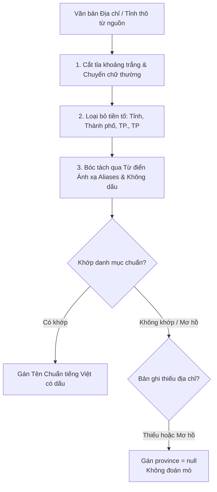
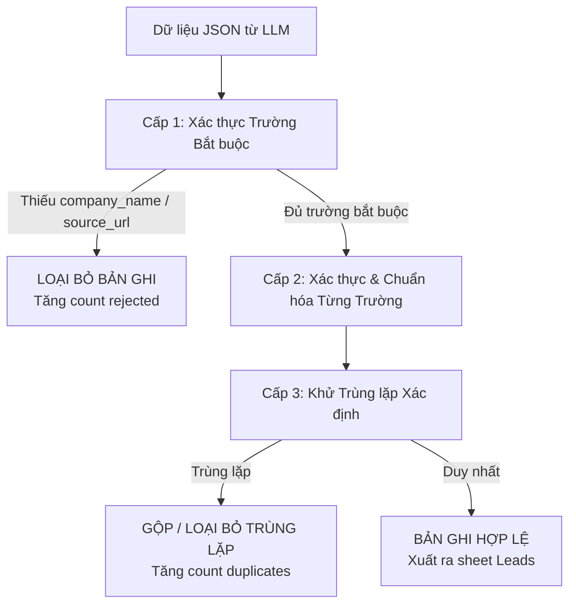

# TÀI LIỆU TỪ ĐIỂN DỮ LIỆU & ĐẶC TẢ SCHEMA (DATA DICTIONARY & SCHEMA SPECIFICATION)
# AI RPA Lead Collector MVP

---

## 1. Document Control & Purpose (Kiểm soát Tài liệu & Mục đích)

### 1.1 Thông tin Tài liệu
* **Tên tài liệu:** Đặc tả Từ điển Dữ liệu, Chuẩn hóa Schema và Định dạng Excel (Data Dictionary & Normalization Specification)
* **Mã tài liệu:** `DATA-DICT-LEADGEN-001`
* **Phiên bản:** `1.0-DRAFT`
* **Ngày tạo:** 13/10/2026
* **Tài liệu liên quan trực tiếp:**
  * [`docs/PRD.md`](Phiên bản `1.2-NATIONWIDE`)
  * [`docs/source-research.md`](Phiên bản `1.2-NATIONWIDE`)

### 1.2 Mục đích và Ranh giới Tài liệu
Tài liệu này cung cấp **đặc tả kỹ thuật sẵn sàng triển khai (implementation-ready specification)** cho lập trình viên duy nhất trong giai đoạn phát triển **AI RPA Lead Collector MVP (Phase 1)**, bao gồm:
1. Định nghĩa chuẩn xác 11 trường dữ liệu nghiệp vụ của thực thể Lead B2B.
2. Quy tắc chuẩn hóa xác định (deterministic normalization) đối với địa lý, URL, email, và số điện thoại.
3. Cơ chế xác thực schema, khử trùng lặp xác định (deterministic deduplication), và xử lý dữ liệu khuyết thiếu.
4. Đặc tả cấu trúc file xuất Microsoft Excel (`.xlsx`) gồm 2 sheet `Leads` và `Summary`, giải quyết triệt để sự khác biệt giữa 11 trường dữ liệu nghiệp vụ và 12 cột bảng tính.
5. Thiết lập ranh giới nghiêm ngặt cho LLM: LLM chỉ đóng vai trò Semantic Parser bóc tách dữ liệu từ văn bản nguồn; **tuyệt đối không suy đoán, bịa đặt (no hallucination) bất kỳ thông tin nào**.

### 1.3 Quy ước Phân loại Quyết định
Tài liệu phân định nghiêm ngặt ba trạng thái yêu cầu:
* **`[CONFIRMED]` - Đã xác nhận:** Các yêu cầu đã được thống nhất chính thức từ đề bài và tài liệu PRD v1.2.
* **`[PROPOSED]` - Đề xuất mặc định:** Các giải pháp kỹ thuật cụ thể do Engineer đề xuất để lập trình viên áp dụng trong giai đoạn Phase 1.
* **`[TBD — Pending TechLead confirmation]` - Chờ phê duyệt:** Các hạng mục bắt buộc TechLead phải chốt trước hoặc trong buổi nghiệm thu.

---

## 2. Canonical Lead Data Schema (Lược đồ Dữ liệu Lead Chuẩn)

### 2.1 Bảng Tổng hợp 11 Trường Dữ liệu Nghiệp vụ
Thực thể dữ liệu trung tâm trong hệ thống là `LeadRecord`. Lược đồ bao gồm **11 trường dữ liệu nghiệp vụ chuẩn (canonical business fields)**:

| STT | Tên Trường (Field Name) | Ý nghĩa Nghiệp vụ | Kiểu Dữ liệu Logic | Bắt buộc (Required) | Cho phép Null (Nullable) | Xuất Excel (In Excel) | Trạng thái Quyết định |
| :---: | :--- | :--- | :--- | :---: | :---: | :---: | :---: |
| 1 | `company_name` | Tên chính thức hoặc tên giao dịch của doanh nghiệp / cơ sở | String | **Required** | **No** | Có (Cột 2) | `[CONFIRMED]` |
| 2 | `industry` | Ngành mục tiêu của chiến dịch | Enum | **Required** | **No** | Có (Cột 3) | `[CONFIRMED]` |
| 3 | `sub_industry` | Phân ngành chi tiết hoặc lĩnh vực hoạt động cụ thể | String | Optional | Yes | Có (Cột 4) | `[PROPOSED]` |
| 4 | `province` | Tỉnh / Thành phố trực thuộc Trung ương nơi đặt trụ sở | String / Enum | Optional | Yes | Có (Cột 5) | `[CONFIRMED]` |
| 5 | `address` | Địa chỉ công khai đầy đủ (số nhà, đường, quận/huyện) | String | Optional | Yes | Có (Cột 6) | `[CONFIRMED]` |
| 6 | `website` | Website chính thức của doanh nghiệp | String (URL) | Optional | Yes | Có (Cột 7) | `[PROPOSED]` |
| 7 | `public_email` | Email liên hệ công khai của tổ chức | String (Email) | Optional | Yes | Có (Cột 8) | `[PROPOSED]` |
| 8 | `public_phone` | Số điện thoại bàn hoặc hotline liên hệ công khai | String (Phone) | Optional | Yes | Có (Cột 9) | `[PROPOSED]` |
| 9 | `description` | Mô tả tóm tắt ngành nghề, sản phẩm, dịch vụ chính | String | Optional | Yes | Có (Cột 10) | `[CONFIRMED]` |
| 10 | `source_url` | URL chính xác của trang web nguồn chứa thông tin bản ghi | String (URL) | **Required** | **No** | Có (Cột 11) | `[CONFIRMED]` |
| 11 | `collected_at` | Thời điểm thu thập bản ghi (ISO 8601 UTC) | Datetime | **Required** | **No** | Có (Cột 12) | `[CONFIRMED]` |

> [!IMPORTANT]
> **Quy tắc Bất biến đối với LLM Extraction:**
> Nếu một trường dữ liệu (ví dụ: `website`, `public_email`, `public_phone`, `province`) không xuất hiện hoặc không có bằng chứng rõ ràng trong văn bản HTML nguồn, LLM **bắt buộc phải trả về giá trị `null`**. Tuyệt đối không được suy luận, phỏng đoán số điện thoại, gán địa chỉ giả mạo hoặc tự sinh thông tin liên hệ.

---

### 2.2 Đặc tả Chi tiết Từng Trường Dữ liệu

#### 1. `company_name`
* **Ý nghĩa nghiệp vụ:** Tên định danh pháp lý hoặc tên thương mại của tổ chức/doanh nghiệp/cơ sở giáo dục.
* **Kiểu dữ liệu:** `String` (UTF-8).
* **Tính bắt buộc:** `Required = True`, `Nullable = False`.
* **Định dạng & Giá trị cho phép:** Chuỗi văn bản tiếng Việt có dấu hoặc tiếng Anh, độ dài từ 2 đến 255 ký tự.
* **Quy tắc Chuẩn hóa:**
  * Cắt tỉa khoảng trắng đầu và cuối chuỗi (`strip()`).
  * Thu gọn nhiều khoảng trắng liên tiếp giữa các từ thành 1 khoảng trắng duy nhất.
  * Giữ nguyên chữ hoa/thường chuẩn theo tên thương mại của doanh nghiệp.
* **Quy tắc Xác thực (Validation):**
  * Không được rỗng (`len(company_name) >= 2`).
  * Không được là các giá trị placeholder lỗi: `"N/A"`, `"None"`, `"null"`, `"Unknown"`, `"Chưa có tên"`, `"Không rõ"`.
* **Hành vi khi Thiếu / Không hợp lệ:** Bản ghi **bị loại bỏ hoàn toàn (Record Rejected)** khỏi danh sách Leads xuất ra.

#### 2. `industry`
* **Ý nghĩa nghiệp vụ:** Ngành kinh doanh mục tiêu chính được cấu hình trong chiến dịch.
* **Kiểu dữ liệu:** `Enum` (Tập hợp giá trị cố định).
* **Tính bắt buộc:** `Required = True`, `Nullable = False`.
* **Định dạng & Giá trị cho phép:** Chỉ chấp nhận chính xác 1 trong 2 giá trị chuỗi:
  * `"Education"`
  * `"Manufacturing"`
* **Quy tắc Chuẩn hóa:** Tự động gán từ tham số cấu hình chiến dịch (`campaign_config.industry`).
* **Quy tắc Xác thực:** Giá trị bản ghi phải khớp chính xác với ngành của chiến dịch đang chạy. Không cho phép giá trị khác.
* **Hành vi khi Thiếu:** Không thể thiếu vì kế thừa trực tiếp từ tham số cấu hình chiến dịch đã được xác thực ở đầu vào.

#### 3. `sub_industry`
* **Ý nghĩa nghiệp vụ:** Phân loại chuyên sâu hoặc nhóm lĩnh vực hoạt động hẹp của doanh nghiệp (ví dụ: "Trung tâm Ngoại ngữ", "Sản xuất linh kiện điện tử").
* **Kiểu dữ liệu:** `String` (UTF-8).
* **Tính bắt buộc:** `Optional = True`, `Nullable = True`.
* **Định dạng & Giá trị cho phép:** Chuỗi văn bản, độ dài tối đa 150 ký tự.
* **Quy tắc Chuẩn hóa:** Cắt tỉa khoảng trắng; viết hoa chữ cái đầu từ nếu là danh mục chuẩn; loại bỏ các ký tự đặc biệt rác.
* **Quy tắc Xác thực:** Nếu có giá trị, độ dài tối đa 150 ký tự.
* **Hành vi khi Thiếu:** Lưu trữ nội bộ là `null`; hiển thị **ô trống (Empty cell)** trong Excel.

#### 4. `province`
* **Ý nghĩa nghiệp vụ:** Tỉnh hoặc Thành phố trực thuộc Trung ương nơi doanh nghiệp/cơ sở đặt trụ sở chính hoặc cơ sở hoạt động.
* **Kiểu dữ liệu:** `String` / `Enum` (Ánh xạ theo danh mục địa giới hành chính chuẩn).
* **Tính bắt buộc:** `Optional = True`, `Nullable = True` (Đặt là Optional vì nhiều nguồn web chỉ ghi địa chỉ chung mà không phân tách tỉnh, hoặc doanh nghiệp ở vùng chưa xác định; nếu đặt bắt buộc sẽ loại bỏ nhầm nhiều lead giá trị).
* **Định dạng & Giá trị cho phép:** Tên tỉnh/thành phố chuẩn tiếng Việt có dấu thuộc danh mục tham chiếu hành chính (ví dụ: `"Đà Nẵng"`, `"Hà Nội"`, `"TP. Hồ Chí Minh"`).
* **Quy tắc Chuẩn hóa:** Chi tiết tại [Mục 4: Geographic Normalization](#4-geographic-normalization).
* **Quy tắc Xác thực:** Nếu có giá trị, giá trị chuẩn hóa phải nằm trong danh mục địa giới hành chính được hỗ trợ. Nếu không khớp hoặc không nhận diện được, chuyển về `null`. Tuyệt đối không đoán mò.
* **Hành vi khi Thiếu:** Lưu trữ nội bộ là `null`; hiển thị **ô trống (Empty cell)** trong Excel.

#### 5. `address`
* **Ý nghĩa nghiệp vụ:** Địa chỉ địa lý công khai chi tiết của doanh nghiệp (bao gồm số nhà, tên đường, phường/xã, quận/huyện).
* **Kiểu dữ liệu:** `String` (UTF-8).
* **Tính bắt buộc:** `Optional = True`, `Nullable = True`.
* **Định dạng & Giá trị cho phép:** Chuỗi văn bản có dấu, độ dài tối đa 300 ký tự.
* **Quy tắc Chuẩn hóa:** Cắt tỉa khoảng trắng; loại bỏ các ký tự tab, xuống dòng thừa (`\n`, `\r`); chuẩn hóa dấu phẩy ngăn cách địa chỉ.
* **Quy tắc Xác thực:** Loại bỏ thẻ HTML còn sót lại (`strip_tags`).
* **Hành vi khi Thiếu:** Lưu trữ nội bộ là `null`; hiển thị **ô trống (Empty cell)** trong Excel.

#### 6. `website`
* **Ý nghĩa nghiệp vụ:** Địa chỉ website chính thức của doanh nghiệp phục vụ tra cứu thông tin và liên hệ.
* **Kiểu dữ liệu:** `String` (URL).
* **Tính bắt buộc:** `Optional = True`, `Nullable = True`.
* **Định dạng & Giá trị cho phép:** URL hợp lệ với giao thức HTTP/HTTPS (ví dụ: `https://example.edu.vn`).
* **Quy tắc Chuẩn hóa:** Chi tiết tại [Mục 5: URL, Email and Phone Normalization](#5-url-email-and-phone-normalization).
* **Quy tắc Xác thực:** Kiểm tra cú pháp Regex domain và TLD hợp lệ. Nếu không hợp lệ, gán `null`.
* **Hành vi khi Thiếu:** Lưu trữ nội bộ là `null`; hiển thị **ô trống (Empty cell)** trong Excel.

#### 7. `public_email`
* **Ý nghĩa nghiệp vụ:** Địa chỉ thư điện tử liên hệ công khai của tổ chức.
* **Kiểu dữ liệu:** `String` (Email format).
* **Tính bắt buộc:** `Optional = True`, `Nullable = True`.
* **Định dạng & Giá trị cho phép:** Cú pháp email hợp lệ theo RFC 5322 cơ bản (`user@domain.tld`).
* **Quy tắc Chuẩn hóa:** Chi tiết tại [Mục 5: URL, Email and Phone Normalization](#5-url-email-and-phone-normalization).
* **Quy tắc Xác thực:** Kiểm tra cú pháp Regex tiêu chuẩn; loại bỏ email chứa từ khóa blacklist rác (ví dụ: `test@example.com`, `admin@localhost`).
* **Hành vi khi Thiếu:** Lưu trữ nội bộ là `null`; hiển thị **ô trống (Empty cell)** trong Excel.

#### 8. `public_phone`
* **Ý nghĩa nghiệp vụ:** Số điện thoại bàn hoặc số hotline công khai của tổ chức.
* **Kiểu dữ liệu:** `String` (Phone format).
* **Tính bắt buộc:** `Optional = True`, `Nullable = True`.
* **Định dạng & Giá trị cho phép:** Chuỗi ký tự số kèm tiền tố `+` nếu có mã quốc gia, độ dài từ 8 đến 15 chữ số.
* **Quy tắc Chuẩn hóa:** Chi tiết tại [Mục 5: URL, Email and Phone Normalization](#5-url-email-and-phone-normalization).
* **Quy tắc Xác thực:** Kiểm tra chuỗi chứa từ 8 đến 15 chữ số; không chứa chữ cái hay ký tự đặc biệt lạ.
* **Hành vi khi Thiếu:** Lưu trữ nội bộ là `null`; hiển thị **ô trống (Empty cell)** trong Excel.

#### 9. `description`
* **Ý nghĩa nghiệp vụ:** Đoạn tóm tắt ngắn gọn giới thiệu về doanh nghiệp, chương trình đào tạo hoặc danh mục sản phẩm chủ lực.
* **Kiểu dữ liệu:** `String` (UTF-8).
* **Tính bắt buộc:** `Optional = True`, `Nullable = True`.
* **Định dạng & Giá trị cho phép:** Chuỗi văn bản thuần túy, độ dài tối đa 500 ký tự.
* **Quy tắc Chuẩn hóa:** Loại bỏ toàn bộ thẻ HTML; cắt ngắn an toàn ở ranh giới từ nếu vượt quá 500 ký tự (kèm dấu `...`).
* **Quy tắc Xác thực:** Văn bản đọc hiểu được, không chứa mã độc hoặc chuỗi nhị phân rác.
* **Hành vi khi Thiếu:** Lưu trữ nội bộ là `null`; hiển thị **ô trống (Empty cell)** trong Excel.

#### 10. `source_url`
* **Ý nghĩa nghiệp vụ:** Đường dẫn URL cụ thể nơi hệ thống thu thập được thông tin của bản ghi (phục vụ đối chứng kiểm toán 100%).
* **Kiểu dữ liệu:** `String` (URL / URI).
* **Tính bắt buộc:** `Required = True`, `Nullable = False`.
* **Định dạng & Giá trị cho phép:** URL hợp lệ (`http://`, `https://`) đối với dữ liệu Live, hoặc URI định danh fixture (`fixture://education_sample_01.html`) đối với chế độ Fallback Test.
* **Quy tắc Chuẩn hóa:** Giữ nguyên URL gốc; chỉ loại bỏ các tham số tracking không cần thiết (`utm_*`, `fbclid`).
* **Quy tắc Xác thực:** URL phải có cấu trúc hợp lệ và truy cập lại được.
* **Hành vi khi Thiếu:** Bản ghi **bị loại bỏ hoàn toàn (Record Rejected)**.

#### 11. `collected_at`
* **Ý nghĩa nghiệp vụ:** Dấu thời gian ghi nhận thời điểm bản ghi được bóc tách và nạp vào hệ thống.
* **Kiểu dữ liệu:** `Datetime` (ISO 8601 UTC).
* **Tính bắt buộc:** `Required = True`, `Nullable = False`.
* **Định dạng & Giá trị cho phép:** `YYYY-MM-DDTHH:mm:ssZ` (ví dụ: `2026-10-13T08:30:00Z`).
* **Quy tắc Chuẩn hóa:** Tự động tạo bởi đồng hồ hệ thống theo múi giờ UTC tại thời điểm xử lý.
* **Quy tắc Xác thực:** Phải là chuỗi thời gian hợp lệ, không nằm trong tương lai.
* **Hành vi khi Thiếu:** Tự động gán thời gian hiện tại của hệ thống.

---

## 3. Industry & Campaign Configuration (Cấu hình Ngành & Chiến dịch)

### 3.1 Định nghĩa Ngành Mục tiêu & Phân ngành
Hệ thống vận hành trên **01 Đường ống Xử lý Dùng chung (Shared Collection Pipeline)** duy nhất. Điểm khác biệt giữa hai ngành được điều khiển hoàn toàn thông qua cấu hình tham số:

| Thuộc tính | Ngành Giáo dục (`Education`) | Ngành Sản xuất (`Manufacturing`) |
| :--- | :--- | :--- |
| **Giá trị Enum chuẩn** | `"Education"` | `"Manufacturing"` |
| **Đối tượng mục tiêu** | Trường học, đại học, cao đẳng, trung tâm ngoại ngữ, trung tâm tin học, cơ sở giáo dục nghề nghiệp (GDNN), công ty EdTech. | Nhà máy sản xuất, xưởng cơ khí chế tạo, công ty điện - điện tử, công ty linh kiện phụ tùng, doanh nghiệp nhựa, bao bì, vật liệu công nghiệp. |
| **Bản chất `sub_industry`** | Mô tả chi tiết loại hình giáo dục (ví dụ: `"Trung tâm Ngoại ngữ"`, `"Trường Cao đẳng Nghề"`, `"Doanh nghiệp EdTech"`). | Mô tả phân nhóm ngành sản xuất (ví dụ: `"Cơ khí chính xác"`, `"Sản xuất linh kiện điện tử"`, `"Bao bì công nghiệp"`). |
| **Quan hệ Schema** | `industry` là trường phân vùng cấp 1 (Enum cố định). `sub_industry` là trường phân loại cấp 2 chi tiết (chuỗi văn bản tự do, do LLM bóc tách theo ngữ cảnh nguồn). |

---

### 3.2 Tham số Cấu hình Chiến dịch (Campaign Configuration Parameters)
Khi người dùng khởi tạo một chiến dịch trên giao diện, đối tượng cấu hình `CampaignConfig` bao gồm:

```json
{
  "campaign_name": "Demo Education Da Nang Campaign",
  "industry": "Education",
  "geographic_scope": "PROVINCE",
  "target_province": "Đà Nẵng",
  "max_records": 20,
  "execution_mode": "LIVE"
}
```

* **`industry` (Required, Enum):** Chọn `"Education"` hoặc `"Manufacturing"`.
* **`geographic_scope` (Required, Enum):** Chỉ định phạm vi địa lý của chiến dịch:
  * `"NATIONWIDE"`: Chiến dịch toàn quốc (không áp dụng bộ lọc tỉnh thành).
  * `"PROVINCE"`: Chiến dịch giới hạn theo một tỉnh/thành phố cụ thể.
* **`target_province` (Optional/Conditional, String):** 
  * Nếu `geographic_scope == "PROVINCE"`: Trường này là **bắt buộc**, chứa tên tỉnh/thành phố chuẩn (ví dụ: `"Đà Nẵng"`, `"Hà Nội"`, `"TP. Hồ Chí Minh"`).
  * Nếu `geographic_scope == "NATIONWIDE"`: Trường này có giá trị là `null` hoặc chuỗi rỗng `""`.
* **`max_records` (Required, Integer):** Số lượng bản ghi hợp lệ tối đa cần thu thập (mặc định: `20`, khoảng cho phép: `5` đến `100`).
* **`execution_mode` (Required, Enum):** `"LIVE"` (thu thập trực tiếp từ nguồn web được duyệt) hoặc `"FIXTURE"` (chạy trên tập dữ liệu mẫu offline).

---

### 3.3 Phân định Quan trọng về Địa lý & Độ phủ Nguồn

#### 1. Phân định giữa Tham số Chiến dịch (`target_province`) và Trường Bản ghi (`lead.province`)
* **`target_province`:** Là **mong muốn/ý định lọc của người dùng** khi tạo chiến dịch.
* **`lead.province`:** Là **kết quả bóc tách và chuẩn hóa thực tế** từ bằng chứng văn bản của trang nguồn.
* Khi chạy chiến dịch đơn tỉnh (`geographic_scope == "PROVINCE"`): Hệ thống chỉ giữ lại các lead có `lead.province == target_province`. Nếu nguồn trả về bản ghi có `lead.province` khác hoặc `lead.province == null`, bản ghi đó sẽ bị loại bỏ khỏi kết quả cuối cùng của chiến dịch này.

#### 2. Phân định giữa Bộ lọc Chiến dịch và Độ phủ Thực tế của Nguồn (Source Coverage)
Người dùng có quyền chọn bất kỳ tỉnh/thành nào hoặc chọn Toàn quốc trên giao diện hệ thống. Tuy nhiên, khả năng đáp ứng phụ thuộc vào độ phủ thực tế của từng nguồn dữ liệu (đã khảo sát trong [`docs/source-research.md`]):
* **Trang Vàng VN (`trangvangvietnam.com`):** Độ phủ thực tế là **Toàn quốc** và **có dữ liệu Đà Nẵng** cho cả 2 ngành. Hỗ trợ lọc trực tiếp qua query params (`?city=...`).
* **VASI (`vasi.org.vn`):** Độ phủ thực tế chỉ gồm **17 tỉnh thành công nghiệp lớn** (Bắc/Nam), **hoàn toàn khuyết thiếu Đà Nẵng**. Nếu cấu hình `target_province = "Đà Nẵng"`, nguồn này sẽ trả về 0 kết quả hợp lệ.
* **Cổng DLM TP.HCM:** Là **nguồn cục bộ (Local Only)**, chỉ có dữ liệu TP.HCM, không hỗ trợ Đà Nẵng hay Toàn quốc.

---

## 4. Geographic Normalization (Chuẩn hóa Dịa lý)

### 4.1 Quy tắc Chuẩn hóa Tên Tỉnh / Thành phố
Quá trình chuẩn hóa trường `province` được thực hiện hoàn toàn bằng mã nguồn xác định (Deterministic Engine) theo quy trình 5 bước:



1. **Bước 1 (Sanitization):** Cắt tỉa khoảng trắng đầu/cuối, loại bỏ dấu chấm, dấu phẩy thừa.
2. **Bước 2 (Prefix Stripping):** Loại bỏ các tiền tố hành chính không phân biệt hoa thường: `"tỉnh"`, `"thành phố"`, `"tp."`, `"tp "`, `"t."`.
3. **Bước 3 (Alias & Diacritic Mapping):** Đối chiếu chuỗi đã làm sạch với bảng ánh xạ bí danh (alias lookup table) bao gồm cả dạng có dấu và không dấu:
   * `"đà nẵng"`, `"da nang"`, `"tp da nang"`, `"tp. đà nẵng"`, `"danang"` → `"Đà Nẵng"`
   * `"hà nội"`, `"ha noi"`, `"tp ha noi"`, `"tp. hà nội"`, `"hanoi"` → `"Hà Nội"`
   * `"hồ chí minh"`, `"ho chi minh"`, `"tp.hcm"`, `"tphcm"`, `"sài gòn"`, `"saigon"` → `"TP. Hồ Chí Minh"`
4. **Bước 4 (Canonical Assignment):** Gán tên chuẩn hóa chính thức viết hoa đúng quy chuẩn.
5. **Bước 5 (Safe Fallback):** Nếu chuỗi địa chỉ không chứa dấu hiệu nhận biết địa phương hoặc chứa các địa danh mâu thuẫn, gán `province = null`. **Tuyệt đối không đoán mò địa phương lân cận.**

---

### 4.2 Xử lý Lịch sử Địa danh & Sáp nhập Hành chính
* **Địa danh lịch sử đã sáp nhập rõ ràng:**
  * Khu vực `"Hà Tây"` (đã sáp nhập hoàn toàn vào Hà Nội năm 2008) → Ánh xạ xác định về `"Hà Nội"`.
* **Địa danh lịch sử bị chia tách / mơ hồ:**
  * Các địa danh cũ như `"Hà Bắc"` (nay là Bắc Ninh và Bắc Giang), `"Cửu Long"` (Vĩnh Long và Trà Vinh) nếu xuất hiện trong nội dung cũ mà không có thông tin huyện/xã đi kèm → Xác định là **Mơ hồ (Ambiguous)** → Gán `province = null`, lưu toàn bộ văn bản gốc vào `address`.
* **Nguyên tắc cốt lõi:** Bằng chứng nguồn được bảo toàn nguyên vẹn trong trường `address`. Không cố gắng suy đoán khi dữ liệu không đủ căn cứ.

---

### 4.3 Xác thực Ca Kiểm thử Trọng điểm Đà Nẵng (Đà Nẵng Test Case)
Do Đà Nẵng là địa bàn bắt buộc có dữ liệu kiểm chứng của MVP, bộ xác thực địa lý phải vượt qua bộ test case sau:

| Đầu vào Thô (Raw Input) | Kết quả Mong đợi (`lead.province`) | Ghi chú Kiểm thử |
| :--- | :--- | :--- |
| `"Đà Nẵng"` | `"Đà Nẵng"` | Khớp trực tiếp chuẩn |
| `"TP. Đà Nẵng"` | `"Đà Nẵng"` | Tự động bóc tiền tố `"TP."` |
| `"tp da nang"` | `"Đà Nẵng"` | Xử lý chữ thường và không dấu |
| `"Quận Hải Châu, Đà Nẵng"` | `"Đà Nẵng"` | Bóc tách tỉnh từ chuỗi địa chỉ chi tiết |
| `"KCN Hòa Khánh, Liên Chiểu, Da Nang"` | `"Đà Nẵng"` | Bóc tách từ địa chỉ khu công nghiệp |
| `""` (Rỗng) | `null` | Trường hợp thiếu thông tin: gán `null` |
| `"Việt Nam"` (Chỉ có quốc gia) | `null` | Không đủ thông tin tỉnh: gán `null` |

---

### 4.4 Danh mục Tham chiếu Hành chính & Quyết định Chờ Xác nhận

> [!WARNING]
> **Vấn đề Đối chiếu Danh mục Đơn vị Hành chính Cấp Tỉnh:**
> * Trong tài liệu PRD ban đầu, danh mục tham chiếu được giả định là **63 tỉnh/thành phố**.
> * Tuy nhiên, theo các Nghị quyết của Quốc hội và lộ trình sắp xếp đơn vị hành chính giai đoạn 2023–2025, cơ cấu đơn vị hành chính có những điều chỉnh liên tục theo các văn bản quy phạm pháp luật mới nhất.
> * **Giải pháp cho MVP Phase 1:**
>   * `[PROPOSED]` Tạm thời sử dụng danh mục nền tảng **63 tỉnh/thành phố chuẩn** của Tổng cục Thống kê (GSO - Quyết định 124/2004/QĐ-TTg và bảng mã cập nhật hiện hành) làm bộ tham chiếu mặc định trong code để không làm gián đoạn tiến độ.
>   * `[TBD — Pending TechLead confirmation]` Trình TechLead xem xét và phê duyệt văn bản quy chuẩn chính thức cần đối chiếu nếu doanh nghiệp yêu cầu chuẩn hóa theo danh mục hành chính chuyên biệt.

---

## 5. URL, Email & Phone Normalization (Chuẩn hóa URL, Email & SĐT)

Tất cả các hàm chuẩn hóa liên hệ phải là **hàm thuần túy (pure deterministic functions)**, độc lập hoàn toàn với LLM.

### 5.1 Chuẩn hóa Website URL (`website`)
1. **Loại bỏ khoảng trắng:** Cắt tỉa khoảng trắng đầu và cuối.
2. **Kiểm tra rỗng:** Nếu rỗng hoặc chuỗi rỗng `""` → Trả về `null`.
3. **Bổ sung Scheme:** Nếu thiếu tiền tố giao thức (ví dụ: `vasi.org.vn` hoặc `www.edu.vn`), tự động thêm tiền tố `https://`.
4. **Chuẩn hóa Tên miền:** Chuyển phần domain về chữ thường (lowercase); giữ nguyên chữ hoa/thường ở phần path nếu có.
5. **Loại bỏ Trailing Slash:** Loại bỏ dấu gạch chéo cuối cùng ở domain gốc (`https://abc.edu.vn/` → `https://abc.edu.vn`).
6. **Xác thực Cú pháp Regex:**
   ```regex
   ^https?://([a-zA-Z0-9]([a-zA-Z0-9\-]{0,61}[a-zA-Z0-9])?\.)+[a-zA-Z]{2,}(/.*)?$
   ```
   * Nếu không khớp regex → Coi là URL không hợp lệ → Gán `website = null` (không loại bỏ bản ghi).

---

### 5.2 Bảo toàn URL Nguồn (`source_url`)
* URL nguồn phục vụ mục đích kiểm toán tính xác thực của lead (Source Traceability).
* **Quy tắc:**
  * Giữ nguyên vẹn URL trang web đã tải về.
  * Chỉ loại bỏ các tham số tracking quảng cáo gây nhiễu nếu an toàn: `utm_source`, `utm_medium`, `utm_campaign`, `fbclid`, `gclid`.
  * Tuyệt đối không thay đổi domain, đường dẫn path, hoặc các tham số truy vấn định danh (`id`, `item`, `paged`).
  * Nếu ở chế độ Fallback, giữ nguyên định danh URI: `fixture://education_sample_01.html`.

---

### 5.3 Chuẩn hóa Email Công khai (`public_email`)
1. **Làm sạch:** Cắt tỉa khoảng trắng, loại bỏ khoảng trắng thừa bên trong.
2. **Chuyển chữ thường:** Chuyển 100% ký tự về chữ thường (lowercase).
3. **Xác thực Cú pháp Regex:**
   ```regex
   ^[a-zA-Z0-9_.+-]+@[a-zA-Z0-9-]+\.[a-zA-Z0-9-.]+$
   ```
4. **Loại bỏ Email Placeholder / Rác:** Loại bỏ các email vô nghĩa như: `info@`, `test@test.com`, `admin@domain.com`, `none@none.com`.
5. **Hành vi khi Không hợp lệ:** Gán `public_email = null`.
6. **Tuyên bố Ranh giới (Disclaimer):** Việc vượt qua kiểm tra cú pháp Regex **chỉ chứng minh tính hợp lệ về mặt định dạng**, hệ thống **không xác minh hộp thư có tồn tại thực tế (no mailbox deliverability check)** trong phạm vi MVP.

---

### 5.4 Chuẩn hóa Số Điện thoại Công khai (`public_phone`)
1. **Làm sạch ký tự phân tách:** Loại bỏ toàn bộ dấu chấm `.`, dấu gạch ngang `-`, dấu ngoặc đơn `()`, dấu gạch chéo `/`, và khoảng trắng.
2. **Bảo toàn Ký tự Hợp lệ:** Chỉ giữ lại các chữ số `0-9` và ký tự `+` ở vị trí đầu tiên (nếu có mã quốc gia).
3. **Bảo toàn Mã vùng & Đầu số:**
   * Giữ nguyên số `0` đầu của số bàn hoặc hotline nội địa (ví dụ: `02363822123`, `0905123456`).
   * **Tuyệt đối không tự ý thêm mã quốc gia `+84`** nếu trong văn bản nguồn không có dấu `+` hoặc `84`. Tránh rủi ro làm biến dạng số máy lẻ hoặc số tổng đài nội bộ.
4. **Xác thực Độ dài:**
   * Số hợp lệ phải có độ dài từ 8 đến 15 chữ số.
   * Nếu chuỗi sau làm sạch có ít hơn 8 ký tự hoặc nhiều hơn 15 chữ số → Coi là số không hợp lệ → Gán `public_phone = null`.
5. **Tuyên bố Ranh giới:** Hệ thống **không xác minh số điện thoại có đang hoạt động thực tế (no live line pinging)**.

---

### 5.5 Phân định Xử lý Lỗi Trường vs Lỗi Bản ghi (Field Rejection vs Record Rejection)

| Loại Lỗi / Dữ liệu Sai | Hành vi của Hệ thống | Trạng thái Bản ghi | Ghi chú Log |
| :--- | :--- | :---: | :--- |
| `website` sai cú pháp (vd: `htt://abc`) | Gán `website = null` | **Giữ lại bản ghi** | Log mức `WARNING` |
| `public_email` sai cú pháp (vd: `abc@`) | Gán `public_email = null` | **Giữ lại bản ghi** | Log mức `WARNING` |
| `public_phone` có chữ cái (vd: `0905abc`) | Gán `public_phone = null` | **Giữ lại bản ghi** | Log mức `WARNING` |
| `province` không nhận diện được | Gán `province = null` | **Giữ lại bản ghi** | Log mức `INFO` |
| `company_name` bị rỗng / dưới 2 ký tự | **Loại bỏ bản ghi (Reject Record)** | **Bị loại bỏ khỏi Leads** | Log mức `ERROR`, tăng `rejected_count` |
| `source_url` bị rỗng | **Loại bỏ bản ghi (Reject Record)** | **Bị loại bỏ khỏi Leads** | Log mức `ERROR`, tăng `rejected_count` |

---

## 6. Validation Rules (Quy tắc Xác thực Chi tiết)

Bộ quy tắc xác thực được thực thi tuần tự theo 3 cấp độ:



### 6.1 Xác thực Cấp 1: Bản ghi & Trường Bắt buộc
* **Quy tắc 1.1 (`company_name`):** Bắt buộc phải tồn tại, là chuỗi văn bản, sau khi cắt tỉa khoảng trắng phải có độ dài >= 2 ký tự, và không nằm trong danh sách đen placeholder. Vi phạm → **Hủy bản ghi ngay lập tức**.
* **Quy tắc 1.2 (`industry`):** Bắt buộc phải là chuỗi khớp chính xác với `"Education"` hoặc `"Manufacturing"`. Vi phạm → **Hủy bản ghi**.
* **Quy tắc 1.3 (`source_url`):** Bắt buộc phải có định dạng URL hợp lệ và không rỗng. Vi phạm → **Hủy bản ghi**.
* **Quy tắc 1.4 (`collected_at`):** Bắt buộc phải là định dạng thời gian ISO 8601 hợp lệ. Vi phạm → Tự động gán thời gian hệ thống UTC.

### 6.2 Xác thực Cấp 2: Trường Tùy chọn (Graceful Field Degradation)
* Đối với tất cả các trường tùy chọn (`sub_industry`, `province`, `address`, `website`, `public_email`, `public_phone`, `description`):
  * Nếu dữ liệu do LLM trả về bị lỗi cú pháp, rỗng, hoặc không hợp lệ, hệ thống áp dụng cơ chế **thoái lui an toàn (graceful degradation)**: Gán giá trị bằng `null`.
  * **Tuyệt đối không làm sập tiến trình chạy và không hủy bản ghi** chỉ vì thiếu trường tùy chọn.

### 6.3 Xử lý Bản ghi Không Hợp lệ (Invalid Record Handling)
* Bản ghi vi phạm Cấp 1 sẽ không được đưa vào danh sách xuất ra file Excel (sheet `Leads`).
* Thông tin bản ghi lỗi được ghi nhận chi tiết vào file log cục bộ (`logs/campaign_{id}.log`) kèm lý do cụ thể (ví dụ: `REJECTED: company_name is empty from URL https://...`).
* Tổng số bản ghi bị loại bỏ được đếm tự động và thể hiện trên chỉ số `records_rejected` tại sheet `Summary`.

---

## 7. Deduplication Specification (Đặc tả Khử Trùng lặp Xác định)

Hệ thống cài đặt giải thuật khử trùng lặp xác định theo thứ tự ưu tiên 3 bước:

### 7.1 Chiến lược Khử trùng lặp 3 Bước

#### Bước 1: Khử trùng lặp Ưu tiên theo Domain Website (Domain-based Deduplication)
* **Điều kiện áp dụng:** Cả hai bản ghi đều có trường `website` hợp lệ (khác `null`).
* **Quy tắc bóc tách Domain so sánh:**
  * Bóc tách hostname từ URL, chuyển về chữ thường.
  * Loại bỏ tiền tố `www.` (ví dụ: `https://www.duytan.edu.vn/` và `http://duytan.edu.vn` đều có so sánh domain là `duytan.edu.vn`).
* **Kết luận:** Nếu hai bản ghi có cùng domain so sánh → Xác định là **Trùng lặp (Duplicate)**.

#### Bước 2: Khử trùng lặp theo Tên Doanh nghiệp Kết hợp SĐT / Địa chỉ
* **Điều kiện áp dụng:** Ít nhất một trong hai bản ghi không có website.
* **Quy tắc chuẩn hóa Tên so sánh (`normalized_name`):**
  * Chuyển về chữ thường, bỏ toàn bộ dấu câu và khoảng trắng thừa.
  * Loại bỏ các định danh loại hình doanh nghiệp phổ biến: `"công ty tnhh"`, `"công ty tnhh mtv"`, `"công ty cổ phần"`, `"ctcp"`, `"doanh nghiệp tư nhân"`, `"trường đại học"`, `"đại học"`, `"trung tâm"`.
* **Quy tắc kết hợp:** Hai bản ghi được xác định là Trùng lặp nếu có `normalized_name` trùng khớp VÀ thỏa mãn 1 trong 2 điều kiện sau:
  1. Có cùng số điện thoại chuẩn hóa (`public_phone`).
  2. HOẶC có cùng `province` chuẩn hóa VÀ cùng tên đường/số nhà cốt lõi trong `address`.

#### Bước 3: Nguyên tắc Phủ định Nghiêm ngặt (Strict Negative Rule)
* **Tuyệt đối không gộp bản ghi** chỉ vì có tên doanh nghiệp tương tự nhau nếu số điện thoại hoặc địa chỉ khác nhau hoàn toàn (ví dụ: nhiều công ty thành viên trong cùng một tập đoàn đặt tại các tỉnh khác nhau).
* **Giá trị khuyết thiếu không phải là bằng chứng trùng lặp:** Hai bản ghi cùng tên nhưng đều có `website = null`, `public_phone = null`, và `address = null` sẽ **KHÔNG** bị gộp bừa, mà được giữ lại cả hai để tránh mất dữ liệu tiềm năng.

---

### 7.2 Chính sách Hợp nhất Trường khi Phát hiện Trùng lặp (Field Merge Policy)
Khi hai bản ghi `Record_A` (đến trước) và `Record_B` (đến sau) được xác định là trùng lặp, hệ thống thực hiện hợp nhất theo nguyên tắc:

* **Trường Tên và Ngành:** Giữ nguyên tên của bản ghi có độ dài đầy đủ hơn.
* **Trường Liên hệ (`website`, `public_email`, `public_phone`, `address`, `province`, `description`):**
  * Ưu tiên giữ giá trị khác `null`.
  * Nếu cả hai đều có giá trị và không mâu thuẫn: Giữ giá trị của bản ghi đến trước (`Record_A`).
  * `[PROPOSED]` Nếu có xung đột giá trị không rỗng (ví dụ: hai số điện thoại khác nhau): Giữ giá trị của bản ghi đến trước (`Record_A`), và ghi nhận cảnh báo vào audit log.
* **Trường Kiểm toán (`source_url`, `collected_at`):**
  * `[PROPOSED]` Giữ nguyên `source_url` và `collected_at` của bản ghi đến trước (`Record_A`) để bảo toàn tính toàn vẹn của mốc thời gian thu thập ban đầu.
* **Đếm số lượng:** Tăng biến đếm `duplicates_removed` thêm 1.

---

## 8. Excel Workbook Specification (Đặc tả File Excel Xuất ra)

File Microsoft Excel (`.xlsx`) là sản phẩm đầu ra hoàn chỉnh cuối cùng của quy trình. Thư viện tạo file khuyến nghị là `openpyxl`.

### 8.1 Cấu trúc Workbook Tổng thể
Workbook gồm chính xác **02 Worksheet**:
1. **Worksheet `Leads` (Bắt buộc):** Chứa danh sách dữ liệu chi tiết của toàn bộ các lead đã được xác thực và làm sạch.
2. **Worksheet `Summary` (Bắt buộc):** Chứa bảng thông tin tóm tắt và chỉ số hiệu năng của chiến dịch.

---

### 8.2 Giải quyết Mâu thuẫn: 11 Trường Nghiệp vụ vs 12 Cột Bảng tính

> [!NOTE]
> **Làm rõ sự khác biệt giữa 11 Trường Schema và 12 Cột Excel:**
> * Lược đồ dữ liệu nghiệp vụ chuẩn (Canonical Data Schema) gồm đúng **11 trường dữ liệu nghiệp vụ** bóc tách từ nguồn.
> * Worksheet `Leads` trong Excel hiển thị đúng **12 cột**.
> * Cột thứ nhất là **`STT` (Số thứ tự)** — Đây là **trường phát sinh khi xuất file (export-only sequence index)**, có giá trị số nguyên tăng dần (`1, 2, 3...`), không phải là một trường lưu trữ trong cơ sở dữ liệu hay mô hình thực thể nghiệp vụ.

---

### 8.3 Đặc tả Chi tiết Worksheet `Leads`

#### 1. Thứ tự 12 Cột và Ánh xạ Trường Dữ liệu
| Cột | Tiêu đề Cột Excel (Header Name) | Ánh xạ Trường Schema | Kiểu Dữ liệu Excel | Định dạng Hiển thị & Căn lề | Độ rộng Cột (Width) |
| :---: | :--- | :--- | :--- | :--- | :---: |
| **A** | `STT` | `export_index` (Hệ thống tự sinh) | Integer | Căn giữa | 8 |
| **B** | `Company Name` | `company_name` | Text | Căn trái, In đậm | 35 |
| **C** | `Industry` | `industry` | Text | Căn giữa | 16 |
| **D** | `Sub-Industry` | `sub_industry` | Text | Căn trái | 24 |
| **E** | `Province` | `province` | Text | Căn giữa | 18 |
| **F** | `Address` | `address` | Text | Căn trái, Wrap Text | 40 |
| **G** | `Website` | `website` | Hyperlink | Căn trái, Chữ xanh, Gạch chân | 28 |
| **H** | `Public Email` | `public_email` | Text | Căn trái | 28 |
| **I** | `Public Phone` | `public_phone` | Text (dạng chuỗi) | Căn giữa | 18 |
| **J** | `Description` | `description` | Text | Căn trái, Wrap Text | 45 |
| **K** | `Source URL` | `source_url` | Hyperlink | Căn trái, Chữ xanh, Gạch chân | 35 |
| **L** | `Collected At` | `collected_at` | Text / Datetime | Căn giữa (`YYYY-MM-DD HH:mm:ss`) | 20 |

#### 2. Quy chuẩn Định dạng và Trải nghiệm Người dùng (Styling Conventions)
* **Dòng Tiêu đề (Row 1):**
  * Chiều cao dòng: 28pt.
  * Phông chữ: Segoe UI / Arial, cỡ chữ 11pt, in đậm (`Bold = True`).
  * Căn lề: Căn giữa theo chiều dọc và ngang (`alignment = Alignment(vertical='center', horizontal='center')`).
  * Màu nền: Màu xám bạc chuyên nghiệp (`Fill = PatternFill(fill_type='solid', fgColor='F2F4F7')`).
  * Đường viền: Đường kẻ nét mảnh xung quanh ô và đường đôi hoặc nét đậm ở đáy dòng header.
* **Cố định Dòng Tiêu đề (Freeze Panes):** Cố định dòng 1 (`ws.freeze_panes = 'A2'`) để khi cuộn trang, tiêu đề cột luôn hiển thị.
* **Bộ lọc Dữ liệu Tự động (AutoFilter):** Kích hoạt bộ lọc cho toàn bộ dải ô từ `A1` đến `L1` (`ws.auto_filter.ref = ws.dimensions`).
* **Định dạng Liên kết (Clickable Hyperlink):**
  * Các ô trong cột `Website` và `Source URL` có giá trị hợp lệ được gắn hyperlink nhấp chuột trực tiếp (`cell.hyperlink = value`).
  * Định dạng phông chữ: Màu xanh lam chuẩn (`font = Font(color='0563C1', underline='single')`).
* **Quy tắc Biểu diễn Giá trị Khuyết thiếu (Missing Values Representation):**
  * Các ô khuyết thiếu dữ liệu (giá trị nội bộ là `null` hoặc chuỗi rỗng `""`) bắt buộc phải xuất ra **ô trống hoàn toàn (Empty Cell)**.
  * **Tuyệt đối không hiển thị các chuỗi văn bản gây hiểu lầm như:** `"None"`, `"null"`, `"undefined"`, `"N/A"`, hay `"0"`.
* **Định dạng Số điện thoại:** Cột `Public Phone` phải được định dạng tường minh ở kiểu chuỗi văn bản (`Text / String`), ngăn không cho Microsoft Excel tự ý chuyển đổi số điện thoại thành số nguyên (dẫn đến mất số `0` ở đầu).

---

### 8.4 Đặc tả Chi tiết Worksheet `Summary`
Worksheet `Summary` được thiết kế dưới dạng bảng Dashboard Key-Value gọn gàng, cung cấp toàn bộ bức tranh về chiến dịch:

| Dòng | Tham số Tóm tắt (Metric Label) | Ý nghĩa Kỹ thuật & Nghiệp vụ | Giá trị Ví dụ |
| :---: | :--- | :--- | :--- |
| **1** | **Chiến dịch (Campaign Name)** | Tên hoặc định danh của chiến dịch thu thập | `Education Da Nang Lead Gen Campaign #1` |
| **2** | **Ngành mục tiêu (Target Industry)** | Ngành cấu hình: `Education` hoặc `Manufacturing` | `Education` |
| **3** | **Phạm vi Địa lý (Geographic Scope)** | Phạm vi chạy: `Toàn quốc` hoặc `Một tỉnh/thành` | `Một tỉnh/thành cụ thể (PROVINCE)` |
| **4** | **Bộ lọc Tỉnh/Thành (Requested Filter)** | Tên tỉnh/thành chỉ định nếu có | `Đà Nẵng` |
| **5** | **Nguồn Dữ liệu (Data Source)** | URL hoặc định danh nguồn được phê duyệt / Fixture | `https://trangvangvietnam.com (YellowPages VN)` |
| **6** | **Chế độ Thực thi (Execution Mode)** | Chế độ chạy: `LIVE COLLECTION` hoặc `SAMPLE FIXTURE`| `LIVE COLLECTION` |
| **7** | **Thời gian Bắt đầu (Started At)** | Thời điểm bắt đầu chạy (Giờ địa phương) | `2026-10-13 09:00:15` |
| **8** | **Thời gian Kết thúc (Finished At)** | Thời điểm hoàn tất chiến dịch | `2026-10-13 09:02:45` |
| **9** | **Tổng thời gian chạy (Execution Time)**| Tổng thời gian xử lý thực tế | `2 phút 30 giây` |
| **10**| **Số trang web đã quét (Pages Crawled)**| Số lượng trang HTML đã tải về thành công | `5` |
| **11**| **Tổng bản ghi thu thập thô (Records Raw)** | Số bản ghi thô phát hiện từ các trang web | `28` |
| **12**| **Số bản ghi trích xuất thành công** | Số bản ghi LLM parse thành công ra JSON | `26` |
| **13**| **Số bản ghi bị loại bỏ do lỗi Schema** | Bản ghi thiếu `company_name` hoặc sai schema | `2` |
| **14**| **Số bản ghi trùng lặp đã loại bỏ** | Bản ghi bị gộp/hủy do trùng website hoặc tên+SĐT | `4` |
| **15**| **Tổng số Lead hợp lệ xuất ra (Exported)** | Số dòng lead thực tế có trong sheet `Leads` | `20` |
| **16**| **Trạng thái Chiến dịch (Status)** | `THÀNH CÔNG (COMPLETED)` / `CÓ LỖI (WARNING)` | `THÀNH CÔNG (COMPLETED)` |

---

## 9. Error and Missing-Data Conventions (Quy ước Xử lý Lỗi & Dữ liệu Thiếu)

Ma trận dưới đây định nghĩa hành vi xác định của hệ thống đối với từng loại bất thường dữ liệu:

| Tình huống Bất thường | Hành vi Tầng Xử lý Dữ liệu | Trạng thái Bản ghi | Biểu diễn trong Excel |
| :--- | :--- | :---: | :--- |
| **Thiếu trường bắt buộc** (`company_name` rỗng) | Bắt lỗi `ValidationError`, ghi log mức `ERROR`, tăng `rejected_count`. | **HỦY BẢN GHI (Dropped)** | Không xuất hiện trong sheet `Leads`. |
| **Thiếu trường bắt buộc** (`source_url` rỗng) | Ghi log `ERROR`, tăng `rejected_count`. | **HỦY BẢN GHI (Dropped)** | Không xuất hiện trong sheet `Leads`. |
| **Thiếu trường tùy chọn** (`website`, `phone`...) | Gán giá trị nội bộ là `null`. Tiếp tục pipeline bình thường. | **HỢP LỆ (Retained)** | **Ô trống hoàn toàn (Empty Cell)**. |
| **Địa phương không xác định** (thiếu hoặc mơ hồ) | Gán `province = null`. Không suy đoán bừa bãi. | **HỢP LỆ (Retained)** | **Ô trống hoàn toàn (Empty Cell)**. |
| **Email sai cú pháp** (vd: `abc@@gmail`) | Gán `public_email = null`. Ghi log cảnh báo mức `WARNING`. | **HỢP LỆ (Retained)** | **Ô trống hoàn toàn (Empty Cell)**. |
| **Số điện thoại sai định dạng** | Gán `public_phone = null`. Ghi log cảnh báo mức `WARNING`. | **HỢP LỆ (Retained)** | **Ô trống hoàn toàn (Empty Cell)**. |
| **URL website không hợp lệ** | Gán `website = null`. Ghi log cảnh báo mức `WARNING`. | **HỢP LỆ (Retained)** | **Ô trống hoàn toàn (Empty Cell)**. |
| **Bản ghi trùng lặp** (trùng domain/tên+SĐT) | Gộp thông tin theo chính sách Section 7, tăng `duplicates_count`.| **HỦY BẢN SAU (Deduplicated)**| Chỉ giữ lại 1 bản ghi hợp nhất. |
| **Nguồn web lỗi mạng** (HTTP 404, 500, Timeout) | Thử lại 2 lần (Exponential Backoff). Nếu thất bại: Bỏ qua trang. | Bỏ qua trang đó | Không làm sập ứng dụng; ghi nhận log. |
| **LLM API Timeout / Rate Limit** | Thử lại 1 lần. Nếu hết quota: Dừng an toàn, xuất dữ liệu hiện có. | Giữ các lead đã xong | Xuất Excel cho phần dữ liệu đã bóc tách. |
| **Chiến dịch thu thập được 0 bản ghi** | Hệ thống tạo file Excel với header rỗng; thông báo cảnh báo. | Không có lead | Sheet `Leads` ghi chú 0 bản ghi; Sheet `Summary` báo `WARNING_ZERO_RECORDS`. |

---

## 10. Illustrative Examples (Dữ liệu Mẫu Minh họa)

> [!NOTE]
> Toàn bộ dữ liệu dưới đây là **dữ liệu mẫu minh họa (mock / synthetic illustrative data)** nhằm mục đích kiểm thử định dạng và các ca kiểm thử biên (edge cases). Các thông tin liên hệ này không đại diện cho dữ liệu đã thu thập hay xác minh thực tế.

### 10.1 Ví dụ 1: Bản ghi Giáo dục Hợp lệ tại Đà Nẵng (Valid Education Lead)
```json
{
  "company_name": "Trung tâm Đào tạo Ngoại ngữ Quốc tế Đà Nẵng",
  "industry": "Education",
  "sub_industry": "Trung tâm Ngoại ngữ",
  "province": "Đà Nẵng",
  "address": "Số 123 Đường Lê Lợi, Phường Thạch Thang, Quận Hải Châu, Đà Nẵng",
  "website": "https://danang-languages.edu.vn",
  "public_email": "tuyensinh@danang-languages.edu.vn",
  "public_phone": "02363889988",
  "description": "Đào tạo các khóa học tiếng Anh giao tiếp, luyện thi IELTS và tiếng Nhật cho sinh viên và người đi làm.",
  "source_url": "https://trangvangvietnam.com/listings/12345/ngoai-ngu-da-nang.html",
  "collected_at": "2026-10-13T08:15:30Z"
}
```

### 10.2 Ví dụ 2: Bản ghi Sản xuất Hợp lệ tại Hà Nội (Valid Manufacturing Lead)
```json
{
  "company_name": "Công ty Cổ phần Chế tạo Cơ khí Chính xác Thăng Long",
  "industry": "Manufacturing",
  "sub_industry": "Cơ khí chế tạo & Gia công CNC",
  "province": "Hà Nội",
  "address": "Lô CN-05, Khu công nghiệp hỗ trợ Nam Hà Nội, Huyện Phú Xuyên, Hà Nội",
  "website": "https://thanglong-precision.vn",
  "public_email": "contact@thanglong-precision.vn",
  "public_phone": "02438765432",
  "description": "Chuyên gia công cơ khí chính xác, tiện phay CNC, chế tạo khuôn mẫu kim loại cho các doanh nghiệp FDI.",
  "source_url": "https://trangvangvietnam.com/listings/67890/co-khi-thang-long.html",
  "collected_at": "2026-10-13T08:20:10Z"
}
```

### 10.3 Ví dụ 3: Bản ghi Hợp lệ Khuyết thiếu Tỉnh/Thành (Missing Province Lead)
*(Minh họa trường hợp nguồn chỉ có tên công ty và số điện thoại, không có địa chỉ rõ ràng; hệ thống không đoán mò địa phương mà giữ `province = null` và xuất ô trống trong Excel)*
```json
{
  "company_name": "Công ty TNHH Giải pháp Phần mềm Giáo dục Trực tuyến EduSmart",
  "industry": "Education",
  "sub_industry": "Doanh nghiệp EdTech",
  "province": null,
  "address": null,
  "website": "https://edusmart-vietnam.io",
  "public_email": "support@edusmart-vietnam.io",
  "public_phone": "0912345678",
  "description": "Nền tảng thi trắc nghiệm trực tuyến và quản lý học sinh cho các trường phổ thông.",
  "source_url": "https://trangvangvietnam.com/listings/99881/edusmart.html",
  "collected_at": "2026-10-13T08:25:40Z"
}
```

### 10.4 Ví dụ 4: Bản ghi Không Hợp lệ do Thiếu Tên Doanh nghiệp (Invalid Record - Rejected)
*(Minh họa bản ghi bị loại bỏ khỏi danh sách Leads xuất ra do `company_name` bị rỗng)*
```json
{
  "company_name": "",
  "industry": "Manufacturing",
  "sub_industry": "Sản xuất bao bì carton",
  "province": "Hồ Chí Minh",
  "address": "Khu công nghiệp Tân Bình, TP. Hồ Chí Minh",
  "website": "https://baobicarton-example.vn",
  "public_email": "info@baobicarton-example.vn",
  "public_phone": "02838123456",
  "description": "Sản xuất thùng carton 3 lớp, 5 lớp sóng chất lượng cao.",
  "source_url": "https://trangvangvietnam.com/listings/11223/unknown.html",
  "collected_at": "2026-10-13T08:28:00Z"
}
```
* **Kết quả xử lý:** `ValidationError: company_name cannot be empty (length < 2)`. Bản ghi bị loại bỏ, tăng chỉ số `records_rejected` trong sheet `Summary`, không xuất hiện trên sheet `Leads`.

### 10.5 Ví dụ 5: Cặp Bản ghi Trùng lặp Minh họa Quy tắc Gộp (Duplicate Pair Example)

* **Bản ghi A (Đến trước từ trang danh mục):**
```json
{
  "company_name": "Công ty TNHH Nhựa Kỹ thuật Minh Phát",
  "industry": "Manufacturing",
  "sub_industry": "Sản xuất linh kiện nhựa",
  "province": "Đà Nẵng",
  "address": "Đường số 3, KCN Hòa Khánh, Đà Nẵng",
  "website": "https://minhphatplastic.com.vn",
  "public_email": null,
  "public_phone": "02363778899",
  "description": "Sản xuất ép nhựa kỹ thuật cao.",
  "source_url": "https://trangvangvietnam.com/listing/3344/minh-phat.html",
  "collected_at": "2026-10-13T08:30:00Z"
}
```

* **Bản ghi B (Đến sau từ trang chi tiết với domain `www.minhphatplastic.com.vn`):**
```json
{
  "company_name": "Công ty Nhựa Minh Phát",
  "industry": "Manufacturing",
  "sub_industry": "Nhựa kỹ thuật",
  "province": "Đà Nẵng",
  "address": "Lô B2 Đường số 3, KCN Hòa Khánh, Liên Chiểu, Đà Nẵng",
  "website": "http://www.minhphatplastic.com.vn/",
  "public_email": "sales@minhphatplastic.com.vn",
  "public_phone": "02363778899",
  "description": "Sản xuất phụ tùng và linh kiện nhựa chính xác cho thiết bị gia dụng.",
  "source_url": "https://trangvangvietnam.com/detail/3344/nhua-minh-phat.html",
  "collected_at": "2026-10-13T08:31:15Z"
}
```

* **Kết quả Khử trùng lặp & Hợp nhất:**
  * Khớp quy tắc: Cùng domain chuẩn hóa `minhphatplastic.com.vn`.
  * Hợp nhất trường: Bổ sung `public_email` từ Bản ghi B (`sales@minhphatplastic.com.vn`); cập nhật địa chỉ đầy đủ hơn từ Bản ghi B; giữ `company_name` đầy đủ từ Bản ghi A; giữ `source_url` và `collected_at` của Bản ghi A.
  * Chỉ số `duplicates_removed` trong sheet `Summary` tăng thêm 1.

---

## 11. Acceptance Criteria & Traceability (Tiêu chí Nghiệm thu & Truy vết)

### 11.1 Bảng Kiểm Nghiệm thu Đặc tả Schema (Verification Checklist)

| STT | Tiêu chí Kiểm tra (Acceptance Item) | Mô tả Chi tiết Tiêu chuẩn | Trạng thái Đáp ứng |
| :---: | :--- | :--- | :---: |
| 1 | **Đủ 11 Trường Canonical** | Toàn bộ 11 trường dữ liệu nghiệp vụ được định nghĩa đầy đủ (Mục 2). | [x] Đã hoàn thành |
| 2 | **Quy tắc Bắt buộc / Nullable Rõ ràng** | 4 trường bắt buộc (`company_name`, `industry`, `source_url`, `collected_at`) và các trường nullable được đặc tả chi tiết (Mục 2). | [x] Đã hoàn thành |
| 3 | **Giá trị Enum Ngành Cố định** | Ngành chỉ chấp nhận `"Education"` hoặc `"Manufacturing"` (Mục 3.1). | [x] Đã hoàn thành |
| 4 | **Giải quyết Mâu thuẫn 11 vs 12 Cột** | Làm rõ cột thứ 12 là cột `STT` (index tự sinh khi xuất Excel), không phải trường dữ liệu nghiệp vụ thứ 12 (Mục 8.2). | [x] Đã hoàn thành |
| 5 | **Phạm vi Địa lý Toàn quốc & Đà Nẵng** | Phân định rõ chiến dịch Toàn quốc và Đơn tỉnh; có test case xác thực Đà Nẵng (Mục 3.2, 4.3). | [x] Đã hoàn thành |
| 6 | **Xử lý Dữ liệu Địa lý Thiếu** | Bản ghi thiếu hoặc mơ hồ tỉnh/thành được gán `null`, không đoán mò; xuất ô trống trong Excel (Mục 4.1, 8.3). | [x] Đã hoàn thành |
| 7 | **Quy chuẩn Danh mục Hành chính GSO** | Tạm thời dùng 63 tỉnh/thành GSO và ghi nhận quyết định chờ TechLead duyệt danh mục mới (Mục 4.4). | [x] Đã hoàn thành |
| 8 | **Chuẩn hóa URL, Email, Phone Xác định** | Các quy tắc làm sạch và Regex không phụ thuộc LLM; không bịa đặt mã quốc gia (Mục 5). | [x] Đã hoàn thành |
| 9 | **Chiến lược Khử trùng lặp Xác định** | 3 bước so sánh (Domain → Tên + SĐT/Địa chỉ → Strict Negative) được định nghĩa rõ ràng (Mục 7). | [x] Đã hoàn thành |
| 10 | **Đặc tả File Excel Hoàn chỉnh** | Định dạng 2 sheet (`Leads` và `Summary`), freeze pane dòng 1, autofilter, hyperlinks, ô trống khi thiếu (Mục 8). | [x] Đã hoàn thành |
| 11 | **Không Tự Duyệt Nguồn Dữ liệu** | Ghi nhận rõ hiện trạng nguồn và độ phủ thực tế đối chiếu từ `source-research.md`; không tự coi nguồn là đã duyệt (Mục 3.3). | [x] Đã hoàn thành |
| 12 | **Danh sách Quyết định Chờ Duyệt** | Liệt kê đầy đủ các quyết định cần TechLead xác nhận trước khi triển khai (Mục 11.3). | [x] Đã hoàn thành |

---

### 11.2 Ma trận Truy vết Yêu cầu về PRD (Requirements Traceability Matrix)

| Yêu cầu trong `data-dictionary.md` | Mục tương ứng trong [`docs/PRD.md] | Ghi chú Đối chiếu |
| :--- | :--- | :--- |
| 11 Trường Dữ liệu Canonical | **Mục 12.1 (Data Dictionary)** | Hoàn toàn khớp tên trường, kiểu dữ liệu và tính bắt buộc. |
| Ngành Education & Manufacturing | **Mục 7.1, 7.2 (Target Industries)** | Khớp danh mục ngành và taxonomy dự thảo. |
| Shared Pipeline Interface | **Mục 4.1, 7.3 (Shared Pipeline)** | Chung pipeline xử lý, khác biệt ở tham số cấu hình. |
| Phạm vi Toàn quốc & Đà Nẵng | **Mục 4.1, 6.1, FR-01 (AC-01.3)** | Khớp yêu cầu hỗ trợ toàn quốc và bắt buộc có Đà Nẵng. |
| Chuẩn hóa Province & Xử lý Ô trống | **Mục FR-05 (AC-05.6, AC-05.7), Mục 12.1** | Khớp quy tắc chuẩn hóa GSO và xuất ô trống khi thiếu. |
| Khử trùng lặp Website & Tên + SĐT | **Mục FR-06 (Deterministic Deduplication)**| Khớp giải thuật khử trùng lặp 2 cấp độ ưu tiên. |
| Định dạng Workbook Excel (2 Sheets) | **Mục 13.1, 13.2, 13.3 (Excel Specification)** | Khớp cấu trúc sheet `Leads` (12 cột) và sheet `Summary`. |
| Cột `STT` trong Excel | **Mục 13.2 (Thứ tự cột #1: STT)** | Khớp định nghĩa cột thứ 12 là số thứ tự tăng dần. |
| Kế hoạch Fallback & Fixtures Đa Vùng | **Mục 10.4, FR-10 (AC-10.3)** | Khớp yêu cầu fixture mẫu tĩnh có Đà Nẵng và bản ghi thiếu province. |
| Ranh giới Không Sinh Ảo giác LLM | **Mục 11.1 (Vai trò & Ranh giới LLM)** | Khớp nguyên tắc cấm hallucination, thiếu trả về null. |

---

### 11.3 Danh mục Quyết định Chờ TechLead Phê duyệt (Decisions Pending TechLead Approval)

| Mã Quyết định | Nội dung Cần TechLead Chốt | Đề xuất Mặc định trong Tài liệu (`[PROPOSED]`) | Tác động nếu Điều chỉnh |
| :---: | :--- | :--- | :--- |
| **DEC-01** | **Chuẩn Danh mục Đơn vị Hành chính:** Áp dụng danh mục 63 tỉnh/thành phố GSO chuẩn hay danh mục điều chỉnh sau sáp nhập 2025? | Sử dụng 63 tỉnh/thành phố GSO hiện hành làm từ điển tham chiếu trong code. | Nếu thay đổi, cập nhật lại bảng từ điển ánh xạ `provinces_lookup.json`. |
| **DEC-02** | **Chính sách Xung đột Dữ liệu khi Gộp Lead:** Khi 2 bản ghi trùng có thông tin SĐT/Website khác nhau, ưu tiên bản ghi nào? | Ưu tiên giữ dữ liệu của bản ghi đến trước (`Record_A`), ghi log cảnh báo xung đột. | Điều chỉnh logic merge trong module `Deduplicator`. |
| **DEC-03** | **Phê duyệt Nguồn Dữ liệu Live hay Fixture:** Dùng Trang Vàng (Toàn quốc + Đà Nẵng, có rủi ro ToS) hay chạy Fallback Fixture đa vùng? | Chuẩn bị sẵn cả Collector Trang Vàng và Fixtures mẫu offline; vận hành ở Fixture Mode cho Phase 1; kích hoạt Live Mode ở Phase 2 khi có phê duyệt. | Quyết định kích hoạt Live Mode. |
| **DEC-04** | **Trạng thái Trường `sub_industry`, `website`, `public_email`, `public_phone`:** Giữ là `Optional` hay có trường nào chuyển sang bắt buộc? | Giữ toàn bộ là `Optional`; bản ghi thiếu trường này vẫn được coi là lead hợp lệ. | Nếu đặt bắt buộc, tỷ lệ lead bị loại bỏ sẽ tăng cao (ước tính 30%–60%). |

---

*Tài liệu được lập bởi Senior Software Engineer & Technical Documentation Engineer. Toàn bộ mã nguồn triển khai từ Phase 1 trở đi phải tuân thủ nghiêm ngặt các định nghĩa và ràng buộc trong tài liệu này.*
