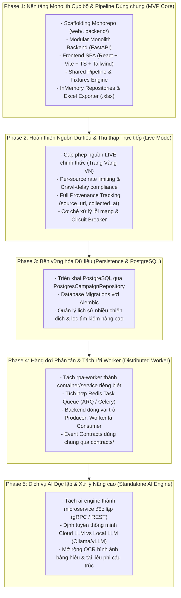

# KẾ HOẠCH TRIỂN KHAI PHÂN KỲ HỆ THỐNG (PHASED IMPLEMENTATION PLAN)
# AI RPA Lead Collector

---

## 1. Mục tiêu và Nguyên tắc Triển khai (Goals and Principles)

### 1.1 Mục tiêu Kế hoạch
Tài liệu này xác lập **Kế hoạch Triển khai Phân kỳ Kỹ thuật (Phased Implementation Plan)** cho hệ thống **AI RPA Lead Collector**, đóng vai trò là kim chỉ nam hướng dẫn lập trình viên hiện thực hóa kiến trúc mục tiêu đã được phê duyệt trong [`docs/architecture.md`](architecture.md) và các yêu cầu sản phẩm tại [`docs/PRD.md`](PRD.md).

Mục tiêu cốt lõi:
1. **Phân kỳ Rõ ràng (Phased & Milestone-Driven):** Thay thế toàn bộ các kế hoạch theo ngày hoặc deadline ngắn hạn nhân tạo bằng lộ trình 5 giai đoạn phát triển có thứ tự phụ thuộc, deliverables và tiêu chí nghiệm thu chặt chẽ.
2. **Ưu tiên Nền tảng Cốt lõi (MVP Core First):** Tập trung bàn giao bản phát hành đầu tiên (Phase 1) hoạt động ổn định trên môi trường cục bộ (Local PoC/Demo) theo mô hình **Modular Monolith** trước khi phân tán hóa hạ tầng.
3. **Tiến hóa Không Đập đi Xây lại (Evolutionary Architecture):** Thiết lập các lớp trừu tượng (Repository Pattern cho lưu trữ, Provider Adapter cho LLM, Dispatcher Interface cho xử lý nền) để việc nâng cấp sang PostgreSQL (Phase 3), Redis & Worker phân tán (Phase 4), hay AI Engine độc lập (Phase 5) không làm thay đổi logic nghiệp vụ cốt lõi.

### 1.2 Nguyên tắc Triển khai Bắt buộc
* **Kỷ luật Ranh giới Module:** Mọi dòng mã nguồn viết trong `backend/` phải tuân thủ 8 quy tắc phụ thuộc một chiều tại Mục 8 của [`docs/architecture.md`](architecture.md).
* **Quy tắc Dispatch khi Chưa có Redis:** Trong Phase 1, toàn bộ quy trình pipeline bắt buộc chạy **in-process** (sử dụng `FastAPI BackgroundTasks`). Tuyệt đối không giả định Backend và Worker ở hai tiến trình độc lập có thể chia sẻ hàng đợi trong RAM.
* **Chính sách Nguồn Dữ liệu Nghiêm ngặt:** Chế độ mặc định của Phase 1 là **`FIXTURE`**. Nguồn `LIVE` chỉ được tích hợp và kích hoạt khi có văn bản phê duyệt từ TechLead ở Phase 2. Tuyệt đối không tự động chuyển từ LIVE sang FIXTURE khi gặp lỗi.
* **Chuẩn hóa Dữ liệu Tuyệt đối:** Tuân thủ đúng 11 trường canonical từ [`docs/data-dictionary.md`](data-dictionary.md). Không thêm `tax_code`, `business_scale`, hay `contact_person`. Bắt buộc hỗ trợ và kiểm chứng phạm vi Toàn quốc và Thành phố Đà Nẵng.

---

## 2. Tổng quan Lộ trình 5 Giai đoạn (5-Phase Roadmap Overview)

---

## 3. Kế hoạch Chi tiết Từng Giai đoạn (Detailed Phase Breakdown)

---

### Phase 1: Nền tảng Monolith Cục bộ & Pipeline Dùng chung (MVP Core Release)

* **Trạng thái:** `[ƯU TIÊN HÀNG ĐẦU — SẴN SÀNG TRIỂN KHAI]`
* **Mục tiêu:** Bàn giao phiên bản MVP chạy cục bộ ổn định, kết nối thông suốt từ Web UI React đến Backend FastAPI, vận hành trơn tru pipeline bóc tách qua dữ liệu mẫu (Fixture Mode), hiển thị xem trước và xuất file Excel hoàn chỉnh.
* **Thời lượng Ước tính:** 1 sprint phát triển (khoảng 35–40 giờ làm việc độc lập).
* **Điều kiện tiên quyết:** Tài liệu kỹ thuật tại `docs/` đã được đồng bộ hoàn toàn; máy trạm cài đặt Python 3.11+, Node.js 18+.

#### Danh mục Nhiệm vụ Kỹ thuật (Task Breakdown):

1. **Khởi tạo Nền tảng & Cấu trúc Thư mục (Scaffolding & Core Setup):**
   * Thiết lập cấu trúc `backend/src/app/` theo Mục 9 của [`docs/architecture.md`](architecture.md).
   * Cấu hình quản lý môi trường: `core/config.py` dùng `pydantic-settings`, đọc `.env.example`.
   * Cài đặt logging có cấu trúc: `core/logging.py`, tự động che giấu secret (redaction).
   * Định nghĩa mã lỗi và ngoại lệ: `core/exceptions.py` và `core/constants.py` tương ứng 19 mã lỗi chuẩn.
   * Khởi tạo dự án `web/` bằng Vite + React 18 + TypeScript + Tailwind CSS.

2. **Tầng API & Custom Exception Handlers (`backend/src/app/api/`):**
   * Đăng ký router FastAPI với prefix canonical `/api/v1/` và alias `/api/`.
   * Cài đặt Global Exception Handlers bọc 100% lỗi theo vỏ bọc `StandardErrorResponse` (bắt `RequestValidationError` dịch sang tiếng Việt, giấu stack trace lỗi 500).
   * Hiện thực hóa 06 endpoints chuẩn:
     * `POST /api/v1/campaigns` (Validate schema, từ chối LIVE chưa duyệt, trả HTTP 202).
     * `GET /api/v1/campaigns/{id}` (Thăm dò trạng thái, metrics, mảng `errors[]`).
     * `GET /api/v1/campaigns/{id}/leads` (Xem trước 11 trường canonical, phân trang).
     * `GET /api/v1/campaigns/{id}/export` (Tải file Excel, bảo vệ Path Traversal bằng `is_relative_to`).
     * `GET /api/v1/provinces` (Nạp danh mục địa lý từ `data/provinces_reference.json`).
     * `GET /api/v1/health` (Kiểm tra liveness và quyền ghi đĩa exports).

3. **Tầng Lưu trữ Bộ nhớ & Dịch vụ Ứng dụng (`services/` & `repositories/`):**
   * Định nghĩa interface trừu tượng `CampaignRepository` và `LeadRepository`.
   * Hiện thực `InMemoryCampaignRepository` và `InMemoryLeadRepository` quản lý state trong RAM (sử dụng thread-safe locks).
   * Cài đặt `CampaignService` và `LeadService`.

4. **Đường ống Xử lý Dữ liệu Dùng chung (`pipeline/`, `collectors/`, `extraction/`, v.v.):**
   * **Collectors:** Hiện thực `FixtureCollector` nạp dữ liệu mẫu đa địa phương (có Đà Nẵng) từ `data/fixtures/`; cài đặt `SourcePolicy` chặn request mạng tới nguồn live chưa duyệt.
   * **Extraction:** Hiện thực `LLMAdapter` kết nối Company LLM API qua `httpx` (JSON Schema Mode) kèm fallback `MockLLMExtractor` dự phòng.
   * **Validation:** Cài đặt `LeadValidator` kiểm tra 11 trường canonical, chuẩn hóa email/phone.
   * **Geographic Normalizer:** Cài đặt `GeoNormalizer` ánh xạ tỉnh/thành theo bộ tham chiếu có phiên bản; thiếu gán `null`.
   * **Deduplication:** Hiện thực giải thuật khử trùng lặp xác định 3 bước (Website → Tên + Liên hệ).
   * **Exporters:** Cài đặt `ExcelExporter` bằng `openpyxl`, xuất 2 sheet `Leads` (12 cột) và `Summary`.
   * **Orchestrator:** Kết nối tuần tự các giai đoạn qua `FastAPI BackgroundTasks`.

5. **Giao diện Người dùng Web UI (`web/`):**
   * Xây dựng Form cấu hình chiến dịch (chọn ngành, phạm vi Toàn quốc/Tỉnh thành, dropdown có Đà Nẵng, số lượng records).
   * Cài đặt custom hook `useCampaignPolling` với cơ chế đệ quy `setTimeout` (1.5s – 2.0s), chống request chồng lấn.
   * Hiển thị trực quan: Progress bar, Toast thông báo, Banner vàng cảnh báo `PARTIAL_SUCCESS`, Banner đỏ `FAILED`.
   * Bảng xem trước dữ liệu Lead (Data Preview Table) và nút tải file Excel an toàn.

6. **Kiểm thử Tự động (Testing Suite):**
   * Unit test cho Validator, GeoNormalizer, Deduplicator và ExcelExporter.
   * API Integration test với `TestClient` kiểm tra trọn vẹn 6 endpoints.
   * End-to-End test chạy 1 chiến dịch hoàn chỉnh ở chế độ FIXTURE.

* **Đầu ra Bàn giao (Deliverables):** Mã nguồn hoạt động của `backend/` và `web/`, bộ fixture HTML mẫu đa địa phương, tệp tham chiếu địa lý có Đà Nẵng, bộ test tự động pass 100%.
* **Tiêu chí Nghiệm thu (Definition of Done):**
  * `pytest` chạy pass toàn bộ test suites.
  * Khởi động server backend và web UI, tạo chiến dịch Giáo dục/Sản xuất tại Đà Nẵng hoặc Toàn quốc ở chế độ FIXTURE.
  * Tải được file Excel `.xlsx` hợp lệ, mở đẹp trên Microsoft Excel, đầy đủ dữ liệu 2 sheet.

---

### Phase 2: Hoàn thiện Nguồn Dữ liệu & Thu thập Trực tiếp (Source Hardening & Live Mode)

* **Phụ thuộc:** Hoàn thành Phase 1; Có văn bản phê duyệt nguồn LIVE từ TechLead và Pháp chế.
* **Mục tiêu:** Kích hoạt khả năng thu thập dữ liệu trực tiếp từ nguồn web được cấp phép, đảm bảo tuân thủ đạo đức thu thập (`robots.txt`, crawl-delay), bảo toàn nguồn gốc dữ liệu (provenance), và có cơ chế chống sập khi gặp lỗi mạng.
* **Thời lượng Ước tính:** 1 sprint phát triển.

#### Danh mục Nhiệm vụ Kỹ thuật:
1. **Source Policy & Compliance Hardening:**
   * Cập nhật danh sách nguồn được duyệt trong `core/config.py`.
   * Cài đặt module phân tích `robots.txt` tự động hoặc cấu hình cố định `Crawl-delay: 5` cho nguồn Trang Vàng.
   * Xây dựng cơ chế Per-source Rate Limiter (Token Bucket hoặc Semaphore delay).
2. **Live Collector Adapters:**
   * Hiện thực adapter thu thập trực tiếp cho Trang Vàng (`collectors/sources/trangvang_adapter.py`).
   * Xây dựng cơ chế phân trang và truyền tham số địa phương (`?city=...`).
   * Bổ sung cơ chế thử lại (Retry with Exponential Backoff) cho lỗi HTTP 429/503.
3. **Data Provenance & Audit Logging:**
   * Lưu vết chi tiết `source_url` chính xác tới từng trang listing hoặc trang chi tiết.
   * Ghi nhận audit log riêng biệt cho từng chiến dịch (`logs/campaign_<id>.log`).
4. **Resilience & Fault Tolerance:**
   * Đảm bảo nguyên tắc bảo toàn dữ liệu: Khi 1 URL bị timeout hoặc LLM cạn quota giữa chừng, hệ thống dừng cào an toàn và xuất file Excel cho các lead đã lấy được (`PARTIAL_SUCCESS`).
   * Tuyệt đối không tự động chuyển ngầm từ LIVE sang FIXTURE khi lỗi mạng.

* **Deliverables:** Module `LiveCollectorAdapter`, bộ cấu hình rate limiter, audit logging engine, báo cáo kiểm chứng tuân thủ nguồn.
* **Acceptance Criteria:** Chạy thành công chiến dịch thu thập LIVE từ nguồn được duyệt; xuất file Excel chứa 100% lead có `source_url` thực tế; các lỗi mạng được ghi nhận trung thực vào mảng `errors[]`.

---

### Phase 3: Bền vững hóa Dữ liệu (Persistence & PostgreSQL Storage)

* **Phụ thuộc:** Hoàn thành Phase 1; Đạt tiêu chuẩn nghiệm thu lưu trữ bền vững.
* **Mục tiêu:** Thay thế bộ lưu trữ RAM tạm thời bằng hệ quản trị cơ sở dữ liệu quan hệ PostgreSQL, bảo toàn lịch sử chiến dịch và danh sách lead qua các lần khởi động lại máy chủ.
* **Thời lượng Ước tính:** 1 sprint phát triển.

#### Danh mục Nhiệm vụ Kỹ thuật:
1. **Thiết kế Cơ sở Dữ liệu & ORM Models:**
   * Khởi tạo cấu hình kết nối PostgreSQL qua `SQLAlchemy` async hoặc `SQLModel`.
   * Định nghĩa các bảng quan hệ: `campaigns`, `leads`, `campaign_errors`, `audit_logs`.
   * Thiết lập quan hệ 1-N giữa Campaign và Lead; đánh index cho `campaign_id`, `company_name`, `province`, `collected_at`.
2. **Database Migrations:**
   * Tích hợp `Alembic` quản lý migrations tự động.
   * Viết script migration khởi tạo ban đầu (Initial migration).
3. **Hiện thực Lớp Repository Bền vững:**
   * Xây dựng `PostgresCampaignRepository` và `PostgresLeadRepository` kế thừa các interface trừu tượng đã định nghĩa từ Phase 1.
   * Chuyển đổi dependency injection trong FastAPI từ InMemory sang Postgres thông qua cấu hình môi trường `DATABASE_URL`.
   * **Bảo toàn nghiệp vụ:** Toàn bộ logic của `CampaignService`, `LeadService`, và `PipelineOrchestrator` giữ nguyên 100%, không cần viết lại.
4. **Nâng cấp Giao diện Lịch sử Chiến dịch:**
   * Bổ sung trang danh sách chiến dịch lịch sử (`/campaigns`) trên Web UI.
   * Cho phép lọc tìm kiếm chiến dịch theo ngày tạo, ngành, địa phương, và trạng thái.

* **Deliverables:** Schema PostgreSQL, Alembic migrations, Docker Compose service `postgres`, module repository bền vững, UI quản lý lịch sử chiến dịch.
* **Acceptance Criteria:** Khởi động lại máy chủ backend, dữ liệu chiến dịch và danh sách lead trước đó vẫn tồn tại nguyên vẹn; tải lại file Excel từ lịch sử thành công.

---

### Phase 4: Hàng đợi Phân tán & Tách rời Worker (Distributed Worker & Message Queue)

* **Phụ thuộc:** Hoàn thành Phase 3; Quy mô thu thập mở rộng hoặc có yêu cầu chạy nhiều worker song song.
* **Mục tiêu:** Tách quy trình thu thập dữ liệu nặng ra khỏi tiến trình máy chủ API, chuyển sang mô hình xử lý phân tán hướng sự kiện với hàng đợi Redis bền vững.
* **Thời lượng Ước tính:** 1 sprint phát triển.

#### Danh mục Nhiệm vụ Kỹ thuật:
1. **Tách rời Thư mục `rpa-worker/`:**
   * Đóng gói toàn bộ các module pipeline (`collectors/`, `extraction/`, `validation/`, `deduplication/`, `exporters/`) vào thư mục độc lập `rpa-worker/`.
   * Xây dựng Dockerfile riêng biệt cho `rpa-worker`.
2. **Tích hợp Message Broker (Redis Task Queue):**
   * Bổ sung service `redis` vào `docker-compose.yml`.
   * Cài đặt thư viện hàng đợi tác vụ bất đồng bộ (ARQ hoặc Celery/RabbitMQ).
   * Chia sẻ các hợp đồng DTO sự kiện (Event Schemas) thông qua thư mục chung `contracts/`.
3. **Chuyển đổi Mô hình Dispatch:**
   * Backend API chuyển sang đóng vai trò **Task Producer**: Nhận HTTP POST, ghi nhận chiến dịch `PENDING` vào PostgreSQL, đẩy sự kiện `start_campaign_task` vào Redis, trả ngay `HTTP 202 Accepted` cho client (độ trễ < 50ms).
   * `rpa-worker` đóng vai trò **Task Consumer**: Lắng nghe hàng đợi Redis, nhận task, thực thi tuần tự các giai đoạn pipeline, cập nhật tiến độ trực tiếp vào PostgreSQL.
4. **Giám sát & Quản trị Hàng đợi:**
   * Tích hợp dashboard giám sát worker (ARQ dashboard hoặc Flower cho Celery).
   * Cấu hình Dead-Letter Queue (DLQ) cho các tác vụ gặp lỗi nghiêm trọng.

* **Deliverables:** Thư mục `rpa-worker/` độc lập, container worker, cấu hình Redis, module task producer/consumer, tài liệu `contracts/`.
* **Acceptance Criteria:** Backend API và RPA Worker chạy ở 2 container riêng biệt; tắt/bật lại worker mà không làm gián đoạn API; tác vụ được dispatch qua Redis và hoàn tất chính xác.

---

### Phase 5: Dịch vụ AI Độc lập & Xử lý Nâng cao (Standalone AI Engine)

* **Phụ thuộc:** Hoàn thành Phase 4; Có nhu cầu xử lý đa thể thức (OCR, PDF) hoặc tối ưu hóa hạ tầng suy luận LLM nội bộ.
* **Mục tiêu:** Tách module AI thành microservice chuyên biệt `ai-engine/` để quản lý tập trung tài nguyên mô hình, định tuyến thông minh giữa Cloud API và Local LLM, đồng thời bổ sung các năng lực bóc tách nâng cao.
* **Thời lượng Ước tính:** 1 sprint phát triển.

#### Danh mục Nhiệm vụ Kỹ thuật:
1. **Khởi tạo Dịch vụ `ai-engine/`:**
   * Xây dựng microservice độc lập (Python FastAPI hoặc gRPC server).
   * Đóng gói Dockerfile riêng tối ưu hóa cho AI inference (hỗ trợ GPU CUDA nếu có).
2. **Định tuyến Mô hình Thông minh (Model Routing & Cost Optimization):**
   * Tích hợp cơ chế fallback đa tầng: Thử nghiệm Local LLM (Ollama / vLLM) cho các tác vụ đơn giản; chuyển tiếp sang Cloud LLM (Gemini / OpenAI) cho các cấu trúc phức tạp.
   * Bộ đệm ngữ nghĩa (Semantic Cache) lưu kết quả trích xuất của các nội dung tương đồng để tiết kiệm chi phí token.
3. **Mở rộng Năng lực Bóc tách Phi cấu trúc:**
   * Tích hợp module OCR nhận diện thông tin doanh nghiệp từ hình ảnh bảng hiệu, danh thiếp hoặc ảnh chụp giấy phép kinh doanh.
   * Xử lý tài liệu biểu mẫu phức tạp (PDF, bảng biểu scan).

* **Deliverables:** Thư mục `ai-engine/` độc lập, container AI Engine, giao thức RPC/REST nội bộ, tài liệu hướng dẫn cấu hình model serving.
* **Acceptance Criteria:** `rpa-worker` gọi `ai-engine` qua mạng nội bộ để trích xuất dữ liệu; cơ chế circuit breaker tự động ngắt khi AI Engine quá tải; hỗ trợ chạy hoàn toàn offline với Local LLM.

---

## 4. Thứ Tự Triển Khai Khuyến Nghị Sau Khi Đồng Bộ Tài Liệu

Sau khi toàn bộ tài liệu kỹ thuật tại `docs/` được rà soát và đồng bộ, lập trình viên bắt tay vào triển khai **Phase 1** theo đúng trình tự sau:

| Bước | Hạng mục Công việc | Chi tiết Kỹ thuật | File / Thư mục Tạo | Tiêu chuẩn Hoàn thành |
| :---: | :--- | :--- | :--- | :--- |
| **B1** | **Khởi tạo Monorepo & Môi trường** `[HOÀN THÀNH — Task 1]` | Cấu hình Python virtualenv, dependencies (`fastapi`, `uvicorn`, `pydantic-settings`, `httpx`, `openpyxl`, `pytest`), `.env.example`, `.gitignore`. | `backend/`, `web/`, `.env.example` | Môi trường cài đặt thành công, chạy được lệnh test rỗng. |
| **B2** | **Core & Error Envelope** `[HOÀN THÀNH — Task 1]` | Cài đặt `config.py`, `logging.py`, `exceptions.py` (19 mã lỗi), và Custom Exception Handlers bọc `StandardErrorResponse`. | `backend/src/app/core/`, `schemas/common.py` | Lỗi 422, 404, 500 trả về đúng định dạng vỏ bọc JSON chuẩn. |
| **B3** | **Data Models & In-Memory Store** `[HOÀN THÀNH — Task 2]` | Cài đặt DTOs Pydantic (`schemas/`), Domain Models (`models/`), interface Repository và `InMemoryCampaignStore` (deep-copy snapshot, validation invariants). | `schemas/`, `models/`, `repositories/` | Thao tác CRUD chiến dịch chạy trơn tru trong bộ nhớ RAM, pass 31/31 unit tests. |
| **B4** | **API Router, Dispatcher & Provinces** `[HOÀN THÀNH — Task 3]` | Hiện thực các endpoints cốt lõi tại `api/v1/` và alias `api/` (`POST /campaigns` 202, `GET /campaigns/{id}` 200, `GET /provinces` 34 đơn vị, `GET /health`), kèm In-Process Background Dispatcher chuyển PENDING $\rightarrow$ RUNNING. (Endpoints `leads` và `export` hoàn thiện ở Task 4/5). | `backend/src/app/api/`, `pipeline/dispatcher.py`, `schemas/` | Đạt 100% 87 tiêu chí kỹ thuật Task 3, pass 88/88 test suites. |
| **B5** | **Pipeline Modules & Fixtures** `[ƯU TIÊN TIẾP THEO — Task 4]` | Cài đặt tuần tự: `FixtureCollector`, `LeadValidator` (11 trường), `GeoNormalizer` (34 tỉnh thành, có Đà Nẵng), `Deduplicator`, `ExcelExporter` (`openpyxl`). | `collectors/`, `validation/`, `deduplication/`, `exporters/` | Unit test từng module đạt 100% logic nghiệp vụ. |
| **B6** | **Pipeline Orchestrator** `[ƯU TIÊN TIẾP THEO — Task 4]` | Ghép nối 11 giai đoạn thành `PipelineOrchestrator`, kết nối in-process qua `BackgroundTasks`, cập nhật metrics và lỗi. | `backend/src/app/pipeline/` | Chạy 1 chiến dịch fixture từ đầu đến cuối, xuất file `.xlsx` ra `exports/`. |
| **B7** | **Frontend SPA (React + Vite)** | Xây dựng giao diện Form cấu hình, custom hook `useCampaignPolling`, Data Preview Table, nút tải Excel. | `web/src/` | Giao diện chạy mượt mà trên `localhost:5173`, kết nối API `localhost:8000`. |
| **B8** | **Kiểm thử E2E & Hoàn thiện** | Chạy kiểm thử End-to-End toàn hệ thống cả 2 ngành Education & Manufacturing; kiểm tra kịch bản Đà Nẵng và Toàn quốc. | `tests/` | Đạt toàn bộ tiêu chí nghiệm thu của Phase 1. |

---

## 5. Ma Trận Quản Lý Rủi Ro Kỹ Thuật (Risk Matrix)

| Rủi ro | Mức độ | Giai đoạn | Biện pháp Phòng ngừa & Xử lý |
| :--- | :---: | :---: | :--- |
| **Mất dữ liệu RAM khi server khởi động lại** | Trung bình | Phase 1 | Chấp nhận giới hạn trong Phase 1 (file Excel trên đĩa cứng vẫn còn nguyên). Chuyển sang PostgreSQL ở Phase 3. |
| **Tài khoản LLM API cạn Quota hoặc gián đoạn** | Cao | Phase 1 & 2 | Bắt ngoại lệ `ERR_LLM_QUOTA`, dừng gọi AI an toàn, bảo toàn lead đã lấy để xuất file (`PARTIAL_SUCCESS`), hỗ trợ `MockLLMExtractor`. |
| **Website nguồn chặn IP hoặc cấu trúc DOM thay đổi** | Cao | Phase 2 | Cài đặt crawl-delay giãn cách, per-source rate limiter. Nếu cấu trúc thay đổi: báo lỗi `ERR_SRC_HTTP_CLIENT_ERR`, chuyển sang Fixture Mode. |
| **Bộ nhớ RAM phình to khi chạy chiến dịch lớn** | Trung bình | Phase 1 | Giới hạn `max_records` tối đa 50 trong Phase 1. Dọn dẹp các chiến dịch cũ không hoạt động. |
| **Lỗi lệch bộ nhớ giữa 2 tiến trình khi chưa có Redis** | Nghiêm trọng | Phase 1 | **Quy tắc bắt buộc:** Tuyệt đối không chạy worker ở process riêng biệt trong Phase 1; toàn bộ pipeline chạy in-process qua `BackgroundTasks`. |

---

*Kế hoạch này là tài liệu chuẩn mực hướng dẫn triển khai kỹ thuật cho toàn bộ chu kỳ phát triển dự án AI RPA Lead Collector.*
