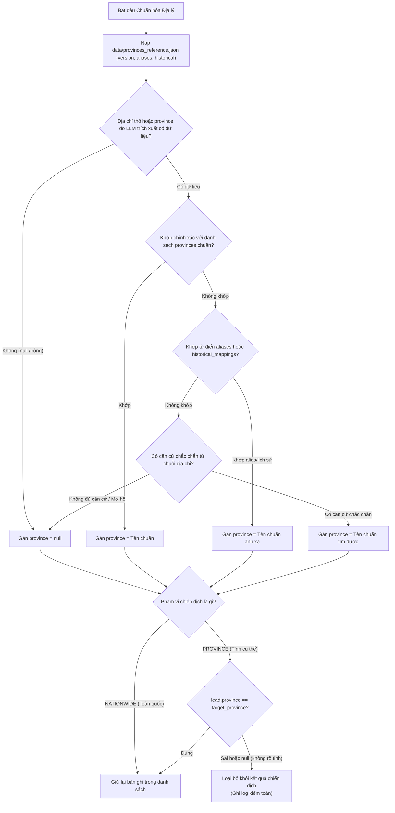
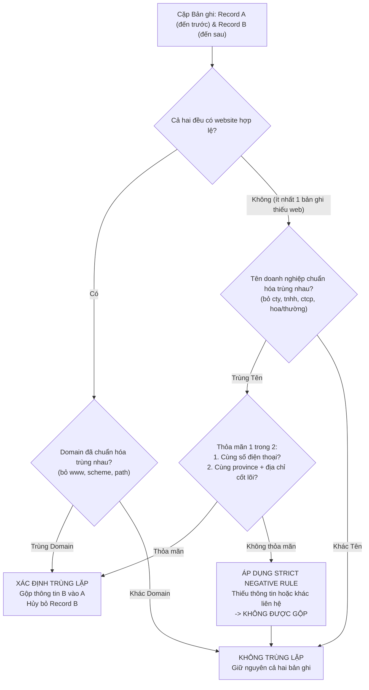
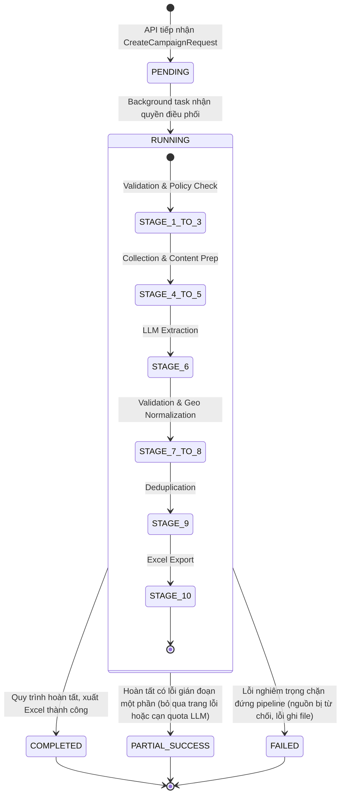
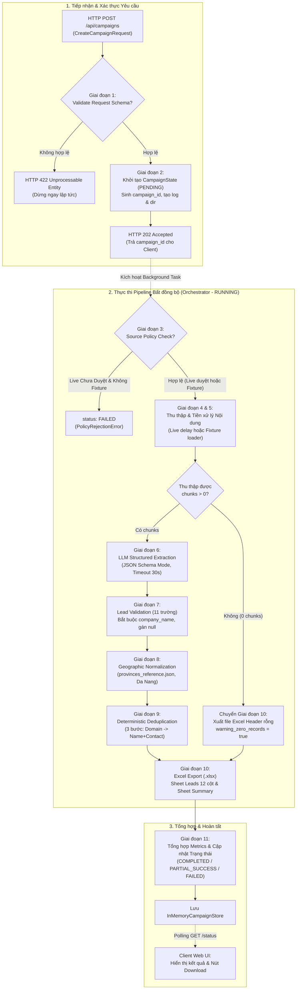
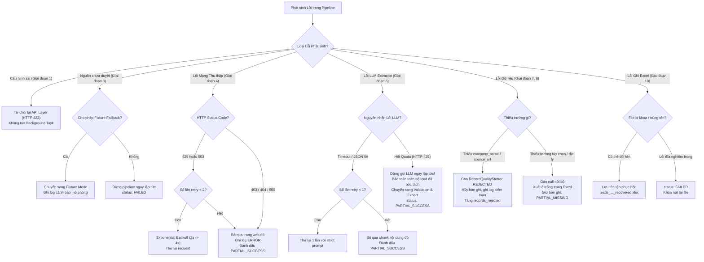
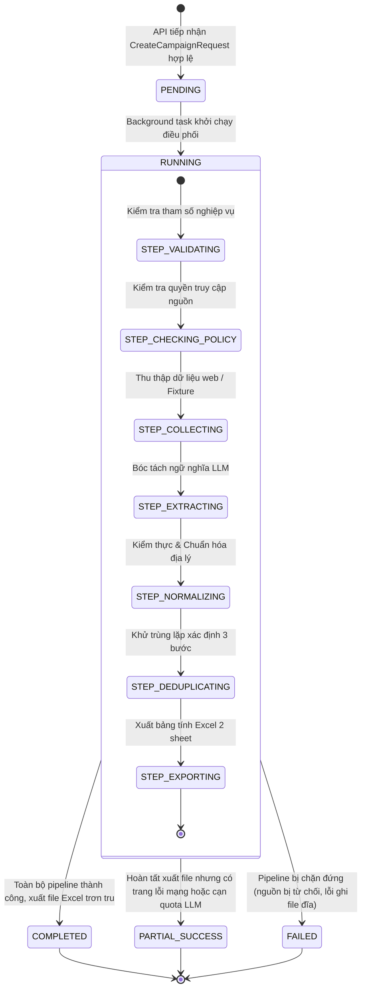

# ĐẶC TẢ ĐƯỜNG ỐNG XỬ LÝ DỮ LIỆU (PIPELINE SPECIFICATION)
# AI RPA Lead Collector MVP

---

## 1. Mục tiêu và Phạm vi (Goals and Scope)

### 1.1 Mục tiêu Tài liệu
Tài liệu này xác lập đặc tả kỹ thuật chi tiết cho **Đường ống Xử lý Dữ liệu Dùng chung (Shared Data Pipeline)** của dự án **AI RPA Lead Collector MVP**. 

Mục tiêu cốt lõi:
1. **Đặc tả quy trình đầu-cuối (End-to-End Workflow):** Mô tả chuẩn xác từng bước xử lý một chiến dịch thu thập thông tin khách hàng tiềm năng B2B từ lúc tiếp nhận tham số cấu hình, kiểm tra chính sách, thu thập nội dung, trích xuất ngữ nghĩa bằng LLM, kiểm thực cú pháp, chuẩn hóa địa lý, khử trùng lặp cho đến khi xuất file Excel hoàn tất.
2. **Định hình ranh giới trách nhiệm (Stage Boundaries & Contracts):** Xác định tường minh đầu vào (Input), đầu ra (Output), điều kiện chuyển tiếp và dữ liệu truy vết (provenance) được lưu giữ ở từng giai đoạn.
3. **Phân định rõ vai trò Điều phối (Orchestration vs Service Logic):** Phân biệt rạch ròi giữa trách nhiệm điều phối, tổng hợp trạng thái của `CampaignOrchestrator` và trách nhiệm thực thi nghiệp vụ độc lập của từng pipeline service.
4. **Kiểm soát rủi ro & Xử lý lỗi phân tầng (Resilience & Error Handling):** Thiết lập ma trận xử lý lỗi toàn diện, ngăn ngừa sập hệ thống (crash), không retry vô hạn, và không đánh tráo dữ liệu lỗi hoặc dữ liệu mô phỏng.

### 1.2 Phạm vi Ứng dụng
* **Trong phạm vi đặc tả:**
  * Đường ống xử lý dùng chung (Shared Pipeline) cho cả 2 ngành **Giáo dục (Education)** và **Sản xuất (Manufacturing)**.
  * Phạm vi địa lý: Toàn quốc Việt Nam hoặc lọc theo một tỉnh/thành phố cụ thể (bắt buộc hỗ trợ và có dữ liệu kiểm chứng tại Thành phố Đà Nẵng).
  * Vận hành trên môi trường máy trạm cá nhân (**Local PoC/Demo**), phục vụ giai đoạn khởi tạo (Phase 1: Local Foundation & Core Pipeline).
  * Quản lý trạng thái chiến dịch trong bộ nhớ RAM (`InMemoryCampaignStore`), xuất dữ liệu thành phẩm ra file Microsoft Excel (`.xlsx`) lưu tại thư mục `exports/`.
  * Hỗ trợ 2 chế độ thực thi minh bạch: **Fixture Mode** (mặc định khi chưa duyệt nguồn live) và **Live Mode** (thu thập trực tiếp khi có văn bản phê duyệt chính thức).
* **Ngoài phạm vi đặc tả:**
  * Hạ tầng cơ sở dữ liệu quan hệ (PostgreSQL/MySQL), hàng đợi phân tán (Celery, Redis, RabbitMQ, Kafka).
  * Framework đa tác tử tự hành phức tạp (CrewAI, LangGraph, AutoGen) hoặc crawler tự do không kiểm soát.
  * Các nghiệp vụ CRM: Chấm điểm khách hàng tiềm năng (Lead Scoring), dự đoán ý định mua hàng, gửi email tự động (Cold Outreach).

---

## 2. Các Nguyên tắc Thiết kế Pipeline (Pipeline Design Principles)

Đường ống xử lý tuân thủ nghiêm ngặt 6 nguyên tắc thiết kế kỹ thuật:

1. **Một Pipeline Dùng chung Điều khiển bằng Cấu hình (Single Shared, Configuration-Driven Pipeline):**
   * Cả hai ngành Education và Manufacturing đều đi qua cùng một chuỗi các giai đoạn xử lý dữ liệu.
   * Sự khác biệt giữa hai ngành được điều khiển hoàn toàn bằng tham số cấu hình: từ khóa tìm kiếm, nhãn ngành (`industry`), prompt template ngữ cảnh và danh mục nguồn được duyệt. Tuyệt đối không viết hai pipeline hoặc rẽ nhánh mã nguồn thành hai luồng song song.
2. **Kiểm soát Xác định Chặn trên AI (Deterministic Guardrails over AI):**
   * LLM API do công ty cấp chỉ đóng vai trò **Bộ phân tích cú pháp ngữ nghĩa (Semantic Parser)** để chuyển văn bản phi cấu trúc thành JSON bán cấu trúc.
   * Toàn bộ việc kiểm thực bắt buộc, chuẩn hóa số điện thoại/email/URL, ánh xạ tỉnh/thành phố, và khử trùng lặp được thực thi 100% bằng **mã nguồn xác định (Deterministic Code)**, không phó mặc cho LLM.
3. **Truy vết Nguồn gốc 100% & Không Sinh Ảo giác (Traceability & Zero Hallucination):**
   * Mọi bản ghi lead trong suốt vòng đời pipeline bắt buộc phải gắn liền với URL nguồn thực tế (`source_url`) và thời điểm thu thập (`collected_at`).
   * LLM chỉ được phép trích xuất thông tin có bằng chứng rõ ràng trong văn bản nguồn; nếu thiếu, LLM bắt buộc trả về `null`. Hệ thống cấm tuyệt đối việc tự suy đoán, bịa đặt số điện thoại, email hoặc gán bừa địa phương lân cận.
4. **Minh bạch Tuyệt đối Chế độ Thực thi (Transparent Execution Modes):**
   * Phân định rạch ròi giữa **Live Mode** và **Fixture Mode**. Mặc định hệ thống chạy Fixture Mode cho đến khi có văn bản phê duyệt nguồn live từ TechLead.
   * **Cấm đánh tráo dữ liệu (No Silent Fallback):** Nếu Live Mode gặp sự cố mạng, hệ thống báo cáo trung thực lỗi kết nối; tuyệt đối không âm thầm nạp dữ liệu fixture thay thế rồi báo cáo là dữ liệu cào thật. Dữ liệu fixture bắt buộc gắn nhãn mô phỏng trên UI, Log và Excel.
   * **Không phát sinh request mạng tới nguồn chưa duyệt:** Nếu nguồn live chưa có văn bản phê duyệt chính thức từ TechLead, hệ thống cấm gửi bất kỳ HTTP request nào tới nguồn đó.
5. **Tách biệt Trạng thái Vòng đời Hạ tầng và Chất lượng Dữ liệu (Decoupled State and Quality):**
   * Vòng đời chiến dịch (`CampaignStatus`) phản ánh sự vận hành của hạ tầng: `PENDING`, `RUNNING`, `COMPLETED`, `PARTIAL_SUCCESS`, `FAILED`.
   * Chất lượng từng dòng dữ liệu (`RecordQualityStatus`) phản ánh giá trị nghiệp vụ: `VALID`, `PARTIAL_MISSING`, `REJECTED`, `DUPLICATE`. Hai hệ thống trạng thái này độc lập và không được gộp lẫn.
6. **Kiến trúc Monolith Cục bộ & Quy tắc Dispatch Phân kỳ (Modular Monolith & Phased Dispatch):**
   * Trong **Phase 1**, toàn bộ pipeline thực thi tuần tự in-process trong cùng tiến trình máy chủ (`FastAPI BackgroundTasks`).
   * **Quy tắc Dispatch Cốt lõi:** Khi chưa có Redis hoặc message broker bền vững, Backend và Worker **KHÔNG ĐƯỢC PHÉP** chạy ở 2 tiến trình độc lập và chia sẻ hàng đợi trong RAM. Hai tiến trình hệ điều hành riêng biệt không thể chia sẻ vùng nhớ bộ nhớ RAM.
   * Trong **Phase 4**, các module pipeline từ Giai đoạn 3 đến 10 sẽ được tách thành service độc lập `rpa-worker/`, giao tiếp với Backend qua Redis Task Queue.
   * Vai trò của AI Engine: Trong Phase 1, trích xuất được thực hiện qua LLM Provider Adapter; trong Phase 5, `ai-engine/` được tách thành microservice chuyên biệt.
   * Cập nhật tiến độ trên giao diện thông qua cơ chế **Polling API định kỳ (mỗi 1.5s – 2.0s)**, không tuyên bố là cập nhật "real-time" khi chưa sử dụng WebSocket/SSE.

---

## 3. Tổng quan Pipeline (Pipeline Architecture Overview)

### 3.1 Ánh xạ 11 Giai đoạn Pipeline vào 8 Module Kiến trúc
Để tuân thủ thiết kế [docs/architecture.md](file:///D:/ai-rpa-lead-generator/docs/architecture.md) và tránh over-engineering, 11 giai đoạn nghiệp vụ của pipeline được ánh xạ chặt chẽ vào các module kỹ thuật hiện có mà không phát sinh thêm service dư thừa:

| STT | Giai đoạn Nghiệp vụ Pipeline | Module Chịu trách nhiệm (Phase 1 Monolith) | Vị trí Mã nguồn Phase 1 | Định hướng Phase 4 (Worker Extraction) |
| :---: | :--- | :--- | :--- | :--- |
| **1** | Campaign Request Validation | FastAPI API Layer | `backend/src/app/api/v1/campaigns.py` | Thuộc `backend/` (API Gateway / Router) |
| **2** | Campaign Initialization | Application Services | `backend/src/app/services/campaign_service.py` | Thuộc `backend/` (Task Producer) |
| **3** | Source Policy Check | Source Policy Engine | `backend/src/app/collectors/policy.py` | Tách vào `rpa-worker/` (Policy Engine) |
| **4** | Source Collection | Data Collector Engine | `backend/src/app/collectors/` | Tách vào `rpa-worker/` (Collector Adapter) |
| **5** | Content Preparation | Text Preparation Helper | `backend/src/app/collectors/` | Tách vào `rpa-worker/` (Content Cleaner) |
| **6** | LLM Structured Extraction | LLM Extractor Adapter | `backend/src/app/extraction/llm_adapter.py` | Tách vào `rpa-worker/` (hoặc `ai-engine/` ở Phase 5) |
| **7** | Lead Validation | Data Validator | `backend/src/app/validation/lead_validator.py` | Tách vào `rpa-worker/` (Validator Engine) |
| **8** | Geographic Normalization | Geographic Normalizer | `backend/src/app/validation/geo_normalizer.py` | Tách vào `rpa-worker/` (Geo Normalizer) |
| **9** | Deduplication | Deterministic Deduplicator | `backend/src/app/deduplication/deduplicator.py`| Tách vào `rpa-worker/` (Deduplicator Engine) |
| **10**| Excel Export | Excel Exporter Service | `backend/src/app/exporters/excel_exporter.py` | Tách vào `rpa-worker/` (Exporter Service) |
| **11**| Summary and Final Status | Pipeline Orchestrator | `backend/src/app/pipeline/orchestrator.py` | Tách vào `rpa-worker/` (Worker Orchestrator) |

### 3.2 Luồng Dữ liệu Tổng thể xuyên suốt Pipeline
Dữ liệu di chuyển tuần tự qua pipeline theo mô hình chuyển đổi đối tượng bất biến (Immutable Data Flow):

```text
HTTP Request Body (JSON)
  │
  ▼ [Giai đoạn 1: Validation]
CreateCampaignRequest DTO
  │
  ▼ [Giai đoạn 2 & 3: Init & Policy Check]
CampaignConfig & Khởi tạo CampaignState (PENDING -> RUNNING)
  │
  ▼ [Giai đoạn 4 & 5: Collection & Content Prep]
List[RawContentChunk] (Chứa clean_text, source_url, collected_at, execution_mode)
  │
  ▼ [Giai đoạn 6: LLM Extraction]
List[ExtractedLeadDTO] (JSON trích xuất bán cấu trúc)
  │
  ▼ [Giai đoạn 7 & 8: Validation & Geo Normalization]
ValidationResult:
  ├── valid_leads: List[LeadRecord] (Bao gồm VALID và PARTIAL_MISSING)
  └── rejected_leads: List[RejectedLead] (Bị từ chối kèm lý do kiểm toán)
  │
  ▼ [Giai đoạn 9: Deduplication]
List[LeadRecord] (Tập hợp lead duy nhất sau khử trùng lặp 3 bước)
  │
  ▼ [Giai đoạn 10: Excel Export]
File Vật lý: exports/leads_{industry}_{timestamp}_{campaign_id}.xlsx (2 sheets)
  │
  ▼ [Giai đoạn 11: Summary & Final Status]
CampaignSummaryMetrics & Cập nhật Trạng thái Cuối cùng (COMPLETED / PARTIAL_SUCCESS / FAILED)
```

---

## 4. Mô tả Chi tiết Từng Giai đoạn Pipeline (Detailed Stage Specifications)

---

### 4.1. Giai đoạn 1: Xác thực Yêu cầu Chiến dịch (Campaign Request Validation)

* **Mục tiêu:** Kiểm tra tính hợp lệ và toàn vẹn của tham số cấu hình chiến dịch trước khi kích hoạt bất kỳ tiến trình xử lý nền nào. Ngăn chặn triệt để dữ liệu rác hoặc cấu hình sai gây lãng phí tài nguyên mạng và LLM token.
* **Module chịu trách nhiệm:** `FastAPI API Layer` (`src/api/routes_campaign.py` kết hợp Pydantic v2 Schema `CreateCampaignRequest`).
* **Input:** Payload JSON gửi qua HTTP POST từ client:
  ```json
  {
    "campaign_name": "Chiến dịch Giáo dục Đà Nẵng 2026",
    "industry": "Education",
    "geographic_scope": "PROVINCE",
    "target_province": "Đà Nẵng",
    "max_records": 20,
    "execution_mode": "FIXTURE"
  }
  ```
* **Output:** Đối tượng nghiệp vụ `CampaignConfig` đã được xác thực an toàn.
* **Các bước xử lý nghiệp vụ:**
  1. Kiểm tra trường `campaign_name`: Chuỗi không rỗng, độ dài từ 3 đến 100 ký tự.
  2. Kiểm tra trường `industry`: Bắt buộc thuộc tập Enum xác định: `"Education"` hoặc `"Manufacturing"`. Không cho phép để trống.
  3. Kiểm tra trường `geographic_scope`: Bắt buộc là `"NATIONWIDE"` (Toàn quốc) hoặc `"PROVINCE"` (Một tỉnh/thành cụ thể).
  4. Kiểm tra điều kiện phụ thuộc địa lý: Nếu `geographic_scope == "PROVINCE"`, trường `target_province` bắt buộc phải có giá trị chuỗi không rỗng (ví dụ: `"Đà Nẵng"`). Nếu chọn `"NATIONWIDE"`, trường `target_province` được tự động chuyển về `null`.
  5. Kiểm tra trường `max_records`: `[PROPOSED]` Giá trị số nguyên dương. Áp dụng giới hạn cấu hình mặc định đề xuất là 20, mức trần kiểm soát từ 5 đến 50 bản ghi. *(Ghi nhận: Giá trị này chờ TechLead phê duyệt chính thức tại DEC-03)*.
  6. Kiểm tra trường `execution_mode`: Bắt buộc là `"LIVE"` hoặc `"FIXTURE"`.
* **Điều kiện thành công:** Request payload vượt qua toàn bộ các ràng buộc schema Pydantic.
* **Các lỗi có thể xảy ra:** Mã lỗi `ERR_CFG_INVALID` (Thiếu trường bắt buộc, sai ngành, chọn scope PROVINCE nhưng thiếu `target_province`, `max_records` vượt ngưỡng).
* **Hành vi khi lỗi:** FastAPI lập tức từ chối yêu cầu, trả về mã lỗi HTTP `422 Unprocessable Entity` kèm mảng chi tiết các trường vi phạm. Pipeline hoàn toàn không được khởi tạo.
* **Dữ liệu/Metadata giữ lại:** Không có (request bị loại bỏ tại tầng HTTP).
* **Điều kiện chuyển giai đoạn:** Payload hợp lệ → Chuyển sang Giai đoạn 2.

---

### 4.2. Giai đoạn 2: Khởi tạo Chiến dịch (Campaign Initialization)

* **Mục tiêu:** Thiết lập ngữ cảnh thực thi chiến dịch, sinh định danh duy nhất, cấp phát bộ nhớ RAM trong State Store và thiết lập cấu trúc lưu trữ kết quả.
* **Module chịu trách nhiệm:** `FastAPI API Layer` phối hợp `Campaign Orchestrator` (`src/orchestrator/campaign_orchestrator.py` & `src/orchestrator/state_store.py`).
* **Input:** Đối tượng `CampaignConfig` hợp lệ từ Giai đoạn 1.
* **Output:** Đối tượng `CampaignState` được lưu trong RAM với trạng thái `PENDING`, trả về cho Client mã phản hồi HTTP `202 Accepted` kèm `campaign_id`.
* **Các bước xử lý nghiệp vụ:**
  1. Sinh mã định danh duy nhất `campaign_id` theo chuẩn UUIDv4 (ví dụ: `c8f12a9e-5b12-4e67-91a3-2a1d8f7e6b01`).
  2. Ghi nhận mốc thời gian bắt đầu tiếp nhận `created_at` theo chuẩn ISO 8601 UTC.
  3. Khởi tạo đối tượng `CampaignState` trong `InMemoryCampaignStore` với các giá trị ban đầu:
     * `status = CampaignStatus.PENDING`
     * `current_step = "INITIALIZING"`
     * `config = campaign_config`
     * `metrics = CampaignMetrics()` (toàn bộ đếm khởi tạo = 0)
     * `records = []`, `errors = []`
  4. Kiểm tra và đảm bảo các thư mục hệ thống cục bộ tồn tại: thư mục xuất `exports/` và thư mục nhật ký `logs/`.
  5. Khởi tạo file log kiểm toán chuyên biệt cho chiến dịch: `logs/campaign_{campaign_id}.log`.
  6. Dispatch hàm điều phối `orchestrator.run_pipeline(campaign_id)` vào `fastapi.BackgroundTasks`.
  7. Ngay khi background task nhận quyền điều khiển từ CPU event loop, chuyển trạng thái chiến dịch sang `status = CampaignStatus.RUNNING` và `current_step = "CHECKING_POLICY"`.
* **Ràng buộc lưu trữ bộ nhớ RAM:**
  > [!IMPORTANT]
  > Trạng thái chiến dịch được lưu trữ thuần túy trong RAM (`InMemoryCampaignStore`). Nếu ứng dụng backend bị restart hoặc crash trong quá trình chạy, toàn bộ tiến trình của chiến dịch đang thực thi sẽ bị mất và không thể tự phục hồi. Điều này phù hợp với phạm vi PoC chạy local trong giai đoạn đầu (Phase 1); tính bền vững qua restart sẽ được bổ sung ở Phase 3 khi tích hợp PostgreSQL.
* **Điều kiện thành công:** Cấp phát thành công context trong RAM và kích hoạt tác vụ nền an toàn.
* **Các lỗi có thể xảy ra:** `ERR_SYS_INTERNAL` (Không thể ghi thư mục `exports/` hoặc `logs/` do lỗi phân quyền đĩa cứng).
* **Hành vi khi lỗi:** Trả về HTTP `500 Internal Server Error`, ghi log hệ thống.
* **Dữ liệu/Metadata giữ lại:** `campaign_id`, `created_at`, `config`, log stream.
* **Điều kiện chuyển giai đoạn:** Background task chuyển trạng thái sang `RUNNING` → Chuyển sang Giai đoạn 3.

---

### 4.3. Giai đoạn 3: Kiểm tra Chính sách Nguồn (Source Policy Check)

* **Mục tiêu:** Xác minh nguồn dữ liệu mục tiêu có được phép khai thác hợp pháp và kỹ thuật hay không trước khi phát sinh bất kỳ kết nối mạng nào.
* **Module chịu trách nhiệm:** `Source Policy Engine` (`src/collector/policy.py`).
* **Input:** `CampaignConfig` (chứa `industry`, `geographic_scope`, `target_province`, `execution_mode`).
* **Output:** Quyết định chính sách `PolicyDecision`:
  * `is_allowed: bool`
  * `effective_mode: "LIVE" | "FIXTURE"`
  * `source_targets: List[SourceTargetConfig]` (URL mục tiêu, crawl delay, headers, query params)
  * `rejection_reason: Optional[str]`
* **Các bước xử lý nghiệp vụ:**
  1. Đọc danh sách cấu hình nguồn từ biến môi trường và file cấu hình tập trung (`src/config.py`).
  2. **Rà soát Chính sách Truy cập & Whitelist Kỹ thuật:**
     * Đối chiếu nguồn live với danh sách `APPROVED_LIVE_SOURCES`.
     * **Nguyên tắc cốt lõi (DEC-01-V2):** Loại bỏ phê duyệt thủ công cá nhân của TechLead, thay thế bằng cơ chế kiểm soát kỹ thuật tự động: đối chiếu danh sách cho phép `APPROVED_LIVE_SOURCES`, kiểm tra domain hợp lệ, chống giả mạo URL và kiểm tra an toàn chuyển hướng. Việc website mục tiêu có thể truy cập được hoặc file `robots.txt` cho phép crawl **tuyệt đối không đồng nghĩa** nguồn đó được phép thu thập nếu không nằm trong whitelist cấu hình.
  3. **Phân nhánh Chế độ Thực thi:**
     * *Trường hợp 1 (Yêu cầu LIVE nhưng chưa có nguồn trong whitelist):* Nếu `execution_mode == "LIVE"` nhưng danh sách nguồn live chưa được cấu hình cho phép trong `APPROVED_LIVE_SOURCES`:
       * **Tuyệt đối cấm phát sinh request mạng tới nguồn live chưa nằm trong whitelist.**
       * Nếu cấu hình hệ thống và người dùng cho phép fallback: **Từ chối chạy live**, ghi nhận cảnh báo rõ ràng và chuyển hướng có kiểm soát sang chế độ `FIXTURE`, cập nhật `effective_mode = "FIXTURE"`, ghi log kiểm toán: `"Live source not in approved whitelist. Fallback to Fixture Mode"`.
       * Nếu cấu hình không cho phép fallback: Lập tức từ chối thực thi với mã lỗi `ERR_SRC_UNAPPROVED`, dừng chiến dịch.
     * *Trường hợp 2 (Yêu cầu FIXTURE):* Chấp thuận thực thi ở chế độ `effective_mode = "FIXTURE"`, nạp cấu hình danh sách fixture paths tương ứng với ngành và địa bàn từ `data/fixtures/` (hỗ trợ Toàn quốc và Đà Nẵng).
     * *Trường hợp 3 (Yêu cầu LIVE và nguồn nằm trong whitelist cấu hình):* Chấp thuận thực thi ở chế độ `effective_mode = "LIVE"`, nạp cấu hình rate limit riêng biệt của nguồn đó (ví dụ: Trang Vàng tuân thủ `delay = 5.0s` theo chỉ thị `Crawl-delay`).
* **Điều kiện thành công:** Nguồn nằm trong whitelist hợp lệ hoặc chuyển đổi an toàn sang Fixture Mode với đầy đủ cấu hình kết nối.
* **Các lỗi có thể xảy ra:** `ERR_SRC_UNAPPROVED` (Nguồn chưa được cấu hình trong whitelist và không cho phép fallback), `ERR_SRC_FIXTURE_MISSING` (Thư mục fixture không tồn tại file mẫu phù hợp).
* **Hành vi khi lỗi:** Ghi log mức `CRITICAL`. Orchestrator cập nhật chiến dịch sang `CampaignStatus.FAILED` kèm thông điệp giải thích rõ: `"Campaign rejected by Source Policy: Live source not in approved whitelist (DEC-01-V2)"`. Pipeline dừng lại ngay lập tức.
* **Dữ liệu/Metadata giữ lại:** Quyết định chính sách, `effective_mode`, lý do từ chối (nếu có).
* **Điều kiện chuyển giai đoạn:** `is_allowed == True` → Chuyển sang Giai đoạn 4.

---

### 4.4. Giai đoạn 4: Thu thập Dữ liệu Nguồn (Source Collection)

* **Mục tiêu:** Thu thập khối văn bản/HTML thô từ các trang web đã được phê duyệt hoặc nạp dữ liệu mẫu từ các tệp fixture tĩnh, bảo toàn đầy đủ siêu dữ liệu nguồn gốc.
* **Module chịu trách nhiệm:** `Data Collector Engine` (`src/collector/collector.py`).
* **Input:** `SourceTargetConfig`, `effective_mode`, `target_province`, `max_records`.
* **Output:** Danh sách các khối dữ liệu thô `List[RawContentChunk]`. Mỗi chunk bao gồm:
  * `chunk_id: str` (UUIDv4)
  * `raw_content: str` (chuỗi văn bản/HTML)
  * `source_url: str` (URL thực tế hoặc URI fixture)
  * `collected_at: datetime` (ISO 8601 UTC)
  * `execution_mode: "LIVE" | "FIXTURE"`
* **Các bước xử lý nghiệp vụ:**
  1. **Khi chạy Chế độ Fixture (Fixture Mode):**
     * Nạp các file HTML tĩnh từ thư mục `tests/fixtures/` tương ứng với ngành đã chọn:
       * Ngành Education: `edu_danang_sample.html`, `edu_hanoi_sample.html`.
       * Ngành Manufacturing: `mfg_danang_sample.html`, `mfg_missing_province.html`.
     * Gắn nhãn siêu dữ liệu truy vết minh bạch: `source_url = "fixture://" + tệp_mẫu` (ví dụ: `fixture://edu_danang_sample.html`), `execution_mode = "FIXTURE"`.
  2. **Khi chạy Chế độ Trực tiếp (Live Mode):**
     * Khởi tạo HTTP Client bất đồng bộ (`httpx.AsyncClient`) với timeout cấu hình (`[PROPOSED]` mặc định: 15 giây).
     * Thiết lập User-Agent định danh minh bạch theo chính sách: `AI-RPA-LeadCollector-PoC/1.0 (+internal-research)`.
     * **Áp dụng Giãn cách Yêu cầu (Per-source Rate Limiting):** Cố định thời gian chờ giữa các request liên tiếp đến cùng một tên miền theo cấu hình chính sách của nguồn đó (ví dụ: Trang Vàng chờ tối thiểu 5.0 giây). Tuyệt đối không gửi request dồn dập. Tôn trọng header `Retry-After` nếu máy chủ nguồn trả về khi gặp HTTP 429.
     * **Tuyệt đối không phá rào kỹ thuật:** Không chứa logic giải CAPTCHA, không vượt Cloudflare Turnstile, không giả mạo session đăng nhập. Nếu gặp trang chặn hoặc yêu cầu đăng nhập, bỏ qua trang đó.
     * Thu thập trang danh sách và trang chi tiết (nếu có) cho đến khi đạt đủ số lượng bản ghi thô dự kiến (`records_raw >= max_records`) hoặc duyệt hết danh mục.
* **Điều kiện thành công:** Thu thập được ít nhất một khối nội dung thô (`chunks_count >= 1`).
* **Các lỗi có thể xảy ra:**
  * Lỗi mạng tạm thời (HTTP 429, 503, ConnectTimeout).
  * Lỗi máy chủ hoặc trang không tồn tại (HTTP 403, 404, 500).
  * Lỗi thiếu tệp mẫu (`ERR_SRC_FIXTURE_MISSING`).
  * Nội dung trang rỗng hoặc không tải được cấu trúc DOM (`ERR_SRC_EMPTY`).
* **Hành vi khi lỗi:**
  * Nếu gặp HTTP 429 hoặc 503: Áp dụng Exponential Backoff (chờ 2s → 4s), thử lại tối đa 2 lần.
  * Nếu gặp HTTP 403, 404, hoặc sau khi retry vẫn timeout: Ghi log mức `ERROR`, bỏ qua trang đó và tiếp tục quét các trang tiếp theo. Chiến dịch sẽ được đánh dấu trạng thái tiềm năng là `PARTIAL_SUCCESS`.
  * **Xử lý tình huống thu thập được 0 chunks:** Nếu toàn bộ nguồn bị lỗi hoặc không có trang nào tải được: Không làm sập ứng dụng. Orchestrator ghi nhận cảnh báo, chuyển thẳng sang Giai đoạn 10 để xuất file Excel mẫu có header và thông báo rỗng, cập nhật trạng thái chiến dịch thành `COMPLETED` với cờ `warning_zero_records: true`.
* **Dữ liệu/Metadata giữ lại:** `source_url`, `collected_at`, HTTP status code, `execution_mode`.
* **Điều kiện chuyển giai đoạn:** Có ít nhất một chunk nội dung thô → Chuyển sang Giai đoạn 5 (được thực thi ngay trong Collector).

---

### 4.5. Giai đoạn 5: Tiền xử lý Nội dung (Content Preparation)

* **Mục tiêu:** Làm sạch, tối ưu hóa kích thước văn bản và loại bỏ các thành phần giao diện không liên quan (HTML boilerplates, quảng cáo, menu navigation) trước khi chuyển vào LLM Extractor nhằm tiết kiệm token và tăng độ chính xác trích xuất.
* **Module chịu trách nhiệm:** `Data Collector Engine` (Thành phần phụ trợ `TextPreparationHelper` tích hợp bên trong `src/collector/collector.py`, không tách thành microservice riêng theo kiến trúc ADR-01).
* **Input:** Danh sách các khối dữ liệu thô `RawContentChunk`.
* **Output:** Danh sách các khối văn bản đã được làm sạch `CleanedContentChunk` với cấu trúc giữ nguyên siêu dữ liệu truy vết (`chunk_id`, `clean_text`, `source_url`, `collected_at`).
* **Các bước xử lý nghiệp vụ:**
  1. Phân tích cú pháp DOM bằng `BeautifulSoup` (parser: `html.parser` hoặc `lxml`).
  2. Loại bỏ toàn bộ các thẻ không chứa dữ liệu doanh nghiệp: `<script>`, `<style>`, `<noscript>`, `<nav>`, `<footer>`, `<header>`, `<svg>`, `<iframe>`.
  3. Bóc tách các khối chứa thông tin doanh nghiệp mục tiêu (các thẻ chứa class danh bạ như `listing`, `company-item`, `directory-detail`, hoặc thẻ `<article>`, `<main>`).
  4. Chuẩn hóa mã hóa ký tự về định dạng chuẩn UTF-8, loại bỏ các ký tự điều khiển lạ, thu gọn khoảng trắng thừa và ký tự xuống dòng liên tiếp (`\n\n\n` → `\n`).
  5. **Cắt tỉa văn bản an toàn (Truncation Guard):** Nếu khối văn bản vượt quá ngưỡng an toàn cho ngữ cảnh của model (`[PROPOSED]` tối đa 4.000 ký tự cho mỗi chunk bóc tách), cắt tỉa văn bản tại ranh giới từ hoặc thẻ đóng gần nhất.
  6. **Bảo toàn siêu dữ liệu truy vết:** Sao chép nguyên vẹn `source_url` và timestamp `collected_at` gắn liền vào từng `CleanedContentChunk`. Tuyệt đối không làm đứt gãy mối liên kết giữa đoạn văn bản và URL xuất xứ.
* **Điều kiện thành công:** Toàn bộ các chunk được làm sạch và giữ nguyên độ dài có nghĩa (`len(clean_text) >= 50` ký tự).
* **Các lỗi có thể xảy ra:** Lỗi giải mã chuỗi (`UnicodeDecodeError`), văn bản sau làm sạch bị rỗng.
* **Hành vi khi lỗi:** Nếu một chunk bị lỗi giải mã hoặc rỗng, ghi log cảnh báo mức `WARNING` và bỏ qua chunk đó, không làm ảnh hưởng đến các chunk còn lại.
* **Dữ liệu/Metadata giữ lại:** `chunk_id`, `clean_text`, `source_url`, `collected_at`, `execution_mode`.
* **Điều kiện chuyển giai đoạn:** Có ít nhất một chunk văn bản sạch → Chuyển sang Giai đoạn 6.

---

### 4.6. Giai đoạn 6: Trích xuất Ngữ nghĩa Bằng LLM (LLM Structured Extraction)

* **Mục tiêu:** Chuyển đổi khối văn bản phi cấu trúc thành danh sách các đối tượng JSON chứa thông tin doanh nghiệp theo đúng lược đồ dữ liệu lead nghiệp vụ, vận hành dưới sự kiểm soát chặt chẽ để chống sinh dữ liệu ảo (hallucination).
* **Module chịu trách nhiệm:** `LLM Extractor Adapter` (`src/extractor/llm_adapter.py` kế thừa `BaseLLMExtractor`).
* **Input:** `CleanedContentChunk`, `industry` và prompt template ngữ cảnh tương ứng.
* **Output:** Danh sách các đối tượng dữ liệu thô `List[ExtractedLeadDTO]`.
* **Các bước xử lý nghiệp vụ:**
  1. Đóng gói văn bản sạch vào System Prompt và User Prompt có ngữ cảnh ngành:
     * System Prompt quy định rõ vai trò Semantic Parser: Chỉ bóc tách thông tin xuất hiện trong văn bản; nếu trường nào không có thông tin, **bắt buộc gán giá trị `null`**. Tuyệt đối không tự suy đoán, sáng tác số điện thoại, email, địa chỉ hoặc gán bừa địa phương.
     * Cung cấp JSON Schema chuẩn xác định định dạng đầu ra (sử dụng JSON Mode hoặc Structured Outputs của LLM API).
  2. Gọi LLM API do công ty cung cấp thông qua biến môi trường (`LLM_API_BASE_URL`, `LLM_API_KEY`, `LLM_MODEL_NAME`).
  3. Cấu hình thời gian chờ request (`[PROPOSED]` Timeout: 30 giây).
  4. Tiếp nhận phản hồi từ LLM và phân tích cú pháp JSON (`json.loads`).
  5. **Bảo toàn URL Nguồn Gốc Tuyệt đối:**
     > [!CAUTION]
     > Hệ thống **tuyệt đối không tin tưởng và không sử dụng URL do LLM tự sinh ra** trong văn bản JSON. Trường `source_url` và `collected_at` của từng `ExtractedLeadDTO` được gán trực tiếp từ siêu dữ liệu kiểm toán của `CleanedContentChunk` do Collector cung cấp.
  6. **Phân định giữa Thu thập Thô và Bóc tách Thành công:**
     * Việc lưu được nội dung nguồn ở Giai đoạn 4 **không đồng nghĩa** với việc đã trích xuất thành công lead.
     * Chỉ những bản ghi được LLM parse thành công ra JSON đúng cấu trúc và chứa ít nhất một trường dữ liệu có nghĩa mới được tính vào chỉ số `records_extracted`.
* **Điều kiện thành công:** Nhận được JSON hợp lệ chứa danh sách các lead bóc tách.
* **Các lỗi có thể xảy ra:**
  * Lỗi Timeout (`ERR_LLM_TIMEOUT`).
  * Lỗi API quá tải hoặc cạn hạn mức (`ERR_LLM_QUOTA` - HTTP 429 / Rate Limit / Quota Exceeded).
  * Lỗi cú pháp JSON (`ERR_LLM_INVALID_OUTPUT` - JSONDecodeError hoặc model trả về chuỗi markdown không thể parse).
  * Lỗi kết nối mạng đến endpoint LLM (HTTP 500, 502, 503).
* **Hành vi khi lỗi:**
  * *Khi bị Timeout hoặc lỗi cú pháp JSON:* Thử lại tối đa 01 lần. Nếu lần thứ hai vẫn thất bại, ghi log `ERROR`, bỏ qua chunk đó và tiếp tục xử lý các chunk tiếp theo.
  * *Khi cạn Quota hoặc gặp HTTP 429:* Dừng ngay lập tức việc gửi request đến LLM API. **Không hủy bỏ dữ liệu trước đó!** Giữ nguyên toàn bộ các bản ghi đã bóc tách thành công ở các chunk trước, mô tả chính xác phạm vi chunk còn lại chưa được xử lý, chuyển tiếp ngay vào Giai đoạn 7 để chuẩn hóa và xuất file Excel cho phần dữ liệu hiện có. Orchestrator cập nhật trạng thái chiến dịch thành `PARTIAL_SUCCESS` kèm lý do `LLM_QUOTA_EXCEEDED`.
  * *Bảo mật thông tin nhạy cảm:* Tuyệt đối không ghi `LLM_API_KEY` hoặc authorization header vào file log hay thông báo lỗi gửi về client.
* **Dữ liệu/Metadata giữ lại:** `ExtractedLeadDTO` đầy đủ các trường, `source_url`, `collected_at`, số token tiêu thụ (nếu API trả về).
* **Điều kiện chuyển giai đoạn:** Có danh sách `ExtractedLeadDTO` (kể cả rỗng nếu toàn bộ chunk không có lead) → Chuyển sang Giai đoạn 7.

---

### 4.7. Giai đoạn 7: Xác thực Schema & Làm sạch Dữ liệu (Lead Validation)

* **Mục tiêu:** Áp dụng các quy tắc kiểm tra xác định bằng code Python để làm sạch cú pháp, kiểm tra tính bắt buộc của các trường dữ liệu theo đúng hợp đồng [docs/data-dictionary.md](file:///D:/ai-rpa-lead-generator/docs/data-dictionary.md), và phân loại rạch ròi chất lượng từng bản ghi.
* **Module chịu trách nhiệm:** `Data Validator` (`src/validation/validator.py`).
* **Input:** Danh sách `ExtractedLeadDTO` từ Giai đoạn 6.
* **Output:** Đối tượng `ValidationResult` phân tách rõ:
  * `valid_leads: List[LeadRecord]` (gồm bản ghi `VALID` và `PARTIAL_MISSING`)
  * `rejected_leads: List[RejectedLead]` (bị loại bỏ kèm lý do kiểm toán `rejection_reason`)
* **Các bước xử lý nghiệp vụ:**
  1. **Kiểm tra Trường Bắt buộc Cấp 1 (Mandatory Field Check):**
     * Trường `company_name`: Cắt tỉa khoảng trắng (`strip()`). Nếu tên rỗng, có độ dài dưới 2 ký tự, hoặc chứa các giá trị placeholder rác (`"N/A"`, `"None"`, `"null"`, `"Unknown"`, `"Không rõ"`) → **LẬP TỨC LOẠI BỎ BẢN GHI (REJECTED)**.
     * Trường `source_url`: Nếu rỗng hoặc không hợp lệ → **LẬP TỨC LOẠI BỎ BẢN GHI (REJECTED)**.
     * Trường `industry`: Bắt buộc phải trùng khớp với ngành của chiến dịch đang chạy (`"Education"` hoặc `"Manufacturing"`). Tự động chuẩn hóa từ cấu hình.
     * Trường `collected_at`: Bắt buộc là datetime hợp lệ theo chuẩn ISO 8601 (kế thừa từ collector).
  2. **Chuẩn hóa & Làm sạch Trường Tùy chọn (Optional Field Cleansing):**
     * `website`: Tự động thêm tiền tố `https://` nếu thiếu scheme, chuyển hostname về chữ thường, bỏ dấu gạch chéo cuối (`/`), kiểm tra cú pháp Regex domain và TLD hợp lệ. Nếu không hợp lệ, gán `website = null`.
     * `public_email`: Chuyển về chữ thường, loại bỏ khoảng trắng, kiểm tra cú pháp email cơ bản theo RFC 5322. Loại bỏ các email rác placeholder (`test@example.com`). Nếu sai cú pháp, gán `public_email = null`.
     * `public_phone`: Loại bỏ các ký tự phân tách rác (`.`, `-`, ` `, `(`, `)`), giữ lại chuỗi chữ số từ 8 đến 15 ký tự và dấu `+` nếu có mã quốc gia. Nếu chuỗi không chứa đủ 8 chữ số hoặc lẫn ký tự chữ, gán `public_phone = null`.
     * `address`: Loại bỏ thẻ HTML thừa, cắt tỉa khoảng trắng, chuẩn hóa dấu phẩy ngăn cách. Nếu rỗng, gán `address = null`.
     * `description`: Cắt tỉa khoảng trắng, giới hạn tối đa 500 ký tự (cắt an toàn tại ranh giới từ kèm dấu `...`). Nếu rỗng, gán `description = null`.
  3. **Phân định Bản chất Kiểm tra Cú pháp vs Xác minh Thực tế:**
     > [!IMPORTANT]
     > Việc kiểm tra định dạng email (Regex RFC 5322) hay số điện thoại (độ dài 8–15 chữ số) **thuần túy là kiểm tra tính hợp lệ về mặt cú pháp (Syntactic Validation)**. Hệ thống **tuyệt đối không tuyên bố số điện thoại đang hoạt động** hay hòm thư email đang tồn tại trong thực tế.
  4. **Gán Nhãn Trạng thái Chất lượng Từng Bản ghi (`RecordQualityStatus`):**
     * Bản ghi đạt đủ trường bắt buộc và có đầy đủ các trường liên hệ/địa lý hợp lệ → Gán `RecordQualityStatus.VALID`.
     * Bản ghi đạt trường bắt buộc `company_name` nhưng khuyết thiếu một hoặc nhiều trường tùy chọn (`province`, `website`, `phone`, `email` là `null`) → Gán `RecordQualityStatus.PARTIAL_MISSING`. Cả hai nhóm này đều được đưa vào danh sách `valid_leads`.
     * Bản ghi vi phạm trường bắt buộc → Đưa vào danh sách `rejected_leads` kèm `RejectionReason`, tăng biến đếm `records_rejected`.
* **Điều kiện thành công:** Phân loại toàn bộ các lead đầu vào thành công mà không gây ngoại lệ unhandled.
* **Các lỗi có thể xảy ra:** Lỗi cấu trúc dữ liệu không mong muốn (`ERR_VAL_REQUIRED_MISSING`).
* **Hành vi khi lỗi:** Bắt lỗi tại mức bản ghi, chuyển bản ghi đó sang danh sách `rejected_leads`, ghi log chi tiết, tiếp tục xử lý các bản ghi khác.
* **Dữ liệu/Metadata giữ lại:** Bản ghi hợp lệ, lý do loại bỏ của bản ghi hỏng, `RecordQualityStatus`.
* **Điều kiện chuyển giai đoạn:** Hoàn tất xác thực danh sách → Chuyển sang Giai đoạn 8 (được gọi ngay bên trong module Validation).

---

### 4.8. Giai đoạn 8: Chuẩn hóa Địa lý (Geographic Normalization)

* **Mục tiêu:** Ánh xạ thông tin địa chỉ thô về tên tỉnh/thành phố chuẩn theo bộ dữ liệu địa giới hành chính có phiên bản, hỗ trợ lọc theo địa phương đã cấu hình (đặc biệt là Thành phố Đà Nẵng).
* **Module chịu trách nhiệm:** `Geographic Normalizer Sub-component` (`src/validation/normalizer.py` tích hợp trong package validation).
* **Input:** Danh sách `valid_leads` từ Giai đoạn 7, tham số `target_province` từ `CampaignConfig`, và cấu hình nạp từ điển `data/provinces_reference.json`.
* **Output:** Danh sách `valid_leads` đã được cập nhật trường `province` chuẩn hóa và lọc theo địa phương yêu cầu.
* **Các bước xử lý nghiệp vụ:**
  1. **Yêu cầu Bộ Dữ liệu Địa lý Có Phiên bản (Cần chuẩn bị trước khi chạy bộ lọc địa phương):**
     * Dữ liệu địa lý phải có cấu trúc siêu dữ liệu hoàn chỉnh, không hard-code danh sách 63 tỉnh/thành cũ làm danh mục hiện hành:
       ```json
       {
         "version": "2026.1",
         "source_reference": "GSO Administrative Units Catalog / Pending Confirmation",
         "last_updated": "2026-10-13",
         "provinces": ["Hà Nội", "Đà Nẵng", "Hồ Chí Minh", ...],
         "aliases": {
           "TP. Đà Nẵng": "Đà Nẵng",
           "tp da nang": "Đà Nẵng",
           "Da Nang": "Đà Nẵng",
           "TP.HCM": "Hồ Chí Minh"
         },
         "historical_mappings": {
           "Hà Tây": "Hà Nội"
         }
       }
       ```
     * *Lưu ý:* Tài liệu thiết kế không tự bịa đặt rằng file này đã tồn tại sẵn; việc nạp file tham chiếu thực tế là đầu việc kỹ thuật cần chuẩn bị trước khi kiểm thử tính năng lọc địa phương.
  2. **Giải thuật Ánh xạ Tên Tỉnh/Thành (Matching Algorithm):**
     * Trích xuất chuỗi địa chỉ thô (`address`) và trường `province` do LLM bóc tách.
     * Chuyển chuỗi về chữ thường, loại bỏ dấu câu và chuẩn hóa khoảng trắng.
     * So khớp trực tiếp với danh sách tỉnh/thành chuẩn (`provinces`).
     * Nếu không khớp trực tiếp, đối chiếu qua bảng định danh tương đương (`aliases`) và quy tắc sáp nhập lịch sử có căn cứ (`historical_mappings`).
  3. **Quy tắc An toàn Tuyệt đối khi Thiếu Căn cứ:**
     > [!WARNING]
     > Nếu nội dung nguồn không chứa thông tin địa phương, hoặc thông tin địa chỉ quá mơ hồ không thể đối chiếu chính xác vào bộ danh mục, hệ thống **bắt buộc gán `province = null`**. Tuyệt đối không tự suy đoán, bịa đặt hoặc gán bừa địa phương lân cận.
  4. **Thực thi Bộ Lọc Địa phương của Chiến dịch (Geographic Filtering):**
     * Nếu chiến dịch cấu hình `geographic_scope == "PROVINCE"` (ví dụ: `target_province = "Đà Nẵng"`):
       * So sánh trường `province` đã chuẩn hóa của bản ghi với `target_province`.
       * Nếu `lead.province == target_province`: Giữ lại bản ghi.
       * Nếu `lead.province != target_province` HOẶC `lead.province == null` (không xác định được tỉnh): **Loại bỏ bản ghi khỏi kết quả của chiến dịch** (vì không đủ căn cứ xác nhận thuộc tỉnh chỉ định), ghi log kiểm toán: `"Dropped lead outside requested province: Đà Nẵng"`.
     * Nếu chiến dịch cấu hình `geographic_scope == "NATIONWIDE"`: Giữ lại toàn bộ các bản ghi (kể cả bản ghi có `province = null`).
* **Điều kiện thành công:** Toàn bộ bản ghi được gán nhãn `province` chuẩn hoặc `null` một cách xác định; danh sách lọc đúng địa phương yêu cầu.
* **Các lỗi có thể xảy ra:** `ERR_GEO_UNRESOLVED` (Địa chỉ mơ hồ, thoái lui an toàn về `null`).
* **Hành vi khi lỗi:** Bản ghi không rõ địa phương được giữ lại với `province = null` (nếu chạy toàn quốc), hoặc bị loại bỏ an toàn khỏi kết quả (nếu chạy lọc theo tỉnh cụ thể).
* **Dữ liệu/Metadata giữ lại:** Giá trị `province` đã chuẩn hóa hoặc `null`.
* **Điều kiện chuyển giai đoạn:** Hoàn tất chuẩn hóa và lọc địa lý → Chuyển sang Giai đoạn 9.

---

### 4.9. Giai đoạn 9: Khử Trùng lặp Xác định (Deduplication)

* **Mục tiêu:** Phát hiện và hợp nhất các bản ghi trùng lặp nội bộ trong cùng một chiến dịch bằng giải thuật so sánh xác định 3 bước, bảo toàn thông tin liên hệ và truy vết kiểm toán (provenance).
* **Module chịu trách nhiệm:** `Deterministic Deduplicator` (`src/deduplication/deduplicator.py`).
* **Input:** Danh sách `valid_leads` sau khi đã chuẩn hóa địa lý.
* **Output:** Danh sách các bản ghi duy nhất `unique_leads: List[LeadRecord]` và số lượng bản ghi trùng đã xử lý `duplicates_removed: int`.
* **Các bước xử lý nghiệp vụ theo Thứ tự Ưu tiên 3 Bước:**
  1. **Bước 1: Khử trùng lặp theo Domain Website (Domain-based Deduplication):**
     * Điều kiện: Cả hai bản ghi so sánh đều có trường `website` hợp lệ (khác `null`).
     * Chuẩn hóa URL domain: Bóc tách hostname từ URL, chuyển về chữ thường, loại bỏ tiền tố `www.`, path, query parameters và cổng (ví dụ: `https://www.duytan.edu.vn/about` và `http://duytan.edu.vn` đều có normalized domain là `duytan.edu.vn`).
     * Nếu hai bản ghi có cùng domain so sánh → Xác định là **Trùng lặp (Duplicate)**.
  2. **Bước 2: Khử trùng lặp theo Tên Doanh nghiệp Kết hợp SĐT / Địa chỉ:**
     * Điều kiện: Ít nhất một trong hai bản ghi không có website.
     * Chuẩn hóa tên doanh nghiệp so sánh (`normalized_name`): Chuyển về chữ thường, bỏ toàn bộ dấu câu, thu gọn khoảng trắng và loại bỏ các từ khóa loại hình pháp lý phổ biến (`"công ty tnhh"`, `"công ty cổ phần"`, `"ctcp"`, `"doanh nghiệp tư nhân"`, `"trường đại học"`, `"trung tâm"`).
     * Chuẩn hóa số điện thoại: Chỉ so sánh chuỗi chữ số. Chuẩn hóa địa chỉ: So sánh tên tỉnh và số nhà/tên đường cốt lõi.
     * Hai bản ghi được coi là Trùng lặp nếu có `normalized_name` trùng khớp VÀ thỏa mãn 1 trong 2 điều kiện:
       * Có cùng số điện thoại chuẩn hóa (`public_phone != null` và trùng nhau).
       * HOẶC có cùng `province` chuẩn hóa VÀ trùng khớp số nhà/tên đường cốt lõi trong `address`.
  3. **Bước 3: Nguyên tắc Phủ định Nghiêm ngặt (Strict Negative Rule):**
     > [!IMPORTANT]
     > **Tuyệt đối không gộp bản ghi** chỉ vì có tên doanh nghiệp tương tự nhau nếu số điện thoại hoặc địa chỉ khác nhau hoàn toàn.
     > **Dữ liệu khuyết thiếu không phải là bằng chứng trùng lặp:** Hai bản ghi cùng tên nhưng đều có `website = null`, `public_phone = null`, và `address = null` sẽ **KHÔNG BỊ GỘP BỪA**, mà được giữ lại cả hai để tránh làm mất khách hàng tiềm năng.
  4. **Chính sách Hợp nhất Dữ liệu và Bảo toàn Nguồn Gốc (Provenance Policy):**
     * Khi phát hiện bản ghi `Record_B` trùng với bản ghi `Record_A` (đến trước):
       * Giữ lại bản ghi đến trước `Record_A` làm bản ghi đại diện chính.
       * Hợp nhất trường bổ sung: Chỉ bổ sung các trường mà `Record_A` bị thiếu (`null`) nhưng `Record_B` có giá trị (`sub_industry`, `public_phone`, `public_email`, `address`, `description`).
       * **Xử lý xung đột giá trị:** Nếu cả hai đều có giá trị khác rỗng nhưng mâu thuẫn (ví dụ: hai số điện thoại khác nhau), giữ nguyên giá trị của `Record_A`, ghi nhận cảnh báo xung đột vào audit log.
       * **Bảo toàn kiểm toán (Provenance):** Giữ nguyên `source_url` và `collected_at` của bản ghi đến trước (`Record_A`). Nếu `Record_B` bổ sung trường mới, ghi nhận metadata phụ trợ trong log: `supplementary_source = Record_B.source_url` để bảo toàn nguồn gốc dữ liệu.
       * Hủy bỏ bản ghi đến sau `Record_B`, tăng biến đếm `duplicates_removed` thêm 1.
* **Điều kiện thành công:** Tập dữ liệu đầu ra không còn bất kỳ cặp bản ghi nào vi phạm tiêu chí trùng lặp.
* **Các lỗi có thể xảy ra:** Không có (giải thuật thuần túy logic trong bộ nhớ).
* **Hành vi khi lỗi:** Nếu có ngoại lệ xử lý chuỗi bất ngờ, giữ nguyên cả hai bản ghi để bảo toàn dữ liệu.
* **Dữ liệu/Metadata giữ lại:** Danh sách `unique_leads`, tổng số `duplicates_removed`.
* **Điều kiện chuyển giai đoạn:** Có tập `unique_leads` → Chuyển sang Giai đoạn 10.

---

### 4.10. Giai đoạn 10: Xuất File Excel (Excel Export)

* **Mục tiêu:** Tạo file Microsoft Excel (`.xlsx`) hoàn chỉnh, có cấu trúc 2 sheet chuẩn mực tuân thủ 100% tài liệu [docs/data-dictionary.md](file:///D:/ai-rpa-lead-generator/docs/data-dictionary.md), kiểm soát chặt chẽ an toàn hệ thống file.
* **Module chịu trách nhiệm:** `Excel Exporter Service` (`src/exporter/excel_exporter.py` sử dụng thư viện `openpyxl`).
* **Input:** Danh sách `unique_leads`, `CampaignMetrics`, `CampaignConfig`, `campaign_id`.
* **Output:** Tệp bảng tính `.xlsx` lưu thực tế trên đĩa cứng tại thư mục `exports/` và đường dẫn file an toàn `export_path`.
* **Các bước xử lý nghiệp vụ:**
  1. Khởi tạo workbook mới bằng `openpyxl`.
  2. **Khởi tạo Worksheet 1: `Leads` (Danh sách Lead):**
     * Tạo chính xác **12 cột bảng tính**:
       * Cột A: `STT` — Chỉ số số nguyên tự sinh khi xuất file (`1, 2, 3...`), **hoàn toàn không thuộc 11 trường canonical**.
       * Cột B đến L: 11 trường canonical theo đúng thứ tự (`Company Name`, `Industry`, `Sub-Industry`, `Province`, `Address`, `Website`, `Public Email`, `Public Phone`, `Description`, `Source URL`, `Collected At`).
     * Dòng tiêu đề cao 28pt, in đậm, căn giữa, nền màu xám bạc (`#F2F4F7`).
     * Cố định dòng tiêu đề (`ws.freeze_panes = 'A2'`) và kích hoạt bộ lọc tự động (`ws.auto_filter.ref = ws.dimensions`).
     * Gắn Hyperlink nhấp chuột trực tiếp cho các ô có URL hợp lệ trong cột `Website` và `Source URL`.
     * Định dạng cột `Public Phone` ở kiểu chuỗi văn bản (`Text`) để tránh mất chữ số `0` ở đầu.
     * **Quy tắc Biểu diễn Dữ liệu Thiếu:** Mọi ô có giá trị `null` hoặc chuỗi rỗng bắt buộc phải xuất ra **ô trống hoàn toàn (Empty Cell)**. Tuyệt đối không ghi `"None"`, `"null"`, `"undefined"`, hay `"N/A"`.
     * Tự động căn chỉnh độ rộng cột và bật Wrap Text cho `Description`, `Address`.
  3. **Khởi tạo Worksheet 2: `Summary` (Bảng Dashboard Chiến dịch):**
     * Thiết kế bảng Key-Value gồm chính xác 16 chỉ số theo đúng Section 8.4 của Data Dictionary:
       1. Chiến dịch (Campaign Name)
       2. Ngành mục tiêu (Target Industry)
       3. Phạm vi Địa lý (Geographic Scope)
       4. Bộ lọc Tỉnh/Thành (Requested Filter)
       5. Nguồn Dữ liệu (Data Source)
       6. Chế độ Thực thi (Execution Mode: `LIVE COLLECTION` hoặc `SAMPLE FIXTURE`)
       7. Thời gian Bắt đầu (Started At)
       8. Thời gian Kết thúc (Finished At)
       9. Tổng thời gian chạy (Execution Time)
       10. Số trang web đã quét (Pages Crawled)
       11. Tổng bản ghi thu thập thô (Records Raw)
       12. Số bản ghi trích xuất thành công (Records Extracted)
       13. Số bản ghi bị loại bỏ do lỗi Schema (Records Rejected)
       14. Số bản ghi trùng lặp đã loại bỏ (Duplicates Removed)
       15. Tổng số Lead hợp lệ xuất ra (Exported Leads Count)
       16. Trạng thái Chiến dịch (Status: `COMPLETED` / `PARTIAL_SUCCESS` / `WARNING_ZERO_RECORDS`)
  4. **Quy tắc Đặt tên File & Lưu trữ An toàn:**
     * Tên file: `leads_{industry}_{YYYYMMDD_HHmmss}_{campaign_id[:8]}.xlsx`.
     * Đường dẫn vật lý: `exports/leads_{industry}_{YYYYMMDD_HHmmss}_{campaign_id[:8]}.xlsx`.
     * **Quy tắc sẵn sàng tải file:** File chỉ được đánh dấu sẵn sàng tải sau khi hàm `wb.save(filepath)` thực thi thành công và file tồn tại thực tế trên đĩa cứng (`os.path.exists(filepath)` trả về `True`). Tuyệt đối không trả về đường dẫn ảo.
  5. **Xử lý Tình huống Thu thập 0 Bản ghi:**
     * Nếu không có lead nào hợp lệ: Vẫn tạo file Excel chuẩn với 2 sheet; sheet `Leads` chứa dòng tiêu đề và dòng 2 ghi chú `"Không có dữ liệu phù hợp với điều kiện lọc"`; sheet `Summary` ghi nhận trạng thái `WARNING_ZERO_RECORDS`.
* **Điều kiện thành công:** File `.xlsx` được ghi thành công, hợp lệ, mở được trên Microsoft Excel và Google Sheets mà không báo lỗi file bị hỏng.
* **Các lỗi có thể xảy ra:** `ERR_EXP_FAILURE` (Lỗi phân quyền ghi đĩa, file đang bị ứng dụng khác khóa).
* **Hành vi khi lỗi:**
  * Nếu file bị khóa (File Lock): Thử ghi với tên tệp phục hồi: `leads_{industry}_{timestamp}_recovered.xlsx`. Chỉ áp dụng cơ chế này khi việc đổi tên bảo đảm không ghi đè dữ liệu của chiến dịch khác.
  * Nếu ghi file thất bại hoàn toàn: Ghi log mức `CRITICAL`, Orchestrator cập nhật chiến dịch sang `CampaignStatus.FAILED`. Nút tải file bị khóa.
* **Dữ liệu/Metadata giữ lại:** `export_path`, dung lượng file, thời điểm ghi file.
* **Điều kiện chuyển giai đoạn:** Ghi file Excel thành công → Chuyển sang Giai đoạn 11.

---

### 4.11. Giai đoạn 11: Tổng hợp & Xác lập Trạng thái Cuối cùng (Summary and Final Status)

* **Mục tiêu:** Tính toán toàn bộ các chỉ số đo lường hiệu năng của chiến dịch, cập nhật trạng thái vòng đời chiến dịch trung thực vào State Store, hoàn tất file log kiểm toán và mở khóa nút tải file cho người dùng.
* **Module chịu trách nhiệm:** `Campaign Orchestrator` (`src/orchestrator/campaign_orchestrator.py`).
* **Input:** Toàn bộ kết quả từ các giai đoạn trước (`metrics`, `export_path`, danh sách lỗi phát sinh).
* **Output:** Đối tượng `CampaignState` hoàn chỉnh cuối cùng trong RAM, sẵn sàng cho endpoint `GET /api/campaigns/{id}/status` và `GET /api/campaigns/{id}/export`.
* **Các bước xử lý nghiệp vụ:**
  1. Ghi nhận thời điểm kết thúc `finished_at` (ISO 8601 UTC) và tính toán tổng thời gian thực thi: `execution_time = finished_at - started_at`.
  2. Đồng bộ các biến đếm số liệu thống kê vào `CampaignMetrics`:
     * `pages_crawled`: Số trang HTML đã tải về thành công.
     * `records_raw`: Tổng số khối văn bản thô phát hiện được.
     * `records_extracted`: Số bản ghi LLM parse thành công ra JSON.
     * `records_valid`: Số bản ghi hợp lệ đủ điều kiện xuất file.
     * `records_partial_missing`: Số bản ghi hợp lệ khuyết thiếu một số trường tùy chọn.
     * `records_rejected`: Số bản ghi bị loại bỏ do thiếu trường bắt buộc.
     * `duplicates_removed`: Số bản ghi trùng lặp đã loại trừ.
  3. **Tổng hợp Trạng thái Vòng đời Chiến dịch theo Quy tắc Xác định:**
     * **`COMPLETED` (Thành công hoàn toàn):** Toàn bộ pipeline chạy trơn tru, không có trang nào lỗi mạng nghiêm trọng, file Excel đã ghi thành công trên đĩa. *(Nếu `records_valid == 0`, trạng thái vẫn là `COMPLETED` nhưng cờ nghiệp vụ `warning_zero_records = true` được kích hoạt)*.
     * **`PARTIAL_SUCCESS` (Thành công một phần):** File Excel được tạo thành công cho phần dữ liệu thu thập được, nhưng có ít nhất một trang nguồn gặp lỗi mạng bị bỏ qua, hoặc LLM API cạn quota giữa chừng.
     * **`FAILED` (Thất bại hoàn toàn):** Không thể tạo ra file Excel do nguồn bị từ chối chính sách, sai cấu hình API key, hoặc lỗi hệ thống không ghi được file.
  4. Cập nhật `CampaignState` trong `InMemoryCampaignStore` với trạng thái cuối cùng và gán `export_path`.
  5. Ghi dòng nhật ký tổng kết (Audit Summary Log) vào file `logs/campaign_{campaign_id}.log`.
  6. Khi client polling API nhận trạng thái `COMPLETED` hoặc `PARTIAL_SUCCESS`, giao diện Web UI hiển thị bảng số liệu tổng kết và kích hoạt nút **"Download Excel"**.
* **Điều kiện thành công:** Trạng thái cuối cùng được ghi nhận an toàn trong State Store.
* **Các lỗi có thể xảy ra:** Lỗi cập nhật bộ nhớ RAM (xác suất cực thấp).
* **Dữ liệu/Metadata giữ lại:** Toàn bộ `CampaignState` trong RAM (cho đến khi TTL hết hạn hoặc server restart).
* **Điều kiện chuyển giai đoạn:** Kết thúc toàn bộ quy trình pipeline (End of Campaign Pipeline).

---

## 5. Quy tắc Dữ liệu Xuyên suốt Pipeline (End-to-End Data Contracts)

### 5.1 Bảng Chuyển đổi Dữ liệu qua các Giai đoạn (Data Transformation Matrix)

| Giai đoạn | Kiểu Dữ liệu Đầu vào | Kiểu Dữ liệu Đầu ra | Thay đổi Trạng thái & Trường Dữ liệu |
| :--- | :--- | :--- | :--- |
| **1. Validation** | Raw JSON Body | `CreateCampaignRequest` DTO | Kiểm tra kiểu, bắt buộc `industry`, kiểm tra ràng buộc địa phương. |
| **2. Init** | `CreateCampaignRequest` | `CampaignConfig` & `CampaignState` | Gán `campaign_id`, tạo context trong RAM với `PENDING`. |
| **3. Policy Check** | `CampaignConfig` | `PolicyDecision` | Xác định quyền truy cập, chọn chế độ `LIVE` hoặc `FIXTURE`. |
| **4. Collection** | `SourceTargetConfig` | `List[RawContentChunk]` | Thu thập HTML thô, gắn cố định `source_url` và `collected_at`. |
| **5. Content Prep** | `List[RawContentChunk]` | `List[CleanedContentChunk]` | Lọc thẻ HTML rác, chuẩn hóa UTF-8, giữ nguyên metadata nguồn. |
| **6. LLM Extraction** | `CleanedContentChunk` | `List[ExtractedLeadDTO]` | Parse ngữ nghĩa ra JSON; gán `null` cho trường thiếu; kế thừa `source_url`. |
| **7. Lead Validation** | `List[ExtractedLeadDTO]` | `ValidationResult` | Bắt buộc `company_name`; chuẩn hóa cú pháp; phân loại `VALID`/`REJECTED`. |
| **8. Geo Normalization**| `List[LeadRecord]` | `List[LeadRecord]` | Ánh xạ `province` theo từ điển versioned; lọc theo tỉnh yêu cầu; thiếu gán `null`. |
| **9. Deduplication** | `List[LeadRecord]` | `unique_leads: List[LeadRecord]` | So sánh domain → tên+liên hệ → gộp bản ghi đến trước; tăng `duplicates_removed`. |
| **10. Excel Export** | `unique_leads` + Metrics | Tệp `.xlsx` trên đĩa cứng | Sinh cột `STT` (cột 1); 11 trường canonical (cột 2-12); tạo 2 sheets chuẩn. |
| **11. Final Status** | Toàn bộ Pipeline Output | `CampaignState` (Hoàn chỉnh) | Tổng hợp metrics; xác lập `COMPLETED`/`PARTIAL_SUCCESS`/`FAILED`. |

---

### 5.2 Hợp đồng Bất biến về Truy vết Nguồn gốc (Source Traceability Contract)

1. **Tính Bất biến của URL Nguồn:** Hai trường `source_url` và `collected_at` được sinh ra tại thời điểm thu thập (Giai đoạn 4) và **tuyệt đối không được thay đổi, ghi đè hoặc tạo mới** bởi LLM Extractor hay bất kỳ module nào ở các tầng sau.
2. **Khử Trùng lặp Bảo toàn Truy vết:** Khi hợp nhất hai bản ghi trùng lặp tại Giai đoạn 9, hệ thống luôn giữ nguyên `source_url` và `collected_at` của bản ghi đến trước (`Record_A`) để đảm bảo tính toàn vẹn của mốc thời gian phát hiện ban đầu.
3. **Quy tắc Biểu diễn Dữ liệu Khuyết thiếu (Missing Values):**
   * Trong bộ nhớ RAM và API DTO: Biểu diễn bằng `null` (hoặc `None` trong Python).
   * Trong file Excel xuất ra: Bắt buộc biểu diễn bằng **ô trống hoàn toàn (Empty Cell)**.
   * **Nghiêm cấm xuất hiện các chuỗi văn bản gây hiểu lầm:** `"None"`, `"null"`, `"undefined"`, `"N/A"`, hay `"0"`.

---

## 6. Quy tắc Fixture Mode và Live Mode (Execution Mode Rules)

| Tiêu chí | Chế độ Dữ liệu Mẫu (Fixture Mode) | Chế độ Thu thập Trực tiếp (Live Mode) |
| :--- | :--- | :--- |
| **Điều kiện Kích hoạt** | Người dùng chọn trên UI hoặc **Mặc định tự động kích hoạt** khi chưa có nguồn live nào được TechLead duyệt. | Chỉ kích hoạt khi người dùng chỉ định VÀ nguồn mục tiêu đã có văn bản phê duyệt chính thức từ TechLead. |
| **Nguồn dữ liệu** | Nạp offline từ các tệp HTML tĩnh tại `tests/fixtures/`. | Gửi HTTP request đến website mục tiêu qua mạng Internet. |
| **Độ phụ thuộc Internet** | **Hoàn toàn độc lập (0% Internet).** Có thể chạy demo offline khi ngắt mạng. | Bắt buộc có kết nối Internet ổn định. |
| **Định danh `source_url`** | `fixture://edu_danang_sample.html`, `fixture://mfg_danang_sample.html`... | URL thực tế của trang web (ví dụ: `https://trangvangvietnam.com/...`). |
| **Huy hiệu trên Web UI** | Hiển thị nổi bật: `[CHẾ ĐỘ DỮ LIỆU MÔ PHỎNG / FIXTURE MODE]`. | Hiển thị: `[CHẾ ĐỘ THU THẬP TRỰC TIẾP / LIVE MODE]`. |
| **Ghi nhận trong Log** | `[AUDIT] Execution Mode: FIXTURE. IS_SAMPLE_DATA = TRUE`. | `[AUDIT] Execution Mode: LIVE. Source: <TargetDomain>`. |
| **Ghi nhận trong Excel Summary**| Dòng 6: `Chế độ Thực thi (Execution Mode) = SAMPLE FIXTURE`. | Dòng 6: `Chế độ Thực thi (Execution Mode) = LIVE COLLECTION`. |
| **Xử lý khi Lỗi Mạng** | Không áp dụng (không phát sinh kết nối mạng). | Báo cáo trung thực lỗi mạng, tuyệt đối không tự ý nạp fixture thay thế. |

---

## 7. Quy tắc Validation, Geographic Normalization và Deduplication

### 7.1 Ma trận Quy tắc Kiểm thực 11 Trường Canonical (Validation Rules)

| STT | Trường Dữ liệu | Bắt buộc | Kiểu Dữ liệu Logic | Quy tắc Kiểm thực Xác định | Xử lý khi Vi phạm / Khuyết thiếu |
| :---: | :--- | :---: | :--- | :--- | :--- |
| **1** | `company_name` | **Có** | String (2-255) | Cắt khoảng trắng; độ dài >= 2; không chứa từ khóa rác ("N/A", "Unknown"). | **HỦY BẢN GHI (REJECTED)**; tăng `records_rejected`. |
| **2** | `industry` | **Có** | Enum | Phải khớp chính xác với cấu hình: `"Education"` hoặc `"Manufacturing"`. | Tự động gán từ cấu hình chiến dịch. |
| **3** | `sub_industry` | Không | String (<=150) | Cắt khoảng trắng; loại bỏ ký tự lạ. | Gán `null`; hiển thị ô trống trong Excel. |
| **4** | `province` | Không | String | Đối chiếu từ điển `provinces_reference.json`; alias mapping. | Nếu không khớp hoặc mơ hồ: gán `null`; hiển thị ô trống. |
| **5** | `address` | Không | String (<=300) | Loại bỏ HTML tags; chuẩn hóa khoảng trắng và dấu phẩy. | Gán `null`; hiển thị ô trống trong Excel. |
| **6** | `website` | Không | String (URL) | Thêm `https://` nếu thiếu; Regex domain & TLD hợp lệ. | Nếu sai cú pháp: gán `null`; hiển thị ô trống. |
| **7** | `public_email` | Không | String (Email) | Chuyển lowercase; Regex RFC 5322; loại bỏ email placeholder. | Nếu sai cú pháp: gán `null`; hiển thị ô trống. |
| **8** | `public_phone` | Không | String (Phone) | Bỏ ký tự phân tách; kiểm tra chứa từ 8 đến 15 chữ số. | Nếu sai cú pháp: gán `null`; hiển thị ô trống. |
| **9** | `description` | Không | String (<=500) | Bỏ HTML tags; cắt an toàn tại ranh giới từ nếu vượt 500 ký tự. | Gán `null`; hiển thị ô trống trong Excel. |
| **10**| `source_url` | **Có** | String (URI) | URL hợp lệ hoặc URI fixture (`fixture://...`). | **HỦY BẢN GHI (REJECTED)**; tăng `records_rejected`. |
| **11**| `collected_at` | **Có** | Datetime | Đúng định dạng ISO 8601 UTC. | Kế thừa thời điểm thu thập từ Collector. |

---

### 7.2 Thuật toán Chuẩn hóa Địa lý (Geographic Normalization Algorithm)



---

### 7.3 Thuật toán Khử Trùng lặp Xác định 3 Bước (3-Step Deduplication Algorithm)



---

## 8. Quy tắc Tổng hợp Kết quả và Trạng thái Chiến dịch

### 8.1 Năm Trạng thái Vòng đời Chiến dịch (Campaign Lifecycle State Machine)

Chiến dịch chỉ chuyển đổi qua đúng 5 trạng thái xác định:



---

### 8.2 Ma trận Điều kiện Chuyển đổi Trạng thái và Tiêu chí Kết thúc

| Trạng thái Đích | Trạng thái Nguồn | Điều kiện Kích hoạt & Tiêu chí Đánh giá | Trạng thái File Excel | Hành vi Giao diện Người dùng |
| :--- | :--- | :--- | :---: | :--- |
| **`PENDING`** | `[*]` | API tiếp nhận request hợp lệ, sinh `campaign_id`, lưu context vào RAM. | Chưa có | Hiển thị màn hình chờ bắt đầu. |
| **`RUNNING`** | `PENDING` | Background task bắt đầu thực thi chuỗi 11 giai đoạn pipeline. | Đang xử lý | Hiển thị thanh tiến trình và bước xử lý hiện tại (`current_step`). |
| **`COMPLETED`** | `RUNNING` | Pipeline chạy qua đủ các giai đoạn mà không gặp lỗi mạng hoặc cạn quota; file `.xlsx` được ghi thành công tại `exports/`. | Sẵn sàng tải | Kích hoạt nút **"Download Excel"**, hiển thị bảng số liệu tổng kết đầy đủ. |
| **`COMPLETED`** *(Warning 0 Records)* | `RUNNING` | Pipeline chạy hoàn tất nhưng không thu thập được bản ghi nào hoặc toàn bộ lead bị reject. Cờ `warning_zero_records = true`. | Sẵn sàng tải (File mẫu rỗng) | Kích hoạt nút **"Download Excel"**, hiển thị thông báo cảnh báo màu vàng: `"Không tìm thấy dữ liệu"`. |
| **`PARTIAL_SUCCESS`** | `RUNNING` | Xuất được file Excel thành công cho phần dữ liệu hiện có, nhưng có một số trang lỗi HTTP bị bỏ qua HOẶC LLM API cạn Quota (HTTP 429). | Sẵn sàng tải | Kích hoạt nút **"Download Excel"**, hiển thị cảnh báo: `"Hoàn tất một phần (Có trang lỗi / Cạn quota)"`. |
| **`FAILED`** | `RUNNING` | Pipeline bị chặn đứng không thể tạo file Excel (Nguồn bị từ chối chính sách mà không bật fixture; cấu hình API key sai; lỗi phân quyền ghi đĩa). | Bị khóa (Không có file) | Nút tải file bị khóa, hiển thị thông báo lỗi màu đỏ kèm mã lỗi kỹ thuật. |

---

## 9. Bảng Xử lý Lỗi Toàn diện (Comprehensive Error Handling Matrix)

Bảng dưới đây định nghĩa chi tiết toàn bộ 14 mã lỗi chuẩn theo 8 trường dữ liệu bắt buộc:

| error_code | stage | cause | retryable | retry_limit | retry_condition | failure_scope | effect_on_campaign_status |
| :--- | :---: | :--- | :---: | :---: | :--- | :---: | :---: |
| **`ERR_CFG_INVALID`** | Giai đoạn 1 | Payload sai kiểu, thiếu tên, sai ngành, chọn PROVINCE nhưng thiếu target_province. | **Không** | 0 | Không retry lỗi cú pháp đầu vào. | Toàn chiến dịch | Bị từ chối ngay tại API (HTTP 422) |
| **`ERR_SRC_UNAPPROVED`**| Giai đoạn 3 | Nguồn live chưa nằm trong whitelist được cấu hình (APPROVED_LIVE_SOURCES) hoặc vi phạm chính sách kiểm soát truy cập kỹ thuật. | **Không** | 0 | Không retry lỗi vi phạm chính sách truy cập. | Toàn chiến dịch | `FAILED` |
| **`ERR_SRC_FIXTURE_MISSING`**| Giai đoạn 3, 4 | Thiếu file HTML mẫu tĩnh trong thư mục `tests/fixtures/`. | **Không** | 0 | Lỗi thiếu file cấu hình/fixture nội bộ. | Toàn chiến dịch | `FAILED` |
| **`ERR_SRC_TIMEOUT`** | Giai đoạn 4 | Máy chủ nguồn phản hồi chậm vượt quá thời gian chờ (15s). | **Có** | 1 | Thử lại 01 lần sau 3.0s nếu chưa vượt quá tổng thời gian xử lý. | 1 trang web | `PARTIAL_SUCCESS` |
| **`ERR_SRC_HTTP_RATE_LIMIT`**| Giai đoạn 4 | Máy chủ nguồn trả về mã HTTP 429 hoặc 503. | **Có** | 2 | Exponential Backoff (chờ 2s → 4s), tôn trọng Retry-After nếu có. | 1 trang web | `PARTIAL_SUCCESS` |
| **`ERR_SRC_HTTP_CLIENT_ERR`**| Giai đoạn 4 | Máy chủ nguồn trả về HTTP 403, 404, hoặc chặn IP. | **Không** | 0 | Không thử lại trang lỗi quyền hoặc không tồn tại. Bỏ qua trang. | 1 trang web | `PARTIAL_SUCCESS` |
| **`ERR_SRC_EMPTY`** | Giai đoạn 4, 5 | Trang web tải về rỗng hoặc không chứa thẻ văn bản doanh nghiệp. | **Không** | 0 | Bỏ qua khối rỗng. | 1 khối tin | `PARTIAL_SUCCESS` hoặc `COMPLETED` (warning) |
| **`ERR_LLM_TIMEOUT`** | Giai đoạn 6 | LLM API không phản hồi trong vòng 30s. | **Có** | 1 | Thử lại 01 lần nếu timeout. Nếu tiếp tục timeout: bỏ qua chunk. | 1 khối tin | `PARTIAL_SUCCESS` |
| **`ERR_LLM_QUOTA`** | Giai đoạn 6 | LLM API trả về HTTP 429 hoặc báo hết token/quota. | **Không** | 0 | Dừng gọi LLM ngay lập tức; bảo toàn kết quả đã xử lý để xuất file. | Toàn chiến dịch | `PARTIAL_SUCCESS` |
| **`ERR_LLM_INVALID_OUTPUT`**| Giai đoạn 6 | LLM trả về văn bản không phân tích được thành JSON hợp lệ. | **Có** | 1 | Thử lại 01 lần với prompt ép định dạng JSON strict. | 1 khối tin | `PARTIAL_SUCCESS` |
| **`ERR_VAL_REQUIRED_MISSING`**| Giai đoạn 7 | Bản ghi thiếu `company_name` hoặc thiếu `source_url`. | **Không** | 0 | Không retry lỗi thiếu dữ liệu nguồn; chuyển sang danh sách Rejected. | 1 bản ghi | `COMPLETED` hoặc `PARTIAL_SUCCESS` |
| **`ERR_GEO_UNRESOLVED`**| Giai đoạn 8 | Địa chỉ thô thiếu hoặc quá mơ hồ, không thể nhận diện tỉnh/thành. | **Không** | 0 | Thoái lui an toàn: gán `province = null`. | 1 bản ghi | `COMPLETED` |
| **`ERR_DEDUP_DUPLICATE`**| Giai đoạn 9 | Bản ghi trùng lặp website hoặc trùng tên + liên hệ với lead trước. | **Không** | 0 | Hợp nhất trường bổ sung vào lead trước, hủy bản sau. | 1 bản ghi | `COMPLETED` |
| **`ERR_EXP_FAILURE`** | Giai đoạn 10 | Lỗi đĩa cứng hoặc file Excel đang bị phần mềm khác khóa độc quyền. | **Có** | 1 | Thử lưu với tên tệp phục hồi: `leads_<ind>_<time>_recovered.xlsx`. | Toàn chiến dịch | `FAILED` (nếu không thể ghi file) |
| **`ERR_SYS_INTERNAL`** | Bất kỳ | Lỗi ngoại lệ Python không lường trước (Unhandled Exception). | **Không** | 0 | Bắt lỗi tại Middleware/Orchestrator, ghi stack trace nội bộ. | Toàn chiến dịch | `FAILED` |

---

## 10. Các Sơ đồ Kiến trúc Pipeline (Mermaid Diagrams)

### 10.1 Sơ đồ 1: Tổng quan Luồng Xử lý Pipeline (Pipeline Overview Flowchart)



---

### 10.2 Sơ đồ 2: Luồng Xử lý Lỗi Phân tầng (Error Handling Flow)



---

### 10.3 Sơ đồ 3: Vòng đời Trạng thái Chiến dịch (Campaign State Transitions)



---

## 11. Các Quyết định Chưa Chốt (Unresolved Decisions)

Các quyết định mở dưới đây cần người phụ trách kỹ thuật (TechLead) phê duyệt chính thức. Trong thời gian chờ đợi, pipeline áp dụng các **phương án tạm thời (`[PROPOSED] fallback`)** đã được thiết kế sẵn:

| ID | Vấn đề cần quyết định | Phương án đề xuất | Căn cứ | Người có thẩm quyền quyết định | Ảnh hưởng nếu chưa chốt | Thành phần nào bị chặn triển khai |
| :---: | :--- | :--- | :--- | :---: | :--- | :--- |
| **`DEC-01-V2`** | **Kiểm soát Nguồn LIVE Kỹ thuật Tự động (Thay thế DEC-01 từ 14/10/2026)** | Loại bỏ phê duyệt thủ công của TechLead; chuyển sang cơ chế kiểm soát kỹ thuật tự động: đối chiếu danh sách trắng `APPROVED_LIVE_SOURCES`, kiểm tra `robots.txt`, crawl-delay, rate limiting, an toàn domain và ghi audit log. Mặc định whitelist rỗng và chạy FIXTURE mode. | Báo cáo `docs/source-research.md` (DEC-01-V2); `docs/implementation-plan.md`. | Technical Authority / PO | Provenance lưu trong metadata/audit liên kết với Lead; 11 trường canonical giữ nguyên. | Không bị chặn (Chạy Fixture Mode). LIVE yêu cầu cấu hình whitelist hợp lệ. |
| **`DEC-02`** | **Văn bản Danh mục Địa lý & Xử lý Tên Lịch sử** | Sử dụng bộ dữ liệu có phiên bản `data/provinces_reference.json` (tham chiếu GSO kèm alias); địa danh lịch sử chỉ ánh xạ khi có quy tắc rõ ràng; thiếu thông tin gán `null`. | Báo cáo `docs/source-research.md` (mục 3.2: VASI khuyết thiếu Đà Nẵng); `docs/PRD.md` (FR-05). | TechLead | Pipeline nạp từ điển JSON độc lập ngoài code; nếu có quyết định mới, chỉ cập nhật file JSON mà không sửa code. | Không bị chặn (Áp dụng từ điển JSON tham chiếu tạm thời). |
| **`DEC-03`** | **Chỉ số Giới hạn Bản ghi Demo (`max_records`)** | Thiết lập cấu hình mặc định là **20 bản ghi** và mức trần tối đa **50 bản ghi** cho mỗi lượt chạy demo. | `docs/PRD.md` (AC-01.2: đề xuất mặc định 20 bản ghi). | TechLead | Giữ tốc độ demo local và kiểm soát chi phí gọi token LLM API. | Không bị chặn (Áp dụng cấu hình mặc định 20/50). |
| **`DEC-04`** | **Ngôn ngữ Tiêu đề Hiển thị Cột trong File Excel** | File Excel hỗ trợ tiêu đề tiếng Anh chuẩn `docs/data-dictionary.md` (`Company Name`, `Industry`...) hoặc ánh xạ tiếng Việt có dấu (`Tên Doanh nghiệp`, `Ngành nghề`...) qua từ điển mapping. | `docs/data-dictionary.md` (Bảng 8.3 dùng tiếng Anh); `docs/PRD.md` (yêu cầu báo cáo trực quan cho người dùng Việt). | TechLead | Exporter xây dựng sẵn từ điển ánh xạ tiêu đề `HEADER_MAPPING`; chỉ cần đổi cấu hình mà không sửa logic pipeline. | Không bị chặn (Mặc định tiêu đề tiếng Anh kèm từ điển mapping sẵn sàng). |

---

## 12. Checklist Sẵn sàng Chuyển sang Thiết kế API và Triển khai (Pipeline Readiness Checklist)

Đặc tả pipeline này được coi là **Đạt chuẩn Sẵn sàng (Ready for API Design and Implementation)** khi thỏa mãn đầy đủ 12 tiêu chí nghiệm thu kỹ thuật:

* [x] **Pipeline Dùng chung Hợp nhất:** Đã chứng minh 100% cả 2 ngành Education và Manufacturing vận hành chung một pipeline, điều khiển qua cấu hình.
* [x] **Ranh giới Giai đoạn Minh bạch:** 11 giai đoạn nghiệp vụ được phân định rạch ròi về Input, Output, điều kiện thành công và hành vi khi lỗi.
* [x] **Bảo toàn Ranh giới Kiến trúc:** Content Preparation tích hợp trong Collector; Geographic Normalization tích hợp trong Validator; không tạo thêm microservice hay module thừa.
* [x] **Cách ly Chế độ Thực thi:** Live Mode và Fixture Mode được tách biệt hoàn toàn; mặc định chạy Fixture Mode; cấm tuyệt đối việc đánh tráo dữ liệu fixture thành dữ liệu live. Không gửi request mạng tới nguồn chưa duyệt.
* [x] **Không Sinh Dữ liệu Ảo (No Hallucination):** LLM chỉ bóc tách dữ liệu có căn cứ; thiếu dữ liệu bắt buộc trả về `null`; URL nguồn kế thừa trực tiếp từ siêu dữ liệu kiểm toán.
* [x] **Chuẩn hóa Địa lý Có Phiên bản:** Không đóng băng danh mục 63 tỉnh/thành; yêu cầu bộ dữ liệu có siêu dữ liệu (`version`, `source_reference`, `last_updated`); bắt buộc hỗ trợ và có dữ liệu kiểm chứng tại Đà Nẵng; thiếu căn cứ gán `null`; khi lọc theo tỉnh cụ thể mà lead thiếu tỉnh thì loại bỏ khỏi kết quả.
* [x] **Khử Trùng lặp Nghiêm ngặt & Bảo toàn Provenance:** Thuật toán 3 bước tuân thủ Nguyên tắc Phủ định Nghiêm ngặt (Strict Negative Rule); thiếu thông tin đối chứng thì giữ nguyên cả hai bản ghi; bảo toàn `source_url` ban đầu và ghi log nguồn phụ trợ.
* [x] **Tách biệt Trạng thái Hạ tầng và Dữ liệu:** Vòng đời chiến dịch gồm 5 trạng thái (`PENDING`, `RUNNING`, `COMPLETED`, `PARTIAL_SUCCESS`, `FAILED`); chất lượng bản ghi gồm 4 trạng thái (`VALID`, `PARTIAL_MISSING`, `REJECTED`, `DUPLICATE`).
* [x] **Xử lý An toàn Khi Cạn Quota:** Khi LLM hết hạn mức (HTTP 429), dừng gọi model ngay lập tức nhưng bảo toàn các lead đã bóc tách để xuất Excel (`PARTIAL_SUCCESS`).
* [x] **Đồng bộ File Excel Hoàn hảo:** Sheet `Leads` gồm 12 cột (cột 1 `STT` tự sinh, không nằm trong 11 trường canonical); Sheet `Summary` gồm đúng 16 chỉ số đối chiếu Data Dictionary; ô khuyết thiếu xuất ô trống hoàn toàn. File chỉ báo sẵn sàng tải khi đã lưu thành công trên đĩa.
* [x] **Ma trận Lỗi Toàn diện:** 15 mã lỗi chuẩn được định nghĩa chi tiết với 8 trường thông tin: `error_code`, `stage`, `cause`, `retryable`, `retry_limit`, `retry_condition`, `failure_scope`, `effect_on_campaign_status`.
* [x] **Sơ đồ Mermaid Hợp lệ 100%:** Toàn bộ 3 sơ đồ (Tổng quan, Xử lý lỗi, Chuyển đổi trạng thái) có cú pháp hợp lệ, đồng nhất với nội dung văn bản đặc tả.

---

*Tài liệu được xây dựng bởi Senior Software Architect & Backend Engineer. Toàn bộ thiết kế API Contract tại `docs/api-contract.md` và mã nguồn triển khai từ Phase 1 trở đi phải tuân thủ nghiêm ngặt đặc tả đường ống xử lý dữ liệu này.*
